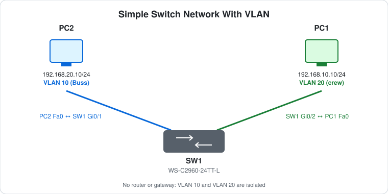

# CCNA Lab 01: Simple Switch Network with VLANs

A hands-on Layer 2 segmentation lab built in the **PingMyNetwork Sandbox**. A single Cisco Catalyst 2960 switch is split into two VLANs. Each VLAN has one host, so the lab shows how VLANs separate broadcast domains on the same physical switch.

The goal is to practise **creating VLANs, assigning access ports and checking segmentation**, and to understand why hosts in different VLANs can't talk without a Layer 3 device.

> **Lab status:** The VLAN database, access-port assignments and host addressing come straight from the exported Sandbox JSON in [`lab-files/`](lab-files/). There's no router in the topology, so no inter-VLAN routing is configured or claimed.

## Learning objectives

- Create and name VLANs on a Cisco switch.
- Assign switch ports to VLANs as access ports.
- Configure static IPv4 addresses on end hosts.
- Understand that each VLAN is a separate broadcast domain.
- Use `show` commands and ping to check, rather than assume, Layer 2 segmentation.
- Spot why a Layer 3 gateway is needed for inter-VLAN communication.

## Topology



```text
                 SW1 (WS-C2960-24TT-L)
               Gi0/1               Gi0/2
          (VLAN 10 "Buss")   (VLAN 20 "crew")
                 |                    |
                PC2                  PC1
          192.168.20.10/24     192.168.10.10/24
```

| Device | Type | Model |
|---|---|---|
| SW1 | Layer 2 switch | Cisco WS-C2960-24TT-L (IOS 15.2) |
| PC1 | End host | PC |
| PC2 | End host | PC |

## Addressing plan

### VLANs

| VLAN | Name | Purpose |
|---|---|---|
| 1 | default | Unused, with interface `Vlan1` shut down |
| 10 | Buss | Business users |
| 20 | crew | Crew users |

### Switch ports

| Switch port | Mode | VLAN | Connected host |
|---|---|---|---|
| Gi0/1 | access | 10 | PC2 (FastEthernet0) |
| Gi0/2 | access | 20 | PC1 (FastEthernet0) |
| Fa0/1 – Fa0/24 | default | 1 | Unused |

### Hosts

| Host | Interface | IP address | Subnet mask | Default gateway | VLAN |
|---|---|---|---|---|---|
| PC1 | FastEthernet0 | `192.168.10.10` | `255.255.255.0` | none | 20 |
| PC2 | FastEthernet0 | `192.168.20.10` | `255.255.255.0` | none | 10 |

> **Note on addressing:** In the exported lab, each host's IP subnet is the *opposite* of its VLAN number: PC1 is in VLAN 20 but uses `192.168.10.0/24`. The lab still works, because VLAN membership comes from the switch port, not the IP address. If you add more hosts or a router later, match the third octet to the VLAN ID (see [Challenge 4](#try-it-yourself-guided-challenges)).

## Configuration highlights

These excerpts show the key features. The complete switch config is in [`configs/SW1-running-config.txt`](configs/SW1-running-config.txt), and the full lab is in the [Sandbox JSON](lab-files/simple-switch-vlan-lab.json).

### 1. VLAN creation (SW1)

```cisco
vlan 10
 name Buss
vlan 20
 name crew
```

VLANs live in the switch's VLAN database (`vlan.dat`), not in the running config. That's why they don't show up in `show running-config`. Use `show vlan brief` to see them. SW1 runs VTP in its default **server** mode with no domain set.

### 2. Access ports (SW1)

```cisco
interface GigabitEthernet0/1
 switchport mode access
 switchport access vlan 10
!
interface GigabitEthernet0/2
 switchport mode access
 switchport access vlan 20
```

`switchport mode access` forces the port to stay a non-trunking access port, so it never negotiates a trunk through DTP.

### 3. Spanning tree (SW1)

```cisco
spanning-tree mode rapid-pvst
spanning-tree portfast edge default
```

Rapid-PVST+ runs one spanning-tree instance per VLAN. `portfast edge default` turns on PortFast for every access port, so host ports go straight to forwarding instead of waiting for STP convergence.

### 4. Hosts

| Host | Setting |
|---|---|
| PC1 | IP `192.168.10.10`, mask `255.255.255.0`, no gateway |
| PC2 | IP `192.168.20.10`, mask `255.255.255.0`, no gateway |

## Expected verification results

What the configuration should produce. Run these yourself in the Sandbox and record what you see.

| Check | Command/test | Expected result |
|---|---|---|
| VLAN database | `show vlan brief` on SW1 | VLAN 10 `Buss` contains Gi0/1, VLAN 20 `crew` contains Gi0/2, VLAN 1 contains Fa0/1–24 |
| Port mode | `show interfaces gi0/1 switchport` | Administrative mode: static access, access mode VLAN 10 |
| Port mode | `show interfaces gi0/2 switchport` | Administrative mode: static access, access mode VLAN 20 |
| Trunking | `show interfaces trunk` on SW1 | No trunks, because all used ports are access ports |
| Spanning tree | `show spanning-tree vlan 10` / `vlan 20` | A separate STP instance per VLAN, SW1 as root, host port forwarding |
| MAC learning | `show mac address-table` on SW1 | PC2's MAC learned on Gi0/1 in VLAN 10, PC1's MAC on Gi0/2 in VLAN 20 |
| Isolation | PC1 → `ping 192.168.20.10` | **Fails**: different VLAN, different subnet, no gateway |
| Isolation | PC2 → `ping 192.168.10.10` | **Fails** for the same reason |

### Why the ping fails

PC1 (`192.168.10.10/24`) sees `192.168.20.10` as a remote network. With no default gateway set, it has nowhere to send the packet. Even if both PCs were moved into the same subnet, the switch would still keep their frames apart, because a VLAN 10 broadcast (such as an ARP request) never reaches a VLAN 20 port. **Both Layer 2 (VLAN) and Layer 3 (subnet) isolation are in effect.**

## Try it yourself: guided challenges

1. **Inspect segmentation.** On SW1, run `show vlan brief`. Which ports are in each VLAN? Why do the unused FastEthernet ports show up in VLAN 1?
2. **Prove VLAN isolation at Layer 2.** Temporarily give PC1 `192.168.20.11/24` so both PCs share a subnet, then ping PC2. Explain why it still fails, and check `show mac address-table` to see where each MAC was learned.
3. **Prove the same VLAN works.** Move Gi0/2 into VLAN 10 (`switchport access vlan 10`) while both PCs are in the same subnet, and ping again. It should now succeed. Restore the original config afterward.
4. **Fix the addressing plan.** Re-address the hosts so the third octet matches the VLAN ID (VLAN 10 → `192.168.10.0/24`, VLAN 20 → `192.168.20.0/24`). [Lab 02](../lab-02-inter-vlan-routing-acl/) uses this corrected plan.
5. **Add a host per VLAN.** Connect PC3 to Fa0/1 in VLAN 10 and PC4 to Fa0/2 in VLAN 20, then confirm same-VLAN pings succeed while cross-VLAN pings still fail.
6. **Optional extension: inter-VLAN routing.** Add a router, configure Gi0/1 or a spare port on SW1 as an 802.1Q trunk, and build router-on-a-stick subinterfaces (`.10`, `.20`). Set each PC's default gateway and check that cross-VLAN pings now succeed. [Lab 02](../lab-02-inter-vlan-routing-acl/) takes a different approach, using a Layer 3 switch with SVIs, and then blocks the traffic with ACLs.
7. **Optional hardening.** Shut down unused ports, move them into an unused "parking" VLAN, and add `switchport port-security` to the host ports.

## Scope and caveats

- This is a **CCNA-oriented** Layer 2 lab. Its value is in VLAN creation, access-port assignment and understanding broadcast-domain separation.
- There's **no router, trunk, DHCP or routing protocol** in this topology, and hosts use static addressing.
- The host IP subnets don't follow a VLAN-ID-to-subnet convention (see the [addressing note](#hosts)).
- The switch has no management IP (`interface Vlan1` is shut down), no passwords and no SSH user. It can only be managed from the console, which is fine in a sandbox but not production-ready.
- `ip http server` and `ip http secure-server` are on by default in this IOS image. In a real network you'd turn them off.

## Useful verification commands

```cisco
show vlan brief
show interfaces status
show interfaces gi0/1 switchport
show interfaces gi0/2 switchport
show interfaces trunk
show spanning-tree summary
show spanning-tree vlan 10
show mac address-table
show running-config
```

## Lab files

| File | Description |
|---|---|
| [`lab-files/simple-switch-vlan-lab.json`](lab-files/simple-switch-vlan-lab.json) | PingMyNetwork Sandbox export. Import it into the Sandbox to load the full topology. |
| [`images/topology.svg`](images/topology.svg) | Topology diagram |
| [`configs/SW1-running-config.txt`](configs/SW1-running-config.txt) | SW1 saved configuration, taken from the export |

**Built with:** [PingMyNetwork Sandbox](https://pingmynetwork.com/sandbox)
