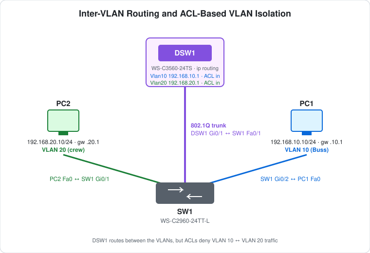

# CCNA Lab 02: Inter-VLAN Routing and ACL-Based VLAN Isolation

A hands-on Layer 3 switching lab built in the **PingMyNetwork Sandbox**. It builds on [Lab 01](../lab-01-vlan-segmentation/) by adding a Cisco Catalyst 3560 multilayer switch. The 3560 routes between VLANs with SVIs (switched virtual interfaces) and then uses extended ACLs to deliberately block traffic between the two VLANs.

The goal is to practise the relationship between **802.1Q trunking, SVI-based inter-VLAN routing and ACL policy**. The point is to show that "routable" and "permitted" are two separate decisions.

> **Lab status:** The VLANs, trunk, SVIs, ACLs and host addressing come straight from the exported Sandbox JSON in [`lab-files/`](lab-files/). The results table below lists the **expected** behaviour of this configuration. It hasn't yet been replaced with observed Sandbox output.

## Learning objectives

- Configure an IEEE 802.1Q trunk between an access switch and a multilayer switch.
- Turn on IPv4 routing on a Layer 3 switch with `ip routing`.
- Create SVIs as default gateways for each VLAN.
- Write named extended ACLs and apply them inbound on SVIs.
- Explain why ACL placement and direction matter, and why one inbound ACL is enough to break two-way communication.
- Use ping, `show` commands and ACL hit counters to check policy, rather than assuming it works.

## Topology



```text
                    DSW1 (WS-C3560-24TS, ip routing)
                 Vlan10 192.168.10.1   Vlan20 192.168.20.1
                              Gi0/1
                                |   802.1Q trunk
                              Fa0/1
                         SW1 (WS-C2960-24TT-L)
                      Gi0/1               Gi0/2
                 (VLAN 20 "crew")    (VLAN 10 "Buss")
                        |                   |
                       PC2                 PC1
                 192.168.20.10/24    192.168.10.10/24
```

| Device | Role | Model |
|---|---|---|
| DSW1 | Distribution / Layer 3 switch: VLAN gateways and ACL policy | Cisco WS-C3560-24TS (IOS 15.2) |
| SW1 | Access / Layer 2 switch | Cisco WS-C2960-24TT-L (IOS 15.2) |
| PC1 | End host, VLAN 10 | PC |
| PC2 | End host, VLAN 20 | PC |

## Addressing plan

### VLANs and gateways

| VLAN | Name (SW1 / DSW1) | Network | Gateway (DSW1 SVI) | Inbound ACL |
|---|---|---|---|---|
| 10 | `Buss` / `buss` | `192.168.10.0/24` | `192.168.10.1` | `block-buss-to-crew` |
| 20 | `crew` / `crew` | `192.168.20.0/24` | `192.168.20.1` | `block-crew-to-buss` |

### Links and ports

| Device | Port | Mode | VLAN | Connected to |
|---|---|---|---|---|
| SW1 | Fa0/1 | trunk (802.1Q) | all | DSW1 Gi0/1 |
| SW1 | Gi0/1 | access | 20 | PC2 FastEthernet0 |
| SW1 | Gi0/2 | access | 10 | PC1 FastEthernet0 |
| DSW1 | Gi0/1 | trunk (802.1Q) | all | SW1 Fa0/1 |
| DSW1 | Gi0/2 | default | 1 | Unused |

### Hosts

| Host | IP address | Subnet mask | Default gateway | VLAN |
|---|---|---|---|---|
| PC1 | `192.168.10.10` | `255.255.255.0` | `192.168.10.1` | 10 |
| PC2 | `192.168.20.10` | `255.255.255.0` | `192.168.20.1` | 20 |

Unlike Lab 01, each host's subnet now matches its VLAN ID.

## Configuration highlights

These excerpts show the key features. The full configs are in [`configs/`](configs/), and the complete lab is in the [Sandbox JSON](lab-files/inter-vlan-routing-acl-lab.json).

### 1. Access ports and trunk (SW1)

```cisco
vlan 10
 name Buss
vlan 20
 name crew
!
interface FastEthernet0/1
 switchport mode trunk
!
interface GigabitEthernet0/1
 switchport mode access
 switchport access vlan 20
!
interface GigabitEthernet0/2
 switchport mode access
 switchport access vlan 10
```

The 2960 only supports 802.1Q, so `switchport mode trunk` works without an encapsulation command.

### 2. Trunk (DSW1)

```cisco
interface GigabitEthernet0/1
 switchport trunk encapsulation dot1q
 switchport mode trunk
```

The 3560 supports both ISL and 802.1Q. You have to set `switchport trunk encapsulation dot1q` before `switchport mode trunk` will be accepted.

### 3. Inter-VLAN routing with SVIs (DSW1)

```cisco
ip routing
!
vlan 10
 name buss
vlan 20
 name crew
!
interface Vlan10
 ip address 192.168.10.1 255.255.255.0
!
interface Vlan20
 ip address 192.168.20.1 255.255.255.0
```

`ip routing` turns the 3560 into a router. Each SVI is the default gateway for its VLAN. An SVI only comes up when its VLAN exists on DSW1 and at least one port carrying that VLAN (here, the trunk) is up. Both subnets show up as connected routes, so no routing protocol is needed.

### 4. ACL-based isolation (DSW1)

```cisco
ip access-list extended block-buss-to-crew
 deny   ip 192.168.10.0 0.0.0.255 192.168.20.0 0.0.0.255
 permit ip any any
!
ip access-list extended block-crew-to-buss
 deny   ip 192.168.20.0 0.0.0.255 192.168.10.0 0.0.0.255
 permit ip any any
!
interface Vlan10
 ip access-group block-buss-to-crew in
!
interface Vlan20
 ip access-group block-crew-to-buss in
```

Each ACL is applied **inbound** on its VLAN's SVI, so it filters traffic as it enters DSW1 from that VLAN, before the routing decision. The `permit ip any any` line is needed. Without it, the implicit `deny any` at the end of every ACL would block all traffic from the VLAN, including traffic to the gateway itself.

## Full configuration commands

These commands rebuild the saved configs in [`configs/`](configs/). The export has no console history for this lab, so they come from the configs rather than a recorded session. Typing them on factory-default switches gives the same result.

How to read the blocks:

- Lines starting with `!` explain the command below them. Don't type them.
- The prompt (`SW1(config-if-range)#`) shows which mode you're in. Type only the text after `#` or `>`.
- Abbreviations such as `conf t` and `f0/1-2` are accepted by IOS, the same as `configure terminal` and `FastEthernet0/1 - 2`.

### DSW1 (WS-C3560-24TS)

```text
! Enter privileged EXEC mode
DSW1>enable
! Enter global configuration mode
DSW1#conf t
! Turn on IPv4 routing (needed on a multilayer switch)
DSW1(config)#ip routing
! Create VLAN 10 (and enter VLAN config mode)
DSW1(config)#vlan 10
! Name the VLAN "buss"
DSW1(config-vlan)#name buss
! Create VLAN 20 (and enter VLAN config mode)
DSW1(config-vlan)#vlan 20
! Name the VLAN "crew"
DSW1(config-vlan)#name crew
DSW1(config-vlan)#exit
! Select interface g0/1
DSW1(config)#interface g0/1
! 3560 only: choose 802.1Q before trunking
DSW1(config-if)#switchport trunk encapsulation dot1q
! Make it an 802.1Q trunk
DSW1(config-if)#switchport mode trunk
DSW1(config-if)#exit
! Create the SVI (gateway interface) for VLAN 10
DSW1(config)#interface vlan 10
! Assign 192.168.10.1 / 255.255.255.0
DSW1(config-if)#ip address 192.168.10.1 255.255.255.0
! Enable the interface
DSW1(config-if)#no shutdown
! Create the SVI (gateway interface) for VLAN 20
DSW1(config-if)#interface vlan 20
! Assign 192.168.20.1 / 255.255.255.0
DSW1(config-if)#ip address 192.168.20.1 255.255.255.0
! Enable the interface
DSW1(config-if)#no shutdown
DSW1(config-if)#exit
! Create named extended ACL block-buss-to-crew
DSW1(config)#ip access-list extended block-buss-to-crew
! ACL entry: deny ip 192.168.10.0 0.0.0.255 192.168.20.0 0.0.0.255
DSW1(config-ext-nacl)#deny ip 192.168.10.0 0.0.0.255 192.168.20.0 0.0.0.255
! ACL entry: permit ip any any
DSW1(config-ext-nacl)#permit ip any any
DSW1(config-ext-nacl)#exit
! Create named extended ACL block-crew-to-buss
DSW1(config)#ip access-list extended block-crew-to-buss
! ACL entry: deny ip 192.168.20.0 0.0.0.255 192.168.10.0 0.0.0.255
DSW1(config-ext-nacl)#deny ip 192.168.20.0 0.0.0.255 192.168.10.0 0.0.0.255
! ACL entry: permit ip any any
DSW1(config-ext-nacl)#permit ip any any
DSW1(config-ext-nacl)#exit
! Create the SVI (gateway interface) for VLAN 10
DSW1(config)#interface vlan 10
! Apply ACL block-buss-to-crew to traffic entering this interface
DSW1(config-if)#ip access-group block-buss-to-crew in
! Create the SVI (gateway interface) for VLAN 20
DSW1(config-if)#interface vlan 20
! Apply ACL block-crew-to-buss to traffic entering this interface
DSW1(config-if)#ip access-group block-crew-to-buss in
DSW1(config-if)#end
! Save the running config to NVRAM
DSW1#write memory
```

### SW1 (WS-C2960-24TT-L)

```text
! Enter privileged EXEC mode
SW1>enable
! Enter global configuration mode
SW1#conf t
! Create VLAN 10 (and enter VLAN config mode)
SW1(config)#vlan 10
! Name the VLAN "buss"
SW1(config-vlan)#name Buss
! Create VLAN 20 (and enter VLAN config mode)
SW1(config-vlan)#vlan 20
! Name the VLAN "crew"
SW1(config-vlan)#name crew
SW1(config-vlan)#exit
! Select interface f0/1
SW1(config)#interface f0/1
! Make it an 802.1Q trunk
SW1(config-if)#switchport mode trunk
! Select interface g0/1
SW1(config-if)#interface g0/1
! Make it an access (host) port
SW1(config-if)#switchport mode access
! Put the port in VLAN 20
SW1(config-if)#switchport access vlan 20
! Select interface g0/2
SW1(config-if)#interface g0/2
! Make it an access (host) port
SW1(config-if)#switchport mode access
! Put the port in VLAN 10
SW1(config-if)#switchport access vlan 10
SW1(config-if)#end
! Save the running config to NVRAM
SW1#write memory
```

### PCs

Set these in each PC's IP configuration:

| PC | IP address | Subnet mask | Default gateway |
|---|---|---|---|
| PC1 | `192.168.10.10` | `255.255.255.0` | `192.168.10.1` |
| PC2 | `192.168.20.10` | `255.255.255.0` | `192.168.20.1` |

Then test from PC1's command prompt:

```text
! Test reachability to 192.168.10.1
C:\> ping 192.168.10.1
! Test reachability to 192.168.20.10
C:\> ping 192.168.20.10
```

## Expected verification results

What the configuration should produce. Run these yourself in the Sandbox and replace this table with what you observe.

| Check | Command/test | Expected result |
|---|---|---|
| VLAN membership | `show vlan brief` on SW1 | VLAN 10 `Buss` contains Gi0/2, VLAN 20 `crew` contains Gi0/1 |
| VLANs on L3 switch | `show vlan brief` on DSW1 | VLANs 10 `buss` and 20 `crew` exist (trunk ports aren't listed) |
| Trunking | `show interfaces trunk` on SW1 and DSW1 | SW1 Fa0/1 / DSW1 Gi0/1 trunking, 802.1Q, native VLAN 1, VLANs 1, 10, 20 active |
| SVIs | `show ip interface brief` on DSW1 | Vlan10 and Vlan20 up/up with `.1` addresses |
| Routing table | `show ip route` on DSW1 | `C 192.168.10.0/24` via Vlan10 and `C 192.168.20.0/24` via Vlan20 |
| ACL applied | `show ip interface vlan 10` | Inbound access list is `block-buss-to-crew` |
| Gateway reachability | PC1 → `ping 192.168.10.1` | **Succeeds** |
| Gateway reachability | PC2 → `ping 192.168.20.1` | **Succeeds** |
| VLAN isolation | PC1 → `ping 192.168.20.10` | **Fails**: denied by `block-buss-to-crew` |
| VLAN isolation | PC2 → `ping 192.168.10.10` | **Fails**: denied by `block-crew-to-buss` |
| Remote gateway | PC1 → `ping 192.168.20.1` | **Fails**: the destination is in `192.168.20.0/24`, so the deny entry matches |
| ACL hit counters | `show access-lists` on DSW1 | `deny` entry match counts increase after each cross-VLAN ping |

### Why the cross-VLAN ping fails

1. PC1 sees `192.168.20.10` as a remote network and sends the ICMP echo to its gateway, `192.168.10.1`.
2. The frame crosses the trunk tagged as VLAN 10 and reaches DSW1's `Vlan10` SVI.
3. Before routing, the inbound ACL `block-buss-to-crew` checks the packet. Source `192.168.10.10` → destination `192.168.20.10` matches the `deny` entry, so DSW1 drops it.

**Routing works, but policy blocks the traffic.** DSW1 has a connected route to both subnets. The ACL is the only thing stopping the traffic.

## Try it yourself: guided challenges

1. **Inspect the trunk.** Run `show interfaces trunk` on both switches. Which VLANs are allowed, which are active, and what's the native VLAN?
2. **Prove routing works.** On DSW1, remove *both* ACLs from the SVIs (`no ip access-group ... in`) and ping PC2 from PC1. It should now succeed. Re-apply the ACLs afterward.
3. **One ACL is enough. Why?** Remove only the ACL on `Vlan10` and ping PC2 from PC1 again. It still fails. Work out where the **echo reply** is dropped, and explain why a single inbound ACL breaks two-way communication in both directions.
4. **Read the hit counters.** Run `clear access-list counters`, then do one cross-VLAN ping. Check `show access-lists` and match each counter increase to the packets you sent.
5. **Selective access.** Change the policy so VLAN 10 can ping VLAN 20 but nothing else is allowed. Remember that ACLs are stateless, so the reply direction needs an entry too.
6. **Harden the trunk.** Restrict both trunk ends to `switchport trunk allowed vlan 10,20`, move the native VLAN to an unused VLAN (for example 99) on both ends, and set `switchport nonegotiate`. Check that nothing breaks.
7. **Optional: DHCP.** Configure DHCP pools for both VLANs on DSW1, switch the PCs to DHCP, and confirm the PCs still get leases with the ACLs in place.

## Scope and caveats

- This is a **CCNA-oriented** lab. Its value is in trunking, SVI-based inter-VLAN routing, and extended ACL placement and direction.
- There's **no redundancy**: DSW1, SW1 and the single trunk are each a single point of failure.
- Both ACLs end with `permit ip any any`, so the VLANs aren't isolated from anything *else* that might be added later, such as an upstream network.
- The two ACLs overlap. Either one alone stops two-way communication between the VLANs (see Challenge 3). Using both makes the policy explicit and also blocks one-way traffic in both directions.
- The VLAN 10 name differs in case between switches (`Buss` on SW1, `buss` on DSW1). VLAN names are only local labels, so this doesn't affect forwarding. VTP is in default server mode with **no domain**, so no VLAN information is synchronised between the switches.
- The trunk uses defaults: native VLAN 1, all VLANs allowed, DTP enabled. That's fine in a sandbox, but not hardened (see Challenge 6).
- Neither switch has a management IP, passwords or an SSH user, and `ip http server` is on by default. Unused ports aren't shut down.

## Useful verification commands

```cisco
show vlan brief
show interfaces trunk
show interfaces fa0/1 switchport
show ip interface brief
show ip route
show ip interface vlan 10
show access-lists
clear access-list counters
show mac address-table
show running-config
```

## Lab files

| File | Description |
|---|---|
| [`lab-files/inter-vlan-routing-acl-lab.json`](lab-files/inter-vlan-routing-acl-lab.json) | PingMyNetwork Sandbox export. Import it into the Sandbox to load the full topology. |
| [`configs/DSW1-running-config.txt`](configs/DSW1-running-config.txt) | DSW1 saved configuration, taken from the export |
| [`configs/SW1-running-config.txt`](configs/SW1-running-config.txt) | SW1 saved configuration, taken from the export |
| [`images/topology.svg`](images/topology.svg) | Topology diagram |

**Built with:** [PingMyNetwork Sandbox](https://pingmynetwork.com/sandbox)
