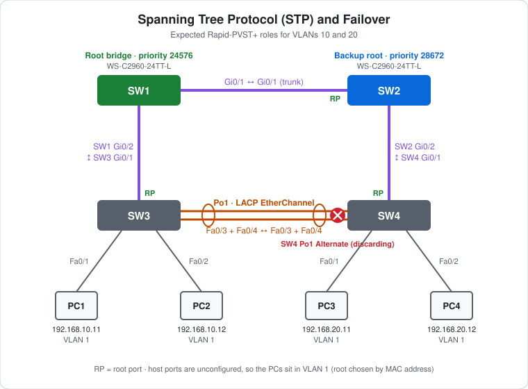

# CCNA Lab 03: Spanning Tree Protocol (STP) and Failover

A hands-on Layer 2 redundancy lab built in the **PingMyNetwork Sandbox**. Four Cisco Catalyst 2960 switches form a physical loop, with one leg built as an LACP EtherChannel. Rapid-PVST+ breaks the loop by putting one port into a discarding state, and it unblocks that port within seconds if the active path fails.

The goal is to practise **root bridge election, port roles, path cost, EtherChannel and STP reconvergence**. You don't just enable redundant links; you predict which port STP will block and then check that prediction.

> **Lab status:** The trunks, EtherChannel, STP priorities and host addressing come straight from the exported Sandbox JSON in [`lab-files/`](lab-files/). The STP roles and results below are **expected** values worked out from the configuration. They haven't yet been replaced with observed Sandbox output.

## Learning objectives

- Build a redundant switched topology and explain why it needs STP.
- Control root bridge election per VLAN with `spanning-tree vlan … priority`.
- Predict root, designated and alternate ports from bridge IDs and path cost.
- Bundle two links into an LACP EtherChannel and trunk over it.
- Watch Rapid-PVST+ move an alternate port to forwarding when a link fails.
- Understand that STP runs **per VLAN**, so a priority set for one VLAN has no effect on another.

## Topology



```text
        Root (24576)                 Backup root (28672)
           SW1 Gi0/1 ------trunk------ Gi0/1 SW2
            Gi0/2                       Gi0/2
              |                           |
            trunk                       trunk
              |                           |
            Gi0/1                       Gi0/1
           SW3  Po1 ===LACP Fa0/3-4=== Po1  SW4   <- SW4 Po1 discarding
        Fa0/1   Fa0/2                Fa0/1   Fa0/2
          |       |                    |       |
         PC1     PC2                  PC3     PC4
```

| Device | Role | Model |
|---|---|---|
| SW1 | Distribution: STP root for VLANs 10/20 | Cisco WS-C2960-24TT-L (IOS 15.2) |
| SW2 | Distribution: backup root for VLANs 10/20 | Cisco WS-C2960-24TT-L (IOS 15.2) |
| SW3 | Access switch for PC1, PC2 | Cisco WS-C2960-24TT-L (IOS 15.2) |
| SW4 | Access switch for PC3, PC4 | Cisco WS-C2960-24TT-L (IOS 15.2) |
| PC1–PC4 | End hosts | PC |

## Addressing plan

### Inter-switch links

| Link | Side A | Side B | Type |
|---|---|---|---|
| SW1 ↔ SW2 | SW1 Gi0/1 (`trunk`) | SW2 Gi0/1 (`trunk`) | 802.1Q trunk |
| SW1 ↔ SW3 | SW1 Gi0/2 (`trunk`) | SW3 Gi0/1 (default, `dynamic auto`) | 802.1Q trunk, negotiated by DTP |
| SW2 ↔ SW4 | SW2 Gi0/2 (`trunk`) | SW4 Gi0/1 (default, `dynamic auto`) | 802.1Q trunk, negotiated by DTP |
| SW3 ↔ SW4 | SW3 Po1 (Fa0/3 + Fa0/4) | SW4 Po1 (Fa0/3 + Fa0/4) | LACP EtherChannel trunk |

### VLANs and STP priorities

| VLAN | Name | SW1 priority | SW2 priority | SW3 / SW4 priority |
|---|---|---|---|---|
| 1 | default | 32768 (default) | 32768 (default) | 32768 (default) |
| 10 | buss | **24576** | **28672** | 32768 (default) |
| 20 | crew | **24576** | **28672** | 32768 (default) |

VLANs 10 and 20 exist on all four switches. SW1 also has a leftover, unused VLAN 2 (`VLAN0002`).

### Hosts

| Host | Switch port | VLAN | IP address | Subnet mask | Default gateway |
|---|---|---|---|---|---|
| PC1 | SW3 Fa0/1 | 1 | `192.168.10.11` | `255.255.255.0` | `192.168.10.1` |
| PC2 | SW3 Fa0/2 | 1 | `192.168.10.12` | `255.255.255.0` | `192.168.10.1` |
| PC3 | SW4 Fa0/1 | 1 | `192.168.20.11` | `255.255.255.0` | `192.168.20.1` |
| PC4 | SW4 Fa0/2 | 1 | `192.168.20.12` | `255.255.255.0` | `192.168.20.1` |

> **Note on host VLANs:** The host ports on SW3 and SW4 have no `switchport access vlan` command, so all four PCs are in **VLAN 1**, even though their addresses follow the VLAN 10 / VLAN 20 plan. There's no device in the topology that owns gateway `192.168.10.1` or `192.168.20.1`. See [Challenge 6](#try-it-yourself-guided-challenges) to put the hosts into their intended VLANs.

## Configuration highlights

These excerpts show the key features. The full configs are in [`configs/`](configs/), and the complete lab is in the [Sandbox JSON](lab-files/stp-failover-lab.json).

### 1. Rapid-PVST+ and root bridge placement (SW1 / SW2)

```cisco
! SW1 – primary root for VLANs 10 and 20
spanning-tree mode rapid-pvst
spanning-tree vlan 10,20 priority 24576
!
! SW2 – backup root for VLANs 10 and 20
spanning-tree mode rapid-pvst
spanning-tree vlan 10,20 priority 28672
```

The bridge ID is the priority plus the VLAN ID (`extend system-id`) plus the MAC address, and the lowest bridge ID wins. SW1's VLAN 10 bridge priority is 24576 + 10 = **24586**, and SW2's is 28672 + 10 = **28682**. SW3 and SW4 stay at the default 32768 + VLAN. If SW1 fails, SW2 takes over as root deterministically, without relying on a MAC-address tiebreak.

### 2. Trunks (SW1 / SW2)

```cisco
interface GigabitEthernet0/1
 switchport mode trunk
!
interface GigabitEthernet0/2
 switchport mode trunk
```

SW3 Gi0/1 and SW4 Gi0/1 are left at the 2960 default (`dynamic auto`). They become trunks because the far end is set to `switchport mode trunk` and sends DTP negotiation frames.

### 3. LACP EtherChannel (SW3 / SW4)

```cisco
interface range FastEthernet0/3 - 4
 switchport mode trunk
 channel-group 1 mode active
!
interface Port-channel1
 switchport mode trunk
```

`mode active` on both ends negotiates the bundle with **LACP** (IEEE 802.3ad). STP treats `Po1` as **one logical link** with a lower path cost than a single FastEthernet link. If one member link fails, the bundle stays up and STP doesn't need to reconverge.

## Expected STP port roles (VLANs 10 and 20)

Default "short" path costs are GigabitEthernet = 4 and FastEthernet = 19. A 2 × FastEthernet bundle costs less than 19 but more than 4.

| Switch | Port | Path to root | Role | State |
|---|---|---|---|---|
| SW1 | Gi0/1, Gi0/2 | This switch is the root bridge | Designated | Forwarding |
| SW2 | Gi0/1 | Direct to SW1, cost 4 | **Root** | Forwarding |
| SW2 | Gi0/2 | Toward SW4 (SW2 cost 4 < SW4 cost 8) | Designated | Forwarding |
| SW3 | Gi0/1 | Direct to SW1, cost 4 | **Root** | Forwarding |
| SW3 | Po1 | Toward SW4 (SW3 cost 4 < SW4 cost 8) | Designated | Forwarding |
| SW4 | Gi0/1 | Via SW2, cost 4 + 4 = **8** | **Root** | Forwarding |
| SW4 | Po1 | Via SW3, cost 4 + Po1 cost (> 8) | **Alternate** | **Discarding** |

**How the blocked port is chosen:** SW4 has two paths to the root. The path via SW2 costs 8 (two Gigabit hops), which is cheaper than going via SW3 and the slower EtherChannel. So Gi0/1 becomes SW4's root port. On the SW3–SW4 segment, SW3 has the lower root path cost (4 vs 8), so SW3's end is designated. That leaves **SW4 Po1** as the alternate port, which breaks the loop.

> **VLAN 1 is different.** No priority was set for VLAN 1, so all four switches tie at 32769 and the switch with the **lowest MAC address** becomes root. The VLAN 1 tree, which is the one the PCs actually use, may block a different port. Check it with `show spanning-tree vlan 1`.

## Expected verification results

What the configuration should produce. Run these yourself in the Sandbox and replace this table with what you observe.

| Check | Command/test | Expected result |
|---|---|---|
| Root bridge | `show spanning-tree vlan 10` on any switch | Root ID priority 24586 with SW1's MAC; SW1 reports "This bridge is the root" |
| Port roles | `show spanning-tree vlan 10` on SW4 | Gi0/1 Root FWD, Po1 Altn BLK |
| Summary | `show spanning-tree summary` | Mode `rapid-pvst`, with an STP instance for VLANs 1, 10 and 20 |
| VLAN 1 root | `show spanning-tree vlan 1` | Root is the switch with the lowest MAC address (all priorities 32769) |
| Trunks | `show interfaces trunk` on SW3 / SW4 | Gi0/1 and Po1 trunking with 802.1Q |
| EtherChannel | `show etherchannel summary` on SW3 / SW4 | `Po1(SU)` with Fa0/3(P) and Fa0/4(P), protocol LACP |
| LACP neighbour | `show lacp neighbor` | Fa0/3 and Fa0/4 each see the partner switch |
| Same-subnet ping | PC1 → `ping 192.168.10.12` | **Succeeds**: same subnet, same switch |
| Same-subnet ping | PC3 → `ping 192.168.20.12` | **Succeeds**: same subnet, same switch |
| Cross-subnet ping | PC1 → `ping 192.168.20.11` | **Fails**: no device owns gateway `192.168.10.1` |

## Failover scenarios

Run `show spanning-tree vlan 10` on SW4 (and on SW2 where relevant) before and after each step. Restore each link with `no shutdown` before starting the next one.

| # | Action | Expected reconvergence |
|---|---|---|
| 1 | `shutdown` on **SW2 Gi0/2** | SW4 loses its root port. **Po1 moves from Alternate to Root and starts forwarding** almost immediately, because Rapid-PVST+ has already pre-calculated the alternate path. |
| 2 | `shutdown` on **SW1 Gi0/1** | SW2 loses its direct path. It now reaches the root via SW4 → Po1 → SW3 → SW1, so SW2 Gi0/2 becomes Root, SW4 Po1 becomes Root, and SW4 Gi0/1 becomes Designated. |
| 3 | `shutdown` on **SW3 Fa0/3** (one EtherChannel member) | Po1 **stays up** on Fa0/4. `show etherchannel summary` shows Fa0/3 down, but no STP topology change is needed. |
| 4 | Power off **SW1** (the root bridge) | SW2 (28682) is elected root for VLANs 10 and 20. Every port role is recalculated relative to SW2. |

To watch convergence in VLAN 1 (the hosts' VLAN), run a continuous ping between hosts while you fail a link that's on the hosts' forwarding path. In the current addressing, each subnet lives on a single access switch, so no PC-to-PC traffic crosses the ring yet (see Challenge 6).

## Try it yourself: guided challenges

1. **Predict before you look.** Before running any `show` commands, use the bridge priorities and costs to work out every port role in VLAN 10. Then check your answer.
2. **Find the VLAN 1 root.** Run `show spanning-tree vlan 1` on each switch. Which switch won, and why? Which port is blocked in VLAN 1, and is it the same one as in VLAN 10?
3. **Move the root.** Make SW2 the root for VLAN 20 only (`spanning-tree vlan 20 priority 20480` on SW2). Compare the blocked ports for VLAN 10 and VLAN 20. Splitting the root per VLAN like this is a simple way to load-share across both uplinks.
4. **Tune path cost.** Change `spanning-tree vlan 10 cost` on SW4 Gi0/1 so the path via Po1 becomes preferred. Which port blocks now?
5. **Break the EtherChannel.** Set one side to `channel-group 1 mode passive`, then both sides to `passive`. Which combinations still form a bundle?
6. **Fix the host VLANs.** Put PC1/PC2 into VLAN 10 and PC3/PC4 into VLAN 20 with `switchport mode access` and `switchport access vlan`. Then re-address one PC so a same-subnet pair sits on *different* access switches, and run a continuous ping while you repeat failover scenario 1.
7. **Optional: protect the edge.** Add `spanning-tree bpduguard enable` to the host ports, then connect a switch to one of them and watch the port go err-disabled.

## Scope and caveats

- This is a **CCNA-oriented** lab. Its value is in STP root election, port roles, path cost, EtherChannel and reconvergence.
- **The PCs are in VLAN 1**, while the root bridge priorities only apply to VLANs 10 and 20. The tuned trees carry no host traffic in the current configuration.
- **There's no Layer 3 device.** The configured default gateways (`.1`) don't exist, so traffic between the `192.168.10.0/24` and `192.168.20.0/24` hosts isn't possible.
- SW3 Gi0/1 and SW4 Gi0/1 rely on **DTP** to become trunks. In production, set `switchport mode trunk` and `switchport nonegotiate` on both ends.
- The expected port roles assume default short path costs and that the Sandbox implements standard IEEE/Cisco STP behaviour. Check them against your own `show spanning-tree` output.
- No switch has a management IP, passwords or an SSH user. Unused ports aren't shut down, and `ip http server` is on by default.

## Useful verification commands

```cisco
show spanning-tree summary
show spanning-tree vlan 10
show spanning-tree vlan 1
show spanning-tree root
show interfaces trunk
show etherchannel summary
show lacp neighbor
show interfaces status
show mac address-table
```

## Lab files

| File | Description |
|---|---|
| [`lab-files/stp-failover-lab.json`](lab-files/stp-failover-lab.json) | PingMyNetwork Sandbox export. Import it into the Sandbox to load the full topology. |
| [`configs/SW1-running-config.txt`](configs/SW1-running-config.txt) | SW1 saved configuration (root bridge) |
| [`configs/SW2-running-config.txt`](configs/SW2-running-config.txt) | SW2 saved configuration (backup root) |
| [`configs/SW3-running-config.txt`](configs/SW3-running-config.txt) | SW3 saved configuration (access, EtherChannel) |
| [`configs/SW4-running-config.txt`](configs/SW4-running-config.txt) | SW4 saved configuration (access, EtherChannel) |
| [`images/topology.svg`](images/topology.svg) | Topology diagram |

**Built with:** [PingMyNetwork Sandbox](https://pingmynetwork.com/sandbox)
