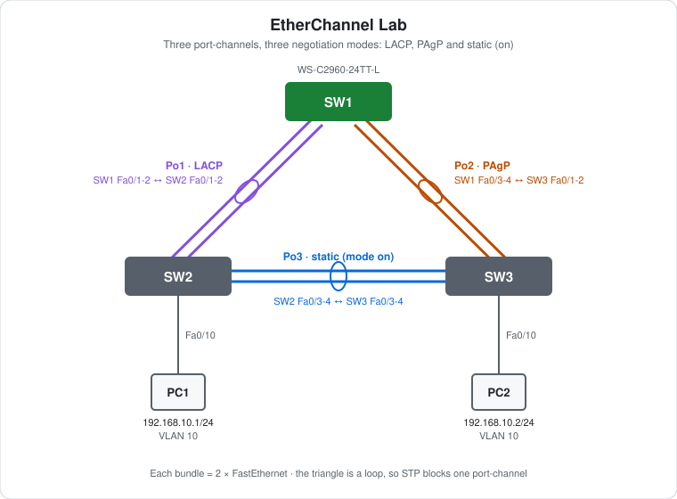

# CCNA Lab 04: EtherChannel (LACP, PAgP and Static)

A hands-on link aggregation lab built in the **PingMyNetwork Sandbox**. Three Cisco Catalyst 2960 switches are connected in a triangle, and every leg is a pair of FastEthernet links. Each pair is bundled into a port-channel with a different negotiation method: **LACP**, **PAgP** and **static (`mode on`)**.

The goal is to practise **building, verifying and breaking EtherChannels**, and to see how the three modes differ in what they negotiate and what they tolerate.

> **Lab status:** The exported Sandbox JSON in [`lab-files/`](lab-files/) holds the **topology and cabling only**. The switches have no saved configuration yet, so there's no `configs/` folder. The configuration below is the **build plan** taken from the lab note (Po1 LACP, Po2 PAgP, Po3 static, PCs in VLAN 10). The verification results are **expected** values, not observed Sandbox output.

## Learning objectives

- Bundle parallel links into a port-channel with `channel-group`.
- Compare LACP (`active`/`passive`), PAgP (`desirable`/`auto`) and static (`on`) modes.
- Know which mode combinations form a bundle and which don't.
- Trunk over a port-channel and carry a VLAN across it.
- See that STP treats each port-channel as one logical link and still blocks one leg of the triangle.
- Watch a bundle survive a member-link failure.

## Topology



```text
                         SW1
            Fa0/1-2  //       \\  Fa0/3-4
          Po1 LACP  //         \\  Po2 PAgP
                   //           \\
          Fa0/1-2 //             \\ Fa0/1-2
               SW2 =============== SW3
                 Fa0/3-4  Po3   Fa0/3-4
                 Fa0/10  static  Fa0/10
                   |              |
                  PC1            PC2
```

| Device | Role | Model |
|---|---|---|
| SW1 | Switch: Po1 to SW2, Po2 to SW3 | Cisco WS-C2960-24TT-L |
| SW2 | Switch: Po1 to SW1, Po3 to SW3, PC1 | Cisco WS-C2960-24TT-L |
| SW3 | Switch: Po2 to SW1, Po3 to SW2, PC2 | Cisco WS-C2960-24TT-L |
| PC1, PC2 | End hosts | PC |

## Addressing plan

### Port-channels

| Bundle | Side A | Side B | Protocol | Modes |
|---|---|---|---|---|
| Po1 | SW1 Fa0/1, Fa0/2 | SW2 Fa0/1, Fa0/2 | LACP (IEEE 802.3ad) | `active` ↔ `active` |
| Po2 | SW1 Fa0/3, Fa0/4 | SW3 Fa0/1, Fa0/2 | PAgP (Cisco) | `desirable` ↔ `desirable` |
| Po3 | SW2 Fa0/3, Fa0/4 | SW3 Fa0/3, Fa0/4 | None (static) | `on` ↔ `on` |

Port-channel numbers are only locally significant, but this lab uses the same number on both ends of each bundle to keep things readable.

### Hosts

| Host | Switch port | VLAN | IP address | Subnet mask |
|---|---|---|---|---|
| PC1 | SW2 Fa0/10 | 10 | `192.168.10.1` | `255.255.255.0` |
| PC2 | SW3 Fa0/10 | 10 | `192.168.10.2` | `255.255.255.0` |

Both PCs are in the same subnet, so no default gateway is needed.

## Configuration walkthrough

### 1. VLAN 10 (all switches)

```cisco
vlan 10
 name USERS
```

### 2. Po1: LACP (SW1 and SW2)

```cisco
interface range FastEthernet0/1 - 2
 switchport mode trunk
 channel-group 1 mode active
!
interface Port-channel1
 switchport mode trunk
```

`active` sends LACP frames. `passive` only answers them. At least one side must be `active`.

### 3. Po2: PAgP (SW1 Fa0/3-4, SW3 Fa0/1-2)

```cisco
! SW1
interface range FastEthernet0/3 - 4
 switchport mode trunk
 channel-group 2 mode desirable
!
! SW3
interface range FastEthernet0/1 - 2
 switchport mode trunk
 channel-group 2 mode desirable
!
! both
interface Port-channel2
 switchport mode trunk
```

PAgP is Cisco proprietary. `desirable` starts negotiation and `auto` only responds, so at least one side must be `desirable`.

### 4. Po3: static (SW2 and SW3 Fa0/3-4)

```cisco
interface range FastEthernet0/3 - 4
 switchport mode trunk
 channel-group 3 mode on
!
interface Port-channel3
 switchport mode trunk
```

`on` forces the bundle with **no negotiation at all**. Both ends must be `on`. If one side isn't, there's no protocol to detect the mismatch, which can cause a loop or an err-disabled port.

### 5. Host ports (SW2 and SW3 Fa0/10)

```cisco
interface FastEthernet0/10
 switchport mode access
 switchport access vlan 10
 spanning-tree portfast
```

### Member-port consistency

Every member of a bundle must match on speed, duplex, switchport mode, access VLAN or allowed/native VLANs. A mismatched member is suspended (`s`) and not added. Configure the members together with `interface range` to avoid this.

## Full configuration commands

These commands are the **build plan**. The export has no saved configs for this lab, so they haven't been checked against Sandbox output yet. Type them on factory-default switches, then compare your results with the expected values below.

How to read the blocks:

- Lines starting with `!` explain the command below them. Don't type them.
- The prompt (`SW1(config-if-range)#`) shows which mode you're in. Type only the text after `#` or `>`.
- Abbreviations such as `conf t` and `f0/1-2` are accepted by IOS, the same as `configure terminal` and `FastEthernet0/1 - 2`.

### SW1 (WS-C2960-24TT-L)

```text
! Enter privileged EXEC mode
SW1>enable
! Enter global configuration mode
SW1#conf t
! Create VLAN 10 (and enter VLAN config mode)
SW1(config)#vlan 10
! Name the VLAN "users"
SW1(config-vlan)#name USERS
SW1(config-vlan)#exit
! Select f0/1-2 and configure them together
SW1(config)#interface range f0/1-2
! Make it an 802.1Q trunk
SW1(config-if-range)#switchport mode trunk
! Join Po1; LACP active: start LACP negotiation
SW1(config-if-range)#channel-group 1 mode active
SW1(config-if-range)#exit
! Select f0/3-4 and configure them together
SW1(config)#interface range f0/3-4
! Make it an 802.1Q trunk
SW1(config-if-range)#switchport mode trunk
! Join Po2; PAgP desirable: start PAgP negotiation
SW1(config-if-range)#channel-group 2 mode desirable
SW1(config-if-range)#end
! Save the running config to NVRAM
SW1#write memory
```

### SW2 (WS-C2960-24TT-L)

```text
! Enter privileged EXEC mode
SW2>enable
! Enter global configuration mode
SW2#conf t
! Create VLAN 10 (and enter VLAN config mode)
SW2(config)#vlan 10
! Name the VLAN "users"
SW2(config-vlan)#name USERS
SW2(config-vlan)#exit
! Select f0/1-2 and configure them together
SW2(config)#interface range f0/1-2
! Make it an 802.1Q trunk
SW2(config-if-range)#switchport mode trunk
! Join Po1; LACP active: start LACP negotiation
SW2(config-if-range)#channel-group 1 mode active
SW2(config-if-range)#exit
! Select f0/3-4 and configure them together
SW2(config)#interface range f0/3-4
! Make it an 802.1Q trunk
SW2(config-if-range)#switchport mode trunk
! Join Po3; static, no negotiation (the far end must also be "on")
SW2(config-if-range)#channel-group 3 mode on
SW2(config-if-range)#exit
! Select interface f0/10
SW2(config)#interface f0/10
! Make it an access (host) port
SW2(config-if)#switchport mode access
! Put the port in VLAN 10
SW2(config-if)#switchport access vlan 10
! Host port: skip the STP listening/learning wait
SW2(config-if)#spanning-tree portfast
SW2(config-if)#end
! Save the running config to NVRAM
SW2#write memory
```

### SW3 (WS-C2960-24TT-L)

```text
! Enter privileged EXEC mode
SW3>enable
! Enter global configuration mode
SW3#conf t
! Create VLAN 10 (and enter VLAN config mode)
SW3(config)#vlan 10
! Name the VLAN "users"
SW3(config-vlan)#name USERS
SW3(config-vlan)#exit
! Select f0/1-2 and configure them together
SW3(config)#interface range f0/1-2
! Make it an 802.1Q trunk
SW3(config-if-range)#switchport mode trunk
! Join Po2; PAgP desirable: start PAgP negotiation
SW3(config-if-range)#channel-group 2 mode desirable
SW3(config-if-range)#exit
! Select f0/3-4 and configure them together
SW3(config)#interface range f0/3-4
! Make it an 802.1Q trunk
SW3(config-if-range)#switchport mode trunk
! Join Po3; static, no negotiation (the far end must also be "on")
SW3(config-if-range)#channel-group 3 mode on
SW3(config-if-range)#exit
! Select interface f0/10
SW3(config)#interface f0/10
! Make it an access (host) port
SW3(config-if)#switchport mode access
! Put the port in VLAN 10
SW3(config-if)#switchport access vlan 10
! Host port: skip the STP listening/learning wait
SW3(config-if)#spanning-tree portfast
SW3(config-if)#end
! Save the running config to NVRAM
SW3#write memory
```

### PCs

Set these in each PC's IP configuration:

| PC | IP address | Subnet mask | Default gateway |
|---|---|---|---|
| PC1 | `192.168.10.1` | `255.255.255.0` | none |
| PC2 | `192.168.10.2` | `255.255.255.0` | none |

Then test from PC1's command prompt:

```text
! Test reachability to 192.168.10.2
C:\> ping 192.168.10.2
```

## Spanning tree over the triangle

The three port-channels form a loop. STP sees each port-channel as **one logical port**, so it blocks a whole bundle, never a single member link. All priorities are at the default (32768 + VLAN), so the root bridge is the switch with the **lowest MAC address**. The bundle between the two non-root switches has one end in the Alternate (discarding) role. Check which one with `show spanning-tree vlan 10`.

## Expected verification results

| Check | Command/test | Expected result |
|---|---|---|
| Bundles up | `show etherchannel summary` on each switch | Each Po shows `(SU)` with both members flagged `(P)` |
| Protocols | `show etherchannel summary` | Po1 `LACP`, Po2 `PAgP`, Po3 `-` (none) |
| LACP partner | `show lacp neighbor` on SW1/SW2 | Fa0/1 and Fa0/2 see the partner switch |
| PAgP partner | `show pagp neighbor` on SW1/SW3 | Fa0/3-4 (SW1) and Fa0/1-2 (SW3) see the partner switch |
| Trunks | `show interfaces trunk` | Po1, Po2, Po3 trunking 802.1Q, VLAN 10 allowed |
| STP | `show spanning-tree vlan 10` | Port-channels listed as single ports; one Po is Altn BLK on a non-root switch |
| Host VLAN | `show vlan brief` on SW2/SW3 | Fa0/10 in VLAN 10 |
| Ping | PC1 → `ping 192.168.10.2` | **Succeeds** |

## Failure scenarios

| # | Action | Expected result |
|---|---|---|
| 1 | `shutdown` on **SW1 Fa0/1** | Po1 stays up on Fa0/2. No STP change. |
| 2 | `shutdown` on both SW2 Fa0/3 and Fa0/4 | Po3 goes down. If Po3 was forwarding, STP unblocks the alternate bundle, and PC1 → PC2 traffic now goes via SW1. |
| 3 | Run a continuous ping PC1 → PC2 during scenario 2 | A few drops at most while Rapid-PVST+ reconverges (if rapid-pvst is enabled), longer with legacy PVST+. |

## Try it yourself: guided challenges

1. **Mode matrix.** On Po1, try `active`/`passive`, then `passive`/`passive`. On Po2, try `desirable`/`auto`, then `auto`/`auto`. Which combinations bundle?
2. **Mix protocols.** Set one end of Po1 to `desirable` (PAgP) while the other stays `active` (LACP). What does `show etherchannel summary` report?
3. **Static mismatch.** Set one end of Po3 to `on` and the other to `active`. Why is this dangerous, and what does each switch show?
4. **Break consistency.** Change the access/trunk mode or allowed VLANs on one member only. Watch it become suspended.
5. **Load balancing.** Check `show etherchannel load-balance`, then change it with `port-channel load-balance src-dst-ip`.
6. **Move the root.** Set `spanning-tree vlan 10 priority 4096` on SW1 and work out which bundle should block. Then check.

## Scope and caveats

- This is a **CCNA-oriented** lab focused on EtherChannel negotiation and verification.
- The exported JSON has **no device configuration**. The configs above are a plan to build in the Sandbox. Once they're built, save them and re-export so `configs/` and observed results can be added.
- PAgP behaviour depends on the Sandbox emulating Cisco's proprietary protocol. Check it against your own `show` output.
- No switch has a management IP, passwords or an SSH user.

## Useful verification commands

```cisco
show etherchannel summary
show etherchannel port-channel
show lacp neighbor
show pagp neighbor
show interfaces trunk
show spanning-tree vlan 10
show etherchannel load-balance
show vlan brief
```

## Lab files

| File | Description |
|---|---|
| [`lab-files/etherchannel-lab.json`](lab-files/etherchannel-lab.json) | PingMyNetwork Sandbox export (topology and cabling). Import it into the Sandbox to load the lab. |
| [`images/topology.svg`](images/topology.svg) | Topology diagram |

**Built with:** [PingMyNetwork Sandbox](https://pingmynetwork.com/sandbox)
