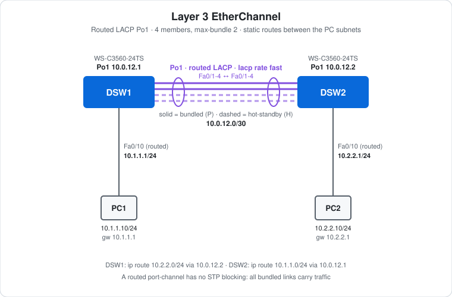

# CCNA Lab 05: Layer 3 EtherChannel

A hands-on routed link aggregation lab built in the **PingMyNetwork Sandbox**. Two Cisco Catalyst 3560 multilayer switches are joined by four FastEthernet links. All four are placed in one **routed LACP port-channel**, but `lacp max-bundle 2` lets only two forward at a time, with the other two on hot-standby. Each switch routes for its own PC subnet, and static routes over the port-channel connect the two.

The goal is to practise **Layer 3 EtherChannel, LACP tuning and static routing**, and to see how a routed bundle differs from the Layer 2 bundles in [Lab 04](../lab-04-etherchannel/).

> **Lab status:** The exported Sandbox JSON in [`lab-files/`](lab-files/) holds the **topology and cabling only**. The switches have no saved configuration yet, so there's no `configs/` folder. The configuration below is the **build plan** taken from the lab note. The verification results are **expected** values, not observed Sandbox output.

## Learning objectives

- Build a routed port-channel with `no switchport` and an IP address on the `Port-channel` interface.
- Explain why the member ports must be made routed **before** they join the channel group.
- Use `lacp rate fast` to detect a failed partner in about 3 seconds instead of 90.
- Limit active members with `lacp max-bundle` and identify hot-standby ports.
- Route between two subnets with static routes over the bundle.
- See that a routed bundle doesn't take part in STP, so no link is blocked.

## Topology



```text
      10.1.1.0/24          10.0.12.0/30           10.2.2.0/24
  PC1 -------- Fa0/10 DSW1 Po1 ====LACP==== Po1 DSW2 Fa0/10 -------- PC2
  .10            .1         .1  Fa0/1-4  .2         .1             .10
                                (2 bundled + 2 hot-standby)
```

| Device | Role | Model |
|---|---|---|
| DSW1 | Multilayer switch: gateway for 10.1.1.0/24 | Cisco WS-C3560-24TS |
| DSW2 | Multilayer switch: gateway for 10.2.2.0/24 | Cisco WS-C3560-24TS |
| PC1, PC2 | End hosts | PC |

## Addressing plan

| Device | Interface | IP address | Subnet mask | Notes |
|---|---|---|---|---|
| DSW1 | Port-channel1 | `10.0.12.1` | `255.255.255.252` | Routed LACP bundle of Fa0/1-4 |
| DSW2 | Port-channel1 | `10.0.12.2` | `255.255.255.252` | Routed LACP bundle of Fa0/1-4 |
| DSW1 | Fa0/10 | `10.1.1.1` | `255.255.255.0` | Routed port, PC1 gateway |
| DSW2 | Fa0/10 | `10.2.2.1` | `255.255.255.0` | Routed port, PC2 gateway |
| PC1 | FastEthernet0 | `10.1.1.10` | `255.255.255.0` | Gateway `10.1.1.1` |
| PC2 | FastEthernet0 | `10.2.2.10` | `255.255.255.0` | Gateway `10.2.2.1` |

## Configuration walkthrough

### 1. Enable routing (both switches)

```cisco
ip routing
```

The 3560 only routes between interfaces once `ip routing` is on.

### 2. Routed LACP port-channel (DSW1)

```cisco
interface range FastEthernet0/1 - 4
 no switchport
 no ip address
 lacp rate fast
 channel-group 1 mode active
!
interface Port-channel1
 no switchport
 ip address 10.0.12.1 255.255.255.252
 lacp max-bundle 2
```

On DSW2, use the same configuration with `ip address 10.0.12.2 255.255.255.252`.

- **`no switchport` on the members first.** If Layer 2 ports join the group, the switch creates a Layer 2 port-channel. The members and the `Port-channel` interface must both be routed.
- **The IP address goes on `Port-channel1`**, never on the member ports.
- **`lacp rate fast`** has the partner send LACPDUs every 1 second instead of every 30, so a dead partner is detected in about 3 seconds instead of 90.
- **`lacp max-bundle 2`** lets only two members forward. The other two join as **hot-standby** and take over if an active member fails. The LACP port priority (`lacp port-priority`, lower wins) decides which ports are active.

### 3. Gateway ports for the PCs

```cisco
! DSW1
interface FastEthernet0/10
 no switchport
 ip address 10.1.1.1 255.255.255.0
!
! DSW2
interface FastEthernet0/10
 no switchport
 ip address 10.2.2.1 255.255.255.0
```

### 4. Static routes

```cisco
! DSW1
ip route 10.2.2.0 255.255.255.0 10.0.12.2
!
! DSW2
ip route 10.1.1.0 255.255.255.0 10.0.12.1
```

Each switch only knows its directly connected subnets. Each static route points at the far end of the /30, so traffic to the remote PC subnet goes over Po1.

## Full configuration commands

These commands are the **build plan**. The export has no saved configs for this lab, so they haven't been checked against Sandbox output yet. Type them on factory-default switches, then compare your results with the expected values below.

How to read the blocks:

- Lines starting with `!` explain the command below them. Don't type them.
- The prompt (`SW1(config-if-range)#`) shows which mode you're in. Type only the text after `#` or `>`.
- Abbreviations such as `conf t` and `f0/1-2` are accepted by IOS, the same as `configure terminal` and `FastEthernet0/1 - 2`.

### DSW1 (WS-C3560-24TS)

```text
! Enter privileged EXEC mode
DSW1>enable
! Enter global configuration mode
DSW1#conf t
! Turn on IPv4 routing (needed on a multilayer switch)
DSW1(config)#ip routing
! Select f0/1-4 and configure them together
DSW1(config)#interface range f0/1-4
! Make it a routed (Layer 3) port
DSW1(config-if-range)#no switchport
! No IP address on this interface
DSW1(config-if-range)#no ip address
! Ask the partner for LACPDUs every 1 s instead of 30 s
DSW1(config-if-range)#lacp rate fast
! Join Po1; LACP active: start LACP negotiation
DSW1(config-if-range)#channel-group 1 mode active
DSW1(config-if-range)#exit
! Configure the logical Port-channel1 interface
DSW1(config)#interface port-channel 1
! Make it a routed (Layer 3) port
DSW1(config-if)#no switchport
! Assign 10.0.12.1 / 255.255.255.252
DSW1(config-if)#ip address 10.0.12.1 255.255.255.252
! At most 2 active members, the rest hot-standby
DSW1(config-if)#lacp max-bundle 2
DSW1(config-if)#exit
! Select interface f0/10
DSW1(config)#interface f0/10
! Make it a routed (Layer 3) port
DSW1(config-if)#no switchport
! Assign 10.1.1.1 / 255.255.255.0
DSW1(config-if)#ip address 10.1.1.1 255.255.255.0
! Enable the interface
DSW1(config-if)#no shutdown
DSW1(config-if)#exit
! Static route to 10.2.2.0/255.255.255.0 via 10.0.12.2
DSW1(config)#ip route 10.2.2.0 255.255.255.0 10.0.12.2
DSW1(config)#end
! Save the running config to NVRAM
DSW1#write memory
```

### DSW2 (WS-C3560-24TS)

```text
! Enter privileged EXEC mode
DSW2>enable
! Enter global configuration mode
DSW2#conf t
! Turn on IPv4 routing (needed on a multilayer switch)
DSW2(config)#ip routing
! Select f0/1-4 and configure them together
DSW2(config)#interface range f0/1-4
! Make it a routed (Layer 3) port
DSW2(config-if-range)#no switchport
! No IP address on this interface
DSW2(config-if-range)#no ip address
! Ask the partner for LACPDUs every 1 s instead of 30 s
DSW2(config-if-range)#lacp rate fast
! Join Po1; LACP active: start LACP negotiation
DSW2(config-if-range)#channel-group 1 mode active
DSW2(config-if-range)#exit
! Configure the logical Port-channel1 interface
DSW2(config)#interface port-channel 1
! Make it a routed (Layer 3) port
DSW2(config-if)#no switchport
! Assign 10.0.12.2 / 255.255.255.252
DSW2(config-if)#ip address 10.0.12.2 255.255.255.252
! At most 2 active members, the rest hot-standby
DSW2(config-if)#lacp max-bundle 2
DSW2(config-if)#exit
! Select interface f0/10
DSW2(config)#interface f0/10
! Make it a routed (Layer 3) port
DSW2(config-if)#no switchport
! Assign 10.2.2.1 / 255.255.255.0
DSW2(config-if)#ip address 10.2.2.1 255.255.255.0
! Enable the interface
DSW2(config-if)#no shutdown
DSW2(config-if)#exit
! Static route to 10.1.1.0/255.255.255.0 via 10.0.12.1
DSW2(config)#ip route 10.1.1.0 255.255.255.0 10.0.12.1
DSW2(config)#end
! Save the running config to NVRAM
DSW2#write memory
```

### PCs

Set these in each PC's IP configuration:

| PC | IP address | Subnet mask | Default gateway |
|---|---|---|---|
| PC1 | `10.1.1.10` | `255.255.255.0` | `10.1.1.1` |
| PC2 | `10.2.2.10` | `255.255.255.0` | `10.2.2.1` |

Then test from PC1's command prompt:

```text
! Test reachability to 10.2.2.10
C:\> ping 10.2.2.10
! Trace the routed path
C:\> tracert 10.2.2.10
```

## Layer 2 vs Layer 3 EtherChannel

| | Layer 2 (Lab 04) | Layer 3 (this lab) |
|---|---|---|
| Port mode | `switchport` (access or trunk) | `no switchport` |
| Addressing | None on the bundle, VLANs carried across it | IP address on `Port-channel` |
| STP | Bundle is one STP port and may be blocked | Not part of STP. Every bundled link forwards |
| Between switches | One shared broadcast domain per VLAN | Separate subnets, routed |

## Expected verification results

| Check | Command/test | Expected result |
|---|---|---|
| Bundle | `show etherchannel summary` | `Po1(RU)`: **R** = Layer 3. Two members `(P)`, two `(H)` hot-standby. Protocol LACP |
| LACP rate | `show lacp internal` | Members show the fast rate flag (`F`) |
| LACP partner | `show lacp neighbor` | Each member sees the partner switch |
| Interfaces | `show ip interface brief` | Po1, Fa0/10 up/up with the planned IPs |
| Routes | `show ip route` | `C` for local subnets, `S` for the remote PC subnet via the far Po1 address |
| Link ping | DSW1 → `ping 10.0.12.2` | **Succeeds** |
| End-to-end | PC1 → `ping 10.2.2.10` | **Succeeds**: routed DSW1 → Po1 → DSW2 |
| Path | PC1 → `tracert 10.2.2.10` | Hops `10.1.1.1`, `10.0.12.2`, `10.2.2.10` |

## Failure scenarios

| # | Action | Expected result |
|---|---|---|
| 1 | `shutdown` an **active** (`P`) member on DSW1 | A hot-standby member becomes bundled. Po1 stays up with two active links, and pings keep working. |
| 2 | `shutdown` three of the four members | Po1 stays up on the one remaining member. |
| 3 | `shutdown` all four members | Po1 goes down and the static routes drop out of the routing table. PC1 → PC2 fails. |
| 4 | Remove `ip routing` on DSW2 | PC1 → PC2 fails. DSW2 no longer forwards between Po1 and Fa0/10. |

## Try it yourself: guided challenges

1. **Wrong order.** On a fresh switch, add `channel-group 1 mode active` to Layer 2 ports, then try to put an IP address on `Port-channel1`. What happens, and how do you fix it?
2. **Choose the active links.** Use `lacp port-priority 100` on Fa0/3-4 so they become the bundled pair instead of Fa0/1-2. Check with `show etherchannel summary`.
3. **Slow vs fast.** Remove `lacp rate fast` and compare the timers in `show lacp internal`.
4. **Replace static routes.** Remove the static routes and run OSPF instead, putting all three subnets in area 0 on each switch. Check `show ip ospf neighbor` over Po1.
5. **Load balancing.** Compare `show etherchannel load-balance` before and after `port-channel load-balance src-dst-ip`.
6. **Min links.** On platforms that support it, add `port-channel min-links 2` and see when Po1 goes down.

## Scope and caveats

- This is a **CCNA-oriented** lab focused on routed EtherChannel, LACP options and static routing.
- The exported JSON has **no device configuration**. The configs above are a plan to build in the Sandbox. Once they're built, save them and re-export so `configs/` and observed results can be added.
- `lacp rate fast`, `lacp max-bundle` and `port-channel min-links` depend on the IOS version. Some older 3560 images don't support them, so check them against what the Sandbox accepts.
- No switch has a management IP, passwords or an SSH user.

## Useful verification commands

```cisco
show etherchannel summary
show etherchannel port-channel
show lacp internal
show lacp neighbor
show ip interface brief
show ip route
show interfaces port-channel 1
```

## Lab files

| File | Description |
|---|---|
| [`lab-files/l3-etherchannel-lab.json`](lab-files/l3-etherchannel-lab.json) | PingMyNetwork Sandbox export (topology and cabling). Import it into the Sandbox to load the lab. |
| [`images/topology.svg`](images/topology.svg) | Topology diagram |

**Built with:** [PingMyNetwork Sandbox](https://pingmynetwork.com/sandbox)
