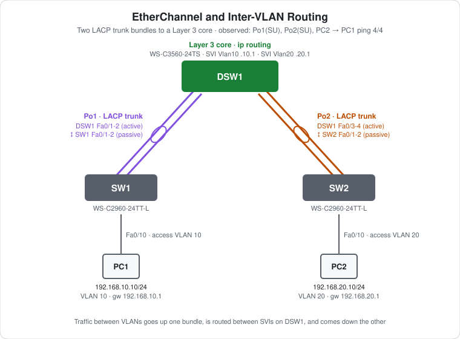

# CCNA Lab 06: EtherChannel and Inter-VLAN Routing

A hands-on lab built in the **PingMyNetwork Sandbox** that combines link aggregation with Layer 3 switching. A Cisco Catalyst 3560 multilayer switch (DSW1) connects to two 2960 access switches. Each connection is a two-link **LACP EtherChannel trunk**. DSW1 routes between VLAN 10 and VLAN 20 with SVIs, so PC1 and PC2 can reach each other across both bundles.

The goal is to practise **LACP trunk bundles, active/passive negotiation, SVIs and inter-VLAN routing** in one topology, the classic collapsed-core design.

> **Lab status:** The configs in [`configs/`](configs/) and the results below come from the exported Sandbox JSON in [`lab-files/`](lab-files/). That export includes the saved configuration of every switch and the console output of the session. Results marked **observed** are copied from that output. Results marked **expected** weren't captured in the export.

## Learning objectives

- Bundle two trunk links into an LACP EtherChannel with `channel-group … mode active` / `passive`.
- Set `switchport trunk encapsulation dot1q` on a 3560 before making a port a trunk.
- Read `show etherchannel summary` flags (`SU`, `SD`, `P`, `s`).
- Explain why a bundle stays down until both ends are configured.
- Route between VLANs on a multilayer switch with `ip routing` and SVIs.
- Explain why an SVI only comes up once its VLAN is active on an up port or trunk.

## Topology



```text
                      DSW1 (3560, ip routing)
                SVI Vlan10 .1      SVI Vlan20 .1
           Fa0/1-2 //                     \\ Fa0/3-4
     Po1 LACP trunk //                     \\ Po2 LACP trunk
                   //                       \\
          Fa0/1-2 //                         \\ Fa0/1-2
               SW1                             SW2
              Fa0/10 (VLAN 10)                Fa0/10 (VLAN 20)
                |                               |
               PC1 192.168.10.10               PC2 192.168.20.10
```

| Device | Role | Model |
|---|---|---|
| DSW1 | Layer 3 core: routes between VLANs 10 and 20 | Cisco WS-C3560-24TS (IOS 15.2) |
| SW1 | Access switch for VLAN 10 | Cisco WS-C2960-24TT-L (IOS 15.2) |
| SW2 | Access switch for VLAN 20 | Cisco WS-C2960-24TT-L (IOS 15.2) |
| PC1, PC2 | End hosts | PC |

## Addressing plan

### Port-channels

| Bundle | DSW1 side | Access side | Protocol | Modes |
|---|---|---|---|---|
| Po1 | Fa0/1, Fa0/2 | SW1 Fa0/1, Fa0/2 | LACP | DSW1 `active` ↔ SW1 `passive` |
| Po2 | Fa0/3, Fa0/4 | SW2 Fa0/1, Fa0/2 | LACP | DSW1 `active` ↔ SW2 `passive` |

Both bundles are 802.1Q trunks with all VLANs allowed.

### VLANs and SVIs

| VLAN | Name | Exists on | SVI on DSW1 |
|---|---|---|---|
| 10 | VLAN0010 (default name) | DSW1, SW1 | `Vlan10` `192.168.10.1/24` |
| 20 | VLAN0020 (default name) | DSW1, SW2 | `Vlan20` `192.168.20.1/24` |

### Hosts

| Host | Switch port | VLAN | IP address | Subnet mask | Default gateway |
|---|---|---|---|---|---|
| PC1 | SW1 Fa0/10 | 10 | `192.168.10.10` | `255.255.255.0` | `192.168.10.1` |
| PC2 | SW2 Fa0/10 | 20 | `192.168.20.10` | `255.255.255.0` | `192.168.20.1` |

## Configuration highlights

These excerpts are from the saved configs. The full configs are in [`configs/`](configs/).

### 1. DSW1: routing, VLANs and LACP trunk bundles

```cisco
ip routing
!
vlan 10
vlan 20
!
interface range FastEthernet0/1 - 2
 switchport trunk encapsulation dot1q
 switchport mode trunk
 channel-group 1 mode active
!
interface range FastEthernet0/3 - 4
 switchport trunk encapsulation dot1q
 switchport mode trunk
 channel-group 2 mode active
```

The 3560 supports both ISL and 802.1Q, so it needs `switchport trunk encapsulation dot1q` before `switchport mode trunk` is accepted. The `Port-channel1` and `Port-channel2` interfaces are created automatically and inherit the trunk settings.

### 2. DSW1: SVIs

```cisco
interface Vlan10
 ip address 192.168.10.1 255.255.255.0
!
interface Vlan20
 ip address 192.168.20.1 255.255.255.0
```

### 3. SW1 and SW2: passive LACP and access ports

```cisco
! SW1
vlan 10
!
interface range FastEthernet0/1 - 2
 switchport mode trunk
 channel-group 1 mode passive
!
interface FastEthernet0/10
 switchport mode access
 switchport access vlan 10
```

SW2 is the same with `vlan 20`, `channel-group 2` and `switchport access vlan 20`. The 2960 only supports 802.1Q, so it doesn't need an encapsulation command. `passive` only answers LACP, which works here because DSW1's end is `active`.

## Full configuration commands

These are the **exact commands typed in the Sandbox session**, copied from the console history in the export, in the order they were entered (including the `show` commands used to verify). Typing them on factory-default devices reproduces the lab.

How to read the blocks:

- Lines starting with `!` explain the command below them. Don't type them.
- The prompt (`SW1(config-if-range)#`) shows which mode you're in. Type only the text after `#` or `>`.
- Abbreviations such as `conf t` and `f0/1-2` are accepted by IOS, the same as `configure terminal` and `FastEthernet0/1 - 2`.

### DSW1 (WS-C3560-24TS)

```text
! Enter privileged EXEC mode
DSW1>enable
! Enter global configuration mode
DSW1#conf t
! Turn on IPv4 routing (needed on a multilayer switch)
DSW1(config)#ip routing
! Create VLAN 10 (and enter VLAN config mode)
DSW1(config)#vlan 10
! Create VLAN 20 (and enter VLAN config mode)
DSW1(config-vlan)#vlan 20
DSW1(config-vlan)#exit
! Select f0/1-2 and configure them together
DSW1(config)#interface range f0/1-2
! 3560 only: choose 802.1Q before trunking
DSW1(config-if-range)#switchport trunk encapsulation dot1q
! Make it an 802.1Q trunk
DSW1(config-if-range)#switchport mode trunk
! Join Po1; LACP active: start LACP negotiation
DSW1(config-if-range)#channel-group 1 mode active
DSW1(config-if-range)#exit
! Select f0/3-4 and configure them together
DSW1(config)#interface range f0/3-4
! 3560 only: choose 802.1Q before trunking
DSW1(config-if-range)#switchport trunk encapsulation dot1q
! Make it an 802.1Q trunk
DSW1(config-if-range)#switchport mode trunk
! Join Po2; LACP active: start LACP negotiation
DSW1(config-if-range)#channel-group 2 mode active
DSW1(config-if-range)#exit
! Create the SVI (gateway interface) for VLAN 10
DSW1(config)#interface vlan 10
! Assign 192.168.10.1 / 255.255.255.0
DSW1(config-if)#ip address 192.168.10.1 255.255.255.0
! Enable the interface
DSW1(config-if)#no shutdown
DSW1(config-if)#exit
! Create the SVI (gateway interface) for VLAN 20
DSW1(config)#interface vlan 20
! Assign 192.168.20.1 / 255.255.255.0
DSW1(config-if)#ip address 192.168.20.1 255.255.255.0
! Enable the interface
DSW1(config-if)#no shutdown
DSW1(config-if)#end
! Save the running config to NVRAM
DSW1#write memory
! Verify: port-channel state (SU/SD) and member flags (P, s, I, D, H)
DSW1#show etherchannel summary | begin Group
! Verify: interface IPs and up/up status
DSW1#show ip interface brief | include Vlan|Port
! Verify: port-channel state (SU/SD) and member flags (P, s, I, D, H)
DSW1#show etherchannel summary | begin Group
! Verify: port-channel state (SU/SD) and member flags (P, s, I, D, H)
DSW1#show etherchannel summary | begin Group
```

### SW1 (WS-C2960-24TT-L)

```text
! Enter privileged EXEC mode
SW1>enable
! Enter global configuration mode
SW1#conf t
! Create VLAN 10 (and enter VLAN config mode)
SW1(config)#vlan 10
SW1(config-vlan)#exit
! Select f0/1-2 and configure them together
SW1(config)#interface range f0/1-2
! Make it an 802.1Q trunk
SW1(config-if-range)#switchport mode trunk
! Join Po1; LACP passive: answer LACP but never start it
SW1(config-if-range)#channel-group 1 mode passive
SW1(config-if-range)#exit
! Select interface f0/10
SW1(config)#interface f0/10
! Make it an access (host) port
SW1(config-if)#switchport mode access
! Put the port in VLAN 10
SW1(config-if)#switchport access vlan 10
SW1(config-if)#end
! Save the running config to NVRAM
SW1#write memory
```

### SW2 (WS-C2960-24TT-L)

```text
! Enter privileged EXEC mode
SW2>enable
! Enter global configuration mode
SW2#conf t
! Create VLAN 20 (and enter VLAN config mode)
SW2(config)#vlan 20
SW2(config-vlan)#exit
! Select f0/1-2 and configure them together
SW2(config)#interface range f0/1-2
! Make it an 802.1Q trunk
SW2(config-if-range)#switchport mode trunk
! Join Po2; LACP passive: answer LACP but never start it
SW2(config-if-range)#channel-group 2 mode passive
SW2(config-if-range)#exit
! Select interface f0/10
SW2(config)#interface f0/10
! Make it an access (host) port
SW2(config-if)#switchport mode access
! Put the port in VLAN 20
SW2(config-if)#switchport access vlan 20
SW2(config-if)#end
! Save the running config to NVRAM
SW2#write memory
```

### PCs

Set these in each PC's IP configuration:

| PC | IP address | Subnet mask | Default gateway |
|---|---|---|---|
| PC1 | `192.168.10.10` | `255.255.255.0` | `192.168.10.1` |
| PC2 | `192.168.20.10` | `255.255.255.0` | `192.168.20.1` |

Then test from PC2's command prompt:

```text
! Test reachability to 192.168.10.10
C:\> ping 192.168.10.10
```

## What the console output shows

The export includes the console session, so you can see the build happen step by step.

1. **Before configuration**, SW1 and SW2 logged `Received 802.1Q BPDU on non trunk` and blocked Fa0/1-2 as an **inconsistent port type**. DSW1 had already turned its ends into trunks, while the access switches were still access ports.
2. **When only one side was configured**, the members were suspended (`Fa0/1 suspended: LACP currently not enabled on the remote port`). DSW1's first `show etherchannel summary` showed `Po1(SU)` but **`Po2(SD)` with `Fa0/3(s) Fa0/4(s)`**, because SW2 hadn't been configured yet.
3. **When SW1 and then SW2 were configured**, Po1 came up at 20:27:15 and Po2 at 20:27:46.
4. **The SVIs went up, then down, then up.** `Vlan10` and `Vlan20` came up when configured, dropped while all the trunk members were suspended, and came back when Po1 came up. An SVI needs at least one up port carrying its VLAN.

## Verification results

| Check | Command/test | Result |
|---|---|---|
| Bundles | `show etherchannel summary` on DSW1 | **Observed:** `Po1(SU) LACP Fa0/1(P) Fa0/2(P)`, `Po2(SU) LACP Fa0/3(P) Fa0/4(P)` |
| Partial build | `show etherchannel summary` on DSW1, before SW2 was configured | **Observed:** `Po2(SD)` with `Fa0/3(s)`, `Fa0/4(s)` |
| SVIs | `show ip interface brief` on DSW1 | **Observed:** `Vlan10 192.168.10.1 up/up`, `Vlan20 192.168.20.1 up/up` |
| Inter-VLAN ping | PC2 → `ping 192.168.10.10` | **Observed:** 4/4 replies, `TTL=127` |
| Trunks | `show interfaces trunk` on DSW1 | Expected: Po1 and Po2 trunking 802.1Q |
| Routes | `show ip route` on DSW1 | Expected: `C 192.168.10.0/24 Vlan10`, `C 192.168.20.0/24 Vlan20` |

The `TTL=127` shows one routed hop. A Windows-style host sends with TTL 128, and DSW1 decrements it once when routing from VLAN 10 to VLAN 20.

## Failure scenarios

| # | Action | Expected result |
|---|---|---|
| 1 | `shutdown` on **DSW1 Fa0/1** | Po1 stays up on Fa0/2. The PC2 → PC1 ping keeps working. |
| 2 | `shutdown` on DSW1 Fa0/1 **and** Fa0/2 | Po1 goes down. SVI `Vlan10` goes down, because VLAN 10 has no other up port on DSW1. PC2 can't reach PC1. |
| 3 | Set SW1 Fa0/1-2 to `channel-group 1 mode active` | Po1 still bundles. `active`/`active` is valid. |
| 4 | Set DSW1 Fa0/1-2 to `passive` | Po1 goes down. With both ends `passive`, neither side starts LACP. |

## Try it yourself: guided challenges

1. **Predict the TTL.** Before you ping, work out the TTL PC1 should see in replies from PC2, then check.
2. **Prune the trunks.** Allow only the needed VLAN on each bundle (`switchport trunk allowed vlan 10` on Po1, `20` on Po2). Does inter-VLAN routing still work?
3. **Name the VLANs.** Give VLANs 10 and 20 names on every switch. Then compare `show vlan brief` before and after.
4. **Add a VLAN.** Put a PC3 in VLAN 30 on SW2. What do you need to add, and on which switches?
5. **Inconsistent member.** Change the allowed VLANs on DSW1 Fa0/2 only. What happens to that member?
6. **Use PAgP instead.** Rebuild Po2 with `desirable`/`auto` and compare `show etherchannel summary`.

## Scope and caveats

- This is a **CCNA-oriented** lab focused on EtherChannel trunks and inter-VLAN routing with SVIs.
- VLANs keep their default names (`VLAN0010`, `VLAN0020`). Each access switch only has its own access VLAN.
- The trunks allow all VLANs, so DSW1 also sends VLAN 20 traffic toward SW1 (and VLAN 10 toward SW2), where it's dropped.
- `spanning-tree portfast edge default` is in every saved config, so PortFast applies to every access port automatically.
- All three switches run VTP in server mode with no domain, so VLANs aren't propagated. Each switch's VLANs were created locally.
- No switch has a management IP, passwords or an SSH user. Unused ports aren't shut down, and `ip http server` is on by default.

## Useful verification commands

```cisco
show etherchannel summary
show etherchannel port-channel
show lacp neighbor
show interfaces trunk
show vlan brief
show ip interface brief
show ip route
```

## Lab files

| File | Description |
|---|---|
| [`lab-files/etherchannel-inter-vlan-lab.json`](lab-files/etherchannel-inter-vlan-lab.json) | PingMyNetwork Sandbox export with saved configs. Import it into the Sandbox to load the full lab. |
| [`configs/DSW1-running-config.txt`](configs/DSW1-running-config.txt) | DSW1 saved configuration (Layer 3 core) |
| [`configs/SW1-running-config.txt`](configs/SW1-running-config.txt) | SW1 saved configuration (access, VLAN 10) |
| [`configs/SW2-running-config.txt`](configs/SW2-running-config.txt) | SW2 saved configuration (access, VLAN 20) |
| [`images/topology.svg`](images/topology.svg) | Topology diagram |

**Built with:** [PingMyNetwork Sandbox](https://pingmynetwork.com/sandbox)
