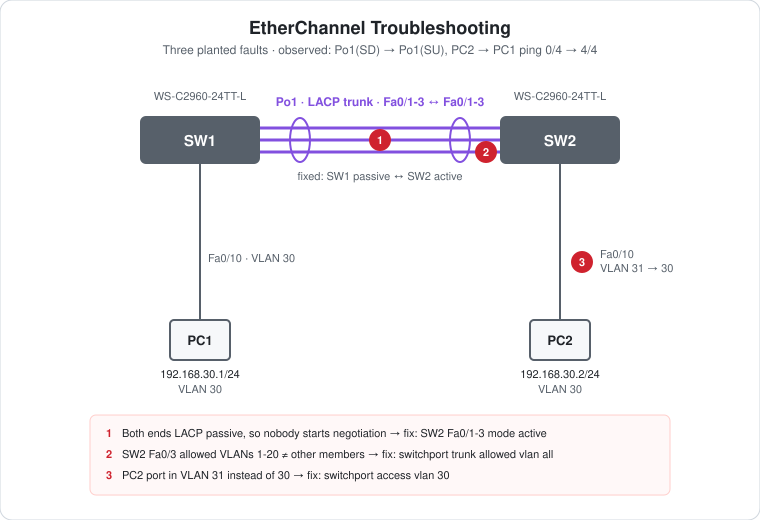

# CCNA Lab 07: EtherChannel Troubleshooting

A hands-on troubleshooting lab built in the **PingMyNetwork Sandbox**. Two Cisco Catalyst 2960 switches should form a three-link LACP EtherChannel trunk carrying VLAN 30 between PC1 and PC2. Three faults were planted in the build, so the bundle stays down and the PCs can't ping each other. This lab walks through finding and fixing each one.

The goal is to practise **reading `show etherchannel summary`, spotting member-port inconsistencies and following a fault from Layer 2 up to the host**.

> **Lab status:** The configs in [`configs/`](configs/) are the **solved** state saved in the exported Sandbox JSON in [`lab-files/`](lab-files/). The broken configuration and the before/after results below come from the console output in the same export. Results marked **observed** are copied from that output.

## Learning objectives

- Recognise the symptoms of an EtherChannel that won't form (`SD`, `s`).
- Know which LACP mode combinations negotiate and which never will.
- Find member ports whose trunk settings don't match the rest of the bundle.
- Check host-port VLAN assignment when the bundle is up but pings still fail.
- Work methodically: physical links → bundle → trunk → VLAN → host.

## Topology



```text
                  Po1 LACP trunk (Fa0/1-3)
   SW1 Fa0/1 ================================ Fa0/1 SW2
       Fa0/2 ================================ Fa0/2
       Fa0/3 ================================ Fa0/3
       Fa0/10                                 Fa0/10
         |                                      |
        PC1 192.168.30.1/24                    PC2 192.168.30.2/24
        VLAN 30                                VLAN 30
```

| Device | Role | Model |
|---|---|---|
| SW1 | Access switch for PC1 | Cisco WS-C2960-24TT-L (IOS 15.2) |
| SW2 | Access switch for PC2 | Cisco WS-C2960-24TT-L (IOS 15.2) |
| PC1, PC2 | End hosts | PC |

## Addressing plan

| Host | Switch port | VLAN | IP address | Subnet mask | Default gateway |
|---|---|---|---|---|---|
| PC1 | SW1 Fa0/10 | 30 | `192.168.30.1` | `255.255.255.0` | none |
| PC2 | SW2 Fa0/10 | 30 | `192.168.30.2` | `255.255.255.0` | none |

Both PCs are in one subnet, so no gateway is needed. The only path between them is Po1.

## The broken build

This is how the switches were first configured, reconstructed from the console output.

```cisco
! SW1
vlan 30
interface range FastEthernet0/1 - 3
 switchport mode trunk
 channel-group 1 mode passive
interface FastEthernet0/10
 switchport mode access
 switchport access vlan 30
!
! SW2
vlan 30
vlan 31
interface range FastEthernet0/1 - 3
 switchport mode trunk
interface FastEthernet0/3
 switchport trunk allowed vlan 1-20        ! fault 2
interface range FastEthernet0/1 - 3
 channel-group 1 mode passive              ! fault 1
interface FastEthernet0/10
 switchport mode access
 switchport access vlan 31                 ! fault 3
```

## Symptoms (observed)

| Where | What was seen |
|---|---|
| SW1 and SW2 log | `Fa0/1 suspended: LACP currently not enabled on the remote port.` (and the same for Fa0/2, Fa0/3) |
| SW2 `show etherchannel summary` | `1  Po1(SD)  LACP  Fa0/1(s) Fa0/2(s) Fa0/3(s)` |
| SW2 `show vlan brief \| include 30\|31` | VLAN 30 active with **no ports**. VLAN 31 active with **Fa0/10** |
| PC2 → `ping 192.168.30.1` | `Request timed out.` ×4: **0/4** |

`SD` means a Layer 2 port-channel that is down. `(s)` means the member is suspended.

## Faults and fixes

### Fault 1: both ends `passive`

**Cause:** LACP `passive` only answers LACPDUs and never sends the first one. With both ends passive, negotiation never starts, so every member is suspended. That's the "LACP currently not enabled on the remote port" message.

**Fix (SW2):**

```cisco
interface range FastEthernet0/1 - 3
 channel-group 1 mode active
```

| SW1 | SW2 | Bundles? |
|---|---|---|
| active | active | Yes |
| active | passive | Yes |
| passive | active | Yes (the fix used here) |
| passive | passive | **No** |

### Fault 2: allowed-VLAN mismatch on one member

**Cause:** SW2 Fa0/3 allowed only VLANs 1-20, while Fa0/1-2 allowed all VLANs. Every member of a bundle must have the same trunk settings. A member that doesn't match is suspended or left out of the bundle. Even if it were bundled, VLAN 30 would be dropped on that link.

**Fix (SW2):**

```cisco
interface FastEthernet0/3
 switchport trunk allowed vlan all
```

Configure members with `interface range` and make trunk changes on the `Port-channel` interface, so the members stay consistent.

### Fault 3: PC2 in the wrong VLAN

**Cause:** SW2 Fa0/10 was in VLAN 31. Even with the bundle up, PC2 sits in a different broadcast domain from PC1, and nothing routes between them. `show vlan brief` gives it away: VLAN 30 has no ports on SW2.

**Fix (SW2):**

```cisco
interface FastEthernet0/10
 switchport access vlan 30
```

All three fixes were applied and saved with `write memory` on SW2. SW1 needed no changes.

## Verification after the fix

| Check | Command/test | Result |
|---|---|---|
| Bundle | SW2 `show etherchannel summary` | **Observed:** `1  Po1(SU)  LACP  Fa0/1(P) Fa0/2(P) Fa0/3(P)` |
| Logs | SW1 and SW2 | **Observed:** `Port-channel1, changed state to up` at 20:36:55 |
| Ping | PC2 → `ping 192.168.30.1` | **Observed:** 4/4 replies, `TTL=128` |
| Trunk | `show interfaces trunk` | Expected: Po1 trunking 802.1Q, VLAN 30 allowed and forwarding |
| Host VLAN | SW2 `show vlan brief` | Expected: Fa0/10 in VLAN 30 |

`TTL=128` shows no routing hop. The PCs are switched together in VLAN 30, unlike the TTL 127 seen in [Lab 06](../lab-06-etherchannel-inter-vlan/).

The three fixes were applied in one step, so the export doesn't show each fault's symptom separately. In particular, the allowed-VLAN mismatch was hidden behind fault 1, because every member was already suspended. Challenge 1 below re-breaks the faults one at a time.

## Try it yourself: guided challenges

1. **One fault at a time.** Load the solved lab and re-introduce each fault on its own. Record what `show etherchannel summary`, `show interfaces trunk` and a ping show for each.
2. **Fault 2 alone.** With both sides `active`, set `switchport trunk allowed vlan 1-20` on SW2 Fa0/3 only. Is Fa0/3 suspended, or is it bundled but dropping VLAN 30?
3. **Mismatched protocols.** Set SW1 to `desirable` (PAgP) and SW2 to `active` (LACP). What do the logs and summary show?
4. **Native VLAN mismatch.** Change the native VLAN on one side's `Port-channel1`. Look for CDP and STP messages.
5. **Clean up.** VLAN 31 is still defined on SW2. Remove it with `no vlan 31`.
6. **Write your own faults.** Break the lab in a new way (speed/duplex, `switchport mode access` on one member, a shutdown member) and have someone else find it.

## Troubleshooting checklist

1. `show interfaces status`: are all member links connected?
2. `show etherchannel summary`: is the Po `SU`, and are the members `P`? Look out for `s`, `I` and `D`.
3. `show lacp neighbor` / `show pagp neighbor`: does each member see a partner?
4. `show etherchannel port-channel` and the logs: look for suspension reasons.
5. `show interfaces trunk`: is the needed VLAN allowed and forwarding on Po1?
6. `show vlan brief`: is the host port in the right VLAN, and does that VLAN exist on both switches?
7. `show mac address-table`: are both PCs' MACs learned in VLAN 30?

## Scope and caveats

- This is a **CCNA-oriented** troubleshooting lab. The faults are the common EtherChannel misconfigurations.
- The exported configs are the **solved** state. Import the JSON and re-break it to practise (Challenge 1).
- VLAN 31 is left over in SW2's VLAN database. It's harmless but unused.
- No switch has a management IP, passwords or an SSH user. Unused ports aren't shut down, and `ip http server` is on by default.

## Useful verification commands

```cisco
show etherchannel summary
show etherchannel port-channel
show lacp neighbor
show interfaces trunk
show interfaces FastEthernet0/3 switchport
show vlan brief
show mac address-table
```

## Lab files

| File | Description |
|---|---|
| [`lab-files/etherchannel-troubleshooting-lab.json`](lab-files/etherchannel-troubleshooting-lab.json) | PingMyNetwork Sandbox export (solved state). Import it into the Sandbox to load the full lab. |
| [`configs/SW1-running-config.txt`](configs/SW1-running-config.txt) | SW1 saved configuration (unchanged by the fix) |
| [`configs/SW2-running-config.txt`](configs/SW2-running-config.txt) | SW2 saved configuration (after all three fixes) |
| [`images/topology.svg`](images/topology.svg) | Topology diagram with the faults marked |

**Built with:** [PingMyNetwork Sandbox](https://pingmynetwork.com/sandbox)
