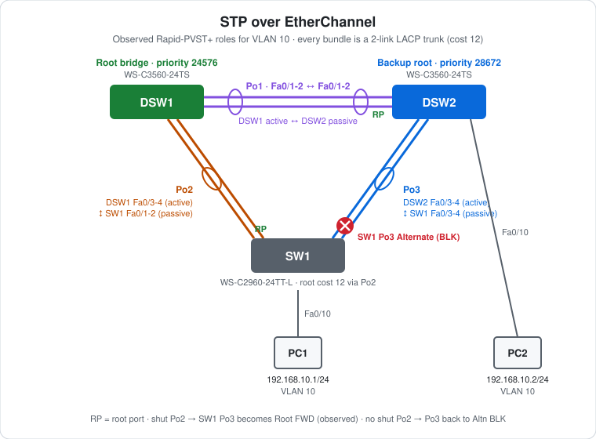

# CCNA Lab 08: STP over EtherChannel

A hands-on Layer 2 redundancy lab built in the **PingMyNetwork Sandbox**. Two Cisco Catalyst 3560 distribution switches and one 2960 access switch form a triangle. Every leg is a two-link **LACP EtherChannel trunk**. Rapid-PVST+ treats each port-channel as a single port, so it blocks one whole bundle to break the loop, and unblocks it when the active uplink fails.

The goal is to practise **root bridge placement with `root primary`/`secondary`, port-channel path cost, and STP failover between bundles**. It combines [Lab 03](../lab-03-stp-failover/) (STP) with [Lab 04](../lab-04-etherchannel/) (EtherChannel).

> **Lab status:** The configs in [`configs/`](configs/) and the results below come from the exported Sandbox JSON in [`lab-files/`](lab-files/). That export includes the saved configuration of every switch and the console output of the session. Results marked **observed** are copied from that output.

## Learning objectives

- Build LACP trunk bundles between three switches.
- Place the root bridge with `spanning-tree vlan … root primary` and `root secondary`, and see what they save as.
- Read STP port cost for a port-channel and predict the root port.
- Explain why STP blocks a **whole bundle**, never one member link.
- Fail the active uplink bundle and watch the alternate bundle take over.

## Topology



```text
      Root (24576)                         Backup root (28672)
       DSW1 Po1 =======LACP Fa0/1-2======= Po1 DSW2 ------ Fa0/10 PC2
       Fa0/3-4 \\                         // Fa0/3-4
          Po2   \\                       //   Po3
                 \\                     //
           Fa0/1-2 \\                 // Fa0/3-4   <- SW1 Po3 blocking
                     Po2   SW1   Po3
                           Fa0/10
                             |
                            PC1
```

| Device | Role | Model |
|---|---|---|
| DSW1 | Distribution: STP root for VLANs 1 and 10 | Cisco WS-C3560-24TS (IOS 15.2) |
| DSW2 | Distribution: backup root for VLANs 1 and 10, PC2 access port | Cisco WS-C3560-24TS (IOS 15.2) |
| SW1 | Access switch for PC1 | Cisco WS-C2960-24TT-L (IOS 15.2) |
| PC1, PC2 | End hosts | PC |

All three switches use the 3560/2960 only as Layer 2 switches here. `ip routing` isn't enabled.

## Addressing plan

### Port-channels

| Bundle | Side A | Side B | LACP modes | Trunk |
|---|---|---|---|---|
| Po1 | DSW1 Fa0/1-2 | DSW2 Fa0/1-2 | DSW1 `active` ↔ DSW2 `passive` | 802.1Q |
| Po2 | DSW1 Fa0/3-4 | SW1 Fa0/1-2 | DSW1 `active` ↔ SW1 `passive` | 802.1Q |
| Po3 | DSW2 Fa0/3-4 | SW1 Fa0/3-4 | DSW2 `active` ↔ SW1 `passive` | 802.1Q |

### STP priorities

| VLAN | DSW1 | DSW2 | SW1 |
|---|---|---|---|
| 1 | **24576** (`root primary`) | **28672** (`root secondary`) | 32768 (default) |
| 10 | **24576** (`root primary`) | **28672** (`root secondary`) | 32768 (default) |

### Hosts

| Host | Switch port | VLAN | IP address | Subnet mask |
|---|---|---|---|---|
| PC1 | SW1 Fa0/10 | 10 | `192.168.10.1` | `255.255.255.0` |
| PC2 | DSW2 Fa0/10 | 10 | `192.168.10.2` | `255.255.255.0` |

## Configuration highlights

These excerpts are from the saved configs. The full configs are in [`configs/`](configs/).

### 1. Bundles (DSW1 shown)

```cisco
vlan 10
!
interface range FastEthernet0/1 - 4
 switchport trunk encapsulation dot1q
 switchport mode trunk
!
interface range FastEthernet0/1 - 2
 channel-group 1 mode active
!
interface range FastEthernet0/3 - 4
 channel-group 2 mode active
```

DSW2 uses `channel-group 1 mode passive` on Fa0/1-2 and `channel-group 3 mode active` on Fa0/3-4. SW1 uses `channel-group 2 mode passive` on Fa0/1-2 and `channel-group 3 mode passive` on Fa0/3-4. On the 2960, no encapsulation command is needed.

### 2. Root bridge placement

```cisco
! DSW1 – typed:
spanning-tree vlan 1,10 root primary
! saved as:
spanning-tree vlan 1,10 priority 24576
!
! DSW2 – typed:
spanning-tree vlan 1,10 root secondary
! saved as:
spanning-tree vlan 1,10 priority 28672
```

`root primary` is a macro, not a stored setting. When run, it sets the priority to 24576, or lower if another switch already has a lower one. `root secondary` sets 28672. The config only keeps the resulting `priority`, so if a third switch later joins with a lower priority, DSW1 won't adjust automatically.

## Full configuration commands

These are the **exact commands typed in the Sandbox session**, copied from the console history in the export, in the order they were entered (including the `show` commands used to verify). Typing them on factory-default devices reproduces the lab. SW1's session ends with the failover test: shutting Po2, checking STP, and bringing Po2 back.

How to read the blocks:

- Lines starting with `!` explain the command below them. Don't type them.
- The prompt (`SW1(config-if-range)#`) shows which mode you're in. Type only the text after `#` or `>`.
- Abbreviations such as `conf t` and `f0/1-2` are accepted by IOS, the same as `configure terminal` and `FastEthernet0/1 - 2`.

### DSW1 (WS-C3560-24TS)

```text
! Enter privileged EXEC mode
DSW1>enable
! Enter global configuration mode
DSW1#conf t
! Create VLAN 10 (and enter VLAN config mode)
DSW1(config)#vlan 10
DSW1(config-vlan)#exit
! Select f0/1-4 and configure them together
DSW1(config)#interface range f0/1-4
! 3560 only: choose 802.1Q before trunking
DSW1(config-if-range)#switchport trunk encapsulation dot1q
! Make it an 802.1Q trunk
DSW1(config-if-range)#switchport mode trunk
DSW1(config-if-range)#exit
! Select f0/1-2 and configure them together
DSW1(config)#interface range f0/1-2
! Join Po1; LACP active: start LACP negotiation
DSW1(config-if-range)#channel-group 1 mode active
DSW1(config-if-range)#exit
! Select f0/3-4 and configure them together
DSW1(config)#interface range f0/3-4
! Join Po2; LACP active: start LACP negotiation
DSW1(config-if-range)#channel-group 2 mode active
DSW1(config-if-range)#exit
! Make this switch root for VLAN(s) 1,10 (saved as priority 24576)
DSW1(config)#spanning-tree vlan 1,10 root primary
DSW1(config)#end
! Save the running config to NVRAM
DSW1#write memory
```

### DSW2 (WS-C3560-24TS)

```text
! Enter privileged EXEC mode
DSW2>enable
! Enter global configuration mode
DSW2#conf t
! Create VLAN 10 (and enter VLAN config mode)
DSW2(config)#vlan 10
DSW2(config-vlan)#exit
! Select f0/1-4 and configure them together
DSW2(config)#interface range f0/1-4
! 3560 only: choose 802.1Q before trunking
DSW2(config-if-range)#switchport trunk encapsulation dot1q
! Make it an 802.1Q trunk
DSW2(config-if-range)#switchport mode trunk
DSW2(config-if-range)#exit
! Select f0/1-2 and configure them together
DSW2(config)#interface range f0/1-2
! Join Po1; LACP passive: answer LACP but never start it
DSW2(config-if-range)#channel-group 1 mode passive
DSW2(config-if-range)#exit
! Select f0/3-4 and configure them together
DSW2(config)#interface range f0/3-4
! Join Po3; LACP active: start LACP negotiation
DSW2(config-if-range)#channel-group 3 mode active
DSW2(config-if-range)#exit
! Select interface f0/10
DSW2(config)#interface f0/10
! Make it an access (host) port
DSW2(config-if)#switchport mode access
! Put the port in VLAN 10
DSW2(config-if)#switchport access vlan 10
DSW2(config-if)#exit
! Make this switch backup root for VLAN(s) 1,10 (saved as priority 28672)
DSW2(config)#spanning-tree vlan 1,10 root secondary
DSW2(config)#end
! Save the running config to NVRAM
DSW2#write memory
```

### SW1 (WS-C2960-24TT-L)

```text
! Enter privileged EXEC mode
SW1>enable
! Enter global configuration mode
SW1#conf t
! Create VLAN 10 (and enter VLAN config mode)
SW1(config)#vlan 10
SW1(config-vlan)#exit
! Select f0/1-4 and configure them together
SW1(config)#interface range f0/1-4
! Make it an 802.1Q trunk
SW1(config-if-range)#switchport mode trunk
SW1(config-if-range)#exit
! Select f0/1-2 and configure them together
SW1(config)#interface range f0/1-2
! Join Po2; LACP passive: answer LACP but never start it
SW1(config-if-range)#channel-group 2 mode passive
SW1(config-if-range)#exit
! Select f0/3-4 and configure them together
SW1(config)#interface range f0/3-4
! Join Po3; LACP passive: answer LACP but never start it
SW1(config-if-range)#channel-group 3 mode passive
SW1(config-if-range)#exit
! Select interface f0/10
SW1(config)#interface f0/10
! Make it an access (host) port
SW1(config-if)#switchport mode access
! Put the port in VLAN 10
SW1(config-if)#switchport access vlan 10
SW1(config-if)#end
! Save the running config to NVRAM
SW1#write memory
! Verify: port-channel state (SU/SD) and member flags (P, s, I, D, H)
SW1#show etherchannel summary | begin Group
! Verify: STP root bridge and port roles/states
SW1#show spanning-tree vlan 10
! Enter global configuration mode
SW1#conf t
! Configure the logical Port-channel2 interface
SW1(config)#interface port-channel 2
! Disable the interface (failover test)
SW1(config-if)#shutdown
SW1(config-if)#end
! Verify: STP root bridge and port roles/states
SW1#show spanning-tree vlan 10 | begin Interface
! Enter global configuration mode
SW1#conf t
! Configure the logical Port-channel2 interface
SW1(config)#interface port-channel 2
! Enable the interface
SW1(config-if)#no shutdown
SW1(config-if)#end
! Verify: STP root bridge and port roles/states
SW1#show spanning-tree vlan 10 | begin Interface
```

### PCs

Set these in each PC's IP configuration:

| PC | IP address | Subnet mask | Default gateway |
|---|---|---|---|
| PC1 | `192.168.10.1` | `255.255.255.0` | none |
| PC2 | `192.168.10.2` | `255.255.255.0` | none |

Then test from PC2's command prompt:

```text
! Test reachability to 192.168.10.1
C:\> ping 192.168.10.1
! Test reachability to 192.168.10.1
C:\> ping 192.168.10.1
```

## Spanning tree results (VLAN 10)

### Observed on SW1

```text
SW1#show spanning-tree vlan 10
VLAN0010
  Spanning tree enabled protocol rstp
  Root ID    Priority    24586
             Address     0070.8129.1758
             Cost        12
             Port        66 (Port-channel2)

  Bridge ID  Priority    32778  (priority 32768 sys-id-ext 10)
             Address     2450.2653.0790

Interface           Role Sts Cost      Prio.Nbr Type
------------------- ---- --- --------- -------- --------------------------------
Fa0/10              Desg FWD 19        128.10   P2p Edge
Po2                 Root FWD 12        128.66   P2p
Po3                 Altn BLK 12        128.67   P2p
```

### Why Po3 blocks

- **Root bridge:** DSW1 has the lowest bridge ID (24576 + 10 = **24586**).
- **Port-channel cost:** each 2 × FastEthernet bundle costs **12**, compared with 19 for a single FastEthernet link. STP uses the bundle's combined bandwidth.
- **SW1's root port:** via Po2 the cost is 12 (direct to DSW1). Via Po3 it's 12 + 12 = 24 (through DSW2 and Po1). **Po2 wins.**
- **The Po3 segment:** DSW2 and SW1 both advertise a root path cost of 12 onto it. The tie goes to the lower bridge ID, DSW2 (28682 vs 32778), so DSW2's end is designated and **SW1 Po3 becomes Alternate (BLK)**.

| Switch | Port | Role | State |
|---|---|---|---|
| DSW1 | Po1, Po2 | Designated (root bridge) | Forwarding |
| DSW2 | Po1 | Root | Forwarding |
| DSW2 | Po3 | Designated | Forwarding |
| SW1 | Po2 | **Root** (observed) | Forwarding |
| SW1 | Po3 | **Alternate** (observed) | **Blocking** |

The SW1 rows are observed. The DSW1 and DSW2 rows are expected, because `show spanning-tree` wasn't run on them in the export.

The normal path from PC1 to PC2 is SW1 → Po2 → DSW1 → Po1 → DSW2.

## Failover (observed)

| Step | Action on SW1 | `show spanning-tree vlan 10` on SW1 |
|---|---|---|
| Before | none | `Po2 Root FWD 12` · `Po3 Altn BLK 12` |
| 1 | `interface port-channel 2` → `shutdown` (20:44:07) | Po2 gone · **`Po3 Root FWD 12`** |
| 2 | `interface port-channel 2` → `no shutdown` (20:44:31) | `Po2 Root FWD 12` · `Po3 Altn BLK 12` |

Shutting down `Port-channel2` also took down both members (Fa0/1, Fa0/2), and DSW1 logged Po2 down on its side. When Po2 was removed, Po3 moved straight from Alternate to Root. That's Rapid-PVST+ using the alternate port it had already calculated. When Po2 came back, its lower cost (12 vs 24) won the root port role again.

During failover, PC1 → PC2 traffic takes the direct path SW1 → Po3 → DSW2.

PC2 → `ping 192.168.10.1` was run twice and got **4/4 replies both times** (`TTL=128`, switched with no routing hop). The export doesn't timestamp PC pings, so it doesn't show whether one ran while Po2 was down.

## Verification results

| Check | Command/test | Result |
|---|---|---|
| Bundles | SW1 `show etherchannel summary` | **Observed:** `Po2(SU) LACP Fa0/1(P) Fa0/2(P)`, `Po3(SU) LACP Fa0/3(P) Fa0/4(P)` |
| Bundles | DSW1 / DSW2 logs | **Observed:** Po1 and Po2 up on DSW1, Po1 and Po3 up on DSW2 |
| Root | SW1 `show spanning-tree vlan 10` | **Observed:** Root ID 24586, address `0070.8129.1758` (DSW1), cost 12 via Po2 |
| Port roles | SW1 `show spanning-tree vlan 10` | **Observed:** Po2 Root FWD, Po3 Altn BLK |
| Failover | Shut Po2 on SW1 | **Observed:** Po3 Root FWD |
| Ping | PC2 → `ping 192.168.10.1` | **Observed:** 4/4 replies, `TTL=128` |
| Root bridge | DSW1 `show spanning-tree vlan 10` | Expected: "This bridge is the root" |

## Try it yourself: guided challenges

1. **Continuous ping during failover.** Run `ping -t 192.168.10.2` on PC1, then shut Po2 on SW1. How many replies are lost?
2. **Lose one member.** Shut only SW1 Fa0/1. Does STP change anything? Check the Po2 cost in `show spanning-tree vlan 10`.
3. **Fail the root.** Power off DSW1. Which switch becomes root, and what happens to SW1's ports?
4. **Move the blocked bundle.** Change `spanning-tree vlan 10 cost` on SW1 Po2 so Po3 becomes the root port. Which bundle blocks now?
5. **Load-share by VLAN.** Add VLAN 20 and make DSW2 root for it. Compare the blocked bundle in VLAN 10 and VLAN 20.
6. **Shut a member instead of the Po.** What's the difference between `shutdown` on `Port-channel2` and on both Fa0/1 and Fa0/2?

## Scope and caveats

- This is a **CCNA-oriented** lab focused on STP behaviour over port-channels.
- There's no Layer 3 in the lab, and the PCs have no default gateway.
- `spanning-tree portfast edge default` is in every saved config, so access ports such as Fa0/10 come up as `Edge`.
- SW1's running config differs from its saved one only in the "last configuration change" timestamp. Po2 was shut and then re-enabled, so the end state matches.
- No switch has a management IP, passwords or an SSH user. Unused ports aren't shut down, and `ip http server` is on by default.

## Useful verification commands

```cisco
show etherchannel summary
show spanning-tree vlan 10
show spanning-tree root
show spanning-tree interface port-channel 2 detail
show interfaces trunk
show lacp neighbor
show mac address-table vlan 10
```

## Lab files

| File | Description |
|---|---|
| [`lab-files/etherchannel-stp-lab.json`](lab-files/etherchannel-stp-lab.json) | PingMyNetwork Sandbox export with saved configs. Import it into the Sandbox to load the full lab. |
| [`configs/DSW1-running-config.txt`](configs/DSW1-running-config.txt) | DSW1 saved configuration (root bridge) |
| [`configs/DSW2-running-config.txt`](configs/DSW2-running-config.txt) | DSW2 saved configuration (backup root, PC2) |
| [`configs/SW1-running-config.txt`](configs/SW1-running-config.txt) | SW1 saved configuration (access, PC1) |
| [`images/topology.svg`](images/topology.svg) | Topology diagram |

**Built with:** [PingMyNetwork Sandbox](https://pingmynetwork.com/sandbox)
