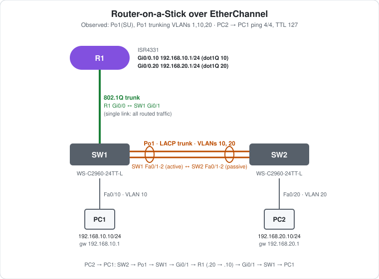

# CCNA Lab 09: Router-on-a-Stick over EtherChannel

A hands-on inter-VLAN routing lab built in the **PingMyNetwork Sandbox**. A Cisco ISR4331 router (R1) routes between VLAN 10 and VLAN 20 using 802.1Q subinterfaces on a single trunk link to SW1. This is **router-on-a-stick (ROAS)**. SW1 and SW2 are joined by a two-link **LACP EtherChannel trunk**, so VLAN 20 traffic from SW2 reaches the router over the bundle.

The goal is to practise **ROAS subinterfaces, carrying multiple VLANs over an EtherChannel trunk, and tracing a routed packet's path**. It's the router-based counterpart of [Lab 06](../lab-06-etherchannel-inter-vlan/), where a Layer 3 switch did the routing with SVIs.

> **Lab status:** The configs in [`configs/`](configs/) and the results below come from the exported Sandbox JSON in [`lab-files/`](lab-files/). That export includes the saved configuration of every device and the console output of the session. Results marked **observed** are copied from that output.

## Learning objectives

- Configure ROAS: `encapsulation dot1Q` and an IP address on each subinterface.
- Know that the physical router interface needs `no shutdown` but no IP address.
- Build an LACP trunk bundle between two access switches.
- Read `show interfaces trunk` on a port-channel: allowed, active and forwarding VLANs.
- Trace how inter-VLAN traffic hairpins through the router over the same trunk link.
- Compare ROAS with Layer 3 switch SVIs.

## Topology



```text
                 R1 (ISR4331)
          Gi0/0.10 192.168.10.1/24
          Gi0/0.20 192.168.20.1/24
                  | Gi0/0
                  | 802.1Q trunk
                  | Gi0/1
                 SW1 Po1 ====LACP Fa0/1-2==== Po1 SW2
                Fa0/10                            Fa0/20
                  |                                 |
                 PC1 192.168.10.10                 PC2 192.168.20.10
                 VLAN 10                           VLAN 20
```

| Device | Role | Model |
|---|---|---|
| R1 | Router-on-a-stick: gateway for VLANs 10 and 20 | Cisco ISR4331 (IOS 15.9 in the Sandbox) |
| SW1 | Access switch: trunk to R1, Po1 to SW2, PC1 | Cisco WS-C2960-24TT-L (IOS 15.2) |
| SW2 | Access switch: Po1 to SW1, PC2 | Cisco WS-C2960-24TT-L (IOS 15.2) |
| PC1, PC2 | End hosts | PC |

## Addressing plan

### Links

| Link | Side A | Side B | Type |
|---|---|---|---|
| R1 ↔ SW1 | R1 Gi0/0 (subinterfaces) | SW1 Gi0/1 (`switchport mode trunk`) | 802.1Q trunk, single link |
| SW1 ↔ SW2 | SW1 Fa0/1-2, LACP `active` | SW2 Fa0/1-2, LACP `passive` | Po1, LACP EtherChannel trunk |

### VLANs and gateways

| VLAN | Subnet | Gateway (R1 subinterface) | VLAN exists on |
|---|---|---|---|
| 10 | `192.168.10.0/24` | `Gi0/0.10` `192.168.10.1` | SW1, SW2 |
| 20 | `192.168.20.0/24` | `Gi0/0.20` `192.168.20.1` | SW1, SW2 |

### Hosts

| Host | Switch port | VLAN | IP address | Subnet mask | Default gateway |
|---|---|---|---|---|---|
| PC1 | SW1 Fa0/10 | 10 | `192.168.10.10` | `255.255.255.0` | `192.168.10.1` |
| PC2 | SW2 Fa0/20 | 20 | `192.168.20.10` | `255.255.255.0` | `192.168.20.1` |

## Configuration highlights

These excerpts are from the saved configs. The full configs are in [`configs/`](configs/).

### 1. R1: router-on-a-stick

```cisco
no ip domain lookup
!
interface GigabitEthernet0/0
 no ip address
 no shutdown
!
interface GigabitEthernet0/0.10
 encapsulation dot1Q 10
 ip address 192.168.10.1 255.255.255.0
!
interface GigabitEthernet0/0.20
 encapsulation dot1Q 20
 ip address 192.168.20.1 255.255.255.0
```

- The **physical interface** has no IP address. It only needs `no shutdown`, and its subinterfaces come up with it.
- **`encapsulation dot1Q <vlan>`** must come before the IP address. It tells the subinterface which VLAN tag to send and accept.
- The subinterface number (`.10`) doesn't have to match the VLAN, but matching makes the config readable.
- Routers route between connected interfaces by default, so no `ip routing` command is needed.

### 2. SW1: trunk to the router and LACP bundle

```cisco
vlan 10
vlan 20
!
interface GigabitEthernet0/1
 switchport mode trunk
!
interface range FastEthernet0/1 - 2
 switchport mode trunk
 channel-group 1 mode active
!
interface FastEthernet0/10
 switchport mode access
 switchport access vlan 10
```

### 3. SW2: passive bundle and access port

```cisco
vlan 10
vlan 20
!
interface range FastEthernet0/1 - 2
 switchport mode trunk
 channel-group 1 mode passive
!
interface FastEthernet0/20
 switchport mode access
 switchport access vlan 20
```

Both VLANs are created on **both** switches. SW2 needs VLAN 10 too, or VLAN 10 wouldn't be active on its end of Po1. And SW1 must have VLAN 20 so it can forward PC2's frames between Po1 and the router trunk.

## Full configuration commands

These are the **exact commands typed in the Sandbox session**, copied from the console history in the export, in the order they were entered (including the `show` commands used to verify). Typing them on factory-default devices reproduces the lab.

How to read the blocks:

- Lines starting with `!` explain the command below them. Don't type them.
- The prompt (`SW1(config-if-range)#`) shows which mode you're in. Type only the text after `#` or `>`.
- Abbreviations such as `conf t` and `f0/1-2` are accepted by IOS, the same as `configure terminal` and `FastEthernet0/1 - 2`.

### R1 (ISR4331)

```text
! Enter privileged EXEC mode
R1>enable
! Enter global configuration mode
R1#conf t
! Stop mistyped commands being treated as hostnames to look up
R1(config)#no ip domain-lookup
! Select interface g0/0
R1(config)#interface g0/0
! Enable the interface
R1(config-if)#no shutdown
! Create subinterface g0/0.10
R1(config-if)#interface g0/0.10
! Tag/accept VLAN 10 on this subinterface
R1(config-subif)#encapsulation dot1q 10
! Assign 192.168.10.1 / 255.255.255.0
R1(config-subif)#ip address 192.168.10.1 255.255.255.0
! Create subinterface g0/0.20
R1(config-subif)#interface g0/0.20
! Tag/accept VLAN 20 on this subinterface
R1(config-subif)#encapsulation dot1q 20
! Assign 192.168.20.1 / 255.255.255.0
R1(config-subif)#ip address 192.168.20.1 255.255.255.0
R1(config-subif)#end
! Save the running config to NVRAM
R1#write memory
```

### SW1 (WS-C2960-24TT-L)

```text
! Enter privileged EXEC mode
SW1>enable
! Enter global configuration mode
SW1#conf t
! Create VLAN 10 (and enter VLAN config mode)
SW1(config)#vlan 10
! Create VLAN 20 (and enter VLAN config mode)
SW1(config-vlan)#vlan 20
SW1(config-vlan)#exit
! Select interface g0/1
SW1(config)#interface g0/1
! Make it an 802.1Q trunk
SW1(config-if)#switchport mode trunk
SW1(config-if)#exit
! Select f0/1-2 and configure them together
SW1(config)#interface range f0/1-2
! Make it an 802.1Q trunk
SW1(config-if-range)#switchport mode trunk
! Join Po1; LACP active: start LACP negotiation
SW1(config-if-range)#channel-group 1 mode active
SW1(config-if-range)#exit
! Select interface f0/10
SW1(config)#interface f0/10
! Make it an access (host) port
SW1(config-if)#switchport mode access
! Put the port in VLAN 10
SW1(config-if)#switchport access vlan 10
SW1(config-if)#end
! Save the running config to NVRAM
SW1#write memory
```

### SW2 (WS-C2960-24TT-L)

```text
! Enter privileged EXEC mode
SW2>enable
! Enter global configuration mode
SW2#conf t
! Create VLAN 10 (and enter VLAN config mode)
SW2(config)#vlan 10
! Create VLAN 20 (and enter VLAN config mode)
SW2(config-vlan)#vlan 20
SW2(config-vlan)#exit
! Select f0/1-2 and configure them together
SW2(config)#interface range f0/1-2
! Make it an 802.1Q trunk
SW2(config-if-range)#switchport mode trunk
! Join Po1; LACP passive: answer LACP but never start it
SW2(config-if-range)#channel-group 1 mode passive
SW2(config-if-range)#exit
! Select interface f0/20
SW2(config)#interface f0/20
! Make it an access (host) port
SW2(config-if)#switchport mode access
! Put the port in VLAN 20
SW2(config-if)#switchport access vlan 20
SW2(config-if)#end
! Save the running config to NVRAM
SW2#write memory
! Verify: port-channel state (SU/SD) and member flags (P, s, I, D, H)
SW2#show etherchannel summary | begin Group
! Verify: trunk ports, encapsulation and allowed/active VLANs
SW2#show interfaces trunk
```

### PCs

Set these in each PC's IP configuration:

| PC | IP address | Subnet mask | Default gateway |
|---|---|---|---|
| PC1 | `192.168.10.10` | `255.255.255.0` | `192.168.10.1` |
| PC2 | `192.168.20.10` | `255.255.255.0` | `192.168.20.1` |

Then test from PC2's command prompt:

```text
! Test reachability to 192.168.10.10
C:\> ping 192.168.10.10
```

## How a packet gets from PC2 to PC1

1. PC2 (VLAN 20) sends to its gateway `192.168.20.1`. SW2 tags the frame with VLAN 20 and sends it over **Po1**.
2. SW1 forwards it out **Gi0/1**, still tagged with VLAN 20, to R1.
3. R1 receives it on **Gi0/0.20**, routes it to `192.168.10.0/24` and sends it out **Gi0/0.10**, tagged with VLAN 10. This decrements the TTL by 1.
4. SW1 receives it on Gi0/1 in VLAN 10 and delivers it untagged to PC1 on Fa0/10.

The packet crosses the R1–SW1 link **twice**, once in each VLAN. Every inter-VLAN packet does this, which is the main limitation of router-on-a-stick.

## Verification results

| Check | Command/test | Result |
|---|---|---|
| Bundle | SW2 `show etherchannel summary` | **Observed:** `1  Po1(SU)  LACP  Fa0/1(P) Fa0/2(P)` |
| Trunk | SW2 `show interfaces trunk` | **Observed:** Po1 mode `on`, `802.1q`, `trunking`, native VLAN 1 |
| Trunk VLANs | SW2 `show interfaces trunk` | **Observed:** allowed `1-4094`, active `1,10,20`, forwarding `1,10,20` |
| Router link | SW1 log | **Observed:** `GigabitEthernet0/1, changed state to up` after `no shutdown` on R1 Gi0/0 |
| Inter-VLAN ping | PC2 → `ping 192.168.10.10` | **Observed:** 4/4 replies, `TTL=127` |
| Subinterfaces | R1 `show ip interface brief` | Expected: Gi0/0.10 and Gi0/0.20 up/up with their gateway IPs |
| Routes | R1 `show ip route` | Expected: `C 192.168.10.0/24 Gi0/0.10`, `C 192.168.20.0/24 Gi0/0.20` |
| Router trunk | SW1 `show interfaces trunk` | Expected: Gi0/1 and Po1 trunking, VLANs 10 and 20 forwarding |

`TTL=127` confirms one routed hop through R1. It matches the Layer 3 switch result in Lab 06.

The first reply took 63 ms and the rest 7–8 ms. The extra delay is the ARP resolution for each hop on the first packet.

## ROAS vs Layer 3 switch (Lab 06)

| | Router-on-a-stick (this lab) | Layer 3 switch SVIs (Lab 06) |
|---|---|---|
| Gateway interfaces | Router subinterfaces (`Gi0/0.10`) | SVIs (`interface Vlan10`) |
| Enabling routing | On by default on a router | Needs `ip routing` |
| Inter-VLAN path | Hairpins over one router link, twice | Routed inside the switch |
| Bandwidth | Limited to one link, shared both ways | Switch backplane |
| Redundancy | R1 Gi0/0 is a single point of failure | Depends on the uplinks |

## Failure scenarios

| # | Action | Expected result |
|---|---|---|
| 1 | `shutdown` on **SW1 Fa0/1** | Po1 stays up on Fa0/2. The ping keeps working. |
| 2 | `shutdown` on **R1 Gi0/0** | Both subinterfaces go down. All inter-VLAN traffic stops. Same-VLAN traffic isn't affected. |
| 3 | `no vlan 20` on **SW1** | PC2 can't reach its gateway. SW1 no longer forwards VLAN 20 between Po1 and Gi0/1. |
| 4 | `switchport trunk allowed vlan 10` on **SW1 Po1** | PC2 loses its path to R1. PC1 is unaffected. |

## Try it yourself: guided challenges

1. **Wrong tag.** Change `Gi0/0.20` to `encapsulation dot1Q 30`. What does PC2 see, and what does `show vlans` on R1 report?
2. **Native VLAN.** Make VLAN 10 the native VLAN on the router trunk (`encapsulation dot1Q 10 native` on R1, `switchport trunk native vlan 10` on SW1). Does PC1 still reach its gateway?
3. **Bundle the router link.** Connect R1 Gi0/1 to SW1 Gi0/2 and build an LACP port-channel on R1 (`interface Port-channel1`, subinterfaces `Po1.10` and `Po1.20`). What does this fix?
4. **Prune the trunks.** Allow only VLANs 10 and 20 on Gi0/1 and Po1. Check `show interfaces trunk` again.
5. **Trace it.** Run `tracert 192.168.10.10` from PC2. How many hops, and which address is the first one?
6. **Add VLAN 30.** Add a PC3 in VLAN 30 on SW2. List every change you need on R1, SW1 and SW2.

## Scope and caveats

- This is a **CCNA-oriented** lab focused on router-on-a-stick and EtherChannel trunking.
- The Sandbox names the ISR4331's ports `GigabitEthernet0/0`–`0/3`. A real ISR4331 uses `GigabitEthernet0/0/0` style names.
- The R1–SW1 link is a single link with no redundancy. Challenge 3 bundles it.
- The trunks allow all VLANs (`1-4094`). VLAN 1 is the native VLAN everywhere and is still active on Po1.
- R1's `line vty 0 4` has `login` but no password, and `transport input none`, so remote access is disabled. No switch has a management IP, passwords or an SSH user.

## Useful verification commands

```cisco
! R1
show ip interface brief
show ip route
show vlans
show interfaces GigabitEthernet0/0.10
!
! SW1 / SW2
show etherchannel summary
show interfaces trunk
show vlan brief
show mac address-table
```

## Lab files

| File | Description |
|---|---|
| [`lab-files/etherchannel-roas-lab.json`](lab-files/etherchannel-roas-lab.json) | PingMyNetwork Sandbox export with saved configs. Import it into the Sandbox to load the full lab. |
| [`configs/R1-running-config.txt`](configs/R1-running-config.txt) | R1 saved configuration (router-on-a-stick) |
| [`configs/SW1-running-config.txt`](configs/SW1-running-config.txt) | SW1 saved configuration (router trunk, Po1 active, PC1) |
| [`configs/SW2-running-config.txt`](configs/SW2-running-config.txt) | SW2 saved configuration (Po1 passive, PC2) |
| [`images/topology.svg`](images/topology.svg) | Topology diagram |

**Built with:** [PingMyNetwork Sandbox](https://pingmynetwork.com/sandbox)
