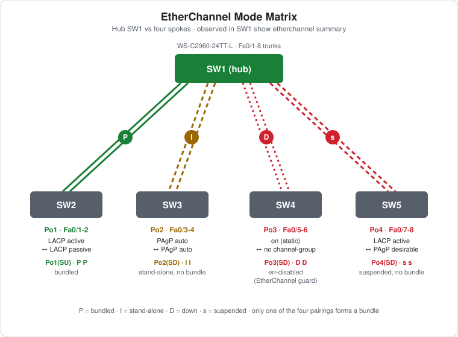

# CCNA Lab 10: EtherChannel Mode Matrix

A hands-on "predict, then check" lab built in the **PingMyNetwork Sandbox**. A hub switch (SW1) connects to four spoke switches with two links each. Each pair of links uses a **different EtherChannel mode combination**, and only one of them is valid. One `show etherchannel summary` on SW1 shows all four outcomes side by side: bundled, stand-alone, err-disabled and suspended.

The goal is to **learn the mode compatibility rules by seeing every failure mode once**, and to learn the flag that goes with each one. It builds on the mode challenges in [Lab 04](../lab-04-etherchannel/) and the troubleshooting in [Lab 07](../lab-07-etherchannel-troubleshooting/).

> **Lab status:** The configs in [`configs/`](configs/) and the results below come from the exported Sandbox JSON in [`lab-files/`](lab-files/). That export includes the saved configuration of every switch and the console output of the session. Results marked **observed** are copied from that output.

## Learning objectives

- Predict whether each LACP, PAgP and static mode pairing forms a bundle.
- Read every `show etherchannel summary` port flag you're likely to meet: `P`, `I`, `D`, `s`.
- Explain why `auto`/`auto` and `passive`/`passive` never negotiate.
- Explain why LACP and PAgP can't form a bundle together.
- See **EtherChannel guard** err-disable a static (`on`) bundle when the other side isn't bundling.
- Recover an err-disabled port-channel.

## Topology



```text
                              SW1 (hub)
       Fa0/1-2 //    Fa0/3-4 //      \\ Fa0/5-6     \\ Fa0/7-8
         Po1  //       Po2  //        \\  Po3        \\  Po4
             //            //          \\             \\
          SW2           SW3            SW4             SW5
     LACP passive    PAgP auto    (no channel)   PAgP desirable
```

| Device | Role | Model |
|---|---|---|
| SW1 | Hub: one port-channel to each spoke | Cisco WS-C2960-24TT-L (IOS 15.2) |
| SW2–SW5 | Spokes: each with Fa0/1-2 to SW1 | Cisco WS-C2960-24TT-L (IOS 15.2) |

There are no hosts or VLANs in this lab. All links are 802.1Q trunks (`switchport mode trunk` on both ends) with only VLAN 1 present.

## Full configuration commands

These are the **exact commands typed in the Sandbox session**, copied from the console history in the export, in the order they were entered (including the `show` commands used to verify). Typing them on factory-default devices reproduces the lab. The four pairings are broken on purpose. The fixes are under [Fixing each one](#fixing-each-one).

How to read the blocks:

- Lines starting with `!` explain the command below them. Don't type them.
- The prompt (`SW1(config-if-range)#`) shows which mode you're in. Type only the text after `#` or `>`.
- Abbreviations such as `conf t` and `f0/1-2` are accepted by IOS, the same as `configure terminal` and `FastEthernet0/1 - 2`.

### SW1 (WS-C2960-24TT-L)

```text
! Enter privileged EXEC mode
SW1>enable
! Enter global configuration mode
SW1#conf t
! Select f0/1-8 and configure them together
SW1(config)#interface range f0/1-8
! Make it an 802.1Q trunk
SW1(config-if-range)#switchport mode trunk
SW1(config-if-range)#exit
! Select f0/1-2 and configure them together
SW1(config)#interface range f0/1-2
! Join Po1; LACP active: start LACP negotiation
SW1(config-if-range)#channel-group 1 mode active
SW1(config-if-range)#exit
! Select f0/3-4 and configure them together
SW1(config)#interface range f0/3-4
! Join Po2; PAgP auto: answer PAgP but never start it
SW1(config-if-range)#channel-group 2 mode auto
SW1(config-if-range)#exit
! Select f0/5-6 and configure them together
SW1(config)#interface range f0/5-6
! Join Po3; static, no negotiation (the far end must also be "on")
SW1(config-if-range)#channel-group 3 mode on
SW1(config-if-range)#exit
! Select f0/7-8 and configure them together
SW1(config)#interface range f0/7-8
! Join Po4; LACP active: start LACP negotiation
SW1(config-if-range)#channel-group 4 mode active
SW1(config-if-range)#end
! Save the running config to NVRAM
SW1#write memory
! Verify: port-channel state (SU/SD) and member flags (P, s, I, D, H)
SW1#show etherchannel summary | begin Group
! Verify: link state of each port (connected, err-disabled, suspended)
SW1#show interfaces status | include Fa0/[1-8]
```

### SW2 (WS-C2960-24TT-L)

```text
! Enter privileged EXEC mode
SW2>enable
! Enter global configuration mode
SW2#conf t
! Select f0/1-2 and configure them together
SW2(config)#interface range f0/1-2
! Make it an 802.1Q trunk
SW2(config-if-range)#switchport mode trunk
! Join Po1; LACP passive: answer LACP but never start it
SW2(config-if-range)#channel-group 1 mode passive
SW2(config-if-range)#end
! Save the running config to NVRAM
SW2#write memory
```

### SW3 (WS-C2960-24TT-L)

```text
! Enter privileged EXEC mode
SW3>enable
! Enter global configuration mode
SW3#conf t
! Select f0/1-2 and configure them together
SW3(config)#interface range f0/1-2
! Make it an 802.1Q trunk
SW3(config-if-range)#switchport mode trunk
! Join Po1; PAgP auto: answer PAgP but never start it
SW3(config-if-range)#channel-group 1 mode auto
SW3(config-if-range)#end
! Save the running config to NVRAM
SW3#write memory
```

### SW4 (WS-C2960-24TT-L)

```text
! Enter privileged EXEC mode
SW4>enable
! Enter global configuration mode
SW4#conf t
! Select f0/1-2 and configure them together
SW4(config)#interface range f0/1-2
! Make it an 802.1Q trunk
SW4(config-if-range)#switchport mode trunk
SW4(config-if-range)#end
! Save the running config to NVRAM
SW4#write memory
```

### SW5 (WS-C2960-24TT-L)

```text
! Enter privileged EXEC mode
SW5>enable
! Enter global configuration mode
SW5#conf t
! Select f0/1-2 and configure them together
SW5(config)#interface range f0/1-2
! Make it an 802.1Q trunk
SW5(config-if-range)#switchport mode trunk
! Join Po1; PAgP desirable: start PAgP negotiation
SW5(config-if-range)#channel-group 1 mode desirable
SW5(config-if-range)#end
! Save the running config to NVRAM
SW5#write memory
```

## The matrix

| Bundle | SW1 ports | SW1 mode | Spoke | Spoke mode | Predict first, then check below |
|---|---|---|---|---|---|
| Po1 | Fa0/1-2 | LACP `active` | SW2 | LACP `passive` | ? |
| Po2 | Fa0/3-4 | PAgP `auto` | SW3 | PAgP `auto` | ? |
| Po3 | Fa0/5-6 | `on` (static) | SW4 | no `channel-group` | ? |
| Po4 | Fa0/7-8 | LACP `active` | SW5 | PAgP `desirable` | ? |

<details>
<summary><strong>Show the results</strong></summary>

### Observed on SW1

```text
SW1#show etherchannel summary | begin Group
Group  Port-channel  Protocol    Ports
------+-------------+-----------+-----------------------------------------------
1      Po1(SU)         LACP      Fa0/1(P)    Fa0/2(P)
2      Po2(SD)         PAgP      Fa0/3(I)    Fa0/4(I)
3      Po3(SD)          -        Fa0/5(D)    Fa0/6(D)
4      Po4(SD)         LACP      Fa0/7(s)    Fa0/8(s)
```

```text
SW1#show interfaces status | include Fa0/[1-8]
Fa0/1      connected    trunk   a-full  a-100 10/100BaseTX
Fa0/2      connected    trunk   a-full  a-100 10/100BaseTX
Fa0/3      connected    trunk   a-full  a-100 10/100BaseTX
Fa0/4      connected    trunk   a-full  a-100 10/100BaseTX
Fa0/5      err-disabled 1         auto   auto 10/100BaseTX
Fa0/6      err-disabled 1         auto   auto 10/100BaseTX
Fa0/7      suspended    trunk   a-full  a-100 10/100BaseTX
Fa0/8      suspended    trunk   a-full  a-100 10/100BaseTX
```

| Bundle | Pairing | Result | Flag | Why |
|---|---|---|---|---|
| Po1 | `active` ↔ `passive` | **Bundled** `Po1(SU)` | `P` | SW1 starts LACP and SW2 answers. One active side is enough. |
| Po2 | `auto` ↔ `auto` | **No bundle** `Po2(SD)` | `I` stand-alone | `auto` only answers PAgP and never starts it. Neither side asks, so the ports run as two separate trunks. |
| Po3 | `on` ↔ none | **Err-disabled** `Po3(SD)` | `D` down | `on` forces a bundle with no negotiation. SW4 treats its two links as separate ports, so EtherChannel guard on SW1 detects the misconfiguration and err-disables the bundle to prevent a loop. |
| Po4 | LACP `active` ↔ PAgP `desirable` | **No bundle** `Po4(SD)` | `s` suspended | LACP and PAgP are different protocols. SW1 never receives an LACPDU (`LACP currently not enabled on the remote port`), so its members are suspended. |

</details>

## Key log messages (observed)

```text
! Po3 – EtherChannel guard, seconds after SW1 was configured
%PM-4-ERR_DISABLE: channel-misconfig (STP) error detected on Po3, putting Fa0/5 in err-disable state
%PM-4-ERR_DISABLE: channel-misconfig (STP) error detected on Po3, putting Fa0/6 in err-disable state
%PM-4-ERR_DISABLE: channel-misconfig (STP) error detected on Po3, putting Po3 in err-disable state
!
! Po1 / Po4 – LACP members waiting for a partner
%EC-5-L3DONTBNDL2: Fa0/1 suspended: LACP currently not enabled on the remote port.
%EC-5-L3DONTBNDL2: Fa0/7 suspended: LACP currently not enabled on the remote port.
!
! Po1 – recovers as soon as SW2 is set to passive
%LINK-3-UPDOWN: Interface Port-channel1, changed state to up
```

SW4 saw its own Fa0/1 and Fa0/2 go down when SW1 err-disabled the far end. SW4 itself never logged an error.

## The rules

| | `active` | `passive` | `desirable` | `auto` | `on` |
|---|---|---|---|---|---|
| **`active`** (LACP) | ✅ | ✅ | ❌ | ❌ | ❌ |
| **`passive`** (LACP) | ✅ | ❌ | ❌ | ❌ | ❌ |
| **`desirable`** (PAgP) | ❌ | ❌ | ✅ | ✅ | ❌ |
| **`auto`** (PAgP) | ❌ | ❌ | ✅ | ❌ | ❌ |
| **`on`** (static) | ❌ | ❌ | ❌ | ❌ | ✅ |

- **One side must start negotiation:** `active` for LACP, `desirable` for PAgP.
- **Don't mix the protocols.** LACP only bundles with LACP, and PAgP only with PAgP.
- **`on` only bundles with `on`.** Paired with anything else, including no channel-group at all, it causes the error shown on Po3.

## Port flags

| Flag | Meaning | Seen on |
|---|---|---|
| `P` | Bundled in the port-channel | Po1 |
| `I` | Stand-alone: forwarding as an individual port, not bundled | Po2 |
| `D` | Down (here, err-disabled) | Po3 |
| `s` | Suspended: not bundled and not forwarding | Po4 |
| `SU` / `SD` | Port-channel is Layer 2, Up / Down | Po1 / Po2–Po4 |

`I` and `s` are both "not bundled" but behave differently. **Stand-alone** PAgP ports still forward as normal individual trunks (Fa0/3-4 show `connected trunk`), so STP has to block one of them. **Suspended** LACP ports don't forward at all (Fa0/7-8 show `suspended`).

## Fixing each one

```cisco
! Po2 – make one side desirable (on SW1 or SW3)
interface range FastEthernet0/3 - 4
 channel-group 2 mode desirable
!
! Po3 – give SW4 a matching static bundle, then clear the err-disable on SW1
SW4(config)# interface range FastEthernet0/1 - 2
SW4(config-if-range)# channel-group 1 mode on
SW1(config)# interface port-channel 3
SW1(config-if)# shutdown
SW1(config-if)# no shutdown
!
! Po4 – use one protocol on both ends, e.g. LACP on SW5
interface range FastEthernet0/1 - 2
 channel-group 1 mode active
```

To bring err-disabled ports back automatically, you can set `errdisable recovery cause channel-misconfig` and `errdisable recovery interval 30`. Fixing the cause is still the real solution.

## About the timing

SW1's `show` commands aren't timestamped. The logs place them after Po1 came up (20:59:52) and after SW3 was configured (20:59:46). SW4 (21:00:02) and SW5 (21:00:05) may have been configured slightly later. That doesn't change the outcome for Po3 or Po4:

- **Po3:** SW4 never got a `channel-group`, only `switchport mode trunk`.
- **Po4:** a PAgP spoke still never sends LACP.

Run `show etherchannel summary` again after loading the lab to confirm.

## Try it yourself: guided challenges

1. **Predict first.** Cover the results and fill in the matrix table yourself before you load the lab.
2. **Fix all four.** Apply the fixes above and get four `SU` port-channels with every member `P`.
3. **Fill the whole matrix.** Use one spoke to try every row of the rules table and record the flags you see.
4. **Watch STP on Po2.** While Po2 is stand-alone, run `show spanning-tree vlan 1` on SW1 and SW3. One of Fa0/3 or Fa0/4 should be blocking. Then fix Po2 and check again.
5. **Disable the guard.** Set `no spanning-tree etherchannel guard misconfig` on SW1 and recreate the Po3 fault. What happens instead? Why is the guard on by default?
6. **PAgP neighbours.** Fix Po2 and Po4 with PAgP, then compare `show pagp neighbor` and `show lacp neighbor`.

## Scope and caveats

- This is a **CCNA-oriented** lab. The point is the mode rules and the `show etherchannel summary` flags.
- The saved configs keep the four pairings broken on purpose. Import the JSON to reproduce them, then fix them.
- There are no hosts and no VLANs except VLAN 1, so nothing tests data forwarding across the bundles.
- No switch has a management IP, passwords or an SSH user. Unused ports aren't shut down, and `ip http server` is on by default.

## Useful verification commands

```cisco
show etherchannel summary
show etherchannel port-channel
show interfaces status
show interfaces status err-disabled
show lacp neighbor
show pagp neighbor
show spanning-tree vlan 1
show errdisable recovery
```

## Lab files

| File | Description |
|---|---|
| [`lab-files/etherchannel-mode-matrix-lab.json`](lab-files/etherchannel-mode-matrix-lab.json) | PingMyNetwork Sandbox export with saved configs. Import it into the Sandbox to load the full lab. |
| [`configs/SW1-running-config.txt`](configs/SW1-running-config.txt) | SW1 saved configuration (hub: Po1 active, Po2 auto, Po3 on, Po4 active) |
| [`configs/SW2-running-config.txt`](configs/SW2-running-config.txt) | SW2 saved configuration (LACP passive) |
| [`configs/SW3-running-config.txt`](configs/SW3-running-config.txt) | SW3 saved configuration (PAgP auto) |
| [`configs/SW4-running-config.txt`](configs/SW4-running-config.txt) | SW4 saved configuration (trunks, no channel-group) |
| [`configs/SW5-running-config.txt`](configs/SW5-running-config.txt) | SW5 saved configuration (PAgP desirable) |
| [`images/topology.svg`](images/topology.svg) | Topology diagram with each bundle's result |

**Built with:** [PingMyNetwork Sandbox](https://pingmynetwork.com/sandbox)
