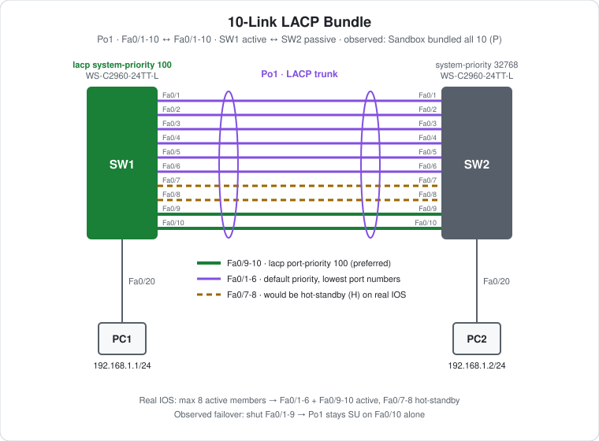

# CCNA Lab 11: 10-Link LACP Bundle

A hands-on lab built in the **PingMyNetwork Sandbox** that pushes an EtherChannel past its member limit. Two Cisco Catalyst 2960 switches are joined by **ten** FastEthernet links in one LACP port-channel. Real Cisco IOS allows at most **8 active members**, with up to 8 more as hot-standby. LACP **system priority** and **port priority** decide which 8 are active. The lab then shuts nine of the ten links to show the bundle surviving on a single member.

The goal is to practise **LACP member selection (system priority, port priority, port number), hot-standby ports and member-level failover**.

> **Lab status:** The configs in [`configs/`](configs/) and the results below come from the exported Sandbox JSON in [`lab-files/`](lab-files/). That export includes the saved configuration of both switches and the console output of the session. Results marked **observed** are copied from that output.
>
> **Simulator difference:** The Sandbox bundled **all 10** members as `P`. On real IOS, two of them would be hot-standby (`H`). This README shows both: what the Sandbox did, and what real hardware is expected to do.

## Learning objectives

- Build a large LACP bundle with `interface range`.
- Know the LACP limits: 16 members per port-channel, at most 8 active at a time.
- Explain how LACP **system priority** decides which switch chooses the active members.
- Use LACP **port priority** to prefer specific links, with port number as the tiebreaker.
- Identify hot-standby (`H`) members and when they take over.
- Show that a bundle stays up as long as one member is left.

## Topology



```text
        lacp system-priority 100
   SW1 Fa0/1  ================================ Fa0/1  SW2
       Fa0/2  ================================ Fa0/2
        ...        Po1 · LACP trunk · 10 links  ...
       Fa0/9  ==== port-priority 100 ========= Fa0/9
       Fa0/10 ==== port-priority 100 ========= Fa0/10
       Fa0/20                                  Fa0/20
         |                                       |
        PC1 192.168.1.1/24                      PC2 192.168.1.2/24
```

| Device | Role | Model |
|---|---|---|
| SW1 | LACP `active`, system priority 100 | Cisco WS-C2960-24TT-L (IOS 15.2) |
| SW2 | LACP `passive`, default system priority | Cisco WS-C2960-24TT-L (IOS 15.2) |
| PC1, PC2 | End hosts | PC |

## Addressing plan

| Host | Switch port | VLAN | IP address | Subnet mask |
|---|---|---|---|---|
| PC1 | SW1 Fa0/20 | 1 | `192.168.1.1` | `255.255.255.0` |
| PC2 | SW2 Fa0/20 | 1 | `192.168.1.2` | `255.255.255.0` |

The PC ports are left unconfigured (the default, VLAN 1). The only path between the PCs is Po1.

## Configuration highlights

These excerpts are from the saved configs. The full configs are in [`configs/`](configs/).

### SW1: active side and LACP priorities

```cisco
lacp system-priority 100
!
interface range FastEthernet0/1 - 10
 switchport mode trunk
 channel-group 1 mode active
!
interface range FastEthernet0/9 - 10
 lacp port-priority 100
```

### SW2: passive side

```cisco
interface range FastEthernet0/1 - 10
 switchport mode trunk
 channel-group 1 mode passive
```

## How LACP picks the active members (real IOS)

When more members are configured than can be active, LACP decides in two steps.

1. **Which switch decides?** The switch with the **lower system priority** (then lower MAC address) controls the selection. SW1 has `lacp system-priority 100` and SW2 has the default 32768, so **SW1's port priorities are the ones used**.
2. **Which ports win?** On the deciding switch, members are ranked by **port priority** (lower wins, default 32768), then by **port number** (lower wins). The top 8 become active and the rest go to hot-standby.

| Rank | SW1 port | Port priority | Expected state on real IOS |
|---|---|---|---|
| 1–2 | Fa0/9, Fa0/10 | **100** | Active (`P`) |
| 3–8 | Fa0/1 – Fa0/6 | 32768 | Active (`P`) |
| 9–10 | Fa0/7, Fa0/8 | 32768 | **Hot-standby (`H`)** |

Without the priority commands, Fa0/1-8 would be active and Fa0/9-10 hot-standby. The two priority settings move Fa0/9-10 into the active set and push Fa0/7-8 out.

If an active member fails, the best-ranked hot-standby member takes its place. On real hardware, `lacp max-bundle <n>` on the port-channel can set a lower limit than 8.

## Results (observed)

### 1. Before SW2 was configured

```text
SW1#show etherchannel summary | begin Group
1      Po1(SD)         LACP      Fa0/1(s)  Fa0/2(s)  Fa0/3(s)  Fa0/4(s)  Fa0/5(s)
                                 Fa0/6(s)  Fa0/7(s)  Fa0/8(s)  Fa0/9(s)  Fa0/10(s)
```

All ten members were suspended, with `LACP currently not enabled on the remote port`.

### 2. Bundle up

```text
SW1#show etherchannel summary | begin Group
1      Po1(SU)         LACP      Fa0/1(P)  Fa0/2(P)  Fa0/3(P)  Fa0/4(P)  Fa0/5(P)
                                 Fa0/6(P)  Fa0/7(P)  Fa0/8(P)  Fa0/9(P)  Fa0/10(P)
```

Po1 came up at 21:04:41, about 16 seconds after SW2 was set to `passive`. **The Sandbox bundled all 10 members.** On real IOS, Fa0/7 and Fa0/8 would show `(H)` here.

### 3. Shut nine members: `interface range f0/1-9` → `shutdown`

```text
SW1#show etherchannel summary | begin Group
1      Po1(SU)         LACP      Fa0/1(D)  Fa0/2(D)  Fa0/3(D)  Fa0/4(D)  Fa0/5(D)
                                 Fa0/6(D)  Fa0/7(D)  Fa0/8(D)  Fa0/9(D)  Fa0/10(P)
```

**Po1 stayed `SU` on Fa0/10 alone.** SW2 saw its Fa0/1-9 go down but logged no Port-channel1 change, so the logical link never dropped.

### 4. Restore: `no shutdown`

All ten members returned to `(P)` and Po1 stayed `SU` throughout.

### Ping

PC2 → `ping 192.168.1.1` got **4/4 replies** with `TTL=128` (switched, no routing hop). The export doesn't timestamp PC pings, so it doesn't show whether this ran during step 3, with only one link up.

## Verification results

| Check | Command/test | Result |
|---|---|---|
| Partial build | SW1 `show etherchannel summary` | **Observed:** `Po1(SD)`, all members `(s)` |
| Bundle | SW1 `show etherchannel summary` | **Observed:** `Po1(SU)`, all 10 members `(P)` (Sandbox) |
| Real IOS | `show etherchannel summary` | Expected: 8 × `(P)` (Fa0/1-6, 9, 10), 2 × `(H)` (Fa0/7-8) |
| One-link survival | Shut Fa0/1-9 on SW1 | **Observed:** `Po1(SU)`, Fa0/10 `(P)`, the rest `(D)` |
| Recovery | `no shutdown` Fa0/1-9 | **Observed:** all 10 `(P)` again |
| Ping | PC2 → `ping 192.168.1.1` | **Observed:** 4/4 replies, `TTL=128` |
| LACP detail | `show lacp internal` / `show lacp sys-id` | Expected: port priority 100 on Fa0/9-10, system priority 100 on SW1 |

## Try it yourself: guided challenges

1. **Predict the hot-standby ports.** Before reading the table above, work out which two members real IOS would put in hot-standby, and why.
2. **Hand control to SW2.** Remove `lacp system-priority 100` from SW1 and set `lacp system-priority 50` on SW2. Whose port priorities count now, and which ports would be standby?
3. **Limit the bundle.** Try `lacp max-bundle 4` on `Port-channel1`. Does the Sandbox accept it? On real IOS, which four members stay active?
4. **Shut an active member.** On real IOS, shutting Fa0/9 should move one hot-standby member (Fa0/7) to active. Which one, and why?
5. **Continuous ping.** Run `ping -t 192.168.1.2` on PC1 while you shut Fa0/1-9. Are any replies lost?
6. **Bandwidth.** Compare `show interfaces port-channel 1` (BW) with all members up and with one member up.

## Scope and caveats

- This is a **CCNA-oriented** lab focused on LACP member selection and failover.
- **The Sandbox doesn't enforce the 8-active-member limit.** Treat the `(H)` results in this README as expected real-IOS behaviour, not observed results.
- The 2960 supports up to 16 ports per LACP channel (8 active + 8 hot-standby). PAgP and static (`on`) channels are limited to 8 ports with no hot-standby.
- SW1's running config differs from its saved one only in the "last configuration change" timestamp. Fa0/1-9 were shut and re-enabled, so the end state matches.
- No switch has a management IP, passwords or an SSH user. Unused ports aren't shut down, and `ip http server` is on by default.

## Useful verification commands

```cisco
show etherchannel summary
show etherchannel port-channel
show lacp internal
show lacp neighbor
show lacp sys-id
show interfaces port-channel 1
```

## Lab files

| File | Description |
|---|---|
| [`lab-files/etherchannel-10-link-bundle-lab.json`](lab-files/etherchannel-10-link-bundle-lab.json) | PingMyNetwork Sandbox export with saved configs. Import it into the Sandbox to load the full lab. |
| [`configs/SW1-running-config.txt`](configs/SW1-running-config.txt) | SW1 saved configuration (LACP active, system priority 100, Fa0/9-10 port priority 100) |
| [`configs/SW2-running-config.txt`](configs/SW2-running-config.txt) | SW2 saved configuration (LACP passive) |
| [`images/topology.svg`](images/topology.svg) | Topology diagram |

**Built with:** [PingMyNetwork Sandbox](https://pingmynetwork.com/sandbox)
