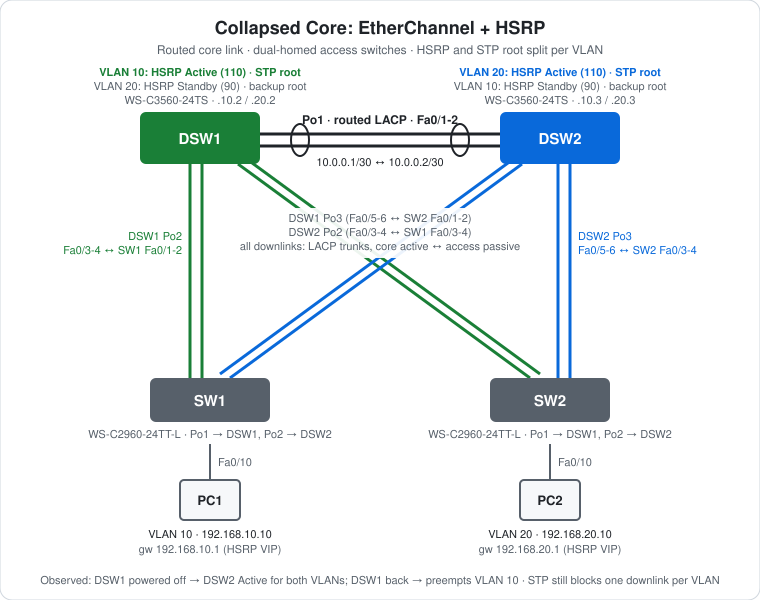

# CCNA Lab 12: Collapsed Core with EtherChannel and HSRP

A production-style lab built in the **PingMyNetwork Sandbox**. Two Cisco Catalyst 3560 core switches (DSW1, DSW2) share a **routed LACP port-channel**. Two 2960 access switches are each **dual-homed** to both cores with LACP trunk bundles. Both cores route for VLANs 10 and 20, and **HSRP** gives each VLAN one virtual gateway that survives losing a core. HSRP Active and the STP root are aligned per VLAN: DSW1 owns VLAN 10 and DSW2 owns VLAN 20, so the load is shared across the two cores.

The goal is to bring together everything from the earlier labs (EtherChannel, trunking, SVIs, STP root placement) and add **first-hop redundancy**. Then you power off a core and watch the gateway fail over and preempt back.

> **Lab status:** The configs in [`configs/`](configs/) and the results below come from the exported Sandbox JSON in [`lab-files/`](lab-files/). That export includes the saved configuration of every switch and the console output of the session. Results marked **observed** are copied from that output. DSW1 was power-cycled during the failover test, which cleared its console, so its commands below are rebuilt from its saved config.

## Learning objectives

- Build a routed core link (Layer 3 EtherChannel) and Layer 2 dual-homed access bundles on the same switch.
- Configure HSRP: virtual IP, priority and preempt.
- Split HSRP Active and the STP root per VLAN to share load across both cores.
- Explain why the HSRP Active router and the STP root should be the same switch.
- Fail a core switch, watch the standby take over, then watch preempt return the role.
- Explain why a dual-homed access layer with VLANs on both cores still needs STP.

## Topology



```text
     VLAN 10 Active / root                         VLAN 20 Active / root
              DSW1 ============ Po1 routed ============ DSW2
               |  \            10.0.0.0/30            /  |
           Po2 |   \ Po3                         Po2 /   | Po3
               |    \                               /    |
               |     `----------------.  .---------'     |
               |                       \/                |
               |     .----------------'  `---------.     |
               |    /                               \    |
           Po1 |   / Po2                         Po1 \   | Po2
              SW1                                       SW2
             Fa0/10                                    Fa0/10
               |                                         |
              PC1  VLAN 10  192.168.10.10               PC2  VLAN 20  192.168.20.10

Labels at the top are the core's port-channel numbers; labels at the bottom are the access switch's.
SW1: Po1 -> DSW1, Po2 -> DSW2        SW2: Po1 -> DSW1, Po2 -> DSW2
```

| Device | Role | Model |
|---|---|---|
| DSW1 | Core: HSRP Active and STP root for VLAN 10, standby for VLAN 20 | Cisco WS-C3560-24TS (IOS 15.2) |
| DSW2 | Core: HSRP Active and STP root for VLAN 20, standby for VLAN 10 | Cisco WS-C3560-24TS (IOS 15.2) |
| SW1 | Access switch for PC1 (VLAN 10), dual-homed | Cisco WS-C2960-24TT-L (IOS 15.2) |
| SW2 | Access switch for PC2 (VLAN 20), dual-homed | Cisco WS-C2960-24TT-L (IOS 15.2) |
| PC1, PC2 | End hosts | PC |

## Addressing plan

### Links

| Bundle | Side A | Side B | Type | LACP modes |
|---|---|---|---|---|
| Po1 (core) | DSW1 Fa0/1-2 | DSW2 Fa0/1-2 | **Routed**, `10.0.0.1/30` ↔ `10.0.0.2/30` | DSW1 `active` ↔ DSW2 `passive` |
| DSW1 Po2 / SW1 Po1 | DSW1 Fa0/3-4 | SW1 Fa0/1-2 | 802.1Q trunk | DSW1 `active` ↔ SW1 `passive` |
| DSW1 Po3 / SW2 Po1 | DSW1 Fa0/5-6 | SW2 Fa0/1-2 | 802.1Q trunk | DSW1 `active` ↔ SW2 `passive` |
| DSW2 Po2 / SW1 Po2 | DSW2 Fa0/3-4 | SW1 Fa0/3-4 | 802.1Q trunk | DSW2 `active` ↔ SW1 `passive` |
| DSW2 Po3 / SW2 Po2 | DSW2 Fa0/5-6 | SW2 Fa0/3-4 | 802.1Q trunk | DSW2 `active` ↔ SW2 `passive` |

### Gateways (HSRP)

| VLAN | Subnet | DSW1 SVI | DSW2 SVI | HSRP group | Virtual IP | DSW1 priority | DSW2 priority |
|---|---|---|---|---|---|---|---|
| 10 | `192.168.10.0/24` | `.2` | `.3` | 10 | **`192.168.10.1`** | **110** | 90 |
| 20 | `192.168.20.0/24` | `.2` | `.3` | 20 | **`192.168.20.1`** | 90 | **110** |

Both groups use `preempt` on both switches.

### STP priorities

| VLAN | DSW1 | DSW2 | SW1 / SW2 |
|---|---|---|---|
| 10 | **24576** (root) | 28672 | 32768 |
| 20 | 28672 | **24576** (root) | 32768 |

### Hosts

| Host | Switch port | VLAN | IP address | Subnet mask | Default gateway |
|---|---|---|---|---|---|
| PC1 | SW1 Fa0/10 | 10 | `192.168.10.10` | `255.255.255.0` | `192.168.10.1` (VIP) |
| PC2 | SW2 Fa0/10 | 20 | `192.168.20.10` | `255.255.255.0` | `192.168.20.1` (VIP) |

## Configuration highlights

These excerpts are from the saved configs. The full configs are in [`configs/`](configs/).

### 1. Routed core link (DSW1, DSW2 mirrors with `.2` and `passive`)

```cisco
ip routing
!
interface range FastEthernet0/1 - 2
 no switchport
 channel-group 1 mode active
!
interface Port-channel1
 no switchport
 ip address 10.0.0.1 255.255.255.252
```

### 2. Dual-homed LACP trunks to the access layer (DSW1)

```cisco
interface range FastEthernet0/3 - 6
 switchport trunk encapsulation dot1q
 switchport mode trunk
!
interface range FastEthernet0/3 - 4
 channel-group 2 mode active        ! to SW1
!
interface range FastEthernet0/5 - 6
 channel-group 3 mode active        ! to SW2
```

SW1 and SW2 use `channel-group 1 mode passive` toward DSW1 (Fa0/1-2) and `channel-group 2 mode passive` toward DSW2 (Fa0/3-4).

### 3. HSRP (DSW1; DSW2 swaps the priorities and uses `.3`)

```cisco
interface Vlan10
 ip address 192.168.10.2 255.255.255.0
 standby 10 ip 192.168.10.1
 standby 10 priority 110
 standby 10 preempt
!
interface Vlan20
 ip address 192.168.20.2 255.255.255.0
 standby 20 ip 192.168.20.1
 standby 20 priority 90
 standby 20 preempt
```

- **`standby <grp> ip`** is the virtual gateway the PCs use. It's never a real interface address.
- **Priority** decides which switch is Active. The default is 100 and higher wins. With 110 vs 90, the roles are deterministic.
- **`preempt`** lets a higher-priority switch take Active back when it recovers. Without it, the switch that took over stays Active.

### 4. STP root aligned with HSRP

```cisco
! DSW1
spanning-tree vlan 10 priority 24576
spanning-tree vlan 20 priority 28672
! DSW2 (typed as "root primary" / "root secondary")
spanning-tree vlan 20 priority 24576
spanning-tree vlan 10 priority 28672
```

If the STP root and HSRP Active for a VLAN were on different cores, traffic from the access switch would go to the root first and then cross to the Active gateway. Keeping them on the same switch gives the shortest Layer 2 path to the gateway.

## Spanning tree: why there's still a blocked port

The DSW1–DSW2 link is **routed**, so it doesn't carry VLAN 10 or 20. But each access switch is trunked to **both** cores, and both cores carry both VLANs. That makes a Layer 2 loop in each VLAN:

```text
SW1 ── DSW1 ── SW2 ── DSW2 ── SW1
```

Rapid-PVST+ breaks it per VLAN. In VLAN 10, the root is DSW1:

- **SW1 and SW2:** each has its root port on its bundle to DSW1 (cost 12).
- **DSW2:** reaches the root through an access switch at cost 24. One downlink becomes its root port, and the other downlink becomes **Alternate (blocking)**. The access switch's end of that segment has the lower cost (12), so it's designated.

VLAN 20 mirrors this: DSW1 blocks one of its downlinks. Which downlink depends on the access switches' MAC addresses (both use priority 32768).

The export doesn't include `show spanning-tree` output, so this is the **expected** result. Check it with `show spanning-tree vlan 10` on DSW2 and `show spanning-tree vlan 20` on DSW1. It isn't a problem: each core still reaches its non-root VLAN, and each access switch forwards on both uplinks, just in different VLANs.

HSRP hellos also travel through the access switches, because the core link is routed and isn't in VLAN 10 or 20. That's how DSW1 and DSW2 see each other in each VLAN.

## HSRP and failover results (observed)

| Time (UTC) | Event | Source |
|---|---|---|
| 21:15:34 | DSW2 `Vlan20 Grp 20 state Speak -> Standby`, then `Standby -> Active` | DSW2 log |
| 21:15:45 | DSW2 `Vlan10 Grp 10 state Speak -> Standby` (DSW1 is Active for VLAN 10) | DSW2 log |
| 21:16:46 | **DSW1 powered off.** DSW2 Po1 and both access switches' Po1 go down | DSW2, SW1, SW2 logs |
| 21:16:54 | DSW2 `Vlan10 Grp 10 state Standby -> Active`: **takeover about 8 s later**, within the 10 s hold time | DSW2 log |
| after | `show standby brief`: Vl10 Active local, Vl20 Active local, standby `unknown` for both | DSW2 |
| 21:17:53 | **DSW1 powered back on.** All its links and bundles come up, and it loads its saved config | DSW1 log |
| 21:17:57 | DSW1 `Vlan10 Grp 10 state Listen -> Active` (**preempt**), DSW2 `Vlan10 Active -> Speak` | DSW1, DSW2 logs |
| 21:18:07 | DSW2 `Vlan10 Grp 10 state Speak -> Standby` | DSW2 log |
| 21:18:14 | DSW1 `Vlan20 Grp 20 state Speak -> Standby` | DSW1 log |

`show standby brief` on DSW2, while DSW1 was off:

```text
Interface   Grp  Pri P State   Active          Standby         Virtual IP
Vl10        10   90  P Active  local           unknown         192.168.10.1
Vl20        20   110 P Active  local           unknown         192.168.20.1
```

After DSW1 came back and preempted:

```text
Interface   Grp  Pri P State   Active          Standby         Virtual IP
Vl10        10   90  P Standby 192.168.10.2    local           192.168.10.1
Vl20        20   110 P Active  local           unknown         192.168.20.1
```

The VLAN 20 standby is still `unknown` in this capture. It was taken a few seconds before DSW1 logged `Vlan20 … -> Standby` (21:18:14).

## Verification results

| Check | Command/test | Result |
|---|---|---|
| Bundles | DSW2, SW1, SW2 logs | **Observed:** Po1, Po2, Po3 up on DSW2; Po1, Po2 up on SW1 and SW2 |
| HSRP roles | DSW2 `show standby brief` | **Observed:** VLAN 10 Standby (Active 192.168.10.2), VLAN 20 Active |
| Gateway failover | Power off DSW1 | **Observed:** DSW2 Active for VLAN 10 about 8 s later |
| Preempt | Power DSW1 back on | **Observed:** DSW1 Active for VLAN 10 again, DSW2 back to Standby |
| Inter-VLAN ping | PC2 → `ping 192.168.10.10` | **Observed:** 4/4 replies twice, `TTL=128 − 1 = 127` (one routed hop) |
| STP | `show spanning-tree vlan 10` on DSW2 | Expected: one downlink Root, the other Altn BLK |
| Core link | `ping 10.0.0.2` from DSW1 | Expected: success over routed Po1 |

PC2's two pings both succeeded, but the export doesn't timestamp PC pings, so it doesn't show whether one ran while DSW1 was off.

## Full configuration commands

DSW2, SW1 and SW2 below are the **exact commands typed in the Sandbox session**, copied from the console history in the export. That includes the `show standby brief` checks DSW2 ran during the failover. **DSW1's console was cleared when it was power-cycled**, so its commands are rebuilt from its saved config (its STP priorities may originally have been typed as `root primary`/`root secondary`, like DSW2's). Typing these on factory-default devices reproduces the lab.

How to read the blocks:

- Lines starting with `!` explain the command below them. Don't type them.
- The prompt (`SW1(config-if-range)#`) shows which mode you're in. Type only the text after `#` or `>`.
- Abbreviations such as `conf t` and `f0/1-2` are accepted by IOS, the same as `configure terminal` and `FastEthernet0/1 - 2`.

### DSW1 (WS-C3560-24TS) – rebuilt from saved config

```text
! Enter privileged EXEC mode
DSW1>enable
! Enter global configuration mode
DSW1#conf t
! Turn on IPv4 routing (needed on a multilayer switch)
DSW1(config)#ip routing
! Create VLAN 10 (and enter VLAN config mode)
DSW1(config)#vlan 10
! Create VLAN 20 (and enter VLAN config mode)
DSW1(config-vlan)#vlan 20
DSW1(config-vlan)#exit
! Select f0/1-2 and configure them together
DSW1(config)#interface range f0/1-2
! Make it a routed (Layer 3) port
DSW1(config-if-range)#no switchport
! Join Po1; LACP active: start LACP negotiation
DSW1(config-if-range)#channel-group 1 mode active
DSW1(config-if-range)#exit
! Configure the logical Port-channel1 interface
DSW1(config)#interface port-channel 1
! Make it a routed (Layer 3) port
DSW1(config-if)#no switchport
! Assign 10.0.0.1 / 255.255.255.252
DSW1(config-if)#ip address 10.0.0.1 255.255.255.252
DSW1(config-if)#exit
! Select f0/3-6 and configure them together
DSW1(config)#interface range f0/3-6
! 3560 only: choose 802.1Q before trunking
DSW1(config-if-range)#switchport trunk encapsulation dot1q
! Make it an 802.1Q trunk
DSW1(config-if-range)#switchport mode trunk
DSW1(config-if-range)#exit
! Select f0/3-4 and configure them together
DSW1(config)#interface range f0/3-4
! Join Po2; LACP active: start LACP negotiation
DSW1(config-if-range)#channel-group 2 mode active
DSW1(config-if-range)#exit
! Select f0/5-6 and configure them together
DSW1(config)#interface range f0/5-6
! Join Po3; LACP active: start LACP negotiation
DSW1(config-if-range)#channel-group 3 mode active
DSW1(config-if-range)#exit
! Create the SVI (gateway interface) for VLAN 10
DSW1(config)#interface vlan 10
! Assign 192.168.10.2 / 255.255.255.0
DSW1(config-if)#ip address 192.168.10.2 255.255.255.0
! HSRP group 10: virtual gateway IP 192.168.10.1 (what the PCs use)
DSW1(config-if)#standby 10 ip 192.168.10.1
! HSRP group 10: priority 110 (higher wins Active, default 100)
DSW1(config-if)#standby 10 priority 110
! HSRP group 10: take Active back when this switch has the higher priority
DSW1(config-if)#standby 10 preempt
! Enable the interface
DSW1(config-if)#no shutdown
DSW1(config-if)#exit
! Create the SVI (gateway interface) for VLAN 20
DSW1(config)#interface vlan 20
! Assign 192.168.20.2 / 255.255.255.0
DSW1(config-if)#ip address 192.168.20.2 255.255.255.0
! HSRP group 20: virtual gateway IP 192.168.20.1 (what the PCs use)
DSW1(config-if)#standby 20 ip 192.168.20.1
! HSRP group 20: priority 90 (higher wins Active, default 100)
DSW1(config-if)#standby 20 priority 90
! HSRP group 20: take Active back when this switch has the higher priority
DSW1(config-if)#standby 20 preempt
! Enable the interface
DSW1(config-if)#no shutdown
DSW1(config-if)#exit
! Set bridge priority 24576 for VLAN(s) 10
DSW1(config)#spanning-tree vlan 10 priority 24576
! Set bridge priority 28672 for VLAN(s) 20
DSW1(config)#spanning-tree vlan 20 priority 28672
DSW1(config)#end
! Save the running config to NVRAM
DSW1#write memory
```

### DSW2 (WS-C3560-24TS) – recorded session

```text
! Enter privileged EXEC mode
DSW2>enable
! Enter global configuration mode
DSW2#conf t
! Turn on IPv4 routing (needed on a multilayer switch)
DSW2(config)#ip routing
! Create VLAN 10 (and enter VLAN config mode)
DSW2(config)#vlan 10
! Create VLAN 20 (and enter VLAN config mode)
DSW2(config-vlan)#vlan 20
DSW2(config-vlan)#exit
! Select f0/1-2 and configure them together
DSW2(config)#interface range f0/1-2
! Make it a routed (Layer 3) port
DSW2(config-if-range)#no switchport
! Join Po1; LACP passive: answer LACP but never start it
DSW2(config-if-range)#channel-group 1 mode passive
DSW2(config-if-range)#exit
! Configure the logical Port-channel1 interface
DSW2(config)#interface port-channel 1
! Make it a routed (Layer 3) port
DSW2(config-if)#no switchport
! Assign 10.0.0.2 / 255.255.255.252
DSW2(config-if)#ip address 10.0.0.2 255.255.255.252
DSW2(config-if)#exit
! Select f0/3-6 and configure them together
DSW2(config)#interface range f0/3-6
! 3560 only: choose 802.1Q before trunking
DSW2(config-if-range)#switchport trunk encapsulation dot1q
! Make it an 802.1Q trunk
DSW2(config-if-range)#switchport mode trunk
DSW2(config-if-range)#exit
! Select f0/3-4 and configure them together
DSW2(config)#interface range f0/3-4
! Join Po2; LACP active: start LACP negotiation
DSW2(config-if-range)#channel-group 2 mode active
DSW2(config-if-range)#exit
! Select f0/5-6 and configure them together
DSW2(config)#interface range f0/5-6
! Join Po3; LACP active: start LACP negotiation
DSW2(config-if-range)#channel-group 3 mode active
DSW2(config-if-range)#exit
! Create the SVI (gateway interface) for VLAN 10
DSW2(config)#interface vlan 10
! Assign 192.168.10.3 / 255.255.255.0
DSW2(config-if)#ip address 192.168.10.3 255.255.255.0
! HSRP group 10: virtual gateway IP 192.168.10.1 (what the PCs use)
DSW2(config-if)#standby 10 ip 192.168.10.1
! HSRP group 10: priority 90 (higher wins Active, default 100)
DSW2(config-if)#standby 10 priority 90
! HSRP group 10: take Active back when this switch has the higher priority
DSW2(config-if)#standby 10 preempt
! Enable the interface
DSW2(config-if)#no shutdown
DSW2(config-if)#exit
! Create the SVI (gateway interface) for VLAN 20
DSW2(config)#interface vlan 20
! Assign 192.168.20.3 / 255.255.255.0
DSW2(config-if)#ip address 192.168.20.3 255.255.255.0
! HSRP group 20: virtual gateway IP 192.168.20.1 (what the PCs use)
DSW2(config-if)#standby 20 ip 192.168.20.1
! HSRP group 20: priority 110 (higher wins Active, default 100)
DSW2(config-if)#standby 20 priority 110
! HSRP group 20: take Active back when this switch has the higher priority
DSW2(config-if)#standby 20 preempt
! Enable the interface
DSW2(config-if)#no shutdown
DSW2(config-if)#exit
! Make this switch root for VLAN(s) 20 (saved as priority 24576)
DSW2(config)#spanning-tree vlan 20 root primary
! Make this switch backup root for VLAN(s) 10 (saved as priority 28672)
DSW2(config)#spanning-tree vlan 10 root secondary
DSW2(config)#end
! Save the running config to NVRAM
DSW2#write memory
! Verify: HSRP state, priority, active/standby router and virtual IP
DSW2#show standby brief
! Verify: HSRP state, priority, active/standby router and virtual IP
DSW2#show standby brief
```

### SW1 (WS-C2960-24TT-L) – recorded session

```text
! Enter privileged EXEC mode
SW1>enable
! Enter global configuration mode
SW1#conf t
! Create VLAN 10 (and enter VLAN config mode)
SW1(config)#vlan 10
! Create VLAN 20 (and enter VLAN config mode)
SW1(config-vlan)#vlan 20
SW1(config-vlan)#exit
! Select f0/1-4 and configure them together
SW1(config)#interface range f0/1-4
! Make it an 802.1Q trunk
SW1(config-if-range)#switchport mode trunk
SW1(config-if-range)#exit
! Select f0/1-2 and configure them together
SW1(config)#interface range f0/1-2
! Join Po1; LACP passive: answer LACP but never start it
SW1(config-if-range)#channel-group 1 mode passive
SW1(config-if-range)#exit
! Select f0/3-4 and configure them together
SW1(config)#interface range f0/3-4
! Join Po2; LACP passive: answer LACP but never start it
SW1(config-if-range)#channel-group 2 mode passive
SW1(config-if-range)#exit
! Select interface f0/10
SW1(config)#interface f0/10
! Make it an access (host) port
SW1(config-if)#switchport mode access
! Put the port in VLAN 10
SW1(config-if)#switchport access vlan 10
SW1(config-if)#end
! Save the running config to NVRAM
SW1#write memory
```

### SW2 (WS-C2960-24TT-L) – recorded session

```text
! Enter privileged EXEC mode
SW2>enable
! Enter global configuration mode
SW2#conf t
! Create VLAN 10 (and enter VLAN config mode)
SW2(config)#vlan 10
! Create VLAN 20 (and enter VLAN config mode)
SW2(config-vlan)#vlan 20
SW2(config-vlan)#exit
! Select f0/1-4 and configure them together
SW2(config)#interface range f0/1-4
! Make it an 802.1Q trunk
SW2(config-if-range)#switchport mode trunk
SW2(config-if-range)#exit
! Select f0/1-2 and configure them together
SW2(config)#interface range f0/1-2
! Join Po1; LACP passive: answer LACP but never start it
SW2(config-if-range)#channel-group 1 mode passive
SW2(config-if-range)#exit
! Select f0/3-4 and configure them together
SW2(config)#interface range f0/3-4
! Join Po2; LACP passive: answer LACP but never start it
SW2(config-if-range)#channel-group 2 mode passive
SW2(config-if-range)#exit
! Select interface f0/10
SW2(config)#interface f0/10
! Make it an access (host) port
SW2(config-if)#switchport mode access
! Put the port in VLAN 20
SW2(config-if)#switchport access vlan 20
SW2(config-if)#end
! Save the running config to NVRAM
SW2#write memory
```

### PCs

Set these in each PC's IP configuration:

| PC | IP address | Subnet mask | Default gateway |
|---|---|---|---|
| PC1 | `192.168.10.10` | `255.255.255.0` | `192.168.10.1` |
| PC2 | `192.168.20.10` | `255.255.255.0` | `192.168.20.1` |

Then test from PC2's command prompt:

```text
! Test reachability to 192.168.10.10
C:\> ping 192.168.10.10
! Test reachability to 192.168.10.10
C:\> ping 192.168.10.10
```

## Try it yourself: guided challenges

1. **Continuous ping through a failover.** Run `ping -t 192.168.20.10` on PC1, power off DSW1, and count the lost replies. Then power it back on and count again during preempt.
2. **No preempt.** Remove `standby 10 preempt` from DSW1 and repeat the failover. Who is Active for VLAN 10 after DSW1 returns?
3. **Find the blocked ports.** Run `show spanning-tree vlan 10` on DSW2 and `show spanning-tree vlan 20` on DSW1. Which downlinks are Alternate?
4. **Misalign root and gateway.** Make DSW2 the STP root for VLAN 10 while DSW1 stays HSRP Active. Trace PC1's path to its gateway with `show mac address-table` on each switch.
5. **Tune the timers.** Set `standby 10 timers 1 3` on both cores and measure the takeover time again.
6. **Track the uplink.** Add a loopback/upstream interface and use HSRP interface tracking (`standby 10 track …`) so DSW1 gives up Active when it loses that link.
7. **Use the core link.** Add OSPF over Po1 and a loopback on each core, then check `show ip route`.

## Scope and caveats

- This lab goes a little beyond CCNA. HSRP configuration is CCNP-level, but first-hop redundancy concepts are on the CCNA blueprint.
- **The lab note says "no STP blocking". With these trunks, Rapid-PVST+ is expected to block one downlink per VLAN** (see [above](#spanning-tree-why-theres-still-a-blocked-port)). To truly remove blocking you'd need each VLAN on only one access switch with pruned trunks, or a routed access layer, or multi-chassis EtherChannel (VSS/StackWise Virtual/vPC).
- DSW1's console session was lost when it was powered off, so its commands are rebuilt from the saved config. DSW1's running config differs from the saved one only in the "last configuration change" header, as expected after a reload.
- The routed core link has no routing protocol. Both cores have both VLANs directly connected, so nothing needs to be routed across it yet (Challenge 7).
- HSRP uses version 1 with default timers (3 s hello, 10 s hold) and no authentication.
- No switch has a management IP, passwords or an SSH user. Unused ports aren't shut down, and `ip http server` is on by default.

## Useful verification commands

```cisco
show standby brief
show standby vlan 10
show etherchannel summary
show spanning-tree vlan 10
show spanning-tree vlan 20
show ip interface brief
show ip route
show interfaces trunk
```

## Lab files

| File | Description |
|---|---|
| [`lab-files/collapsed-core-hsrp-lab.json`](lab-files/collapsed-core-hsrp-lab.json) | PingMyNetwork Sandbox export with saved configs. Import it into the Sandbox to load the full lab. |
| [`configs/DSW1-running-config.txt`](configs/DSW1-running-config.txt) | DSW1 saved configuration (VLAN 10 Active/root) |
| [`configs/DSW2-running-config.txt`](configs/DSW2-running-config.txt) | DSW2 saved configuration (VLAN 20 Active/root) |
| [`configs/SW1-running-config.txt`](configs/SW1-running-config.txt) | SW1 saved configuration (access, VLAN 10) |
| [`configs/SW2-running-config.txt`](configs/SW2-running-config.txt) | SW2 saved configuration (access, VLAN 20) |
| [`images/topology.svg`](images/topology.svg) | Topology diagram |

**Built with:** [PingMyNetwork Sandbox](https://pingmynetwork.com/sandbox)
