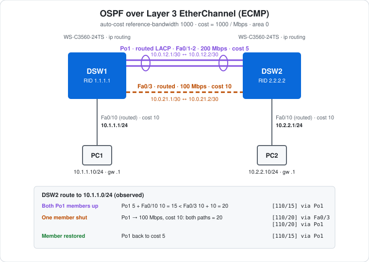

# CCNA Lab 13: OSPF over EtherChannel (ECMP)

A routing lab built in the **PingMyNetwork Sandbox**. Two Cisco Catalyst 3560 multilayer switches run **OSPF area 0** over two parallel routed paths: a two-member **Layer 3 LACP port-channel** (Po1, 200 Mbps) and a single routed FastEthernet link (Fa0/3, 100 Mbps). With `auto-cost reference-bandwidth 1000`, OSPF prefers Po1. When one Po1 member is shut, Po1's bandwidth and cost change, both paths tie, and OSPF installs **equal-cost multipath (ECMP)** routes.

The goal is to practise **OSPF cost calculation, reference bandwidth, how EtherChannel bandwidth feeds into routing, and ECMP**. It builds on the routed port-channel from [Lab 05](../lab-05-l3-etherchannel/), replacing static routes with OSPF.

> **Lab status:** The configs in [`configs/`](configs/) and the results below come from the exported Sandbox JSON in [`lab-files/`](lab-files/). That export includes the saved configuration of both switches and the console output of the session. Results marked **observed** are copied from that output.

## Learning objectives

- Configure single-area OSPF with a fixed router ID and a `network` statement.
- Change the reference bandwidth so FastEthernet and port-channel costs are different.
- Calculate OSPF cost for a port-channel from its combined bandwidth.
- Predict the best path, then read `[AD/metric]` in `show ip route`.
- Make two paths equal and see OSPF load-share across them (ECMP).
- Read `show ip ospf neighbor` and `show ip ospf interface brief`.

## Topology



```text
                    Po1 (Fa0/1-2) 200 Mbps, cost 5
                    10.0.12.1/30 ====== 10.0.12.2/30
   PC1 ---- Fa0/10 DSW1                          DSW2 Fa0/10 ---- PC2
 10.1.1.10  10.1.1.1/24                                10.2.2.1/24  10.2.2.10
                    10.0.21.1/30 ------ 10.0.21.2/30
                    Fa0/3 100 Mbps, cost 10
```

| Device | Role | Model |
|---|---|---|
| DSW1 | OSPF router, RID 1.1.1.1, gateway for 10.1.1.0/24 | Cisco WS-C3560-24TS (IOS 15.2) |
| DSW2 | OSPF router, RID 2.2.2.2, gateway for 10.2.2.0/24 | Cisco WS-C3560-24TS (IOS 15.2) |
| PC1, PC2 | End hosts | PC |

## Addressing plan

| Device | Interface | IP address | Mask | Bandwidth | OSPF cost (ref 1000) |
|---|---|---|---|---|---|
| DSW1 | Po1 (Fa0/1-2, LACP active) | `10.0.12.1` | `/30` | 200 Mbps | **5** |
| DSW1 | Fa0/3 | `10.0.21.1` | `/30` | 100 Mbps | **10** |
| DSW1 | Fa0/10 | `10.1.1.1` | `/24` | 100 Mbps | 10 |
| DSW2 | Po1 (Fa0/1-2, LACP passive) | `10.0.12.2` | `/30` | 200 Mbps | **5** |
| DSW2 | Fa0/3 | `10.0.21.2` | `/30` | 100 Mbps | **10** |
| DSW2 | Fa0/10 | `10.2.2.1` | `/24` | 100 Mbps | 10 |
| PC1 | FastEthernet0 | `10.1.1.10` | `/24` | | gateway `10.1.1.1` |
| PC2 | FastEthernet0 | `10.2.2.10` | `/24` | | gateway `10.2.2.1` |

All interfaces on both switches are routed (`no switchport`).

## Configuration highlights

These excerpts are from the saved configs. The full configs are in [`configs/`](configs/).

### 1. Routed port-channel and backup link (DSW1)

```cisco
ip routing
!
interface range FastEthernet0/1 - 2
 no switchport
 channel-group 1 mode active
!
interface Port-channel1
 no switchport
 ip address 10.0.12.1 255.255.255.252
!
interface FastEthernet0/3
 no switchport
 ip address 10.0.21.1 255.255.255.252
!
interface FastEthernet0/10
 no switchport
 ip address 10.1.1.1 255.255.255.0
```

### 2. OSPF (DSW1; DSW2 uses router-id 2.2.2.2)

```cisco
router ospf 1
 router-id 1.1.1.1
 auto-cost reference-bandwidth 1000
 network 10.0.0.0 0.255.255.255 area 0
```

- **`router-id`** fixes the ID instead of letting OSPF pick the highest interface IP.
- **`network 10.0.0.0 0.255.255.255 area 0`** enables OSPF on every interface whose address falls inside `10.0.0.0/8`. Here that's all of them: Po1, Fa0/3 and Fa0/10.
- **`auto-cost reference-bandwidth 1000`**: the default reference is 100 Mbps, which gives FastEthernet, a 200 Mbps port-channel and anything faster the same cost of 1. Raising it to 1000 Mbps makes them different. **It must match on every OSPF router.** IOS warns about this when you set it.

## How OSPF picks the path

OSPF cost = reference bandwidth ÷ interface bandwidth, rounded down (minimum 1).

| Interface | Bandwidth | Cost (1000 ÷ Mbps) |
|---|---|---|
| Po1, both members up | 200 Mbps | **5** |
| Po1, one member down | 100 Mbps | **10** |
| Fa0/3 | 100 Mbps | **10** |
| Fa0/10 | 100 Mbps | 10 |

DSW2's cost to reach `10.1.1.0/24` is the sum of the outgoing interface costs along the path: its own link to DSW1, plus DSW1's Fa0/10.

| State | Via Po1 | Via Fa0/3 | Result |
|---|---|---|---|
| Both Po1 members up | 5 + 10 = **15** | 10 + 10 = 20 | Po1 only, `[110/15]` |
| One Po1 member down | 10 + 10 = **20** | 10 + 10 = **20** | **ECMP** over both, `[110/20]` |

In `[110/15]`, 110 is OSPF's administrative distance and 15 is the metric (total cost).

## Results (observed on DSW2)

### 1. Adjacencies

```text
DSW2#show ip ospf neighbor
Neighbor ID     Pri   State           Dead Time   Address         Interface
1.1.1.1           1   FULL/BDR        00:00:31    10.0.12.1       Port-channel1
1.1.1.1           1   FULL/BDR        00:00:31    10.0.21.1       FastEthernet0/3
```

There are two adjacencies to the same neighbour, one per link. Both are Ethernet segments, so OSPF elects a DR/BDR on each. An earlier capture, taken while the adjacencies were still forming, showed `2WAY/DROTHER` and interface state `WAIT`.

### 2. Normal state: Po1 preferred

```text
DSW2#show ip route ospf | begin Gateway
O        10.1.1.0/24 [110/15] via 10.0.12.1, 00:00:03, Port-channel1
```

### 3. Shut one Po1 member (`interface f0/1` → `shutdown` on DSW2)

```text
DSW2#show ip ospf interface brief
Interface    PID   Area            IP Address/Mask    Cost  State Nbrs F/C
Po1          1     0               10.0.12.2/30       10    DR    1/1
Fa0/10       1     0               10.2.2.1/24        10    DR    0/0
Fa0/3        1     0               10.0.21.2/30       10    DR    1/1
```

Po1's cost went from 5 to **10** straight away. **But in the Sandbox the route didn't change.** Two later checks still showed `[110/15] via 10.0.12.1, Port-channel1`. After `clear ip ospf process` (which re-runs SPF), it changed:

```text
DSW2#show ip route ospf | begin Gateway
O        10.1.1.0/24 [110/20] via 10.0.21.1, 00:00:25, FastEthernet0/3
                     [110/20] via 10.0.12.1, 00:00:25, Port-channel1
```

That's two equal-cost next hops, **ECMP**. CEF load-shares traffic to `10.1.1.0/24` across Fa0/3 and Po1.

### 4. Restore the member (`no shutdown` + `clear ip ospf process`)

```text
DSW2#show ip ospf interface brief
Po1          1     0               10.0.12.2/30       5     BDR   1/1
Fa0/3        1     0               10.0.21.2/30       10    BDR   1/1
DSW2#show ip route ospf | begin Gateway
O        10.1.1.0/24 [110/15] via 10.0.12.1, 00:00:15, Port-channel1
```

Po1 is back to cost 5 and a single best path.

### Ping

PC2 → `ping 10.1.1.10` got **4/4 replies** with `TTL=126`. That's **two** routed hops (DSW2 and DSW1), compared with 127 in the single-router labs. The export doesn't timestamp PC pings, so it doesn't show which routing state it ran in.

## Verification results

| Check | Command/test | Result |
|---|---|---|
| Adjacencies | DSW2 `show ip ospf neighbor` | **Observed:** 1.1.1.1 FULL on Po1 and Fa0/3 |
| Costs | DSW2 `show ip ospf interface brief` | **Observed:** Po1 5, Fa0/3 10, Fa0/10 10 |
| Best path | DSW2 `show ip route ospf` | **Observed:** `[110/15] via 10.0.12.1, Port-channel1` |
| Member down | Shut DSW2 Fa0/1 | **Observed:** Po1 cost 10 |
| ECMP | `show ip route ospf` after `clear ip ospf process` | **Observed:** `[110/20]` via Fa0/3 **and** Po1 |
| Restore | `no shutdown` + `clear ip ospf process` | **Observed:** Po1 cost 5, `[110/15]` via Po1 only |
| End-to-end | PC2 → `ping 10.1.1.10` | **Observed:** 4/4 replies, `TTL=126` |
| DSW1 view | DSW1 `show ip route ospf` | Expected: `10.2.2.0/24 [110/15] via 10.0.12.2, Port-channel1` |

## Full configuration commands

These are the **exact commands typed in the Sandbox session**, copied from the console history in the export, in the order they were entered (including the `show` commands used to verify). Typing them on factory-default devices reproduces the lab. DSW2's session continues with the ECMP test: shut one Po1 member, check the cost and routes, `clear ip ospf process`, then restore. At each `clear ip ospf process`, IOS asks `Reset ALL OSPF processes? [no]:`. Answer `yes`.

How to read the blocks:

- Lines starting with `!` explain the command below them. Don't type them.
- The prompt (`SW1(config-if-range)#`) shows which mode you're in. Type only the text after `#` or `>`.
- Abbreviations such as `conf t` and `f0/1-2` are accepted by IOS, the same as `configure terminal` and `FastEthernet0/1 - 2`.

### DSW1 (WS-C3560-24TS)

```text
! Enter privileged EXEC mode
DSW1>enable
! Enter global configuration mode
DSW1#conf t
! Turn on IPv4 routing (needed on a multilayer switch)
DSW1(config)#ip routing
! Select f0/1-2 and configure them together
DSW1(config)#interface range f0/1-2
! Make it a routed (Layer 3) port
DSW1(config-if-range)#no switchport
! Join Po1; LACP active: start LACP negotiation
DSW1(config-if-range)#channel-group 1 mode active
DSW1(config-if-range)#exit
! Configure the logical Port-channel1 interface
DSW1(config)#interface port-channel 1
! Make it a routed (Layer 3) port
DSW1(config-if)#no switchport
! Assign 10.0.12.1 / 255.255.255.252
DSW1(config-if)#ip address 10.0.12.1 255.255.255.252
DSW1(config-if)#exit
! Select interface f0/3
DSW1(config)#interface f0/3
! Make it a routed (Layer 3) port
DSW1(config-if)#no switchport
! Assign 10.0.21.1 / 255.255.255.252
DSW1(config-if)#ip address 10.0.21.1 255.255.255.252
DSW1(config-if)#exit
! Select interface f0/10
DSW1(config)#interface f0/10
! Make it a routed (Layer 3) port
DSW1(config-if)#no switchport
! Assign 10.1.1.1 / 255.255.255.0
DSW1(config-if)#ip address 10.1.1.1 255.255.255.0
DSW1(config-if)#exit
! Start OSPF process 1 (enter router config mode)
DSW1(config)#router ospf 1
! Fix the OSPF router ID to 1.1.1.1
DSW1(config-router)#router-id 1.1.1.1
! Reference bandwidth 1000 Mbps: cost = 1000 / interface Mbps (set the same on every router)
DSW1(config-router)#auto-cost reference-bandwidth 1000
! Run OSPF in area 0 on every interface inside 10.0.0.0 0.255.255.255
DSW1(config-router)#network 10.0.0.0 0.255.255.255 area 0
DSW1(config-router)#end
! Save the running config to NVRAM
DSW1#write memory
```

### DSW2 (WS-C3560-24TS) – build, ECMP test and restore

```text
! Enter privileged EXEC mode
DSW2>enable
! Enter global configuration mode
DSW2#conf t
! Turn on IPv4 routing (needed on a multilayer switch)
DSW2(config)#ip routing
! Select f0/1-2 and configure them together
DSW2(config)#interface range f0/1-2
! Make it a routed (Layer 3) port
DSW2(config-if-range)#no switchport
! Join Po1; LACP passive: answer LACP but never start it
DSW2(config-if-range)#channel-group 1 mode passive
DSW2(config-if-range)#exit
! Configure the logical Port-channel1 interface
DSW2(config)#interface port-channel 1
! Make it a routed (Layer 3) port
DSW2(config-if)#no switchport
! Assign 10.0.12.2 / 255.255.255.252
DSW2(config-if)#ip address 10.0.12.2 255.255.255.252
DSW2(config-if)#exit
! Select interface f0/3
DSW2(config)#interface f0/3
! Make it a routed (Layer 3) port
DSW2(config-if)#no switchport
! Assign 10.0.21.2 / 255.255.255.252
DSW2(config-if)#ip address 10.0.21.2 255.255.255.252
DSW2(config-if)#exit
! Select interface f0/10
DSW2(config)#interface f0/10
! Make it a routed (Layer 3) port
DSW2(config-if)#no switchport
! Assign 10.2.2.1 / 255.255.255.0
DSW2(config-if)#ip address 10.2.2.1 255.255.255.0
DSW2(config-if)#exit
! Start OSPF process 1 (enter router config mode)
DSW2(config)#router ospf 1
! Fix the OSPF router ID to 2.2.2.2
DSW2(config-router)#router-id 2.2.2.2
! Reference bandwidth 1000 Mbps: cost = 1000 / interface Mbps (set the same on every router)
DSW2(config-router)#auto-cost reference-bandwidth 1000
! Run OSPF in area 0 on every interface inside 10.0.0.0 0.255.255.255
DSW2(config-router)#network 10.0.0.0 0.255.255.255 area 0
DSW2(config-router)#end
! Save the running config to NVRAM
DSW2#write memory
! Verify: OSPF neighbours and adjacency state
DSW2#show ip ospf neighbor
! Verify: OSPF interfaces, cost and DR/BDR state
DSW2#show ip ospf interface brief
! Verify: routing table
DSW2#show ip route ospf
! Verify: OSPF neighbours and adjacency state
DSW2#show ip ospf neighbor
! Verify: routing table
DSW2#show ip route ospf | begin Gateway
! Enter global configuration mode
DSW2#conf t
! Select interface f0/1
DSW2(config)#interface f0/1
! Disable the interface (failover test)
DSW2(config-if)#shutdown
DSW2(config-if)#end
! Verify: OSPF interfaces, cost and DR/BDR state
DSW2#show ip ospf interface brief
! Verify: routing table
DSW2#show ip route ospf | begin Gateway
! Verify: routing table
DSW2#show ip route ospf | begin Gateway
! Restart OSPF so it re-runs SPF (answer "yes" to the confirmation)
DSW2#clear ip ospf process
! Verify: routing table
DSW2#show ip route ospf | begin Gateway
! Enter global configuration mode
DSW2#conf t
! Select interface f0/1
DSW2(config)#interface f0/1
! Enable the interface
DSW2(config-if)#no shutdown
DSW2(config-if)#end
! Restart OSPF so it re-runs SPF (answer "yes" to the confirmation)
DSW2#clear ip ospf process
! Save the running config to NVRAM
DSW2#write memory
! Verify: OSPF interfaces, cost and DR/BDR state
DSW2#show ip ospf interface brief
! Verify: routing table
DSW2#show ip route ospf | begin Gateway
```

### PCs

Set these in each PC's IP configuration:

| PC | IP address | Subnet mask | Default gateway |
|---|---|---|---|
| PC1 | `10.1.1.10` | `255.255.255.0` | `10.1.1.1` |
| PC2 | `10.2.2.10` | `255.255.255.0` | `10.2.2.1` |

Then test from PC2's command prompt:

```text
! Test reachability to 10.1.1.10
C:\> ping 10.1.1.10
```

## Try it yourself: guided challenges

1. **Default reference bandwidth.** Remove `auto-cost reference-bandwidth 1000` from both switches. What are the Po1 and Fa0/3 costs now, and what does the route look like?
2. **Mismatch on purpose.** Set the reference bandwidth on DSW1 only. Do the two switches still agree on the best path? Why does IOS warn you?
3. **Manual cost.** Instead of shutting a member, set `ip ospf cost 10` on Po1 on both sides to force ECMP.
4. **Passive interface.** Add `passive-interface FastEthernet0/10` on both switches. The PC subnets are still advertised, but no OSPF hellos go to the PCs.
5. **Point-to-point.** Set `ip ospf network point-to-point` on Po1 and Fa0/3 on both sides. What happens to the DR/BDR election and the neighbour state?
6. **Kill the bundle.** Shut both Po1 members. How long until traffic moves to Fa0/3, and does the Sandbox need `clear ip ospf process` again?
7. **Tighter network statements.** Replace `10.0.0.0 0.255.255.255` with one `network` statement per subnet using `0.0.0.3` and `0.0.0.255` wildcards.

## Scope and caveats

- This is a **CCNA-oriented** lab. Single-area OSPF, cost and ECMP are core CCNA routing topics.
- **Sandbox difference:** the Sandbox updated Po1's cost but didn't re-run SPF until `clear ip ospf process`. Real IOS recalculates automatically when an interface's cost or bandwidth changes. The lab note also mentions this tip.
- The `network 10.0.0.0 0.255.255.255 area 0` statement also enables OSPF on the PC-facing Fa0/10 ports, so hellos are sent to the PCs (Challenge 4).
- The /30 links are Ethernet, so OSPF elects a DR/BDR on each. That's unnecessary on point-to-point links (Challenge 5).
- No switch has a management IP, passwords or an SSH user. Unused ports aren't shut down, and `ip http server` is on by default.

## Useful verification commands

```cisco
show ip ospf neighbor
show ip ospf interface brief
show ip route ospf
show ip ospf
show etherchannel summary
show interfaces port-channel 1
show ip cef 10.1.1.0
```

## Lab files

| File | Description |
|---|---|
| [`lab-files/ospf-etherchannel-ecmp-lab.json`](lab-files/ospf-etherchannel-ecmp-lab.json) | PingMyNetwork Sandbox export with saved configs. Import it into the Sandbox to load the full lab. |
| [`configs/DSW1-running-config.txt`](configs/DSW1-running-config.txt) | DSW1 saved configuration (RID 1.1.1.1, LACP active) |
| [`configs/DSW2-running-config.txt`](configs/DSW2-running-config.txt) | DSW2 saved configuration (RID 2.2.2.2, LACP passive) |
| [`images/topology.svg`](images/topology.svg) | Topology diagram with the observed route changes |

**Built with:** [PingMyNetwork Sandbox](https://pingmynetwork.com/sandbox)
