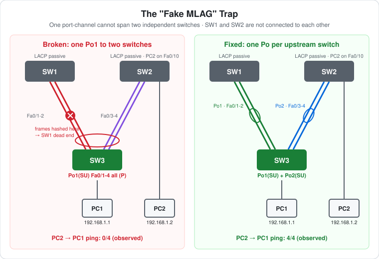

# CCNA Lab 14: The "Fake MLAG" EtherChannel Trap

A troubleshooting lab built in the **PingMyNetwork Sandbox**. An access switch (SW3) has two uplinks to SW1 and two to SW2, and all four are put into **one** LACP port-channel. SW1 and SW2 are separate switches that aren't connected to each other. The Sandbox reports `Po1(SU)` with every member bundled, yet PC2 can't ping PC1. The fix is **one port-channel per upstream switch**.

The goal is to understand **why an EtherChannel must end on a single switch** (unless the two switches act as one, as with MLAG/VSS/vPC), and how a "healthy-looking" bundle can still black-hole traffic.

> **Lab status:** The configs in [`configs/`](configs/) are the **solved** state saved in the exported Sandbox JSON in [`lab-files/`](lab-files/). The broken build, the symptoms and the fix all come from the console output in the same export. Results marked **observed** are copied from that output.

## Learning objectives

- Explain why all members of a port-channel must connect to the same partner switch.
- Know what MLAG (VSS, StackWise Virtual, vPC) does differently.
- Explain how EtherChannel load balancing can send a flow down a link that leads nowhere.
- Recognise that `show etherchannel summary` alone doesn't prove a bundle works.
- Fix it by splitting the bundle into one port-channel per upstream switch.

## Topology



```text
        SW1                      SW2 ---- Fa0/10 ---- PC2 192.168.1.2
    Fa0/1-2 (passive)        Fa0/1-2 (passive)
         \\                      //
     Fa0/1-2 \\                  // Fa0/3-4
              \\                //
                     SW3   (LACP active)
                    Fa0/10
                      |
                     PC1 192.168.1.1

   SW1 and SW2 are NOT connected to each other.
```

| Device | Role | Model |
|---|---|---|
| SW1 | Upstream switch A: LACP passive on Fa0/1-2, nothing else connected | Cisco WS-C2960-24TT-L (IOS 15.2) |
| SW2 | Upstream switch B: LACP passive on Fa0/1-2, PC2 on Fa0/10 | Cisco WS-C2960-24TT-L (IOS 15.2) |
| SW3 | Access switch: two links to SW1, two to SW2, PC1 on Fa0/10 | Cisco WS-C2960-24TT-L (IOS 15.2) |
| PC1, PC2 | End hosts, VLAN 1 | PC |

## Addressing plan

| Host | Switch port | VLAN | IP address | Subnet mask |
|---|---|---|---|---|
| PC1 | SW3 Fa0/10 | 1 | `192.168.1.1` | `255.255.255.0` |
| PC2 | SW2 Fa0/10 | 1 | `192.168.1.2` | `255.255.255.0` |

The PC ports are left at their defaults. The only path from PC1 to PC2 is SW3 → SW2.

## The broken build

```cisco
! SW1 and SW2 (each)
interface range FastEthernet0/1 - 2
 switchport mode trunk
 channel-group 1 mode passive
!
! SW3 – the trap: links to TWO different switches in ONE port-channel
interface range FastEthernet0/1 - 4
 switchport mode trunk
 channel-group 1 mode active
```

### Symptoms (observed)

```text
SW3#show etherchannel summary | begin Group
Group  Port-channel  Protocol    Ports
------+-------------+-----------+-----------------------------------------------
1      Po1(SU)         LACP      Fa0/1(P)    Fa0/2(P)    Fa0/3(P)    Fa0/4(P)
```

```text
C:\>ping 192.168.1.1          (from PC2)
Request timed out.
Request timed out.
Request timed out.
Request timed out.
    Packets: Sent = 4, Received = 0, Lost = 4 (100% loss),
```

Every member shows `(P)` and the bundle is `SU`, but no traffic gets through.

## Why it fails

SW3 treats Po1 as **one logical link to one neighbour**. It learns PC2's MAC address on "Po1", not on a particular member. When it forwards a frame to PC2, or floods a broadcast such as PC1's ARP request, it picks **one member** using its load-balancing hash. The 2960's default is `src-mac`, so all of PC1's frames take the same member.

- If the hash picks **Fa0/3 or Fa0/4**, the frame reaches SW2 and PC2.
- If it picks **Fa0/1 or Fa0/2**, the frame reaches **SW1**. SW1 has no path to SW2 or PC2, so the frame is dropped. That's a **black hole**.

The consistent 100% loss fits PC1's MAC hashing onto a link toward SW1. A different MAC address, or a different `port-channel load-balance` method, could give partial loss instead. That's even harder to troubleshoot.

**What real IOS would do:** LACP includes each partner's **system ID** in its LACPDUs, and members can only be aggregated with ports that see the same partner. On real hardware, SW3 is expected to bundle the ports facing one switch and leave the others out (shown as suspended or stand-alone), rather than report all four as `(P)`. The Sandbox doesn't run this check, which is what makes the trap visible here. Either way, the design is wrong.

### What MLAG changes

With multi-chassis link aggregation (**VSS** or **StackWise Virtual** on Catalyst, **vPC** on Nexus, or a switch **stack**), the two upstream switches share one control plane or LACP system ID and are connected by a peer link. To SW3 they look like **one** partner, so one port-channel across both is valid. Two standalone 2960s can't do this, hence "fake MLAG".

## The fix

```cisco
! SW3 – move the links to SW2 into their own port-channel
interface range FastEthernet0/3 - 4
 no channel-group
 channel-group 2 mode active
```

### Result (observed)

```text
SW3#show etherchannel summary | begin Group
Group  Port-channel  Protocol    Ports
------+-------------+-----------+-----------------------------------------------
1      Po1(SU)         LACP      Fa0/1(P)    Fa0/2(P)
2      Po2(SU)         LACP      Fa0/3(P)    Fa0/4(P)
```

```text
C:\>ping 192.168.1.1          (from PC2)
Reply from 192.168.1.1: bytes=32 time<1ms TTL=128   (x4)
    Packets: Sent = 4, Received = 4, Lost = 0 (0% loss),
```

SW3 now learns PC2's MAC on **Po2**, so frames to PC2 always go to SW2. SW1 is a leaf off Po1. Since SW1 and SW2 aren't connected, there's no loop and STP has nothing to block.

The two PC2 pings aren't timestamped in the export. The failed ping comes first in PC2's console and the successful one second, which matches before and after the fix.

## Verification results

| Check | Command/test | Result |
|---|---|---|
| Broken bundle | SW3 `show etherchannel summary` | **Observed:** `Po1(SU)` with Fa0/1-4 all `(P)` (Sandbox) |
| Broken ping | PC2 → `ping 192.168.1.1` | **Observed:** 0/4, 100% loss |
| Fixed bundles | SW3 `show etherchannel summary` | **Observed:** `Po1(SU)` Fa0/1-2, `Po2(SU)` Fa0/3-4 |
| Fixed ping | PC2 → `ping 192.168.1.1` | **Observed:** 4/4 replies, `TTL=128` |
| LACP partners | SW3 `show lacp neighbor` | Expected: Fa0/1-2 and Fa0/3-4 show **different** partner system IDs. That's the clue that they can't share a bundle |
| MAC learning | SW3 `show mac address-table` | Expected (fixed): PC2's MAC on Po2 |

## Full configuration commands

These are the **exact commands typed in the Sandbox session**, copied from the console history in the export, in the order they were entered (including the `show` commands used to verify). Typing them on factory-default devices reproduces the lab. SW3's session builds the **trap** first (Fa0/1-4 in one Po1), checks it, then **fixes** it by moving Fa0/3-4 into Po2. To build the working lab directly, use the clean commands at the end of this section.

How to read the blocks:

- Lines starting with `!` explain the command below them. Don't type them.
- The prompt (`SW1(config-if-range)#`) shows which mode you're in. Type only the text after `#` or `>`.
- Abbreviations such as `conf t` and `f0/1-2` are accepted by IOS, the same as `configure terminal` and `FastEthernet0/1 - 2`.

### SW1 (WS-C2960-24TT-L)

```text
! Enter privileged EXEC mode
SW1>enable
! Enter global configuration mode
SW1#conf t
! Select f0/1-2 and configure them together
SW1(config)#interface range f0/1-2
! Make it an 802.1Q trunk
SW1(config-if-range)#switchport mode trunk
! Join Po1; LACP passive: answer LACP but never start it
SW1(config-if-range)#channel-group 1 mode passive
SW1(config-if-range)#end
! Save the running config to NVRAM
SW1#write memory
```

### SW2 (WS-C2960-24TT-L)

```text
! Enter privileged EXEC mode
SW2>enable
! Enter global configuration mode
SW2#conf t
! Select f0/1-2 and configure them together
SW2(config)#interface range f0/1-2
! Make it an 802.1Q trunk
SW2(config-if-range)#switchport mode trunk
! Join Po1; LACP passive: answer LACP but never start it
SW2(config-if-range)#channel-group 1 mode passive
SW2(config-if-range)#end
! Save the running config to NVRAM
SW2#write memory
```

### SW3 (WS-C2960-24TT-L) – broken build, check and fix

```text
! Enter privileged EXEC mode
SW3>enable
! Enter global configuration mode
SW3#conf t
! Select f0/1-4 and configure them together
SW3(config)#interface range f0/1-4
! Make it an 802.1Q trunk
SW3(config-if-range)#switchport mode trunk
! Join Po1; LACP active: start LACP negotiation
SW3(config-if-range)#channel-group 1 mode active
SW3(config-if-range)#end
! Save the running config to NVRAM
SW3#write memory
! Verify: port-channel state (SU/SD) and member flags (P, s, I, D, H)
SW3#show etherchannel summary | begin Group
! Enter global configuration mode
SW3#conf t
! Select f0/3-4 and configure them together
SW3(config)#interface range f0/3-4
! Remove the ports from their current port-channel
SW3(config-if-range)#no channel-group
! Join Po2; LACP active: start LACP negotiation
SW3(config-if-range)#channel-group 2 mode active
SW3(config-if-range)#end
! Save the running config to NVRAM
SW3#write memory
! Verify: port-channel state (SU/SD) and member flags (P, s, I, D, H)
SW3#show etherchannel summary | begin Group
```

### PCs

Set these in each PC's IP configuration:

| PC | IP address | Subnet mask | Default gateway |
|---|---|---|---|
| PC1 | `192.168.1.1` | `255.255.255.0` | none |
| PC2 | `192.168.1.2` | `255.255.255.0` | none |

Then test from PC2's command prompt:

```text
! Test reachability to 192.168.1.1
C:\> ping 192.168.1.1
! Test reachability to 192.168.1.1
C:\> ping 192.168.1.1
```

### Solved build from scratch

These commands build the working lab in one pass, matching the saved configs:

#### SW1 (WS-C2960-24TT-L)

```text
! Enter privileged EXEC mode
SW1>enable
! Enter global configuration mode
SW1#conf t
! Select f0/1-2 and configure them together
SW1(config)#interface range f0/1-2
! Make it an 802.1Q trunk
SW1(config-if-range)#switchport mode trunk
! Join Po1; LACP passive: answer LACP but never start it
SW1(config-if-range)#channel-group 1 mode passive
SW1(config-if-range)#end
! Save the running config to NVRAM
SW1#write memory
```

#### SW2 (WS-C2960-24TT-L)

```text
! Enter privileged EXEC mode
SW2>enable
! Enter global configuration mode
SW2#conf t
! Select f0/1-2 and configure them together
SW2(config)#interface range f0/1-2
! Make it an 802.1Q trunk
SW2(config-if-range)#switchport mode trunk
! Join Po1; LACP passive: answer LACP but never start it
SW2(config-if-range)#channel-group 1 mode passive
SW2(config-if-range)#end
! Save the running config to NVRAM
SW2#write memory
```

#### SW3 (WS-C2960-24TT-L)

```text
! Enter privileged EXEC mode
SW3>enable
! Enter global configuration mode
SW3#conf t
! Select f0/1-4 and configure them together
SW3(config)#interface range f0/1-4
! Make it an 802.1Q trunk
SW3(config-if-range)#switchport mode trunk
SW3(config-if-range)#exit
! Select f0/1-2 and configure them together
SW3(config)#interface range f0/1-2
! Join Po1; LACP active: start LACP negotiation
SW3(config-if-range)#channel-group 1 mode active
SW3(config-if-range)#exit
! Select f0/3-4 and configure them together
SW3(config)#interface range f0/3-4
! Join Po2; LACP active: start LACP negotiation
SW3(config-if-range)#channel-group 2 mode active
SW3(config-if-range)#end
! Save the running config to NVRAM
SW3#write memory
```

## Try it yourself: guided challenges

1. **Find the clue.** Rebuild the broken version and run `show lacp neighbor` on SW3. Compare the partner system IDs and device IDs on Fa0/1-2 and Fa0/3-4.
2. **Change the hash.** In the broken state, try `port-channel load-balance dst-mac` and `src-dst-ip` on SW3. Does the loss change?
3. **Swap the PC.** Move PC2 to SW1 in the broken build. Does PC2 → PC1 work now? Why?
4. **Connect SW1 and SW2.** Add a link between SW1 and SW2 in the fixed build. What does STP block, and where?
5. **Static mode.** Rebuild the trap with `channel-group 1 mode on` on all sides. What changes, and what does EtherChannel guard do?

## Scope and caveats

- This is a **CCNA-oriented** lab focused on EtherChannel design rules. MLAG technologies are named for context but not configured.
- **Sandbox difference:** the Sandbox bundled links to two different LACP partners. Real IOS checks the partner system ID and is expected to refuse.
- The exported configs are the **solved** state. Rebuild the trap from the commands below to reproduce the failure.
- No switch has a management IP, passwords or an SSH user. Unused ports aren't shut down, and `ip http server` is on by default.

## Useful verification commands

```cisco
show etherchannel summary
show lacp neighbor
show etherchannel load-balance
show mac address-table
show interfaces trunk
show spanning-tree
```

## Lab files

| File | Description |
|---|---|
| [`lab-files/etherchannel-fake-mlag-lab.json`](lab-files/etherchannel-fake-mlag-lab.json) | PingMyNetwork Sandbox export (solved state). Import it into the Sandbox to load the full lab. |
| [`configs/SW1-running-config.txt`](configs/SW1-running-config.txt) | SW1 saved configuration (LACP passive) |
| [`configs/SW2-running-config.txt`](configs/SW2-running-config.txt) | SW2 saved configuration (LACP passive) |
| [`configs/SW3-running-config.txt`](configs/SW3-running-config.txt) | SW3 saved configuration (fixed: Po1 → SW1, Po2 → SW2) |
| [`images/topology.svg`](images/topology.svg) | Broken vs fixed diagram |

**Built with:** [PingMyNetwork Sandbox](https://pingmynetwork.com/sandbox)
