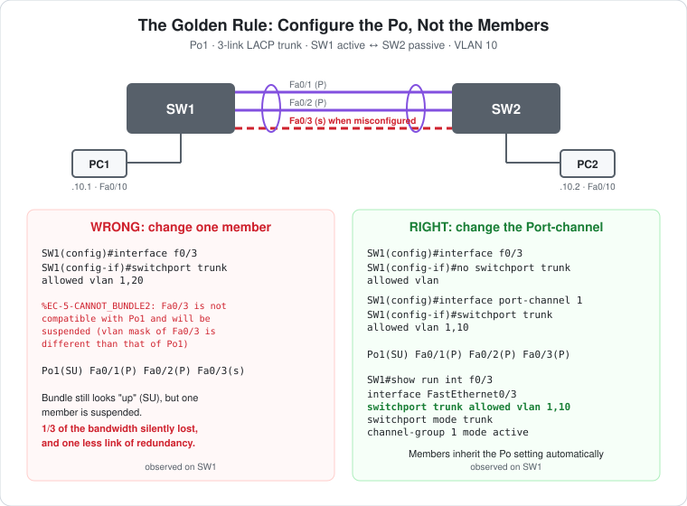

# CCNA Lab 15: The Golden Rule – Configure the Port-channel, Not the Members

A short, focused lab built in the **PingMyNetwork Sandbox**. Two Cisco Catalyst 2960 switches are joined by a three-link LACP trunk. A trunk setting is changed on **one member port** instead of on the port-channel. IOS suspends that member, but the bundle stays `SU`, so the network looks healthy while a third of its bandwidth is gone. Making the same change on the **port-channel interface** applies it to every member and keeps them all bundled.

The goal is to make the EtherChannel golden rule stick: **after the bundle exists, configure `interface port-channel N`, never the individual members.**

> **Lab status:** The configs in [`configs/`](configs/) and the results below come from the exported Sandbox JSON in [`lab-files/`](lab-files/). That export includes the saved configuration of both switches and the console output of the session. Results marked **observed** are copied from that output.

## Learning objectives

- Know which settings must match on every member (trunk mode, allowed VLANs, native VLAN, access VLAN, speed, duplex).
- Recognise `%EC-5-CANNOT_BUNDLE2` and the `(s)` suspended flag.
- Spot a "silent" failure: the port-channel is `SU` but a member isn't bundled.
- Apply settings on the port-channel and confirm the members inherit them with `show running-config interface`.

## Topology



```text
   PC1 ---- Fa0/10 SW1 Fa0/1 ======= Fa0/1 SW2 Fa0/10 ---- PC2
  .10.1             Fa0/2 ======= Fa0/2              .10.2
                    Fa0/3 ======= Fa0/3
                    Po1 · LACP trunk
                 (active)       (passive)
```

| Device | Role | Model |
|---|---|---|
| SW1 | LACP `active`, PC1 in VLAN 10 | Cisco WS-C2960-24TT-L (IOS 15.2) |
| SW2 | LACP `passive`, PC2 in VLAN 10 | Cisco WS-C2960-24TT-L (IOS 15.2) |
| PC1, PC2 | End hosts | PC |

## Addressing plan

| Host | Switch port | VLAN | IP address | Subnet mask |
|---|---|---|---|---|
| PC1 | SW1 Fa0/10 | 10 | `192.168.10.1` | `255.255.255.0` |
| PC2 | SW2 Fa0/10 | 10 | `192.168.10.2` | `255.255.255.0` |

Po1 is an 802.1Q trunk. In the final config, both switches allow VLANs `1,10` on Po1.

## What happened (observed on SW1)

### 1. Build

`interface range f0/1-3` → `switchport mode trunk` → `channel-group 1 mode active` on SW1, and the same with `passive` on SW2. Until SW2 was configured, SW1's members were suspended with `LACP currently not enabled on the remote port`.

### 2. The wrong way: change one member

```text
SW1(config)#interface f0/3
SW1(config-if)#switchport trunk allowed vlan 1,20
%EC-5-CANNOT_BUNDLE2: Fa0/3 is not compatible with Po1 and will be suspended
(vlan mask of Fa0/3 is different than that of Po1)
```

Fa0/3 now allowed VLANs `1,20`, while Po1 and the other members allowed all VLANs. IOS refused to bundle it. When LACP finished forming the bundle (Po1 up at 21:48:30), the result was:

```text
SW1#show etherchannel summary | begin Group
1      Po1(SU)         LACP      Fa0/1(P)    Fa0/2(P)    Fa0/3(s)
```

**This is the silent failure.** Po1 is `SU`, trunking works and pings succeed, but Fa0/3 is suspended. The bundle runs on two of its three links: a third of the bandwidth is gone and there's one less link of redundancy. A quick look at interface status or ping results wouldn't reveal it.

The two `show etherchannel summary` outputs taken just before this showed `Po1(SD)` with all three members `(s)`, because SW2 hadn't finished LACP negotiation yet. The bundle only came up at 21:48:30.

### 3. The right way: change the port-channel

```text
SW1(config)#interface f0/3
SW1(config-if)#no switchport trunk allowed vlan
SW1(config-if)#exit
SW1(config)#interface port-channel 1
SW1(config-if)#switchport trunk allowed vlan 1,10
```

```text
SW1#show etherchannel summary | begin Group
1      Po1(SU)         LACP      Fa0/1(P)    Fa0/2(P)    Fa0/3(P)

SW1#show running-config interface f0/3
interface FastEthernet0/3
 switchport trunk allowed vlan 1,10
 switchport mode trunk
 channel-group 1 mode active
```

Removing the member-level override made Fa0/3 match the bundle again. It came back up at 21:48:52. The allowed-VLAN list set on Po1 was then **copied to every member**: `show running-config interface f0/3` shows `switchport trunk allowed vlan 1,10` even though it was never typed on Fa0/3. SW2 got the same `switchport trunk allowed vlan 1,10` on its Po1 at 21:49:14, so both ends match.

## Why the rule exists

A port-channel's members must be **identical** in the settings that affect forwarding. When you configure the `Port-channel` interface, IOS applies the change to every member at once, so they stay consistent. If you configure one member directly, it's the odd one out and gets suspended:

| Setting | Must match across members |
|---|---|
| `switchport mode` (access/trunk) | ✅ |
| Allowed VLANs, native VLAN | ✅ |
| Access VLAN (for access bundles) | ✅ |
| Speed and duplex | ✅ |
| `channel-group` mode / protocol | ✅ |
| `description` | No (cosmetic only) |

**Exceptions:** some settings only make sense per member, such as `lacp port-priority` ([Lab 11](../lab-11-etherchannel-10-link-bundle/)), `shutdown` on a single link for a failover test, or `description`. Everything that shapes traffic belongs on the port-channel.

## Verification results

| Check | Command/test | Result |
|---|---|---|
| Wrong change | `switchport trunk allowed vlan 1,20` on Fa0/3 | **Observed:** `%EC-5-CANNOT_BUNDLE2 … vlan mask of Fa0/3 is different than that of Po1` |
| Silent failure | SW1 `show etherchannel summary` | **Observed:** `Po1(SU)` with Fa0/1 `(P)`, Fa0/2 `(P)`, **Fa0/3 `(s)`** |
| Right change | `switchport trunk allowed vlan 1,10` on Po1 | **Observed:** `Po1(SU)`, all three members `(P)` |
| Inheritance | SW1 `show running-config interface f0/3` | **Observed:** `switchport trunk allowed vlan 1,10` on the member |
| Saved config | `configs/` | Both switches: `allowed vlan 1,10` on Po1 **and** on Fa0/1-3 |
| Ping | PC2 → `ping 192.168.10.1` | **Observed:** 4/4 replies, `TTL=128` |

The export doesn't timestamp PC pings, so it doesn't show whether the ping ran before or after the fix. VLAN 10 was allowed on Fa0/1-2 the whole time.

## Full configuration commands

These are the **exact commands typed in the Sandbox session**, copied from the console history in the export, in the order they were entered (including the `show` commands used to verify). Typing them on factory-default devices reproduces the lab. SW1's session includes the **wrong way** (changing member Fa0/3) and the **right way** (removing it and configuring `port-channel 1`). To build the final lab directly, use the clean commands at the end of this section.

How to read the blocks:

- Lines starting with `!` explain the command below them. Don't type them.
- The prompt (`SW1(config-if-range)#`) shows which mode you're in. Type only the text after `#` or `>`.
- Abbreviations such as `conf t` and `f0/1-2` are accepted by IOS, the same as `configure terminal` and `FastEthernet0/1 - 2`.

### SW1 (WS-C2960-24TT-L) – build, wrong way, right way

```text
! Enter privileged EXEC mode
SW1>enable
! Enter global configuration mode
SW1#conf t
! Create VLAN 10 (and enter VLAN config mode)
SW1(config)#vlan 10
SW1(config-vlan)#exit
! Select f0/1-3 and configure them together
SW1(config)#interface range f0/1-3
! Make it an 802.1Q trunk
SW1(config-if-range)#switchport mode trunk
! Join Po1; LACP active: start LACP negotiation
SW1(config-if-range)#channel-group 1 mode active
SW1(config-if-range)#exit
! Select interface f0/10
SW1(config)#interface f0/10
! Make it an access (host) port
SW1(config-if)#switchport mode access
! Put the port in VLAN 10
SW1(config-if)#switchport access vlan 10
SW1(config-if)#end
! Save the running config to NVRAM
SW1#write memory
! Verify: port-channel state (SU/SD) and member flags (P, s, I, D, H)
SW1#show etherchannel summary | begin Group
! Enter global configuration mode
SW1#conf t
! Select interface f0/3
SW1(config)#interface f0/3
! Allow only VLANs 1,20 on the trunk
SW1(config-if)#switchport trunk allowed vlan 1,20
SW1(config-if)#end
! Verify: port-channel state (SU/SD) and member flags (P, s, I, D, H)
SW1#show etherchannel summary | begin Group
! Verify: port-channel state (SU/SD) and member flags (P, s, I, D, H)
SW1#show etherchannel summary | begin Group
! Enter global configuration mode
SW1#conf t
! Select interface f0/3
SW1(config)#interface f0/3
! Remove the allowed-VLAN override from this port (back to the default)
SW1(config-if)#no switchport trunk allowed vlan
SW1(config-if)#exit
! Configure the logical Port-channel1 interface
SW1(config)#interface port-channel 1
! Allow only VLANs 1,10 on the trunk
SW1(config-if)#switchport trunk allowed vlan 1,10
SW1(config-if)#end
! Verify: port-channel state (SU/SD) and member flags (P, s, I, D, H)
SW1#show etherchannel summary | begin Group
! Verify: the configuration actually applied to f0/3
SW1#show running-config interface f0/3
! Save the running config to NVRAM
SW1#write memory
```

### SW2 (WS-C2960-24TT-L) – build and Po1 allowed VLANs

```text
! Enter privileged EXEC mode
SW2>enable
! Enter global configuration mode
SW2#conf t
! Create VLAN 10 (and enter VLAN config mode)
SW2(config)#vlan 10
SW2(config-vlan)#exit
! Select f0/1-3 and configure them together
SW2(config)#interface range f0/1-3
! Make it an 802.1Q trunk
SW2(config-if-range)#switchport mode trunk
! Join Po1; LACP passive: answer LACP but never start it
SW2(config-if-range)#channel-group 1 mode passive
SW2(config-if-range)#exit
! Select interface f0/10
SW2(config)#interface f0/10
! Make it an access (host) port
SW2(config-if)#switchport mode access
! Put the port in VLAN 10
SW2(config-if)#switchport access vlan 10
SW2(config-if)#end
! Save the running config to NVRAM
SW2#write memory
! Enter global configuration mode
SW2#conf t
! Configure the logical Port-channel1 interface
SW2(config)#interface port-channel 1
! Allow only VLANs 1,10 on the trunk
SW2(config-if)#switchport trunk allowed vlan 1,10
SW2(config-if)#end
! Save the running config to NVRAM
SW2#write memory
```

### PCs

Set these in each PC's IP configuration:

| PC | IP address | Subnet mask | Default gateway |
|---|---|---|---|
| PC1 | `192.168.10.1` | `255.255.255.0` | none |
| PC2 | `192.168.10.2` | `255.255.255.0` | none |

Then test from PC2's command prompt:

```text
! Test reachability to 192.168.10.1
C:\> ping 192.168.10.1
```

### Final build from scratch

These commands build the lab in its final state in one pass, configuring only the port-channel after the bundle exists:

#### SW1 (WS-C2960-24TT-L)

```text
! Enter privileged EXEC mode
SW1>enable
! Enter global configuration mode
SW1#conf t
! Create VLAN 10 (and enter VLAN config mode)
SW1(config)#vlan 10
SW1(config-vlan)#exit
! Select f0/1-3 and configure them together
SW1(config)#interface range f0/1-3
! Make it an 802.1Q trunk
SW1(config-if-range)#switchport mode trunk
! Join Po1; LACP active: start LACP negotiation
SW1(config-if-range)#channel-group 1 mode active
SW1(config-if-range)#exit
! Configure the logical Port-channel1 interface
SW1(config)#interface port-channel 1
! Allow only VLANs 1,10 on the trunk
SW1(config-if)#switchport trunk allowed vlan 1,10
SW1(config-if)#exit
! Select interface f0/10
SW1(config)#interface f0/10
! Make it an access (host) port
SW1(config-if)#switchport mode access
! Put the port in VLAN 10
SW1(config-if)#switchport access vlan 10
SW1(config-if)#end
! Save the running config to NVRAM
SW1#write memory
```

#### SW2 (WS-C2960-24TT-L)

```text
! Enter privileged EXEC mode
SW2>enable
! Enter global configuration mode
SW2#conf t
! Create VLAN 10 (and enter VLAN config mode)
SW2(config)#vlan 10
SW2(config-vlan)#exit
! Select f0/1-3 and configure them together
SW2(config)#interface range f0/1-3
! Make it an 802.1Q trunk
SW2(config-if-range)#switchport mode trunk
! Join Po1; LACP passive: answer LACP but never start it
SW2(config-if-range)#channel-group 1 mode passive
SW2(config-if-range)#exit
! Configure the logical Port-channel1 interface
SW2(config)#interface port-channel 1
! Allow only VLANs 1,10 on the trunk
SW2(config-if)#switchport trunk allowed vlan 1,10
SW2(config-if)#exit
! Select interface f0/10
SW2(config)#interface f0/10
! Make it an access (host) port
SW2(config-if)#switchport mode access
! Put the port in VLAN 10
SW2(config-if)#switchport access vlan 10
SW2(config-if)#end
! Save the running config to NVRAM
SW2#write memory
```

## Try it yourself: guided challenges

1. **Other mismatches.** Repeat the wrong-way test with `switchport trunk native vlan 99`, `speed 10` and `duplex half` on Fa0/3 only. Which ones suspend the member?
2. **Description is fine.** Add `description to-SW2` on Fa0/3 only. Is it suspended?
3. **Find it fast.** Break Fa0/3 again and find the problem using only `show etherchannel summary`, `show etherchannel detail` and `show interfaces status`.
4. **Add a member.** Add a fourth link and use `channel-group 1 mode active` on it. Does it inherit Po1's `allowed vlan 1,10` automatically?
5. **Prune both sides.** Remove VLAN 10 from Po1's allowed list on SW2 only. What happens to the ping, and does the bundle stay up?

## Scope and caveats

- This is a **CCNA-oriented** lab. The golden rule applies to every EtherChannel.
- The suspended member keeps its link up, so `show interfaces status` alone may not show the problem. Always check `show etherchannel summary` for `(s)`.
- No switch has a management IP, passwords or an SSH user. Unused ports aren't shut down, and `ip http server` is on by default.

## Useful verification commands

```cisco
show etherchannel summary
show etherchannel detail
show running-config interface port-channel 1
show running-config interface FastEthernet0/3
show interfaces trunk
show interfaces FastEthernet0/3 switchport
```

## Lab files

| File | Description |
|---|---|
| [`lab-files/etherchannel-po-inheritance-lab.json`](lab-files/etherchannel-po-inheritance-lab.json) | PingMyNetwork Sandbox export with saved configs. Import it into the Sandbox to load the full lab. |
| [`configs/SW1-running-config.txt`](configs/SW1-running-config.txt) | SW1 saved configuration (LACP active, Po1 allowed VLANs 1,10) |
| [`configs/SW2-running-config.txt`](configs/SW2-running-config.txt) | SW2 saved configuration (LACP passive, Po1 allowed VLANs 1,10) |
| [`images/topology.svg`](images/topology.svg) | Topology with the wrong vs right way |

**Built with:** [PingMyNetwork Sandbox](https://pingmynetwork.com/sandbox)
