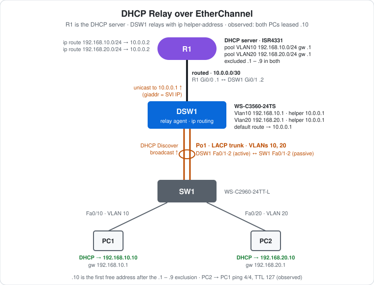

# CCNA Lab 16: DHCP Relay over EtherChannel

A services lab built in the **PingMyNetwork Sandbox**. A Cisco ISR4331 router (R1) is the **DHCP server** for two VLANs. It sits one routed hop away from the users, so their DHCP broadcasts can't reach it directly. The Layer 3 switch DSW1 routes for VLANs 10 and 20 and acts as a **DHCP relay agent** with `ip helper-address`. The access switch SW1 connects to DSW1 over an LACP EtherChannel trunk. Both PCs are set to DHCP and receive their addresses through the relay.

The goal is to practise **DHCP server pools, exclusions, DHCP relay (`ip helper-address`) and the return routing a relay needs**, on top of the EtherChannel and inter-VLAN routing from earlier labs.

> **Lab status:** The configs in [`configs/`](configs/) and the results below come from the exported Sandbox JSON in [`lab-files/`](lab-files/). That export includes the saved configuration of every device and the console output of the session. Results marked **observed** are copied from that output.

## Learning objectives

- Configure an IOS DHCP server: pools, `network`, `default-router` and excluded addresses.
- Explain why DHCP needs a relay when the server is on a different subnet.
- Configure `ip helper-address` on the client-facing SVIs.
- Explain how the server picks a pool from the relay's **giaddr**, and why it needs a route back to the client subnets.
- Read `show ip dhcp binding`.

## Topology



```text
                    R1  (DHCP server)
                    Gi0/0 10.0.0.1/30
                      |  routed
                    Gi0/1 10.0.0.2/30
                   DSW1  (relay agent, ip routing)
            Vlan10 192.168.10.1  helper 10.0.0.1
            Vlan20 192.168.20.1  helper 10.0.0.1
                   Fa0/1-2
                     ||  Po1 · LACP trunk (VLANs 10, 20)
                   Fa0/1-2
                    SW1
            Fa0/10 /    \ Fa0/20
                  /      \
          PC1 (VLAN 10)  PC2 (VLAN 20)
          DHCP client    DHCP client
```

| Device | Role | Model |
|---|---|---|
| R1 | DHCP server for both VLANs, routes back to them | Cisco ISR4331 (IOS 15.9 in the Sandbox) |
| DSW1 | Layer 3 switch: SVI gateways, DHCP relay, default route to R1 | Cisco WS-C3560-24TS (IOS 15.2) |
| SW1 | Access switch: PC1 in VLAN 10, PC2 in VLAN 20 | Cisco WS-C2960-24TT-L (IOS 15.2) |
| PC1, PC2 | DHCP clients | PC |

## Addressing plan

### Links

| Link | Side A | Side B | Type |
|---|---|---|---|
| R1 ↔ DSW1 | R1 Gi0/0 `10.0.0.1/30` | DSW1 Gi0/1 `10.0.0.2/30` (`no switchport`) | Routed |
| DSW1 ↔ SW1 | DSW1 Fa0/1-2, LACP `active` | SW1 Fa0/1-2, LACP `passive` | Po1, 802.1Q trunk |

### VLANs, gateways and DHCP pools

| VLAN | Subnet | Gateway (DSW1 SVI) | Relay to | R1 pool | Excluded | Default router given |
|---|---|---|---|---|---|---|
| 10 | `192.168.10.0/24` | `192.168.10.1` | `10.0.0.1` | `VLAN10` | `.1 – .9` | `192.168.10.1` |
| 20 | `192.168.20.0/24` | `192.168.20.1` | `10.0.0.1` | `VLAN20` | `.1 – .9` | `192.168.20.1` |

### Routing

| Device | Route | Why |
|---|---|---|
| DSW1 | `0.0.0.0/0 → 10.0.0.1` | Everything that isn't a local VLAN goes to R1 |
| R1 | `192.168.10.0/24 → 10.0.0.2` | Return path to VLAN 10, needed for DHCP replies to the relay |
| R1 | `192.168.20.0/24 → 10.0.0.2` | Return path to VLAN 20 |

### Hosts

| Host | Switch port | VLAN | IP setting | Leased address (observed) |
|---|---|---|---|---|
| PC1 | SW1 Fa0/10 | 10 | DHCP | `192.168.10.10` |
| PC2 | SW1 Fa0/20 | 20 | DHCP | `192.168.20.10` |

## Configuration highlights

These excerpts are from the saved configs. The full configs are in [`configs/`](configs/).

### 1. R1: DHCP server and return routes

```cisco
ip dhcp excluded-address 192.168.10.1 192.168.10.9
ip dhcp excluded-address 192.168.20.1 192.168.20.9
!
ip dhcp pool VLAN10
 network 192.168.10.0 255.255.255.0
 default-router 192.168.10.1
!
ip dhcp pool VLAN20
 network 192.168.20.0 255.255.255.0
 default-router 192.168.20.1
!
interface GigabitEthernet0/0
 ip address 10.0.0.1 255.255.255.252
 no shutdown
!
ip route 192.168.10.0 255.255.255.0 10.0.0.2
ip route 192.168.20.0 255.255.255.0 10.0.0.2
```

### 2. DSW1: relay agent

```cisco
ip routing
!
interface GigabitEthernet0/1
 no switchport
 ip address 10.0.0.2 255.255.255.252
!
interface Vlan10
 ip address 192.168.10.1 255.255.255.0
 ip helper-address 10.0.0.1
!
interface Vlan20
 ip address 192.168.20.1 255.255.255.0
 ip helper-address 10.0.0.1
!
ip route 0.0.0.0 0.0.0.0 10.0.0.1
```

DSW1's Fa0/1-2 use `switchport trunk encapsulation dot1q`, `switchport mode trunk` and `channel-group 1 mode active`. SW1 uses `switchport mode trunk` and `channel-group 1 mode passive`, with Fa0/10 in VLAN 10 and Fa0/20 in VLAN 20.

## How DHCP relay works here

1. **Discover:** PC1 has no address yet, so it broadcasts a DHCP Discover (src `0.0.0.0`, dst `255.255.255.255`). SW1 carries it over Po1 in VLAN 10 to DSW1. Routers don't forward broadcasts, so it would stop here.
2. **Relay:** `ip helper-address 10.0.0.1` on `Vlan10` makes DSW1 turn the broadcast into a **unicast to 10.0.0.1**. It also writes its own SVI address `192.168.10.1` into the packet's **giaddr** (gateway address) field.
3. **Pool choice:** R1 sees giaddr `192.168.10.1`, finds the pool whose `network` contains it (`VLAN10`), and offers the first free address after the exclusions: **192.168.10.10**.
4. **Reply:** R1 sends the Offer and Ack back to the giaddr `192.168.10.1`. **This is why R1 needs `ip route 192.168.10.0 … 10.0.0.2`.** Without a route back to the client subnet, the reply can't reach the relay. DSW1 then hands it to PC1 in VLAN 10.

PC2 follows the same steps through `Vlan20`, giaddr `192.168.20.1`, pool `VLAN20`, and gets **192.168.20.10**.

## Results (observed)

### DHCP bindings on R1

```text
R1#show ip dhcp binding
IP address          Client-ID/              Lease expiration        Type
                    Hardware address/
                    User name
192.168.10.10       0128.7564.3529.02       Oct 18 2026 03:28 AM    Automatic
192.168.20.10       0142.5090.2180.63       Oct 18 2026 03:28 AM    Automatic
```

- Each PC got the **first address after the `.1 – .9` exclusion** in its own VLAN's pool, which shows the relay's giaddr chose the right pool.
- The Client-ID is `01` (Ethernet) followed by the client's MAC address.
- The lease ends a day after it was issued, the IOS default `lease 1`.

### Inter-VLAN ping

PC2 (`192.168.20.10`) → `ping 192.168.10.10` got **4/4 replies** with `TTL=127`: one routed hop through DSW1, using the addresses and gateways handed out by DHCP.

### Link events

- Po1 came up at 21:57:11, after SW1 was set to `passive`.
- The R1–DSW1 link came up at 21:57:30, once R1's Gi0/0 was given its address and `no shutdown`.

## Verification results

| Check | Command/test | Result |
|---|---|---|
| Leases | R1 `show ip dhcp binding` | **Observed:** `192.168.10.10` and `192.168.20.10`, type Automatic |
| Bundle | DSW1 / SW1 logs | **Observed:** Port-channel1 up |
| Router link | DSW1 / R1 logs | **Observed:** DSW1 Gi0/1 and R1 Gi0/0 up |
| End-to-end | PC2 → `ping 192.168.10.10` | **Observed:** 4/4 replies, `TTL=127` |
| PC address | `ipconfig` on PC1 / PC2 | Expected: `192.168.10.10` / `192.168.20.10`, gateway `.1` |
| Pools | R1 `show ip dhcp pool` | Expected: 1 leased address in each pool |
| Relay | DSW1 `show ip interface vlan 10` | Expected: "Helper address is 10.0.0.1" |

## Full configuration commands

These are the **exact commands typed in the Sandbox session**, copied from the console history in the export, in the order they were entered (including the `show` commands used to verify). Typing them on factory-default devices reproduces the lab. Both PCs are set to **DHCP** in their IP configuration, so they get their addresses from R1 through DSW1's relay. No static addresses are needed.

How to read the blocks:

- Lines starting with `!` explain the command below them. Don't type them.
- The prompt (`SW1(config-if-range)#`) shows which mode you're in. Type only the text after `#` or `>`.
- Abbreviations such as `conf t` and `f0/1-2` are accepted by IOS, the same as `configure terminal` and `FastEthernet0/1 - 2`.

### R1 (ISR4331)

```text
! Enter privileged EXEC mode
R1>enable
! Enter global configuration mode
R1#conf t
! Stop mistyped commands being treated as hostnames to look up
R1(config)#no ip domain-lookup
! Select interface g0/0
R1(config)#interface g0/0
! Assign 10.0.0.1 / 255.255.255.252
R1(config-if)#ip address 10.0.0.1 255.255.255.252
! Enable the interface
R1(config-if)#no shutdown
R1(config-if)#exit
! Never lease 192.168.10.1 - 192.168.10.9 (reserved for gateways/servers)
R1(config)#ip dhcp excluded-address 192.168.10.1 192.168.10.9
! Never lease 192.168.20.1 - 192.168.20.9 (reserved for gateways/servers)
R1(config)#ip dhcp excluded-address 192.168.20.1 192.168.20.9
! Create DHCP pool VLAN10 (enter DHCP pool config mode)
R1(config)#ip dhcp pool VLAN10
! Pool subnet 192.168.10.0 / 255.255.255.0 (also how the server matches the relay's giaddr)
R1(dhcp-config)#network 192.168.10.0 255.255.255.0
! Gateway handed to clients: 192.168.10.1
R1(dhcp-config)#default-router 192.168.10.1
R1(dhcp-config)#exit
! Create DHCP pool VLAN20 (enter DHCP pool config mode)
R1(config)#ip dhcp pool VLAN20
! Pool subnet 192.168.20.0 / 255.255.255.0 (also how the server matches the relay's giaddr)
R1(dhcp-config)#network 192.168.20.0 255.255.255.0
! Gateway handed to clients: 192.168.20.1
R1(dhcp-config)#default-router 192.168.20.1
R1(dhcp-config)#exit
! Static route to 192.168.10.0/255.255.255.0 via 10.0.0.2
R1(config)#ip route 192.168.10.0 255.255.255.0 10.0.0.2
! Static route to 192.168.20.0/255.255.255.0 via 10.0.0.2
R1(config)#ip route 192.168.20.0 255.255.255.0 10.0.0.2
R1(config)#end
! Save the running config to NVRAM
R1#write memory
! Verify: which IP was leased to which client
R1#show ip dhcp binding
```

### DSW1 (WS-C3560-24TS)

```text
! Enter privileged EXEC mode
DSW1>enable
! Enter global configuration mode
DSW1#conf t
! Turn on IPv4 routing (needed on a multilayer switch)
DSW1(config)#ip routing
! Create VLAN 10 (and enter VLAN config mode)
DSW1(config)#vlan 10
! Create VLAN 20 (and enter VLAN config mode)
DSW1(config-vlan)#vlan 20
DSW1(config-vlan)#exit
! Select interface g0/1
DSW1(config)#interface g0/1
! Make it a routed (Layer 3) port
DSW1(config-if)#no switchport
! Assign 10.0.0.2 / 255.255.255.252
DSW1(config-if)#ip address 10.0.0.2 255.255.255.252
DSW1(config-if)#exit
! Select f0/1-2 and configure them together
DSW1(config)#interface range f0/1-2
! 3560 only: choose 802.1Q before trunking
DSW1(config-if-range)#switchport trunk encapsulation dot1q
! Make it an 802.1Q trunk
DSW1(config-if-range)#switchport mode trunk
! Join Po1; LACP active: start LACP negotiation
DSW1(config-if-range)#channel-group 1 mode active
DSW1(config-if-range)#exit
! Create the SVI (gateway interface) for VLAN 10
DSW1(config)#interface vlan 10
! Assign 192.168.10.1 / 255.255.255.0
DSW1(config-if)#ip address 192.168.10.1 255.255.255.0
! DHCP relay: forward client broadcasts on this VLAN to the server 10.0.0.1 as unicast
DSW1(config-if)#ip helper-address 10.0.0.1
! Enable the interface
DSW1(config-if)#no shutdown
DSW1(config-if)#exit
! Create the SVI (gateway interface) for VLAN 20
DSW1(config)#interface vlan 20
! Assign 192.168.20.1 / 255.255.255.0
DSW1(config-if)#ip address 192.168.20.1 255.255.255.0
! DHCP relay: forward client broadcasts on this VLAN to the server 10.0.0.1 as unicast
DSW1(config-if)#ip helper-address 10.0.0.1
! Enable the interface
DSW1(config-if)#no shutdown
DSW1(config-if)#exit
! Static route to 0.0.0.0/0.0.0.0 via 10.0.0.1
DSW1(config)#ip route 0.0.0.0 0.0.0.0 10.0.0.1
DSW1(config)#end
! Save the running config to NVRAM
DSW1#write memory
```

### SW1 (WS-C2960-24TT-L)

```text
! Enter privileged EXEC mode
SW1>enable
! Enter global configuration mode
SW1#conf t
! Create VLAN 10 (and enter VLAN config mode)
SW1(config)#vlan 10
! Create VLAN 20 (and enter VLAN config mode)
SW1(config-vlan)#vlan 20
SW1(config-vlan)#exit
! Select f0/1-2 and configure them together
SW1(config)#interface range f0/1-2
! Make it an 802.1Q trunk
SW1(config-if-range)#switchport mode trunk
! Join Po1; LACP passive: answer LACP but never start it
SW1(config-if-range)#channel-group 1 mode passive
SW1(config-if-range)#exit
! Select interface f0/10
SW1(config)#interface f0/10
! Make it an access (host) port
SW1(config-if)#switchport mode access
! Put the port in VLAN 10
SW1(config-if)#switchport access vlan 10
SW1(config-if)#exit
! Select interface f0/20
SW1(config)#interface f0/20
! Make it an access (host) port
SW1(config-if)#switchport mode access
! Put the port in VLAN 20
SW1(config-if)#switchport access vlan 20
SW1(config-if)#end
! Save the running config to NVRAM
SW1#write memory
```

### PCs

Set these in each PC's IP configuration:

| PC | IP address | Subnet mask | Default gateway |
|---|---|---|---|
| PC1 | DHCP (automatic) | DHCP (automatic) | DHCP (automatic) |
| PC2 | DHCP (automatic) | DHCP (automatic) | DHCP (automatic) |

Then test from PC2's command prompt:

```text
! Test reachability to 192.168.10.10
C:\> ping 192.168.10.10
```

## Try it yourself: guided challenges

1. **Break the relay.** Remove `ip helper-address 10.0.0.1` from `Vlan10` on DSW1, then renew PC1's address (`ipconfig /release`, `ipconfig /renew`). What address does PC1 get, if any?
2. **Break the return path.** Remove `ip route 192.168.10.0 255.255.255.0 10.0.0.2` from R1 and renew PC1 again. Does `show ip dhcp binding` show a lease? Does the PC get it?
3. **Wrong pool.** Change pool `VLAN10` to `network 192.168.11.0 255.255.255.0`. What happens to PC1's request?
4. **Add DNS and a domain.** Add `dns-server 8.8.8.8` and `domain-name lab.local` to both pools, renew, and check the PC.
5. **Reserve an address.** Create a manual binding so PC1 always gets `192.168.10.50`.
6. **Move the server.** Make DSW1 the DHCP server instead (pools on DSW1, no helper). What changes?

## Scope and caveats

- This is a **CCNA-oriented** lab. DHCP server, relay and `ip helper-address` are core CCNA topics.
- The pools give only a default gateway: no DNS server, domain name or custom lease time.
- `ip helper-address` relays several UDP services by default (DHCP/BOOTP, TFTP, DNS, NetBIOS and others), not just DHCP.
- The Sandbox names the ISR4331's ports `GigabitEthernet0/0`–`0/3`. A real ISR4331 uses `GigabitEthernet0/0/0` style names.
- R1's `line vty 0 4` has `login` but no password, and `transport input none`. No switch has a management IP, passwords or an SSH user.

## Useful verification commands

```cisco
! R1
show ip dhcp binding
show ip dhcp pool
show ip dhcp server statistics
show ip route
!
! DSW1
show ip interface vlan 10
show ip route
show etherchannel summary
!
! PCs
ipconfig /all
ipconfig /renew
```

## Lab files

| File | Description |
|---|---|
| [`lab-files/dhcp-relay-etherchannel-lab.json`](lab-files/dhcp-relay-etherchannel-lab.json) | PingMyNetwork Sandbox export with saved configs. Import it into the Sandbox to load the full lab. |
| [`configs/R1-running-config.txt`](configs/R1-running-config.txt) | R1 saved configuration (DHCP server, return routes) |
| [`configs/DSW1-running-config.txt`](configs/DSW1-running-config.txt) | DSW1 saved configuration (SVIs, helper addresses, default route, Po1) |
| [`configs/SW1-running-config.txt`](configs/SW1-running-config.txt) | SW1 saved configuration (Po1, access ports) |
| [`images/topology.svg`](images/topology.svg) | Topology diagram |

**Built with:** [PingMyNetwork Sandbox](https://pingmynetwork.com/sandbox)
