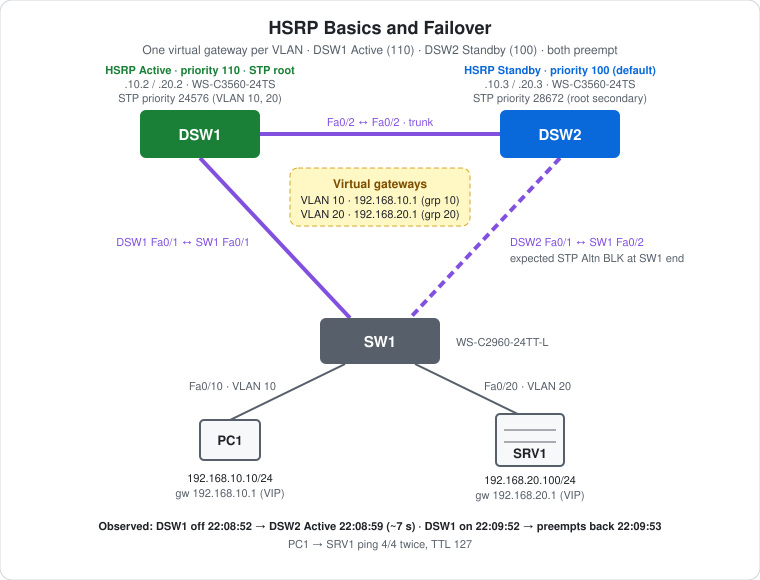

# CCNA Lab 17: HSRP Basics and Failover

A first-hop redundancy lab built in the **PingMyNetwork Sandbox**. Two Cisco Catalyst 3560 multilayer switches (DSW1, DSW2) both route for VLAN 10 and VLAN 20. Instead of pointing hosts at one switch's address, each VLAN gets a **virtual gateway IP** shared by both switches with **HSRP**. DSW1 is Active (priority 110), DSW2 is Standby (default 100), and both use `preempt`. Powering off DSW1 shows DSW2 taking over the gateway; powering it back on shows DSW1 reclaiming it.

The goal is to learn **HSRP from the ground up**: virtual IP, Active/Standby election by priority, preempt, the hello/hold timers behind failover, and why the STP root should sit on the HSRP Active switch. [Lab 12](../lab-12-collapsed-core-hsrp/) uses the same ideas in a bigger, load-shared design.

> **Lab status:** The configs in [`configs/`](configs/) and the results below come from the exported Sandbox JSON in [`lab-files/`](lab-files/). That export includes the saved configuration of every switch and the console output of the session. Results marked **observed** are copied from that output. DSW1 was power-cycled for the failover test, which cleared its console, so its commands below are rebuilt from its saved config.

## Learning objectives

- Explain why a single default gateway is a single point of failure.
- Configure HSRP: `standby <group> ip`, `priority` and `preempt`.
- Predict which switch becomes Active, and read `show standby brief`.
- Explain how hellos and the hold time decide how fast failover happens.
- Explain the HSRP virtual MAC address and why hosts don't notice a failover.
- Align the STP root with the HSRP Active switch.

## Topology



```text
      HSRP Active (110), STP root          HSRP Standby (100)
            DSW1 Fa0/2 ------trunk------ Fa0/2 DSW2
            Fa0/1                              Fa0/1
               \                               /
          trunk \                             / trunk
                 \                           /
               Fa0/1          SW1          Fa0/2
                      Fa0/10      Fa0/20
                        |            |
              PC1 192.168.10.10    SRV1 192.168.20.100
              gw 192.168.10.1      gw 192.168.20.1
                  (VLAN 10)            (VLAN 20)
```

| Device | Role | Model |
|---|---|---|
| DSW1 | HSRP Active for VLANs 10/20 (priority 110), STP root | Cisco WS-C3560-24TS (IOS 15.2) |
| DSW2 | HSRP Standby (priority 100), STP backup root | Cisco WS-C3560-24TS (IOS 15.2) |
| SW1 | Access switch: PC1 in VLAN 10, SRV1 in VLAN 20 | Cisco WS-C2960-24TT-L (IOS 15.2) |
| PC1 | Client in VLAN 10 | PC |
| SRV1 | Server in VLAN 20 | Server |

All three inter-switch links are single 802.1Q trunks (no EtherChannel in this lab).

## Addressing plan

### Gateways (HSRP)

| VLAN | Subnet | DSW1 SVI | DSW2 SVI | HSRP group | **Virtual IP** | DSW1 priority | DSW2 priority | Preempt |
|---|---|---|---|---|---|---|---|---|
| 10 | `192.168.10.0/24` | `.2` | `.3` | 10 | **`192.168.10.1`** | **110** | 100 (default) | both |
| 20 | `192.168.20.0/24` | `.2` | `.3` | 20 | **`192.168.20.1`** | **110** | 100 (default) | both |

### STP

| VLAN | DSW1 | DSW2 | SW1 |
|---|---|---|---|
| 10, 20 | **24576** (root) | 28672 (`root secondary`) | 32768 |

### Hosts

| Host | Switch port | VLAN | IP address | Subnet mask | Default gateway |
|---|---|---|---|---|---|
| PC1 | SW1 Fa0/10 | 10 | `192.168.10.10` | `255.255.255.0` | `192.168.10.1` (VIP) |
| SRV1 | SW1 Fa0/20 | 20 | `192.168.20.100` | `255.255.255.0` | `192.168.20.1` (VIP) |

## Configuration highlights

These excerpts are from the saved configs. The full configs are in [`configs/`](configs/).

### DSW1 (Active)

```cisco
ip routing
spanning-tree vlan 10,20 priority 24576
!
interface Vlan10
 ip address 192.168.10.2 255.255.255.0
 standby 10 ip 192.168.10.1
 standby 10 priority 110
 standby 10 preempt
!
interface Vlan20
 ip address 192.168.20.2 255.255.255.0
 standby 20 ip 192.168.20.1
 standby 20 priority 110
 standby 20 preempt
```

### DSW2 (Standby)

```cisco
ip routing
spanning-tree vlan 10,20 root secondary      ! saved as priority 28672
!
interface Vlan10
 ip address 192.168.10.3 255.255.255.0
 standby 10 ip 192.168.10.1
 standby 10 preempt
!
interface Vlan20
 ip address 192.168.20.3 255.255.255.0
 standby 20 ip 192.168.20.1
 standby 20 preempt
```

DSW2 has no `standby priority` command, so it uses the default **100**. DSW1's 110 wins.

## How HSRP works

- **Virtual IP and MAC.** The group shares a virtual IP (`.1`) and a virtual MAC. For HSRP version 1 that's `0000.0c07.acXX`, where XX is the group number in hex: **`0000.0c07.ac0a`** for group 10 and **`0000.0c07.ac14`** for group 20. Hosts ARP for `.1` and get the virtual MAC, whichever switch is Active.
- **Election.** The highest priority becomes **Active** and answers for the virtual IP/MAC. The next highest is **Standby**. A tie is broken by the higher interface IP.
- **Hellos and hold time.** Defaults are a 3 s hello and a 10 s hold. If the Standby hears no hello from the Active for the hold time, it becomes Active.
- **Preempt.** Without `preempt`, a recovered higher-priority router stays Standby. With it, DSW1 takes Active back as soon as it returns.
- **Failover is invisible to hosts.** The new Active switch uses the same virtual MAC and sends a gratuitous ARP, so PCs keep their ARP entry and gateway.

## Failover results (observed)

| Time (UTC) | Event | Source |
|---|---|---|
| 22:07:07 | DSW2 `Vlan10/Vlan20 … Speak -> Standby` (DSW1 is Active) | DSW2 log |
| 22:08:52 | **DSW1 powered off.** DSW2 Fa0/2 and SW1 Fa0/1 go down | DSW2, SW1 logs |
| 22:08:59 | DSW2 `Vlan10 Grp 10 state Standby -> Active` and `Vlan20 Grp 20 state Standby -> Active`: **about 7 s later**, within the 10 s hold time | DSW2 log |
| after | `show standby brief`: both groups Active local, standby `unknown` | DSW2 |
| 22:09:52 | **DSW1 powered back on.** Links and SVIs come up and it loads its saved config | DSW1, DSW2, SW1 logs |
| 22:09:53 | DSW1 `Listen -> Active` for both groups (**preempt**), DSW2 `Active -> Speak` | DSW1, DSW2 logs |
| 22:10:03 | DSW2 `Speak -> Standby` for both groups | DSW2 log |

`show standby brief` on DSW2 while DSW1 was off:

```text
Interface   Grp  Pri P State   Active          Standby         Virtual IP
Vl10        10   100 P Active  local           unknown         192.168.10.1
Vl20        20   100 P Active  local           unknown         192.168.20.1
```

After DSW1 came back:

```text
Interface   Grp  Pri P State   Active          Standby         Virtual IP
Vl10        10   100 P Standby 192.168.10.2    local           192.168.10.1
Vl20        20   100 P Standby 192.168.20.2    local           192.168.20.1
```

The takeover took about 7 s, not the full 10 s hold time. The hold timer runs from the **last hello received**, and DSW1's last hello came some seconds before the power-off.

## Spanning tree (expected)

The three trunks form a triangle (DSW1–DSW2–SW1), so Rapid-PVST+ blocks one port per VLAN. DSW1 is root.

- **SW1** and **DSW2** each have their root port on the direct link to DSW1 (cost 19).
- On the SW1–DSW2 link, both have cost 19 to the root. DSW2 has the lower bridge ID (28682 vs 32778), so DSW2's end is designated and **SW1 Fa0/2 is Alternate (blocking)**.

This keeps SW1's traffic on the direct path to DSW1, the HSRP Active gateway. That's the point of aligning the STP root with HSRP. The export has no `show spanning-tree` output, so check this with `show spanning-tree vlan 10` on SW1.

## Verification results

| Check | Command/test | Result |
|---|---|---|
| Initial roles | DSW2 log | **Observed:** DSW2 Standby for both groups |
| Failover | Power off DSW1 | **Observed:** DSW2 Active for both groups about 7 s later |
| During failover | DSW2 `show standby brief` | **Observed:** Active local, standby unknown |
| Preempt | Power DSW1 back on | **Observed:** DSW1 Active, DSW2 Standby again |
| Inter-VLAN ping | PC1 → `ping 192.168.20.100` | **Observed:** 4/4 replies twice, `TTL=127` |
| Virtual MAC | `show standby vlan 10` / `arp -a` on PC1 | Expected: `0000.0c07.ac0a` for 192.168.10.1 |
| STP | SW1 `show spanning-tree vlan 10` | Expected: Fa0/1 Root FWD, Fa0/2 Altn BLK |

PC1's two pings both succeeded, but the export doesn't timestamp PC pings, so it doesn't show whether either ran while DSW1 was off.

## Full configuration commands

DSW2 and SW1 below are the **exact commands typed in the Sandbox session**, copied from the console history in the export, including DSW2's `show standby brief` checks during the failover. **DSW1's console was cleared when it was power-cycled**, so its commands are rebuilt from its saved config (its STP priority may originally have been typed as `root primary`). Typing these on factory-default devices reproduces the lab.

How to read the blocks:

- Lines starting with `!` explain the command below them. Don't type them.
- The prompt (`SW1(config-if-range)#`) shows which mode you're in. Type only the text after `#` or `>`.
- Abbreviations such as `conf t` and `f0/1-2` are accepted by IOS, the same as `configure terminal` and `FastEthernet0/1 - 2`.

### DSW1 (WS-C3560-24TS) – rebuilt from saved config

```text
! Enter privileged EXEC mode
DSW1>enable
! Enter global configuration mode
DSW1#conf t
! Turn on IPv4 routing (needed on a multilayer switch)
DSW1(config)#ip routing
! Create VLAN 10 (and enter VLAN config mode)
DSW1(config)#vlan 10
! Create VLAN 20 (and enter VLAN config mode)
DSW1(config-vlan)#vlan 20
DSW1(config-vlan)#exit
! Select f0/1-2 and configure them together
DSW1(config)#interface range f0/1-2
! 3560 only: choose 802.1Q before trunking
DSW1(config-if-range)#switchport trunk encapsulation dot1q
! Make it an 802.1Q trunk
DSW1(config-if-range)#switchport mode trunk
DSW1(config-if-range)#exit
! Create the SVI (gateway interface) for VLAN 10
DSW1(config)#interface vlan 10
! Assign 192.168.10.2 / 255.255.255.0
DSW1(config-if)#ip address 192.168.10.2 255.255.255.0
! HSRP group 10: virtual gateway IP 192.168.10.1 (what the PCs use)
DSW1(config-if)#standby 10 ip 192.168.10.1
! HSRP group 10: priority 110 (higher wins Active, default 100)
DSW1(config-if)#standby 10 priority 110
! HSRP group 10: take Active back when this switch has the higher priority
DSW1(config-if)#standby 10 preempt
! Enable the interface
DSW1(config-if)#no shutdown
DSW1(config-if)#exit
! Create the SVI (gateway interface) for VLAN 20
DSW1(config)#interface vlan 20
! Assign 192.168.20.2 / 255.255.255.0
DSW1(config-if)#ip address 192.168.20.2 255.255.255.0
! HSRP group 20: virtual gateway IP 192.168.20.1 (what the PCs use)
DSW1(config-if)#standby 20 ip 192.168.20.1
! HSRP group 20: priority 110 (higher wins Active, default 100)
DSW1(config-if)#standby 20 priority 110
! HSRP group 20: take Active back when this switch has the higher priority
DSW1(config-if)#standby 20 preempt
! Enable the interface
DSW1(config-if)#no shutdown
DSW1(config-if)#exit
! Set bridge priority 24576 for VLAN(s) 10,20
DSW1(config)#spanning-tree vlan 10,20 priority 24576
DSW1(config)#end
! Save the running config to NVRAM
DSW1#write memory
```

### DSW2 (WS-C3560-24TS) – recorded session

```text
! Enter privileged EXEC mode
DSW2>enable
! Enter global configuration mode
DSW2#conf t
! Turn on IPv4 routing (needed on a multilayer switch)
DSW2(config)#ip routing
! Create VLAN 10 (and enter VLAN config mode)
DSW2(config)#vlan 10
! Create VLAN 20 (and enter VLAN config mode)
DSW2(config-vlan)#vlan 20
DSW2(config-vlan)#exit
! Select f0/1-2 and configure them together
DSW2(config)#interface range f0/1-2
! 3560 only: choose 802.1Q before trunking
DSW2(config-if-range)#switchport trunk encapsulation dot1q
! Make it an 802.1Q trunk
DSW2(config-if-range)#switchport mode trunk
DSW2(config-if-range)#exit
! Create the SVI (gateway interface) for VLAN 10
DSW2(config)#interface vlan 10
! Assign 192.168.10.3 / 255.255.255.0
DSW2(config-if)#ip address 192.168.10.3 255.255.255.0
! HSRP group 10: virtual gateway IP 192.168.10.1 (what the PCs use)
DSW2(config-if)#standby 10 ip 192.168.10.1
! HSRP group 10: take Active back when this switch has the higher priority
DSW2(config-if)#standby 10 preempt
! Enable the interface
DSW2(config-if)#no shutdown
DSW2(config-if)#exit
! Create the SVI (gateway interface) for VLAN 20
DSW2(config)#interface vlan 20
! Assign 192.168.20.3 / 255.255.255.0
DSW2(config-if)#ip address 192.168.20.3 255.255.255.0
! HSRP group 20: virtual gateway IP 192.168.20.1 (what the PCs use)
DSW2(config-if)#standby 20 ip 192.168.20.1
! HSRP group 20: take Active back when this switch has the higher priority
DSW2(config-if)#standby 20 preempt
! Enable the interface
DSW2(config-if)#no shutdown
DSW2(config-if)#exit
! Make this switch backup root for VLAN(s) 10,20 (saved as priority 28672)
DSW2(config)#spanning-tree vlan 10,20 root secondary
DSW2(config)#end
! Save the running config to NVRAM
DSW2#write memory
! Verify: HSRP state, priority, active/standby router and virtual IP
DSW2#show standby brief
! Verify: HSRP state, priority, active/standby router and virtual IP
DSW2#show standby brief
```

### SW1 (WS-C2960-24TT-L) – recorded session

```text
! Enter privileged EXEC mode
SW1>enable
! Enter global configuration mode
SW1#conf t
! Create VLAN 10 (and enter VLAN config mode)
SW1(config)#vlan 10
! Create VLAN 20 (and enter VLAN config mode)
SW1(config-vlan)#vlan 20
SW1(config-vlan)#exit
! Select f0/1-2 and configure them together
SW1(config)#interface range f0/1-2
! Make it an 802.1Q trunk
SW1(config-if-range)#switchport mode trunk
SW1(config-if-range)#exit
! Select interface f0/10
SW1(config)#interface f0/10
! Make it an access (host) port
SW1(config-if)#switchport mode access
! Put the port in VLAN 10
SW1(config-if)#switchport access vlan 10
SW1(config-if)#exit
! Select interface f0/20
SW1(config)#interface f0/20
! Make it an access (host) port
SW1(config-if)#switchport mode access
! Put the port in VLAN 20
SW1(config-if)#switchport access vlan 20
SW1(config-if)#end
! Save the running config to NVRAM
SW1#write memory
```

### PCs and servers

Set these in each host's IP configuration:

| Host | IP address | Subnet mask | Default gateway |
|---|---|---|---|
| PC1 | `192.168.10.10` | `255.255.255.0` | `192.168.10.1` |
| SRV1 | `192.168.20.100` | `255.255.255.0` | `192.168.20.1` |

Then test from PC1's command prompt:

```text
! Test reachability to 192.168.20.100
C:\> ping 192.168.20.100
! Test reachability to 192.168.20.100
C:\> ping 192.168.20.100
```

## Try it yourself: guided challenges

1. **Continuous ping.** Run `ping -t 192.168.20.100` on PC1 and power off DSW1. How many replies are lost? Then power it on and count again.
2. **No preempt.** Remove `standby 10 preempt` from DSW1 and repeat. Who is Active for VLAN 10 afterwards?
3. **Faster failover.** Set `standby 10 timers 1 3` on both switches, or millisecond timers (`standby 10 timers msec 200 msec 750`), and measure again.
4. **Find the virtual MAC.** Run `arp -a` on PC1 before and after a failover. Does the MAC for 192.168.10.1 change?
5. **Load-share.** Make DSW2 Active for VLAN 20 (priority 110 on DSW2 for group 20, 90 on DSW1) and move the VLAN 20 STP root to match, as in [Lab 12](../lab-12-collapsed-core-hsrp/).
6. **Version 2.** Configure `standby version 2` on both switches. What's the new virtual MAC format?
7. **Authentication.** Add `standby 10 authentication md5 key-string …` on one switch only. What happens?

## Scope and caveats

- HSRP is Cisco proprietary. **VRRP** (open standard) and **GLBP** (Cisco, with load balancing) solve the same problem. First-hop redundancy concepts are on the CCNA blueprint.
- Defaults are used: HSRP version 1, a 3 s hello and 10 s hold, and no authentication.
- The DSW1–DSW2 link is a single trunk, which is also how HSRP hellos cross between the switches. In production it would usually be an EtherChannel.
- DSW1's console session was lost when it was powered off, so its commands are rebuilt from the saved config. DSW1's running config differs from the saved one only in the "last configuration change" header.
- No switch has a management IP, passwords or an SSH user. Unused ports aren't shut down, and `ip http server` is on by default.

## Useful verification commands

```cisco
show standby brief
show standby vlan 10
show spanning-tree vlan 10
show ip interface brief
show interfaces trunk
```

## Lab files

| File | Description |
|---|---|
| [`lab-files/hsrp-basics-failover-lab.json`](lab-files/hsrp-basics-failover-lab.json) | PingMyNetwork Sandbox export with saved configs. Import it into the Sandbox to load the full lab. |
| [`configs/DSW1-running-config.txt`](configs/DSW1-running-config.txt) | DSW1 saved configuration (HSRP Active, STP root) |
| [`configs/DSW2-running-config.txt`](configs/DSW2-running-config.txt) | DSW2 saved configuration (HSRP Standby) |
| [`configs/SW1-running-config.txt`](configs/SW1-running-config.txt) | SW1 saved configuration (access) |
| [`images/topology.svg`](images/topology.svg) | Topology diagram |

**Built with:** [PingMyNetwork Sandbox](https://pingmynetwork.com/sandbox)
