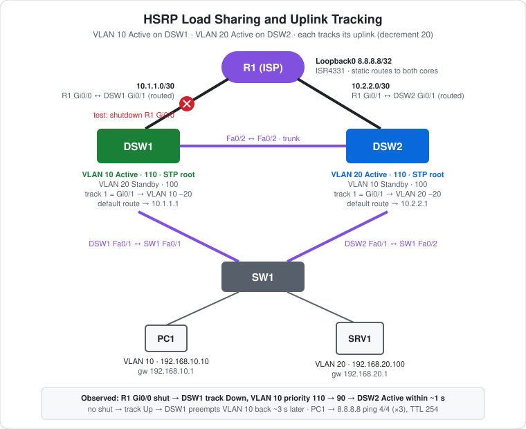

# CCNA Lab 18: HSRP Load Sharing and Uplink Tracking

The follow-on to [Lab 17](../lab-17-hsrp-basics-failover/), built in the **PingMyNetwork Sandbox**. The same two core switches now each have a routed **uplink to an "ISP" router** (R1, with `8.8.8.8` on a loopback). HSRP is split so that **DSW1 is Active for VLAN 10 and DSW2 is Active for VLAN 20**, sharing the load. Each core **tracks its uplink**: if the uplink goes down, the core lowers its HSRP priority by 20 and hands its VLAN to the other core, which still has a path out.

The goal is to practise **HSRP load sharing, object tracking with `track … interface … line-protocol`, priority decrement, and preempt-driven recovery**, and to see why a gateway that's "up" but has lost its uplink shouldn't stay Active.

> **Lab status:** The configs in [`configs/`](configs/) and the results below come from the exported Sandbox JSON in [`lab-files/`](lab-files/). That export includes the saved configuration of every device and the console output of the session. Results marked **observed** are copied from that output. This lab started from Lab 17's saved state, so the recorded sessions for DSW1 and DSW2 only show **what was added**. A full build from scratch is also given.

## Learning objectives

- Split HSRP Active roles per VLAN for load sharing, and align the STP root with each.
- Create a tracked object for an interface's line protocol.
- Tie HSRP priority to the tracked object with `standby … track … decrement`.
- Work out when the decrement is enough to trigger a takeover.
- Watch a takeover caused by an uplink failure, not a switch failure, and the preempt back when it recovers.

## Topology



```text
                         R1 "ISP"  Lo0 8.8.8.8/32
                Gi0/0 10.1.1.1         Gi0/1 10.2.2.1
                    /                         \
   routed 10.1.1.0/30                          routed 10.2.2.0/30
                  /                             \
        Gi0/1 10.1.1.2                     Gi0/1 10.2.2.2
     DSW1  VLAN 10 Active (110)  ==trunk==  DSW2  VLAN 20 Active (110)
          VLAN 20 Standby (100)    Fa0/2       VLAN 10 Standby (100)
          Fa0/1                                Fa0/1
              \                               /
         trunk \                             / trunk
                Fa0/1        SW1        Fa0/2
                     Fa0/10      Fa0/20
                       |            |
              PC1 192.168.10.10   SRV1 192.168.20.100
```

| Device | Role | Model |
|---|---|---|
| R1 | "ISP" router: Loopback0 `8.8.8.8`, static routes back to both VLANs via both cores | Cisco ISR4331 (IOS 15.9 in the Sandbox) |
| DSW1 | VLAN 10 Active (110) + STP root; tracks Gi0/1 | Cisco WS-C3560-24TS (IOS 15.2) |
| DSW2 | VLAN 20 Active (110) + STP root; tracks Gi0/1 | Cisco WS-C3560-24TS (IOS 15.2) |
| SW1 | Access switch: PC1 in VLAN 10, SRV1 in VLAN 20 (unchanged from Lab 17) | Cisco WS-C2960-24TT-L (IOS 15.2) |
| PC1, SRV1 | Hosts using the HSRP virtual gateways | PC, Server |

## Addressing plan

### Uplinks and routing

| Device | Interface | IP address | Default / static routes |
|---|---|---|---|
| R1 | Gi0/0 → DSW1 | `10.1.1.1/30` | `192.168.10.0/24` and `192.168.20.0/24` via **both** `10.1.1.2` and `10.2.2.2` |
| R1 | Gi0/1 → DSW2 | `10.2.2.1/30` | |
| R1 | Loopback0 | `8.8.8.8/32` | the "internet" test address |
| DSW1 | Gi0/1 (`no switchport`) | `10.1.1.2/30` | `0.0.0.0/0 → 10.1.1.1` |
| DSW2 | Gi0/1 (`no switchport`) | `10.2.2.2/30` | `0.0.0.0/0 → 10.2.2.1` |

### HSRP

| VLAN | Virtual IP | DSW1 (SVI `.2`) | DSW2 (SVI `.3`) | Tracking |
|---|---|---|---|---|
| 10 | `192.168.10.1` | **110**, preempt | 100, preempt | DSW1: `track 1` (Gi0/1) **decrement 20** |
| 20 | `192.168.20.1` | 100, preempt | **110**, preempt | DSW2: `track 1` (Gi0/1) **decrement 20** |

### STP

| VLAN | DSW1 | DSW2 |
|---|---|---|
| 10 | **24576** (root) | 28672 |
| 20 | 28672 (`root secondary`) | **24576** (`root primary`) |

### Hosts

| Host | Switch port | VLAN | IP address | Default gateway |
|---|---|---|---|---|
| PC1 | SW1 Fa0/10 | 10 | `192.168.10.10/24` | `192.168.10.1` |
| SRV1 | SW1 Fa0/20 | 20 | `192.168.20.100/24` | `192.168.20.1` |

## Configuration highlights

These excerpts are from the saved configs. The full configs are in [`configs/`](configs/).

### DSW1: uplink, tracking, load-sharing priorities

```cisco
interface GigabitEthernet0/1
 no switchport
 ip address 10.1.1.2 255.255.255.252
!
ip route 0.0.0.0 0.0.0.0 10.1.1.1
!
track 1 interface GigabitEthernet0/1 line-protocol
!
interface Vlan10
 standby 10 ip 192.168.10.1
 standby 10 priority 110
 standby 10 preempt
 standby 10 track 1 decrement 20
!
interface Vlan20
 standby 20 ip 192.168.20.1
 standby 20 preempt            ! priority 100 (default)
!
spanning-tree vlan 10 priority 24576
spanning-tree vlan 20 priority 28672
```

DSW2 mirrors it: Gi0/1 `10.2.2.2/30`, default route to `10.2.2.1`, the same `track 1`, `standby 20 priority 110` + `track 1 decrement 20`, and STP root for VLAN 20.

### R1: the "ISP"

```cisco
interface Loopback0
 ip address 8.8.8.8 255.255.255.255
interface GigabitEthernet0/0
 ip address 10.1.1.1 255.255.255.252
interface GigabitEthernet0/1
 ip address 10.2.2.1 255.255.255.252
!
ip route 192.168.10.0 255.255.255.0 10.1.1.2
ip route 192.168.10.0 255.255.255.0 10.2.2.2
ip route 192.168.20.0 255.255.255.0 10.1.1.2
ip route 192.168.20.0 255.255.255.0 10.2.2.2
```

R1 has **two equal static routes** to each VLAN, one via each core. If one uplink goes down, its route is removed with the interface, and return traffic uses the other core.

## The tracking math

| DSW1 uplink | DSW1 VLAN 10 priority | DSW2 VLAN 10 priority | VLAN 10 Active |
|---|---|---|---|
| Up | **110** | 100 | DSW1 |
| Down | 110 − 20 = **90** | 100 | **DSW2** (it has `preempt`) |

The decrement must push the Active switch's priority **below** the Standby's. Here 110 − 20 = 90 < 100. A decrement of 10 would only tie at 100, and the tie goes to the higher interface IP. The Standby **also needs `preempt`** to take over from a switch that's still alive.

## Results (observed)

### 1. Tracking at startup

While the uplinks were still unconfigured, both tracked objects were **Down**. Both cores ran at the decremented priority, and DSW2 initially held Active for VLAN 10. As each uplink came up, its core preempted its VLAN:

| Time (UTC) | Event |
|---|---|
| 22:19:15 | DSW1 `%TRACK-6-STATE: 1 interface Gi0/1 line-protocol Down -> Up` |
| 22:19:18 | DSW2 `track 1 … Down -> Up` |
| 22:19:18 | DSW1 `Vlan10 Grp 10 Standby -> Active`; DSW2 `Vlan10 Active -> Speak` |
| 22:19:18 | DSW2 `Vlan20 Grp 20 Standby -> Active`; DSW1 `Vlan20 Active -> Speak` |

```text
DSW1#show standby brief
Interface   Grp  Pri P State   Active          Standby         Virtual IP
Vl10        10   110 P Active  local           192.168.10.3    192.168.10.1
Vl20        20   100 P Standby 192.168.20.3    local           192.168.20.1

DSW1#show track 1
Track 1
  Interface GigabitEthernet0/1 line-protocol
  Line protocol is Up
    2 changes, last change 00:00:29
  Tracked by:
    HSRP Vlan10 10
```

That's **load sharing**: DSW1 is Active for VLAN 10 and DSW2 for VLAN 20.

### 2. Uplink failure: `shutdown` on R1 Gi0/0

| Time (UTC) | Event | Source |
|---|---|---|
| 22:21:05.8 | `track 1 interface Gi0/1 line-protocol Up -> Down` | DSW1 |
| 22:21:06.5 | `Vlan10 Grp 10 state Standby -> Active` | DSW2 |
| 22:21:06.6 | `Vlan10 Grp 10 state Active -> Speak` | DSW1 |

```text
DSW1#show standby brief
Interface   Grp  Pri P State   Active          Standby         Virtual IP
Vl10        10   90  P Speak   192.168.10.3    unknown         192.168.10.1
Vl20        20   100 P Standby 192.168.20.3    local           192.168.20.1
```

DSW1's VLAN 10 priority dropped to **90**, and DSW2 took over in **under a second**. Both switches were still up, so there was no hold timer to wait for: DSW2 saw the lower priority in DSW1's next hello and preempted. DSW1 settled into Standby at 22:21:16. VLAN 20 was unaffected.

R1 logged the shutdown at 22:21:06–07. Its clock is slightly offset from DSW1's, so the sub-second ordering across devices is approximate.

### 3. Recovery: `no shutdown` on R1 Gi0/0

| Time (UTC) | Event | Source |
|---|---|---|
| 22:21:48.8 | `track 1 … Down -> Up` | DSW1 |
| 22:21:51.6 | `Vlan10 Grp 10 state Standby -> Active` (**preempt**, about 3 s later at the next hello) | DSW1 |
| 22:21:51.6 → 22:22:01.6 | `Vlan10 Active -> Speak -> Standby` | DSW2 |

```text
DSW1#show standby brief
Interface   Grp  Pri P State   Active          Standby         Virtual IP
Vl10        10   110 P Active  local           unknown         192.168.10.1
Vl20        20   100 P Standby 192.168.20.3    local           192.168.20.1
```

(The VLAN 10 Standby shows `unknown` because DSW2 was still in Speak when this was captured.)

### 4. Reaching the "internet"

PC1's `ipconfig` showed `192.168.10.10/24`, gateway `192.168.10.1`. **`ping 8.8.8.8` got 4/4 replies three times**, with `TTL=254`: R1 replies with TTL 255, and the core decrements it once.

The export doesn't timestamp PC pings, so it doesn't show which ones ran during the failover. The lab note's test is that PC1 keeps reaching 8.8.8.8 while DSW1's uplink is down, via DSW2.

## Verification results

| Check | Command/test | Result |
|---|---|---|
| Load sharing | DSW1 `show standby brief` | **Observed:** VLAN 10 Active (110), VLAN 20 Standby (100) |
| Tracking | DSW1 `show track 1` | **Observed:** Gi0/1 line-protocol Up, tracked by HSRP Vlan10 10 |
| Uplink failure | Shut R1 Gi0/0 | **Observed:** DSW1 VLAN 10 priority 90, DSW2 Active within about 1 s |
| Recovery | No shut R1 Gi0/0 | **Observed:** DSW1 preempts VLAN 10 back about 3 s after the track came up |
| Internet ping | PC1 → `ping 8.8.8.8` | **Observed:** 4/4 replies ×3, `TTL=254` |
| VLAN 20 during the test | DSW2 `show standby brief` | Expected: VLAN 20 Active throughout |
| Return path | R1 `show ip route static` | Expected: two next hops per VLAN while both uplinks are up, one while Gi0/0 is down |

## Full configuration commands

This lab started from [Lab 17](../lab-17-hsrp-basics-failover/)'s saved state. The blocks below are the **exact commands typed in the Sandbox session**, copied from the console history in the export: the **additions** on DSW1 and DSW2 (uplink, default route, tracking, load-sharing priorities), and R1's full session including the `shutdown` / `no shutdown` test. SW1 wasn't changed. To build everything from factory defaults in one pass, use **Full build from scratch** at the end of this section.

How to read the blocks:

- Lines starting with `!` explain the command below them. Don't type them.
- The prompt (`SW1(config-if-range)#`) shows which mode you're in. Type only the text after `#` or `>`.
- Abbreviations such as `conf t` and `f0/1-2` are accepted by IOS, the same as `configure terminal` and `FastEthernet0/1 - 2`.

### DSW1 (WS-C3560-24TS) – recorded additions on top of Lab 17

```text
! Enter privileged EXEC mode
DSW1>enable
! Enter global configuration mode
DSW1#conf t
! Select interface g0/1
DSW1(config)#interface g0/1
! Make it a routed (Layer 3) port
DSW1(config-if)#no switchport
! Assign 10.1.1.2 / 255.255.255.252
DSW1(config-if)#ip address 10.1.1.2 255.255.255.252
DSW1(config-if)#exit
! Default route: send everything unknown to 10.1.1.1
DSW1(config)#ip route 0.0.0.0 0.0.0.0 10.1.1.1
! Track object 1: follow the up/down state of g0/1 (enter track config mode)
DSW1(config)#track 1 interface g0/1 line-protocol
DSW1(config-track)#exit
! Create the SVI (gateway interface) for VLAN 10
DSW1(config)#interface vlan 10
! HSRP group 10: lower priority by 20 while track 1 is down
DSW1(config-if)#standby 10 track 1 decrement 20
DSW1(config-if)#exit
! Create the SVI (gateway interface) for VLAN 20
DSW1(config)#interface vlan 20
! HSRP group 20: priority 100 (higher wins Active, default 100)
DSW1(config-if)#standby 20 priority 100
DSW1(config-if)#exit
! Make this switch backup root for VLAN(s) 20 (saved as priority 28672)
DSW1(config)#spanning-tree vlan 20 root secondary
DSW1(config)#end
! Save the running config to NVRAM
DSW1#write memory
! Verify: HSRP state, priority, active/standby router and virtual IP
DSW1#show standby brief
! Verify: tracked object state and what is tracking it
DSW1#show track 1
! Verify: HSRP state, priority, active/standby router and virtual IP
DSW1#show standby brief
! Verify: HSRP state, priority, active/standby router and virtual IP
DSW1#show standby brief
```

### DSW2 (WS-C3560-24TS) – recorded additions on top of Lab 17

```text
! Enter privileged EXEC mode
DSW2>enable
! Enter global configuration mode
DSW2#conf t
! Select interface g0/1
DSW2(config)#interface g0/1
! Make it a routed (Layer 3) port
DSW2(config-if)#no switchport
! Assign 10.2.2.2 / 255.255.255.252
DSW2(config-if)#ip address 10.2.2.2 255.255.255.252
DSW2(config-if)#exit
! Default route: send everything unknown to 10.2.2.1
DSW2(config)#ip route 0.0.0.0 0.0.0.0 10.2.2.1
! Track object 1: follow the up/down state of g0/1 (enter track config mode)
DSW2(config)#track 1 interface g0/1 line-protocol
DSW2(config-track)#exit
! Create the SVI (gateway interface) for VLAN 20
DSW2(config)#interface vlan 20
! HSRP group 20: priority 110 (higher wins Active, default 100)
DSW2(config-if)#standby 20 priority 110
! HSRP group 20: lower priority by 20 while track 1 is down
DSW2(config-if)#standby 20 track 1 decrement 20
DSW2(config-if)#exit
! Make this switch root for VLAN(s) 20 (saved as priority 24576)
DSW2(config)#spanning-tree vlan 20 root primary
DSW2(config)#end
! Save the running config to NVRAM
DSW2#write memory
```

### R1 (ISR4331) – recorded session, including the uplink failure test

```text
! Enter privileged EXEC mode
R1>enable
! Enter global configuration mode
R1#conf t
! Stop mistyped commands being treated as hostnames to look up
R1(config)#no ip domain-lookup
! Select interface g0/0
R1(config)#interface g0/0
! Assign 10.1.1.1 / 255.255.255.252
R1(config-if)#ip address 10.1.1.1 255.255.255.252
! Enable the interface
R1(config-if)#no shutdown
! Select interface g0/1
R1(config-if)#interface g0/1
! Assign 10.2.2.1 / 255.255.255.252
R1(config-if)#ip address 10.2.2.1 255.255.255.252
! Enable the interface
R1(config-if)#no shutdown
! Create Loopback0 (always-up virtual interface)
R1(config-if)#interface loopback0
! Assign 8.8.8.8 / 255.255.255.255
R1(config-if)#ip address 8.8.8.8 255.255.255.255
R1(config-if)#exit
! Static route to 192.168.10.0/255.255.255.0 via 10.1.1.2
R1(config)#ip route 192.168.10.0 255.255.255.0 10.1.1.2
! Static route to 192.168.10.0/255.255.255.0 via 10.2.2.2
R1(config)#ip route 192.168.10.0 255.255.255.0 10.2.2.2
! Static route to 192.168.20.0/255.255.255.0 via 10.1.1.2
R1(config)#ip route 192.168.20.0 255.255.255.0 10.1.1.2
! Static route to 192.168.20.0/255.255.255.0 via 10.2.2.2
R1(config)#ip route 192.168.20.0 255.255.255.0 10.2.2.2
R1(config)#end
! Save the running config to NVRAM
R1#write memory
! Enter global configuration mode
R1#conf t
! Select interface g0/0
R1(config)#interface g0/0
! Disable the interface (failover test)
R1(config-if)#shutdown
R1(config-if)#end
! Enter global configuration mode
R1#conf t
! Select interface g0/0
R1(config)#interface g0/0
! Enable the interface
R1(config-if)#no shutdown
R1(config-if)#end
! Save the running config to NVRAM
R1#write memory
```

### PCs and servers

Set these in each host's IP configuration:

| Host | IP address | Subnet mask | Default gateway |
|---|---|---|---|
| PC1 | `192.168.10.10` | `255.255.255.0` | `192.168.10.1` |
| SRV1 | `192.168.20.100` | `255.255.255.0` | `192.168.20.1` |

Then test from PC1's command prompt:

```text
C:\> ipconfig
! Test reachability to 8.8.8.8
C:\> ping 8.8.8.8
! Test reachability to 8.8.8.8
C:\> ping 8.8.8.8
! Test reachability to 8.8.8.8
C:\> ping 8.8.8.8
```

### Full build from scratch

These commands build the final lab from factory defaults, matching the saved configs. Use R1's recorded session above for R1 (skip its `shutdown` / `no shutdown` test).

#### DSW1 (WS-C3560-24TS)

```text
! Enter privileged EXEC mode
DSW1>enable
! Enter global configuration mode
DSW1#conf t
! Turn on IPv4 routing (needed on a multilayer switch)
DSW1(config)#ip routing
! Create VLAN 10 (and enter VLAN config mode)
DSW1(config)#vlan 10
! Create VLAN 20 (and enter VLAN config mode)
DSW1(config-vlan)#vlan 20
DSW1(config-vlan)#exit
! Select f0/1-2 and configure them together
DSW1(config)#interface range f0/1-2
! 3560 only: choose 802.1Q before trunking
DSW1(config-if-range)#switchport trunk encapsulation dot1q
! Make it an 802.1Q trunk
DSW1(config-if-range)#switchport mode trunk
DSW1(config-if-range)#exit
! Select interface g0/1
DSW1(config)#interface g0/1
! Make it a routed (Layer 3) port
DSW1(config-if)#no switchport
! Assign 10.1.1.2 / 255.255.255.252
DSW1(config-if)#ip address 10.1.1.2 255.255.255.252
DSW1(config-if)#exit
! Default route: send everything unknown to 10.1.1.1
DSW1(config)#ip route 0.0.0.0 0.0.0.0 10.1.1.1
! Track object 1: follow the up/down state of g0/1 (enter track config mode)
DSW1(config)#track 1 interface g0/1 line-protocol
DSW1(config-track)#exit
! Create the SVI (gateway interface) for VLAN 10
DSW1(config)#interface vlan 10
! Assign 192.168.10.2 / 255.255.255.0
DSW1(config-if)#ip address 192.168.10.2 255.255.255.0
! HSRP group 10: virtual gateway IP 192.168.10.1 (what the PCs use)
DSW1(config-if)#standby 10 ip 192.168.10.1
! HSRP group 10: priority 110 (higher wins Active, default 100)
DSW1(config-if)#standby 10 priority 110
! HSRP group 10: take Active back when this switch has the higher priority
DSW1(config-if)#standby 10 preempt
! HSRP group 10: lower priority by 20 while track 1 is down
DSW1(config-if)#standby 10 track 1 decrement 20
! Enable the interface
DSW1(config-if)#no shutdown
DSW1(config-if)#exit
! Create the SVI (gateway interface) for VLAN 20
DSW1(config)#interface vlan 20
! Assign 192.168.20.2 / 255.255.255.0
DSW1(config-if)#ip address 192.168.20.2 255.255.255.0
! HSRP group 20: virtual gateway IP 192.168.20.1 (what the PCs use)
DSW1(config-if)#standby 20 ip 192.168.20.1
! HSRP group 20: take Active back when this switch has the higher priority
DSW1(config-if)#standby 20 preempt
! Enable the interface
DSW1(config-if)#no shutdown
DSW1(config-if)#exit
! Set bridge priority 24576 for VLAN(s) 10
DSW1(config)#spanning-tree vlan 10 priority 24576
! Set bridge priority 28672 for VLAN(s) 20
DSW1(config)#spanning-tree vlan 20 priority 28672
DSW1(config)#end
! Save the running config to NVRAM
DSW1#write memory
```

#### DSW2 (WS-C3560-24TS)

```text
! Enter privileged EXEC mode
DSW2>enable
! Enter global configuration mode
DSW2#conf t
! Turn on IPv4 routing (needed on a multilayer switch)
DSW2(config)#ip routing
! Create VLAN 10 (and enter VLAN config mode)
DSW2(config)#vlan 10
! Create VLAN 20 (and enter VLAN config mode)
DSW2(config-vlan)#vlan 20
DSW2(config-vlan)#exit
! Select f0/1-2 and configure them together
DSW2(config)#interface range f0/1-2
! 3560 only: choose 802.1Q before trunking
DSW2(config-if-range)#switchport trunk encapsulation dot1q
! Make it an 802.1Q trunk
DSW2(config-if-range)#switchport mode trunk
DSW2(config-if-range)#exit
! Select interface g0/1
DSW2(config)#interface g0/1
! Make it a routed (Layer 3) port
DSW2(config-if)#no switchport
! Assign 10.2.2.2 / 255.255.255.252
DSW2(config-if)#ip address 10.2.2.2 255.255.255.252
DSW2(config-if)#exit
! Default route: send everything unknown to 10.2.2.1
DSW2(config)#ip route 0.0.0.0 0.0.0.0 10.2.2.1
! Track object 1: follow the up/down state of g0/1 (enter track config mode)
DSW2(config)#track 1 interface g0/1 line-protocol
DSW2(config-track)#exit
! Create the SVI (gateway interface) for VLAN 20
DSW2(config)#interface vlan 20
! Assign 192.168.20.3 / 255.255.255.0
DSW2(config-if)#ip address 192.168.20.3 255.255.255.0
! HSRP group 20: virtual gateway IP 192.168.20.1 (what the PCs use)
DSW2(config-if)#standby 20 ip 192.168.20.1
! HSRP group 20: priority 110 (higher wins Active, default 100)
DSW2(config-if)#standby 20 priority 110
! HSRP group 20: take Active back when this switch has the higher priority
DSW2(config-if)#standby 20 preempt
! HSRP group 20: lower priority by 20 while track 1 is down
DSW2(config-if)#standby 20 track 1 decrement 20
! Enable the interface
DSW2(config-if)#no shutdown
DSW2(config-if)#exit
! Create the SVI (gateway interface) for VLAN 10
DSW2(config)#interface vlan 10
! Assign 192.168.10.3 / 255.255.255.0
DSW2(config-if)#ip address 192.168.10.3 255.255.255.0
! HSRP group 10: virtual gateway IP 192.168.10.1 (what the PCs use)
DSW2(config-if)#standby 10 ip 192.168.10.1
! HSRP group 10: take Active back when this switch has the higher priority
DSW2(config-if)#standby 10 preempt
! Enable the interface
DSW2(config-if)#no shutdown
DSW2(config-if)#exit
! Set bridge priority 28672 for VLAN(s) 10
DSW2(config)#spanning-tree vlan 10 priority 28672
! Set bridge priority 24576 for VLAN(s) 20
DSW2(config)#spanning-tree vlan 20 priority 24576
DSW2(config)#end
! Save the running config to NVRAM
DSW2#write memory
```

#### SW1 (WS-C2960-24TT-L)

```text
! Enter privileged EXEC mode
SW1>enable
! Enter global configuration mode
SW1#conf t
! Create VLAN 10 (and enter VLAN config mode)
SW1(config)#vlan 10
! Create VLAN 20 (and enter VLAN config mode)
SW1(config-vlan)#vlan 20
SW1(config-vlan)#exit
! Select f0/1-2 and configure them together
SW1(config)#interface range f0/1-2
! Make it an 802.1Q trunk
SW1(config-if-range)#switchport mode trunk
SW1(config-if-range)#exit
! Select interface f0/10
SW1(config)#interface f0/10
! Make it an access (host) port
SW1(config-if)#switchport mode access
! Put the port in VLAN 10
SW1(config-if)#switchport access vlan 10
SW1(config-if)#exit
! Select interface f0/20
SW1(config)#interface f0/20
! Make it an access (host) port
SW1(config-if)#switchport mode access
! Put the port in VLAN 20
SW1(config-if)#switchport access vlan 20
SW1(config-if)#end
! Save the running config to NVRAM
SW1#write memory
```

## Try it yourself: guided challenges

1. **Too small a decrement.** Change DSW1 to `standby 10 track 1 decrement 10` and repeat the shutdown. What's the priority, and who's Active?
2. **Remove preempt from DSW2.** Repeat the uplink failure. Does DSW2 take over VLAN 10? Why not?
3. **Continuous ping.** Run `ping -t 8.8.8.8` on PC1 during the shutdown and no shutdown. Count any lost replies.
4. **Fail the other side.** Shut R1 Gi0/1. Which VLAN moves, and to which core?
5. **Track reachability, not the link.** A link can be up while the ISP is down. Use an IP SLA (`ip sla 1` / `icmp-echo 8.8.8.8`) with `track 2 ip sla 1 reachability`, and track that instead.
6. **Both uplinks down.** Shut both R1 interfaces. What does HSRP do, and does it matter?

## Scope and caveats

- HSRP object tracking goes slightly beyond CCNA, but it's the standard companion to HSRP in real designs.
- Line-protocol tracking only detects a **local link** failure. A failure further upstream, with the link still up, isn't detected (Challenge 5).
- R1 is a stand-in "ISP" with no NAT or upstream. `8.8.8.8` is just its loopback.
- The recorded DSW1/DSW2 sessions are **additions** on top of Lab 17's saved config. SW1 wasn't changed: its running config differs from the saved one only in the "last configuration change" header.
- The Sandbox names the ISR4331's ports `GigabitEthernet0/0`–`0/3`. A real ISR4331 uses `GigabitEthernet0/0/0` style names.
- No device has a management IP, passwords or an SSH user.

## Useful verification commands

```cisco
show standby brief
show standby vlan 10
show track 1
show track brief
show ip route
show spanning-tree vlan 10
```

## Lab files

| File | Description |
|---|---|
| [`lab-files/hsrp-load-sharing-tracking-lab.json`](lab-files/hsrp-load-sharing-tracking-lab.json) | PingMyNetwork Sandbox export with saved configs. Import it into the Sandbox to load the full lab. |
| [`configs/DSW1-running-config.txt`](configs/DSW1-running-config.txt) | DSW1 saved configuration (VLAN 10 Active, tracks Gi0/1) |
| [`configs/DSW2-running-config.txt`](configs/DSW2-running-config.txt) | DSW2 saved configuration (VLAN 20 Active, tracks Gi0/1) |
| [`configs/SW1-running-config.txt`](configs/SW1-running-config.txt) | SW1 saved configuration (unchanged from Lab 17) |
| [`configs/R1-running-config.txt`](configs/R1-running-config.txt) | R1 saved configuration ("ISP", 8.8.8.8) |
| [`images/topology.svg`](images/topology.svg) | Topology diagram |

**Built with:** [PingMyNetwork Sandbox](https://pingmynetwork.com/sandbox)
