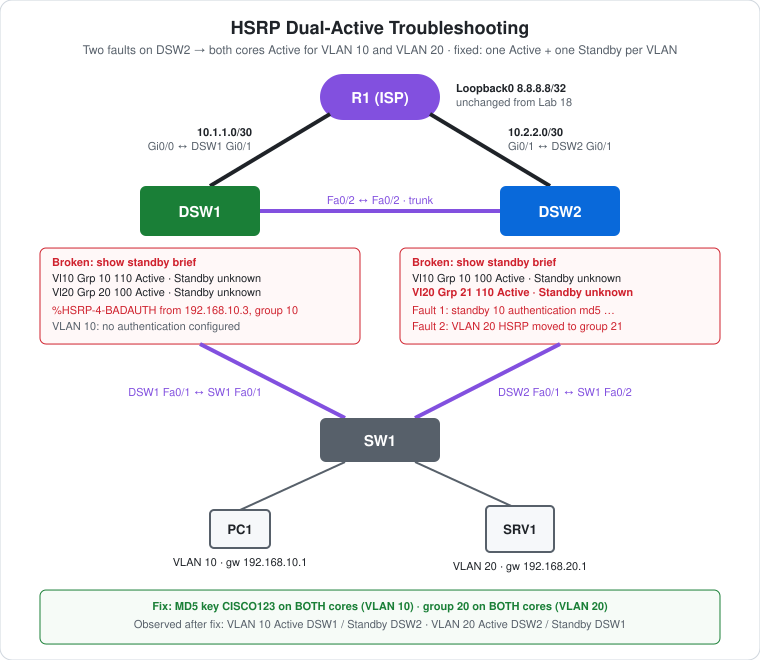

# CCNA Lab 19: HSRP Dual-Active Troubleshooting

A troubleshooting lab that follows on from [Lab 18](../lab-18-hsrp-load-sharing-tracking/), built in the **PingMyNetwork Sandbox**. It uses the same topology: two core switches sharing HSRP load across VLAN 10 and VLAN 20, each tracking its uplink to R1. Two faults are introduced on DSW2, and **both cores end up Active for both VLANs**. That's **dual-active**: two gateways each believe they own the same virtual IP. The task is to find both faults with `show standby brief` and the logs, then fix them.

The goal is to practise **HSRP troubleshooting**: reading `show standby brief` for the tell-tale `Standby unknown`, recognising `%HSRP-4-BADAUTH`, and spotting a **group-number mismatch**, a fault that the Sandbox didn't log at all.

> **Lab status:** The configs in [`configs/`](configs/) are the **solved** state saved in the exported Sandbox JSON in [`lab-files/`](lab-files/). The faults, the symptoms and the fix all come from the console output in the same export. Results marked **observed** are copied from that output. This lab started from Lab 18's saved state, so the recorded sessions below only show **what was typed for this lab**. To reproduce the broken state, load the export and type the commands in [Reproduce the faults](#reproduce-the-faults).

## Learning objectives

- Recognise dual-active in `show standby brief`: **Active** on both peers, with **Standby `unknown`**.
- Explain why HSRP peers that can't accept each other's hellos both become Active.
- Read `%HSRP-4-BADAUTH` and fix an authentication mismatch.
- Spot a group-number mismatch: different groups with the same virtual IP are separate groups and never see each other.
- Know which HSRP parameters must match between peers and which can differ.

## Topology



```text
                         R1 "ISP"  Lo0 8.8.8.8/32
                Gi0/0 10.1.1.1         Gi0/1 10.2.2.1
                    /                         \
        Gi0/1 10.1.1.2                     Gi0/1 10.2.2.2
     DSW1  VLAN 10 Active (110)  ==trunk==  DSW2  VLAN 20 Active (110)
          VLAN 20 Standby (100)    Fa0/2       VLAN 10 Standby (100)
          Fa0/1                                Fa0/1
              \                               /
         trunk \                             / trunk
                Fa0/1        SW1        Fa0/2
                     Fa0/10      Fa0/20
                       |            |
              PC1 192.168.10.10   SRV1 192.168.20.100

   Intended (and fixed) roles shown. Broken: both cores Active for both VLANs.
```

| Device | Role | Model |
|---|---|---|
| R1 | "ISP" router: Loopback0 `8.8.8.8`, static routes to both VLANs via both cores (unchanged from Lab 18) | Cisco ISR4331 (IOS 15.9 in the Sandbox) |
| DSW1 | Intended VLAN 10 Active (110); tracks Gi0/1 | Cisco WS-C3560-24TS (IOS 15.2) |
| DSW2 | Intended VLAN 20 Active (110); tracks Gi0/1. **Both faults were introduced here** | Cisco WS-C3560-24TS (IOS 15.2) |
| SW1 | Access switch: PC1 in VLAN 10, SRV1 in VLAN 20 (unchanged) | Cisco WS-C2960-24TT-L (IOS 15.2) |
| PC1, SRV1 | Hosts using the HSRP virtual gateways | PC, Server |

## Addressing plan

Addressing, uplinks, routing and STP are the same as in [Lab 18](../lab-18-hsrp-load-sharing-tracking/#addressing-plan). The HSRP settings, which this lab is about, are:

| VLAN | Group | Virtual IP | Virtual MAC | DSW1 (SVI `.2`) | DSW2 (SVI `.3`) | Authentication |
|---|---|---|---|---|---|---|
| 10 | 10 | `192.168.10.1` | `0000.0c07.ac0a` | **110**, preempt, track 1 −20 | 100, preempt | **MD5, key string `CISCO123`, on both** |
| 20 | 20 | `192.168.20.1` | `0000.0c07.ac14` | 100, preempt | **110**, preempt, track 1 −20 | none |

The virtual MAC is `0000.0c07.acXX`, where `XX` is the group number in hex (HSRP version 1, the default). Group 10 is `0a`, group 20 is `14` and group 21 would be `15`.

| Host | Switch port | VLAN | IP address | Default gateway |
|---|---|---|---|---|
| PC1 | SW1 Fa0/10 | 10 | `192.168.10.10/24` | `192.168.10.1` |
| SRV1 | SW1 Fa0/20 | 20 | `192.168.20.100/24` | `192.168.20.1` |

## The faults

Both faults were typed on **DSW2**, starting from Lab 18's working config:

```cisco
interface Vlan10
 standby 10 authentication md5 key-string CISCO123   ! Fault 1: MD5 on DSW2 only
!
interface Vlan20
 no standby 20                                       ! removes ALL group 20 settings
 standby 21 ip 192.168.20.1                          ! Fault 2: same VIP, group 21
 standby 21 priority 110
 standby 21 preempt
```

`no standby 20` removes **every** group 20 command, including `standby 20 track 1 decrement 20`. The faulty group 21 had no tracking, so the fix has to add it back.

### Symptoms (observed)

```text
DSW1#show standby brief
                     P indicates configured to preempt.
                     |
Interface   Grp  Pri P State   Active          Standby         Virtual IP
Vl10        10   110 P Active  local           unknown         192.168.10.1
Vl20        20   100 P Active  local           unknown         192.168.20.1
```

```text
DSW2#show standby brief
                     P indicates configured to preempt.
                     |
Interface   Grp  Pri P State   Active          Standby         Virtual IP
Vl10        10   100 P Active  local           unknown         192.168.10.1
Vl20        21   110 P Active  local           unknown         192.168.20.1
```

Every group on both cores is **Active**, with Active `local` and Standby `unknown`. Each switch is acting as if it were alone. The logs showed:

```text
DSW1: %HSRP-4-BADAUTH: Bad authentication from 192.168.10.3, group 10, remote state Standby
DSW2: %HSRP-4-BADAUTH: Bad authentication from 192.168.10.2, group 10, remote state Active
```

The logs had **nothing about VLAN 20**.

### Timeline (observed)

| Time (UTC) | Event | Source |
|---|---|---|
| 09:51:45.401 | `no standby 20`: `Vlan20 Grp 20 state Active -> Disabled` | DSW2 |
| 09:51:45.427 | `Vlan20 Grp 20 state Standby -> Active` (the only group 20 member left) | DSW1 |
| 09:51:47.5 | `%HSRP-4-BADAUTH` for group 10, logged by each core about the other | DSW1, DSW2 |
| 09:51:54.511 | `Vlan10 Grp 10 state Standby -> Active`: about 10 s (the hold time) with no accepted hello | DSW2 |
| 09:52:05.411 | `Vlan20 Grp 21 state Speak -> Standby -> Active` | DSW2 |
| 09:52:48–50 | `BADAUTH` again, now `remote state Active` on both sides | DSW1, DSW2 |

DSW1 never left Active for VLAN 10. DSW2 took VLAN 10 over **without preempting**: it just stopped accepting DSW1's hellos, and once its hold timer expired it assumed DSW1 was gone.

## Why it fails

### Fault 1: authentication mismatch (VLAN 10)

HSRP peers must agree on authentication, or they **drop each other's hellos**. DSW1 has no `standby 10 authentication` command, so it uses the HSRPv1 default: the plain-text string `cisco` in every hello. DSW2 expects MD5 with key `CISCO123`. Each switch rejects the other's hellos (`BADAUTH`), so neither hears a peer and both become Active.

The rejection works in both directions: DSW1 logged bad authentication from `.3` and DSW2 logged it from `.2`. So the fix can go either way: configure the same key on both cores, or remove authentication from DSW2. This lab adds MD5 to DSW1, so the group stays authenticated.

### Fault 2: group-number mismatch (VLAN 20)

The **group number** identifies the group in every hello and also sets the virtual MAC. DSW1 runs group 20 and DSW2 runs group 21. HSRP ignores hellos for a group it isn't running, so there's no error, just **two separate one-member groups**. Each one is alone, and each becomes Active for `192.168.20.1`:

| Core | Group | Virtual MAC it answers ARP with |
|---|---|---|
| DSW1 | 20 | `0000.0c07.ac14` |
| DSW2 | 21 | `0000.0c07.ac15` |

There was no `BADAUTH`, and the Sandbox logged nothing for VLAN 20. The only clues are in `show standby brief`: the **Grp** column (20 on one core, 21 on the other) and `Standby unknown`.

### What dual-active does to traffic

These effects are **expected**. The export doesn't capture them:

- **VLAN 10:** both cores answer as `0000.0c07.ac0a`. SW1 receives frames from that MAC on both uplinks, so its MAC table flaps between Fa0/1 and Fa0/2.
- **VLAN 20:** a host uses whichever core's ARP reply it last cached. SRV1 might use DSW1's `ac14` while another host uses DSW2's `ac15`.
- Both cores can still route, so pings often **still work**. That's what makes dual-active easy to miss until something like tracking fails: DSW1's uplink tracking can't move a VLAN to DSW2 when DSW2 already thinks it's Active.

## The fix

```cisco
! DSW1 – match DSW2's authentication on VLAN 10
interface Vlan10
 standby 10 authentication md5 key-string CISCO123
!
! DSW2 – put VLAN 20 back in group 20, including the tracking that "no standby 20" removed
interface Vlan20
 no standby 21
 standby 20 ip 192.168.20.1
 standby 20 priority 110
 standby 20 preempt
 standby 20 track 1 decrement 20
```

### Recovery timeline (observed)

| Time (UTC) | Event | Source |
|---|---|---|
| 09:53:31 | MD5 added on VLAN 10 | DSW1 |
| 09:53:32.511 | `Vlan10 Grp 10 state Active -> Speak` (now hears DSW1 at 110) | DSW2 |
| 09:53:33.232 | `no standby 21`: `Vlan20 Grp 21 state Active -> Disabled` | DSW2 |
| 09:53:33.453 | `Vlan20 Grp 20 state Listen -> Active` (110 beats DSW1's 100, with preempt) | DSW2 |
| 09:53:33.479 | `Vlan20 Grp 20 state Active -> Speak`, then `Speak -> Standby` at 09:53:43.479 | DSW1 |
| 09:53:42.511 | `Vlan10 Grp 10 state Speak -> Standby` | DSW2 |

### Result (observed)

```text
DSW1#show standby brief
Interface   Grp  Pri P State   Active          Standby         Virtual IP
Vl10        10   110 P Active  local           192.168.10.3    192.168.10.1
Vl20        20   100 P Standby 192.168.20.3    local           192.168.20.1
```

```text
DSW2#show standby brief
Interface   Grp  Pri P State   Active          Standby         Virtual IP
Vl10        10   100 P Standby 192.168.10.2    local           192.168.10.1
Vl20        20   110 P Active  local           192.168.20.2    192.168.20.1
```

There's **one Active and one Standby per VLAN**, each core sees the other, and Lab 18's load sharing is back.

PC1's console carries over from Lab 18 and has one more `ping 8.8.8.8` than Lab 18's export (4/4 replies, `TTL=254`). PC pings aren't timestamped, so the export doesn't show whether that ping ran during the fault or after the fix.

## Verification results

| Check | Command/test | Result |
|---|---|---|
| Dual-active (broken) | `show standby brief` on both cores | **Observed:** every group Active, Standby `unknown`, on both cores |
| Authentication mismatch | Logs | **Observed:** `%HSRP-4-BADAUTH` for group 10 on both cores |
| Group mismatch | `show standby brief` Grp column | **Observed:** VLAN 20 is group 20 on DSW1 and group 21 on DSW2; nothing logged |
| Fixed | `show standby brief` on both cores | **Observed:** VLAN 10 Active DSW1 / Standby DSW2, VLAN 20 Active DSW2 / Standby DSW1 |
| Saved configs | `configs/` | **Observed:** `standby 10 authentication md5 key-string CISCO123` on both cores, group 20 on both |
| Virtual MACs (broken) | `show standby vlan 20` on each core | Expected: `0000.0c07.ac14` on DSW1, `0000.0c07.ac15` on DSW2 |
| MAC flapping (broken) | SW1 `show mac address-table address 0000.0c07.ac0a` | Expected: the VLAN 10 virtual MAC moves between Fa0/1 and Fa0/2 |
| Tracking restored | DSW2 `show track 1` | Expected: `Tracked by: HSRP Vlan20 20` |

## Reproduce the faults

The export is the **solved** state, where both cores already have the MD5 key. To recreate the two faults, remove the key from **DSW1** so that only DSW2 has it, then move DSW2's VLAN 20 to group 21:

```text
! Enter privileged EXEC mode
DSW1>enable
! Enter global configuration mode
DSW1#conf t
! Select the VLAN 10 SVI
DSW1(config)#interface vlan 10
! Fault 1: remove authentication on this side only (NOT "no standby 10", which deletes the group)
DSW1(config-if)#no standby 10 authentication
DSW1(config-if)#end
```

```text
! Enter privileged EXEC mode
DSW2>enable
! Enter global configuration mode
DSW2#conf t
! Select the VLAN 20 SVI
DSW2(config)#interface vlan 20
! Remove HSRP group 20 completely (IP, priority, preempt, tracking)
DSW2(config-if)#no standby 20
! Fault 2: same virtual IP, but group 21
DSW2(config-if)#standby 21 ip 192.168.20.1
DSW2(config-if)#standby 21 priority 110
DSW2(config-if)#standby 21 preempt
DSW2(config-if)#end
```

Wait about 20 s, then run `show standby brief` on both cores. Don't `write memory`, so reloading the lab restores the solved state.

## Full configuration commands

The blocks below are the **exact commands typed in the Sandbox session** for this lab, copied from the console output in the export, on top of Lab 18's saved state. R1 and SW1 weren't changed. To build everything from factory defaults in one pass, use **Solved build from scratch** at the end of this section.

How to read the blocks:

- Lines starting with `!` explain the command below them. Don't type them.
- The prompt (`DSW1(config-if)#`) shows which mode you're in. Type only the text after `#` or `>`.
- Abbreviations such as `conf t` are accepted by IOS, the same as `configure terminal`.

### DSW2 (WS-C3560-24TS) – faults, check and fix

```text
! Enter global configuration mode
DSW2#conf t
! Select the VLAN 10 SVI
DSW2(config)#interface vlan 10
! Fault 1: MD5 authentication on this side only
DSW2(config-if)#standby 10 authentication md5 key-string CISCO123
DSW2(config-if)#exit
! Select the VLAN 20 SVI
DSW2(config)#interface vlan 20
! Remove HSRP group 20 completely
DSW2(config-if)#no standby 20
! Fault 2: same virtual IP in group 21
DSW2(config-if)#standby 21 ip 192.168.20.1
! HSRP group 21: priority 110
DSW2(config-if)#standby 21 priority 110
! HSRP group 21: preempt
DSW2(config-if)#standby 21 preempt
DSW2(config-if)#end
! Verify: both groups Active, Standby unknown
DSW2#show standby brief
! Enter global configuration mode
DSW2#conf t
! Select the VLAN 20 SVI
DSW2(config)#interface vlan 20
! Fix 2: remove the wrong group
DSW2(config-if)#no standby 21
! HSRP group 20: virtual gateway IP 192.168.20.1 (what the hosts use)
DSW2(config-if)#standby 20 ip 192.168.20.1
! HSRP group 20: priority 110 (higher wins Active, default 100)
DSW2(config-if)#standby 20 priority 110
! HSRP group 20: take Active back when this switch has the higher priority
DSW2(config-if)#standby 20 preempt
! HSRP group 20: lower priority by 20 while track 1 is down (removed by "no standby 20")
DSW2(config-if)#standby 20 track 1 decrement 20
DSW2(config-if)#end
! Save the running config to NVRAM
DSW2#write memory
! Verify: VLAN 10 Standby, VLAN 20 Active, both peers known
DSW2#show standby brief
```

### DSW1 (WS-C3560-24TS) – check and fix

```text
! Verify: both groups Active, Standby unknown (BADAUTH in the log)
DSW1#show standby brief
! Enter global configuration mode
DSW1#conf t
! Select the VLAN 10 SVI
DSW1(config)#interface vlan 10
! Fix 1: the same MD5 key as DSW2
DSW1(config-if)#standby 10 authentication md5 key-string CISCO123
DSW1(config-if)#end
! Save the running config to NVRAM
DSW1#write memory
! Save the running config to NVRAM
DSW1#write memory
! Verify: VLAN 10 Active, VLAN 20 Standby, both peers known
DSW1#show standby brief
```

### Solved build from scratch

These commands build the solved lab from factory defaults, matching the saved configs. They're Lab 18's build plus `standby 10 authentication md5 key-string CISCO123` on both cores.

#### DSW1 (WS-C3560-24TS)

```text
! Enter privileged EXEC mode
DSW1>enable
! Enter global configuration mode
DSW1#conf t
! Turn on IPv4 routing (needed on a multilayer switch)
DSW1(config)#ip routing
! Create VLAN 10 (and enter VLAN config mode)
DSW1(config)#vlan 10
! Create VLAN 20 (and enter VLAN config mode)
DSW1(config-vlan)#vlan 20
DSW1(config-vlan)#exit
! Select f0/1-2 and configure them together
DSW1(config)#interface range f0/1-2
! 3560 only: choose 802.1Q before trunking
DSW1(config-if-range)#switchport trunk encapsulation dot1q
! Make it an 802.1Q trunk
DSW1(config-if-range)#switchport mode trunk
DSW1(config-if-range)#exit
! Select interface g0/1
DSW1(config)#interface g0/1
! Make it a routed (Layer 3) port
DSW1(config-if)#no switchport
! Assign 10.1.1.2 / 255.255.255.252
DSW1(config-if)#ip address 10.1.1.2 255.255.255.252
DSW1(config-if)#exit
! Default route: send everything unknown to 10.1.1.1
DSW1(config)#ip route 0.0.0.0 0.0.0.0 10.1.1.1
! Track object 1: follow the up/down state of g0/1 (enter track config mode)
DSW1(config)#track 1 interface g0/1 line-protocol
DSW1(config-track)#exit
! Create the SVI (gateway interface) for VLAN 10
DSW1(config)#interface vlan 10
! Assign 192.168.10.2 / 255.255.255.0
DSW1(config-if)#ip address 192.168.10.2 255.255.255.0
! HSRP group 10: virtual gateway IP 192.168.10.1 (what the PCs use)
DSW1(config-if)#standby 10 ip 192.168.10.1
! HSRP group 10: priority 110 (higher wins Active, default 100)
DSW1(config-if)#standby 10 priority 110
! HSRP group 10: take Active back when this switch has the higher priority
DSW1(config-if)#standby 10 preempt
! HSRP group 10: MD5 authentication, key string CISCO123 (must match the peer)
DSW1(config-if)#standby 10 authentication md5 key-string CISCO123
! HSRP group 10: lower priority by 20 while track 1 is down
DSW1(config-if)#standby 10 track 1 decrement 20
! Enable the interface
DSW1(config-if)#no shutdown
DSW1(config-if)#exit
! Create the SVI (gateway interface) for VLAN 20
DSW1(config)#interface vlan 20
! Assign 192.168.20.2 / 255.255.255.0
DSW1(config-if)#ip address 192.168.20.2 255.255.255.0
! HSRP group 20: virtual gateway IP 192.168.20.1 (what the PCs use)
DSW1(config-if)#standby 20 ip 192.168.20.1
! HSRP group 20: take Active back when this switch has the higher priority
DSW1(config-if)#standby 20 preempt
! Enable the interface
DSW1(config-if)#no shutdown
DSW1(config-if)#exit
! Set bridge priority 24576 for VLAN(s) 10
DSW1(config)#spanning-tree vlan 10 priority 24576
! Set bridge priority 28672 for VLAN(s) 20
DSW1(config)#spanning-tree vlan 20 priority 28672
DSW1(config)#end
! Save the running config to NVRAM
DSW1#write memory
```

#### DSW2 (WS-C3560-24TS)

```text
! Enter privileged EXEC mode
DSW2>enable
! Enter global configuration mode
DSW2#conf t
! Turn on IPv4 routing (needed on a multilayer switch)
DSW2(config)#ip routing
! Create VLAN 10 (and enter VLAN config mode)
DSW2(config)#vlan 10
! Create VLAN 20 (and enter VLAN config mode)
DSW2(config-vlan)#vlan 20
DSW2(config-vlan)#exit
! Select f0/1-2 and configure them together
DSW2(config)#interface range f0/1-2
! 3560 only: choose 802.1Q before trunking
DSW2(config-if-range)#switchport trunk encapsulation dot1q
! Make it an 802.1Q trunk
DSW2(config-if-range)#switchport mode trunk
DSW2(config-if-range)#exit
! Select interface g0/1
DSW2(config)#interface g0/1
! Make it a routed (Layer 3) port
DSW2(config-if)#no switchport
! Assign 10.2.2.2 / 255.255.255.252
DSW2(config-if)#ip address 10.2.2.2 255.255.255.252
DSW2(config-if)#exit
! Default route: send everything unknown to 10.2.2.1
DSW2(config)#ip route 0.0.0.0 0.0.0.0 10.2.2.1
! Track object 1: follow the up/down state of g0/1 (enter track config mode)
DSW2(config)#track 1 interface g0/1 line-protocol
DSW2(config-track)#exit
! Create the SVI (gateway interface) for VLAN 10
DSW2(config)#interface vlan 10
! Assign 192.168.10.3 / 255.255.255.0
DSW2(config-if)#ip address 192.168.10.3 255.255.255.0
! HSRP group 10: virtual gateway IP 192.168.10.1 (what the PCs use)
DSW2(config-if)#standby 10 ip 192.168.10.1
! HSRP group 10: take Active back when this switch has the higher priority
DSW2(config-if)#standby 10 preempt
! HSRP group 10: MD5 authentication, key string CISCO123 (must match the peer)
DSW2(config-if)#standby 10 authentication md5 key-string CISCO123
! Enable the interface
DSW2(config-if)#no shutdown
DSW2(config-if)#exit
! Create the SVI (gateway interface) for VLAN 20
DSW2(config)#interface vlan 20
! Assign 192.168.20.3 / 255.255.255.0
DSW2(config-if)#ip address 192.168.20.3 255.255.255.0
! HSRP group 20: virtual gateway IP 192.168.20.1 (what the PCs use)
DSW2(config-if)#standby 20 ip 192.168.20.1
! HSRP group 20: priority 110 (higher wins Active, default 100)
DSW2(config-if)#standby 20 priority 110
! HSRP group 20: take Active back when this switch has the higher priority
DSW2(config-if)#standby 20 preempt
! HSRP group 20: lower priority by 20 while track 1 is down
DSW2(config-if)#standby 20 track 1 decrement 20
! Enable the interface
DSW2(config-if)#no shutdown
DSW2(config-if)#exit
! Set bridge priority 28672 for VLAN(s) 10
DSW2(config)#spanning-tree vlan 10 priority 28672
! Set bridge priority 24576 for VLAN(s) 20
DSW2(config)#spanning-tree vlan 20 priority 24576
DSW2(config)#end
! Save the running config to NVRAM
DSW2#write memory
```

#### SW1 (WS-C2960-24TT-L)

```text
! Enter privileged EXEC mode
SW1>enable
! Enter global configuration mode
SW1#conf t
! Create VLAN 10 (and enter VLAN config mode)
SW1(config)#vlan 10
! Create VLAN 20 (and enter VLAN config mode)
SW1(config-vlan)#vlan 20
SW1(config-vlan)#exit
! Select f0/1-2 and configure them together
SW1(config)#interface range f0/1-2
! Make it an 802.1Q trunk
SW1(config-if-range)#switchport mode trunk
SW1(config-if-range)#exit
! Select interface f0/10
SW1(config)#interface f0/10
! Make it an access (host) port
SW1(config-if)#switchport mode access
! Put the port in VLAN 10
SW1(config-if)#switchport access vlan 10
SW1(config-if)#exit
! Select interface f0/20
SW1(config)#interface f0/20
! Make it an access (host) port
SW1(config-if)#switchport mode access
! Put the port in VLAN 20
SW1(config-if)#switchport access vlan 20
SW1(config-if)#end
! Save the running config to NVRAM
SW1#write memory
```

#### R1 (ISR4331)

```text
! Enter privileged EXEC mode
R1>enable
! Enter global configuration mode
R1#conf t
! Stop mistyped commands being treated as hostnames to look up
R1(config)#no ip domain-lookup
! Select interface g0/0
R1(config)#interface g0/0
! Assign 10.1.1.1 / 255.255.255.252
R1(config-if)#ip address 10.1.1.1 255.255.255.252
! Enable the interface
R1(config-if)#no shutdown
! Select interface g0/1
R1(config-if)#interface g0/1
! Assign 10.2.2.1 / 255.255.255.252
R1(config-if)#ip address 10.2.2.1 255.255.255.252
! Enable the interface
R1(config-if)#no shutdown
! Create Loopback0 (always-up virtual interface)
R1(config-if)#interface loopback0
! Assign 8.8.8.8 / 255.255.255.255
R1(config-if)#ip address 8.8.8.8 255.255.255.255
R1(config-if)#exit
! Static route to 192.168.10.0/255.255.255.0 via 10.1.1.2
R1(config)#ip route 192.168.10.0 255.255.255.0 10.1.1.2
! Static route to 192.168.10.0/255.255.255.0 via 10.2.2.2
R1(config)#ip route 192.168.10.0 255.255.255.0 10.2.2.2
! Static route to 192.168.20.0/255.255.255.0 via 10.1.1.2
R1(config)#ip route 192.168.20.0 255.255.255.0 10.1.1.2
! Static route to 192.168.20.0/255.255.255.0 via 10.2.2.2
R1(config)#ip route 192.168.20.0 255.255.255.0 10.2.2.2
R1(config)#end
! Save the running config to NVRAM
R1#write memory
```

#### PCs and servers

| Host | IP address | Subnet mask | Default gateway |
|---|---|---|---|
| PC1 | `192.168.10.10` | `255.255.255.0` | `192.168.10.1` |
| SRV1 | `192.168.20.100` | `255.255.255.0` | `192.168.20.1` |

## What must match between HSRP peers

| Parameter | Must match? | If it doesn't |
|---|---|---|
| Group number | **Yes** | Separate groups, both Active, no error (this lab's Fault 2) |
| Authentication (type and key) | **Yes** | `BADAUTH`, hellos dropped, both Active (this lab's Fault 1) |
| HSRP version (`standby version 1/2`) | **Yes** | v1 and v2 use different multicast addresses and packet formats, so the peers don't see each other |
| Virtual IP | **Yes** | Peers do see each other. Real IOS is expected to warn about the different virtual IP, and hosts may be pointed at a gateway address nobody serves |
| Priority, preempt, tracking | No | They're meant to differ: they decide **who** is Active |
| Hello/hold timers | Should | A router that hasn't configured timers learns them from the Active router. Mismatched configured timers work but make failover behaviour confusing |

## Try it yourself: guided challenges

1. **Break it and find it blind.** Use [Reproduce the faults](#reproduce-the-faults) on a copy, ask someone else to pick one of the two faults, and find which one using only `show standby brief` and the log.
2. **Compare virtual MACs.** With Fault 2 in place, run `show standby vlan 20` on each core. What virtual MAC does each answer with? Then check SRV1's ARP entry for `192.168.20.1` (`arp -a`).
3. **Watch the MAC flap.** With Fault 1 in place, run `show mac address-table address 0000.0c07.ac0a` on SW1 a few times. Which port is it on?
4. **Fix it the other way.** Instead of adding MD5 to DSW1, remove it from DSW2 with `no standby 10 authentication`. Does the group recover? What's the trade-off?
5. **Plain-text vs MD5.** Configure `standby 10 authentication text CISCO123` on DSW1 and MD5 on DSW2. What gets logged?
6. **Version mismatch.** Configure `standby version 2` on DSW2 only. Is it dual-active again? Is there any log message?
7. **Does tracking still work?** In the broken state, shut R1 Gi0/0. DSW1's VLAN 10 priority drops to 90, but does anything change? Compare with Lab 18.

## Scope and caveats

- HSRP authentication and troubleshooting are CCNA-level. Key chains (`standby 10 authentication md5 key-chain …`) aren't covered.
- The exported configs are the **solved** state. Reproduce the faults with the commands above.
- `no service password-encryption` is set, so the MD5 key string is stored **in clear text** in the config. On a real network, use a key chain or at least `service password-encryption`.
- VLAN 20 has no authentication in the solved state. Only VLAN 10 was part of the lab's fault.
- The fault commands on DSW2 weren't saved with `write memory`. Only the fixed state was saved.
- The dual-active traffic effects (MAC flapping, mixed ARP entries) are **expected** behaviour, not observed in the export.
- The canvas also holds a server (**SRV2**) that's powered off, has no links and has no saved state. It isn't part of the lab.
- The Sandbox names the ISR4331's ports `GigabitEthernet0/0`–`0/3`. A real ISR4331 uses `GigabitEthernet0/0/0` style names.
- No device has a management IP, passwords or an SSH user.

## Useful verification commands

```cisco
show standby brief
show standby vlan 10
show standby vlan 20
show track 1
show logging | include HSRP
show mac address-table address 0000.0c07.ac0a
debug standby errors
```

## Lab files

| File | Description |
|---|---|
| [`lab-files/hsrp-dual-active-troubleshooting-lab.json`](lab-files/hsrp-dual-active-troubleshooting-lab.json) | PingMyNetwork Sandbox export (solved state). Import it into the Sandbox to load the full lab. |
| [`configs/DSW1-running-config.txt`](configs/DSW1-running-config.txt) | DSW1 saved configuration (fixed: MD5 on VLAN 10) |
| [`configs/DSW2-running-config.txt`](configs/DSW2-running-config.txt) | DSW2 saved configuration (fixed: MD5 on VLAN 10, group 20 on VLAN 20) |
| [`configs/SW1-running-config.txt`](configs/SW1-running-config.txt) | SW1 saved configuration (unchanged from Lab 18) |
| [`configs/R1-running-config.txt`](configs/R1-running-config.txt) | R1 saved configuration (unchanged from Lab 18) |
| [`images/topology.svg`](images/topology.svg) | Topology diagram with the broken and fixed states |

**Built with:** [PingMyNetwork Sandbox](https://pingmynetwork.com/sandbox)
