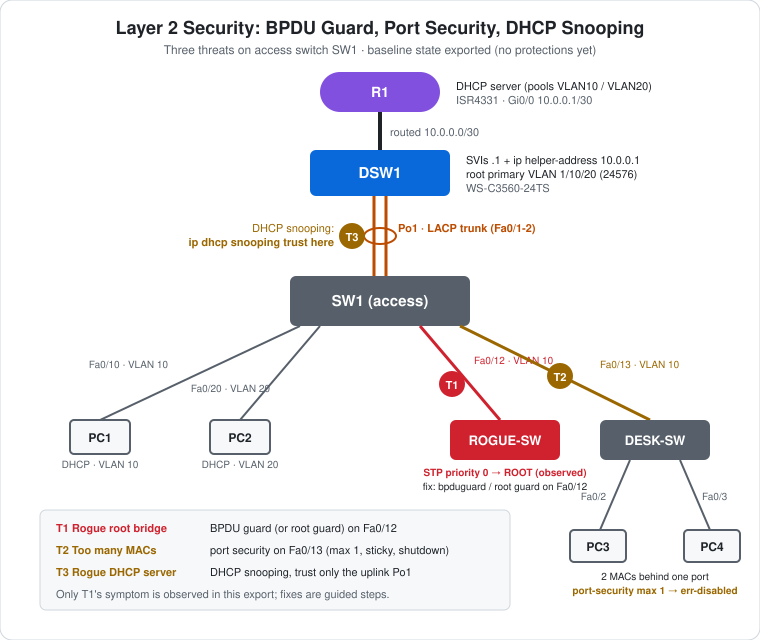

# CCNA Lab 20: Layer 2 Security – BPDU Guard, Port Security and DHCP Snooping

A Layer 2 security lab built in the **PingMyNetwork Sandbox**. It reuses the DHCP-relay design from [Lab 16](../lab-16-dhcp-relay-etherchannel/): R1 is the DHCP server, DSW1 routes and relays, and SW1 is the access switch on an LACP trunk. Then it plugs **three threats** into SW1's VLAN 10 access ports:

| # | Threat | Where | Protection |
|---|---|---|---|
| **T1** | A rogue switch with STP priority 0 takes over as **root bridge** | SW1 Fa0/12 → ROGUE-SW | **BPDU guard** (or root guard) |
| **T2** | A desk switch puts **several MAC addresses** behind one access port | SW1 Fa0/13 → DESK-SW → PC3, PC4 | **Port security** |
| **T3** | Clients must only accept DHCP from the real server | SW1 VLANs 10 and 20 | **DHCP snooping**, trusting only the uplink |

> **Lab status:** The exported Sandbox JSON in [`lab-files/`](lab-files/) is the **unprotected baseline**: every device is configured and saved, ROGUE-SW and DESK-SW are plugged in, and **none of the protections are configured yet**. The configs in [`configs/`](configs/) are that baseline. The one result in the export is **T1's symptom**: SW1's `show spanning-tree vlan 10` shows ROGUE-SW as root. Everything about applying the protections is a **guided exercise with expected results**. It hasn't been run in this export, and the PCs' DHCP results weren't captured either.

## Learning objectives

- Recognise a root bridge takeover in `show spanning-tree` and stop it with BPDU guard or root guard.
- Explain why `spanning-tree portfast edge bpduguard default` can err-disable more ports than you meant to.
- Limit and learn MAC addresses on an access port with port security (`maximum`, `sticky`, `violation`).
- Recover an err-disabled port.
- Enable DHCP snooping and mark the right port as trusted, and explain the option 82 problem with a relay upstream.
- Apply security settings on the right interface: the port-channel, not its members ([Lab 15](../lab-15-etherchannel-po-inheritance/)).

## Topology



```text
                       R1  (DHCP server)  Gi0/0 10.0.0.1/30
                        |  routed
                       DSW1 (relay, root primary 24576)  Gi0/1 10.0.0.2/30
                        ||  Po1 · LACP trunk (Fa0/1-2)            <- T3: trust here
                       SW1 (access)
      Fa0/10 /   Fa0/20 |        Fa0/12 \            Fa0/13 \
            /           |                \                   \
        PC1 (V10)   PC2 (V20)       ROGUE-SW            DESK-SW         <- T2
                                    STP pri 0  <- T1    /     \
                                                     PC3       PC4
                                                    (Fa0/2)   (Fa0/3)
```

| Device | Role | Model |
|---|---|---|
| R1 | DHCP server: pools VLAN10 and VLAN20, `.1 – .9` excluded | Cisco ISR4331 (IOS 15.9 in the Sandbox) |
| DSW1 | SVIs and DHCP relay, STP `root primary` for VLANs 1, 10, 20 | Cisco WS-C3560-24TS (IOS 15.2) |
| SW1 | Access switch: Po1 uplink and the four user-facing ports | Cisco WS-C2960-24TT-L (IOS 15.2) |
| ROGUE-SW | Attacker's switch: `spanning-tree vlan 10 priority 0`, Fa0/1 in VLAN 10 | Cisco WS-C2960-24TT-L |
| DESK-SW | Small switch under a desk, factory defaults (hostname only) | Cisco WS-C2960-24TT-L |
| PC1–PC4 | DHCP clients | PC |

## Addressing plan

| Item | Value |
|---|---|
| R1 ↔ DSW1 | `10.0.0.1/30` ↔ `10.0.0.2/30` (routed) |
| VLAN 10 | `192.168.10.0/24`, gateway DSW1 `Vlan10` `192.168.10.1`, helper `10.0.0.1` |
| VLAN 20 | `192.168.20.0/24`, gateway DSW1 `Vlan20` `192.168.20.1`, helper `10.0.0.1` |
| DSW1 | `ip route 0.0.0.0 0.0.0.0 10.0.0.1` |
| R1 | `ip route 192.168.10.0/24` and `192.168.20.0/24` via `10.0.0.2` |

| SW1 port | Mode | VLAN | Connected to |
|---|---|---|---|
| Fa0/1-2 (Po1) | trunk, LACP passive | – | DSW1 Fa0/1-2 (LACP active) |
| Fa0/10 | access | 10 | PC1 (DHCP) |
| Fa0/20 | access | 20 | PC2 (DHCP) |
| Fa0/12 | access | 10 | **ROGUE-SW** Fa0/1 (access VLAN 10) |
| Fa0/13 | access | 10 | **DESK-SW** Fa0/1 → PC3 (Fa0/2), PC4 (Fa0/3) |

DESK-SW is at factory defaults, so its ports are in VLAN 1. They're untagged access ports, so PC3's and PC4's frames arrive untagged on SW1 Fa0/13 and land in **VLAN 10**.

All switches have `spanning-tree portfast edge default` in their saved configs (a Sandbox default), so **every access port is a PortFast edge port**. That matters for the T1 twist.

## Baseline: what the export shows (observed)

- Every device was configured from factory defaults and saved (sessions below). Po1 came up at 17:44:22 UTC.
- Until SW1 was configured, it blocked Fa0/1-2 with `Received 802.1Q BPDU on non trunk … Inconsistent port type`. DSW1's ends were already trunks.

### T1 symptom: the rogue switch is root

```text
SW1#show spanning-tree vlan 10
VLAN0010
  Spanning tree enabled protocol rstp
  Root ID    Priority    10
             Address     4052.2759.7047
             Cost        19
             Port        12 (FastEthernet0/12)

  Bridge ID  Priority    32778  (priority 32768 sys-id-ext 10)
             Address     2450.2653.0790

Interface           Role Sts Cost      Prio.Nbr Type
------------------- ---- --- --------- -------- --------------------------------
Fa0/10              Desg FWD 19        128.10   P2p Edge
Fa0/12              Root FWD 19        128.12   P2p
Fa0/13              Desg FWD 19        128.13   P2p
Po1                 Desg FWD 12        128.65   P2p
```

- **Root priority 10** = 0 + VLAN 10. ROGUE-SW's `spanning-tree vlan 10 priority 0` beats DSW1's `root primary` (24576 + 10 = 24586). `root primary` is a one-time macro, not a guarantee, as [Lab 08](../lab-08-etherchannel-stp/) explains.
- SW1's **root port is now Fa0/12, a user access port**, and **Po1 is Designated**. The VLAN 10 tree now points toward a device the attacker controls. With a second link, the rogue could pull traffic through itself or force blocking on real uplinks.
- Fa0/12 and Fa0/13 show `P2p`, not `Edge`, even with PortFast edge on by default. **Receiving a BPDU drops a port out of the edge state.** Both ROGUE-SW and DESK-SW send BPDUs. PC1's Fa0/10 stays `Edge`.

## T1: stop the rogue root (guided, expected results)

### Option A: BPDU guard on the port

```cisco
interface FastEthernet0/12
 spanning-tree bpduguard enable
```

The next BPDU from ROGUE-SW should err-disable the port (`%SPANTREE-2-BLOCK_BPDUGUARD` and `%PM-4-ERR_DISABLE: bpduguard error detected on Fa0/12`). With the rogue gone, the VLAN 10 root returns to **DSW1 (24586)**, and SW1's root port goes back to **Po1**. Check with `show spanning-tree vlan 10` and `show interfaces status err-disabled`.

### Option B: root guard

```cisco
interface FastEthernet0/12
 spanning-tree guard root
```

Root guard keeps the port up but puts it in **root-inconsistent** (blocking) state while superior BPDUs keep arriving. It recovers by itself when they stop. Use it where a downstream switch is allowed but must never become root. Use BPDU guard where **no** switch should be connected.

### The twist: `bpduguard default` also kills Fa0/13

```cisco
spanning-tree portfast edge bpduguard default
```

This global command enables BPDU guard on **every PortFast edge port**. Because `spanning-tree portfast edge default` is already on, that's every access port, including **Fa0/13**. DESK-SW is a real switch running STP, so it sends BPDUs, and **Fa0/13 is err-disabled too, cutting off PC3 and PC4**.

Options: enable BPDU guard per port instead, exclude Fa0/13 (`spanning-tree bpduguard disable` on that port), or replace DESK-SW with an unmanaged switch or a proper uplink design.

### Recovering an err-disabled port

Remove the cause first, then `shutdown` / `no shutdown` the port. To recover automatically, use `errdisable recovery cause bpduguard` and `errdisable recovery interval 30`.

## T2: port security on Fa0/13 (guided, expected results)

```cisco
interface FastEthernet0/13
 switchport port-security
 switchport port-security maximum 1
 switchport port-security mac-address sticky
 switchport port-security violation shutdown
```

- `sticky` learns the first MAC address seen (PC3's or PC4's, whichever sends first) and writes it into the running config.
- When the **second** PC sends a frame, that's a violation. With `violation shutdown`, the port goes **err-disabled** (`%PM-4-ERR_DISABLE: psecure-violation error detected on Fa0/13`), and **both** PCs lose connectivity.
- `show port-security interface fa0/13` should show `Port Status: Secure-shutdown`, a violation count of 1, and the sticky MAC.
- **Recover:** decide what's allowed (`maximum 2`, or remove the extra device), then `shutdown` / `no shutdown`.
- The other violation modes are `restrict` (drop and log, port stays up) and `protect` (drop silently).

If you already enabled `bpduguard default` (T1 twist), Fa0/13 may be err-disabled by BPDU guard first. Read the reason in `show interfaces status err-disabled`.

## T3: DHCP snooping (guided, expected results)

DHCP snooping stops a **rogue DHCP server** on an access port from handing out a fake gateway. There's no rogue server in this topology, so this part focuses on the classic **misconfiguration**: turning snooping on without trusting the uplink.

### Step 1: enable it, see DHCP break

```cisco
ip dhcp snooping
ip dhcp snooping vlan 10,20
```

Every port is **untrusted** by default, including **Po1**, the uplink toward DSW1 and R1. Server-side messages (Offer, Ack) arriving on an untrusted port are dropped, so **PCs that renew get no address**.

### Step 2: trust the uplink, on the port-channel

```cisco
interface Port-channel1
 ip dhcp snooping trust
```

Configure it on **Po1**, not on Fa0/1-2 ([Lab 15](../lab-15-etherchannel-po-inheritance/)'s golden rule).

### Step 3: the option 82 gotcha

By default, the snooping switch inserts DHCP **option 82** (relay agent information) with an empty giaddr. DSW1, the real relay, receives a request that already carries option 82 on an interface it doesn't trust, and IOS relays **drop** it by default. The fix is either:

```cisco
! on SW1
no ip dhcp snooping information option
```

or, on DSW1, trust option 82 from SW1 (`ip dhcp relay information trust-all`).

### Verify

`show ip dhcp snooping` should show snooping enabled for VLANs 10 and 20 with Po1 trusted. `show ip dhcp snooping binding` should list each PC's MAC, leased IP, VLAN and port once they renew (`ipconfig /renew`).

## Verification results

| Check | Command/test | Result |
|---|---|---|
| Bundle | DSW1 / SW1 logs | **Observed:** Port-channel1 up at 17:44:22 |
| Rogue root | SW1 `show spanning-tree vlan 10` | **Observed:** root priority 10 (ROGUE-SW), root port Fa0/12, Po1 Designated |
| Edge state | same output | **Observed:** Fa0/10 `Edge`; Fa0/12, Fa0/13 `P2p` (receiving BPDUs) |
| Base DHCP | PCs `ipconfig` / R1 `show ip dhcp binding` | Not captured. Expected: PC1, PC3, PC4 get `192.168.10.x` and PC2 gets `192.168.20.x` |
| T1 fix | BPDU guard on Fa0/12 | Expected: Fa0/12 err-disabled, root back to DSW1 via Po1 |
| T1 twist | `bpduguard default` | Expected: Fa0/13 err-disabled as well |
| T2 | Port security max 1 on Fa0/13 | Expected: `Secure-shutdown` after the second MAC |
| T3 step 1 | Snooping without trust | Expected: renewals fail |
| T3 steps 2–3 | Trust Po1, no option 82 insertion | Expected: renewals succeed, bindings listed |

## Full configuration commands

These are the **exact commands typed in the Sandbox session**, copied from the console history in the export, in the order they were entered (including the `show` commands used to verify). Typing them on factory-default devices reproduces the lab. These build the **unprotected baseline**. All four PCs are set to **DHCP**. The hardening commands that come after them **haven't been run in this export**: they're the guided exercise.

How to read the blocks:

- Lines starting with `!` explain the command below them. Don't type them.
- The prompt (`SW1(config-if-range)#`) shows which mode you're in. Type only the text after `#` or `>`.
- Abbreviations such as `conf t` and `f0/1-2` are accepted by IOS, the same as `configure terminal` and `FastEthernet0/1 - 2`.

### R1 (ISR4331)

```text
! Enter privileged EXEC mode
R1>enable
! Enter global configuration mode
R1#conf t
! Stop mistyped commands being treated as hostnames to look up
R1(config)#no ip domain-lookup
! Select interface g0/0
R1(config)#interface g0/0
! Assign 10.0.0.1 / 255.255.255.252
R1(config-if)#ip address 10.0.0.1 255.255.255.252
! Enable the interface
R1(config-if)#no shutdown
R1(config-if)#exit
! Never lease 192.168.10.1 - 192.168.10.9 (reserved for gateways/servers)
R1(config)#ip dhcp excluded-address 192.168.10.1 192.168.10.9
! Never lease 192.168.20.1 - 192.168.20.9 (reserved for gateways/servers)
R1(config)#ip dhcp excluded-address 192.168.20.1 192.168.20.9
! Create DHCP pool VLAN10 (enter DHCP pool config mode)
R1(config)#ip dhcp pool VLAN10
! Pool subnet 192.168.10.0 / 255.255.255.0 (also how the server matches the relay's giaddr)
R1(dhcp-config)#network 192.168.10.0 255.255.255.0
! Gateway handed to clients: 192.168.10.1
R1(dhcp-config)#default-router 192.168.10.1
R1(dhcp-config)#exit
! Create DHCP pool VLAN20 (enter DHCP pool config mode)
R1(config)#ip dhcp pool VLAN20
! Pool subnet 192.168.20.0 / 255.255.255.0 (also how the server matches the relay's giaddr)
R1(dhcp-config)#network 192.168.20.0 255.255.255.0
! Gateway handed to clients: 192.168.20.1
R1(dhcp-config)#default-router 192.168.20.1
R1(dhcp-config)#exit
! Static route to 192.168.10.0/255.255.255.0 via 10.0.0.2
R1(config)#ip route 192.168.10.0 255.255.255.0 10.0.0.2
! Static route to 192.168.20.0/255.255.255.0 via 10.0.0.2
R1(config)#ip route 192.168.20.0 255.255.255.0 10.0.0.2
R1(config)#end
! Save the running config to NVRAM
R1#write memory
```

### DSW1 (WS-C3560-24TS)

```text
! Enter privileged EXEC mode
DSW1>enable
! Enter global configuration mode
DSW1#conf t
! Set the device name to DSW1
DSW1(config)#hostname DSW1
! Turn on IPv4 routing (needed on a multilayer switch)
DSW1(config)#ip routing
! Create VLAN 10 (and enter VLAN config mode)
DSW1(config)#vlan 10
! Create VLAN 20 (and enter VLAN config mode)
DSW1(config-vlan)#vlan 20
DSW1(config-vlan)#exit
! Make this switch root for VLAN(s) 1,10,20 (saved as priority 24576)
DSW1(config)#spanning-tree vlan 1,10,20 root primary
! Select interface g0/1
DSW1(config)#interface g0/1
! Make it a routed (Layer 3) port
DSW1(config-if)#no switchport
! Assign 10.0.0.2 / 255.255.255.252
DSW1(config-if)#ip address 10.0.0.2 255.255.255.252
DSW1(config-if)#exit
! Select f0/1-2 and configure them together
DSW1(config)#interface range f0/1-2
! 3560 only: choose 802.1Q before trunking
DSW1(config-if-range)#switchport trunk encapsulation dot1q
! Make it an 802.1Q trunk
DSW1(config-if-range)#switchport mode trunk
! Join Po1; LACP active: start LACP negotiation
DSW1(config-if-range)#channel-group 1 mode active
DSW1(config-if-range)#exit
! Create the SVI (gateway interface) for VLAN 10
DSW1(config)#interface vlan 10
! Assign 192.168.10.1 / 255.255.255.0
DSW1(config-if)#ip address 192.168.10.1 255.255.255.0
! DHCP relay: forward client broadcasts on this VLAN to the server 10.0.0.1 as unicast
DSW1(config-if)#ip helper-address 10.0.0.1
! Enable the interface
DSW1(config-if)#no shutdown
DSW1(config-if)#exit
! Create the SVI (gateway interface) for VLAN 20
DSW1(config)#interface vlan 20
! Assign 192.168.20.1 / 255.255.255.0
DSW1(config-if)#ip address 192.168.20.1 255.255.255.0
! DHCP relay: forward client broadcasts on this VLAN to the server 10.0.0.1 as unicast
DSW1(config-if)#ip helper-address 10.0.0.1
! Enable the interface
DSW1(config-if)#no shutdown
DSW1(config-if)#exit
! Default route: send everything unknown to 10.0.0.1
DSW1(config)#ip route 0.0.0.0 0.0.0.0 10.0.0.1
DSW1(config)#end
! Save the running config to NVRAM
DSW1#write memory
```

### SW1 (WS-C2960-24TT-L) – baseline build and the T1 check

```text
! Enter privileged EXEC mode
SW1>enable
! Enter global configuration mode
SW1#conf t
! Create VLAN 10 (and enter VLAN config mode)
SW1(config)#vlan 10
! Create VLAN 20 (and enter VLAN config mode)
SW1(config-vlan)#vlan 20
SW1(config-vlan)#exit
! Select f0/1-2 and configure them together
SW1(config)#interface range f0/1-2
! Make it an 802.1Q trunk
SW1(config-if-range)#switchport mode trunk
! Join Po1; LACP passive: answer LACP but never start it
SW1(config-if-range)#channel-group 1 mode passive
SW1(config-if-range)#exit
! Select f0/10 , f0/12 - 13 and configure them together
SW1(config)#interface range f0/10 , f0/12 - 13
! Make it an access (host) port
SW1(config-if-range)#switchport mode access
! Put the port in VLAN 10
SW1(config-if-range)#switchport access vlan 10
SW1(config-if-range)#exit
! Select interface f0/20
SW1(config)#interface f0/20
! Make it an access (host) port
SW1(config-if)#switchport mode access
! Put the port in VLAN 20
SW1(config-if)#switchport access vlan 20
SW1(config-if)#end
! Save the running config to NVRAM
SW1#write memory
! Verify: STP root bridge and port roles/states
SW1#show spanning-tree vlan 10
```

### ROGUE-SW (WS-C2960-24TT-L) – the threat for T1

```text
! Enter privileged EXEC mode
ROGUE-SW>enable
! Enter global configuration mode
ROGUE-SW#conf t
! Set the device name to ROGUE-SW
ROGUE-SW(config)#hostname ROGUE-SW
! Create VLAN 10 (and enter VLAN config mode)
ROGUE-SW(config)#vlan 10
ROGUE-SW(config-vlan)#exit
! Set bridge priority 0 for VLAN(s) 10
ROGUE-SW(config)#spanning-tree vlan 10 priority 0
! Select interface f0/1
ROGUE-SW(config)#interface f0/1
! Make it an access (host) port
ROGUE-SW(config-if)#switchport mode access
! Put the port in VLAN 10
ROGUE-SW(config-if)#switchport access vlan 10
ROGUE-SW(config-if)#end
! Save the running config to NVRAM
ROGUE-SW#write memory
```

### DESK-SW (WS-C2960-24TT-L) – hostname only, everything else default

```text
! Enter privileged EXEC mode
DESK-SW>enable
! Enter global configuration mode
DESK-SW#conf t
! Set the device name to DESK-SW
DESK-SW(config)#hostname DESK-SW
DESK-SW(config)#end
! Save the running config to NVRAM
DESK-SW#write memory
```

### PCs

Set these in each PC's IP configuration:

| PC | IP address | Subnet mask | Default gateway |
|---|---|---|---|
| PC1 | DHCP (automatic) | DHCP (automatic) | DHCP (automatic) |
| PC2 | DHCP (automatic) | DHCP (automatic) | DHCP (automatic) |
| PC3 | DHCP (automatic) | DHCP (automatic) | DHCP (automatic) |
| PC4 | DHCP (automatic) | DHCP (automatic) | DHCP (automatic) |

### Hardening on SW1 (guided, not yet run in this export)

Apply these in order and check the result after each step. The "Verify" lines show what to look at. The expected results are in the T1–T3 sections above.

#### T1: BPDU guard on the rogue port

```text
! Enter privileged EXEC mode
SW1>enable
! Enter global configuration mode
SW1#conf t
! Select interface f0/12
SW1(config)#interface f0/12
! BPDU guard: err-disable this port if any BPDU arrives on it
SW1(config-if)#spanning-tree bpduguard enable
SW1(config-if)#end
! Verify: STP root bridge and port roles/states
SW1#show spanning-tree vlan 10
! Verify: link state of each port (connected, err-disabled, suspended)
SW1#show interfaces status err-disabled
```

#### T1 twist: BPDU guard on every edge port (optional; also err-disables Fa0/13)

```text
! Enter global configuration mode
SW1#conf t
! BPDU guard on every PortFast edge port (all access ports here)
SW1(config)#spanning-tree portfast edge bpduguard default
! Automatically re-enable ports err-disabled by bpduguard
SW1(config)#errdisable recovery cause bpduguard
! Try err-disable recovery every 30 seconds
SW1(config)#errdisable recovery interval 30
SW1(config)#end
! Verify: link state of each port (connected, err-disabled, suspended)
SW1#show interfaces status err-disabled
```

#### T2: port security on the desk-switch port

```text
! Enter global configuration mode
SW1#conf t
! Select interface f0/13
SW1(config)#interface f0/13
! Turn on port security for this port
SW1(config-if)#switchport port-security
! Port security: allow at most 1 MAC address(es)
SW1(config-if)#switchport port-security maximum 1
! Port security: learn the MAC dynamically and save it into the running config
SW1(config-if)#switchport port-security mac-address sticky
! Port security: on a violation, err-disable the port
SW1(config-if)#switchport port-security violation shutdown
SW1(config-if)#end
! Verify: port-security state, MAC count and violations
SW1#show port-security interface fa0/13
```

#### T3: DHCP snooping, trusting only Po1

```text
! Enter global configuration mode
SW1#conf t
! Turn on DHCP snooping globally
SW1(config)#ip dhcp snooping
! Enforce DHCP snooping in VLAN(s) 10,20
SW1(config)#ip dhcp snooping vlan 10,20
! Don't insert option 82 (the relay upstream would drop it)
SW1(config)#no ip dhcp snooping information option
! Configure the logical Port-channel1 interface
SW1(config)#interface port-channel 1
! Trust DHCP server replies arriving on this port (the uplink toward the real server)
SW1(config-if)#ip dhcp snooping trust
SW1(config-if)#end
! Save the running config to NVRAM
SW1#write memory
! Verify
SW1#show ip dhcp snooping
! Verify: IP/MAC/port bindings learned by DHCP snooping
SW1#show ip dhcp snooping binding
```

Then run `ipconfig /renew` on the PCs, and `show ip dhcp snooping binding` on SW1.

## Try it yourself: guided challenges

1. **Do all three.** Apply the T1, T2 and T3 fixes, then save and re-export the lab so the protected configs and results can be added here.
2. **Root guard instead.** Use root guard on Fa0/12. What does `show spanning-tree vlan 10` show for the port while ROGUE-SW keeps sending?
3. **Restrict vs shutdown.** Repeat T2 with `violation restrict`. Do PC3 and PC4 both keep working? What does the violation counter do?
4. **Add a rogue DHCP server.** Put a Server device on SW1 with its DHCP service on, in VLAN 10. Show that clients take its offer without snooping and ignore it with snooping.
5. **Rate-limit DHCP.** Add `ip dhcp snooping limit rate 10` on access ports. Why not on Po1?
6. **Dynamic ARP Inspection.** Turn on `ip arp inspection vlan 10,20` (it uses the snooping bindings) and remember to trust Po1. What happens to a PC with a static IP?

## Scope and caveats

- This is a **CCNA-oriented** lab. Port security, DHCP snooping and BPDU guard are CCNA security topics. Root guard and DAI go slightly beyond.
- **This export is the baseline.** Only T1's symptom is observed. The protection steps and their results are expected behaviour based on standard Catalyst IOS. The Sandbox's behaviour may differ, especially for option 82 handling.
- PortFast edge on every access port is a Sandbox default (`spanning-tree portfast edge default`), which is why the T1 twist hits Fa0/13.
- DESK-SW sits in VLAN 1 on its own ports. It works because the links are untagged, but its BPDUs are sent for VLAN 1 into SW1's VLAN 10 port.
- The Sandbox names the ISR4331's ports `GigabitEthernet0/0`–`0/3`. A real ISR4331 uses `GigabitEthernet0/0/0` style names.
- No device has a management IP, passwords or an SSH user.

## Useful verification commands

```cisco
show spanning-tree vlan 10
show spanning-tree interface fa0/12 detail
show interfaces status err-disabled
show errdisable recovery
show port-security
show port-security interface fa0/13
show ip dhcp snooping
show ip dhcp snooping binding
show etherchannel summary
```

## Lab files

| File | Description |
|---|---|
| [`lab-files/layer2-security-lab.json`](lab-files/layer2-security-lab.json) | PingMyNetwork Sandbox export (unprotected baseline). Import it into the Sandbox to start the exercise. |
| [`configs/R1-running-config.txt`](configs/R1-running-config.txt) | R1 saved configuration (DHCP server) |
| [`configs/DSW1-running-config.txt`](configs/DSW1-running-config.txt) | DSW1 saved configuration (SVIs, relay, root primary, Po1) |
| [`configs/SW1-running-config.txt`](configs/SW1-running-config.txt) | SW1 saved configuration (access ports, Po1, no protections yet) |
| [`configs/ROGUE-SW-running-config.txt`](configs/ROGUE-SW-running-config.txt) | ROGUE-SW saved configuration (STP priority 0 in VLAN 10) |
| [`configs/DESK-SW-running-config.txt`](configs/DESK-SW-running-config.txt) | DESK-SW saved configuration (defaults, hostname only) |
| [`images/topology.svg`](images/topology.svg) | Topology with the three threats marked |

**Built with:** [PingMyNetwork Sandbox](https://pingmynetwork.com/sandbox)
