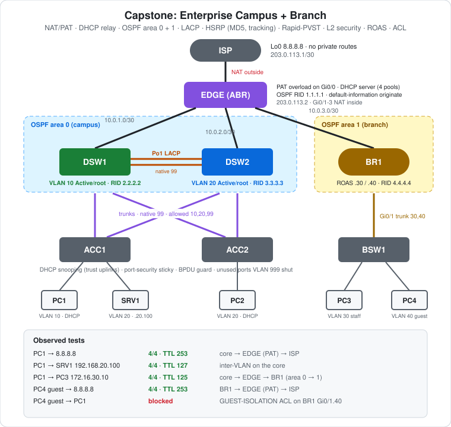

# CCNA Lab 21: Capstone – Enterprise Campus + Branch

The capstone of this series, built in the **PingMyNetwork Sandbox**. Thirteen devices form a small enterprise: an internet edge with **NAT/PAT**, a **central DHCP server**, a dual-core **campus** in OSPF area 0, and a **branch** office in OSPF area 1. Almost every topic from Labs 01–20 appears somewhere, configured the way you'd do it in production.

| Area | What it uses | Builds on |
|---|---|---|
| Internet edge | NAT/PAT overload, default route, `default-information originate` | new |
| Addressing | Central IOS DHCP server, four pools, relay from both sites | [Lab 16](../lab-16-dhcp-relay-etherchannel/) |
| Routing | Multi-area OSPF (EDGE is the ABR), passive interfaces, ECMP | [Lab 13](../lab-13-ospf-etherchannel-ecmp/) |
| Campus core | LACP Po1, native VLAN 99, pruned trunks, Rapid-PVST root split | Labs [04](../lab-04-etherchannel/), [08](../lab-08-etherchannel-stp/) |
| Gateways | HSRP load sharing with MD5 authentication and uplink tracking | Labs [17](../lab-17-hsrp-basics-failover/)–[19](../lab-19-hsrp-dual-active-troubleshooting/) |
| Access security | DHCP snooping, sticky port security, BPDU guard, parked unused ports | [Lab 20](../lab-20-layer2-security/) |
| Branch | Router-on-a-stick, guest isolation ACL | Labs [02](../lab-02-inter-vlan-routing-acl/), [09](../lab-09-etherchannel-roas/) |

> **Lab status:** The configs in [`configs/`](configs/) and the results below come from the exported Sandbox JSON in [`lab-files/`](lab-files/). That export includes the saved configuration of every network device and the console output of the session. Results marked **observed** are copied from that output. The lab note's "TRY" items (shutting EDGE Gi0/1 or a Po1 member, `show ip nat translations`) weren't run in this export, so they're listed under the challenges with expected results.

## Topology



```text
                           ISP  Lo0 8.8.8.8  (203.0.113.1)
                            |  Gi0/0 203.0.113.0/30   [NAT outside]
                           EDGE  (PAT · DHCP server · OSPF ABR, RID 1.1.1.1)
              Gi0/1 /        Gi0/2 |           \ Gi0/3        [NAT inside x3]
        10.0.1.0/30        10.0.2.0/30          10.0.3.0/30
     ---------- area 0 ----------                ---- area 1 ----
       DSW1 ==== Po1 ==== DSW2                      BR1 (RID 4.4.4.4)
     (RID 2.2.2.2)     (RID 3.3.3.3)                 | Gi0/1 (.30 / .40 subifs)
       | \  Fa0/3-4    / |                           |
       |   \         /   |                          BSW1
       |     \     /     |                        /      \
       |       \ /       |                 Fa0/10        Fa0/20
       |       / \       |                   PC3          PC4
      ACC1          ACC2                 VLAN 30 staff  VLAN 40 guest
     /    \           |
  PC1     SRV1       PC2
 VLAN 10  VLAN 20   VLAN 20
```

| Device | Role | Model |
|---|---|---|
| ISP | "Internet": Loopback0 `8.8.8.8`, **no routes to private networks** | Cisco ISR4331 |
| EDGE | NAT/PAT, DHCP server (4 pools), OSPF ABR for areas 0 and 1, default route to ISP | Cisco ISR4331 |
| DSW1 | Campus core: VLAN 10 HSRP Active + STP root (10, 99), tracks Gi0/1 | Cisco WS-C3560-24TS |
| DSW2 | Campus core: VLAN 20 HSRP Active + STP root (20), tracks Gi0/1 | Cisco WS-C3560-24TS |
| ACC1 | Access: PC1 (VLAN 10), SRV1 (VLAN 20), dual-homed to both cores | Cisco WS-C2960-24TT-L |
| ACC2 | Access: PC2 (VLAN 20), dual-homed to both cores | Cisco WS-C2960-24TT-L |
| BR1 | Branch router: router-on-a-stick for VLANs 30/40, relay, guest ACL | Cisco ISR4331 |
| BSW1 | Branch access: PC3 (staff), PC4 (guest) | Cisco WS-C2960-24TT-L |
| PC1–PC4 | DHCP clients | PC |
| SRV1 | Static `192.168.20.100/24`, gateway `.1`, DNS `8.8.8.8` | Server |

## Addressing plan

### Point-to-point links

| Link | Side A | Side B | OSPF area |
|---|---|---|---|
| ISP ↔ EDGE | ISP Gi0/0 `203.0.113.1/30` | EDGE Gi0/0 `203.0.113.2/30` (NAT outside) | – (static default on EDGE) |
| EDGE ↔ DSW1 | EDGE Gi0/1 `10.0.1.1/30` (NAT inside) | DSW1 Gi0/1 `10.0.1.2/30` (routed) | 0 |
| EDGE ↔ DSW2 | EDGE Gi0/2 `10.0.2.1/30` (NAT inside) | DSW2 Gi0/1 `10.0.2.2/30` (routed) | 0 |
| EDGE ↔ BR1 | EDGE Gi0/3 `10.0.3.1/30` (NAT inside) | BR1 Gi0/0 `10.0.3.2/30` | 1 |

### User subnets, gateways and DHCP

| VLAN | Name | Subnet | Gateway | Gateway owner | Relay (helper) | EDGE pool |
|---|---|---|---|---|---|---|
| 10 | USERS | `192.168.10.0/24` | `.1` (HSRP VIP) | DSW1 `.2` Active 110 / DSW2 `.3` 100 | DSW1 → `10.0.1.1`, DSW2 → `10.0.2.1` | `VLAN10-USERS` |
| 20 | SERVERS | `192.168.20.0/24` | `.1` (HSRP VIP) | DSW2 `.3` Active 110 / DSW1 `.2` 100 | same | `VLAN20-SERVERS` |
| 30 | BR-STAFF | `172.16.30.0/24` | `.1` | BR1 Gi0/1.30 | `10.0.3.1` | `BR-STAFF` |
| 40 | BR-GUEST | `172.16.40.0/24` | `.1` | BR1 Gi0/1.40 + `GUEST-ISOLATION` in | `10.0.3.1` | `BR-GUEST` |
| 99 | NATIVE | – | – | native VLAN on all campus trunks | – | – |
| 999 | PARKING | – | – | unused access ports (shut down) | – | – |

Every pool excludes `.1 – .9` and hands out DNS `8.8.8.8`.

### Campus redundancy

| | DSW1 | DSW2 |
|---|---|---|
| STP priority VLAN 10, 99 | **24576** (root primary) | 28672 (root secondary) |
| STP priority VLAN 20 | 28672 (root secondary) | **24576** (root primary) |
| HSRP group 10 (VLAN 10) | **110**, preempt, MD5 `CAPSTONE`, `track 1 decrement 20` | 100, preempt, MD5 |
| HSRP group 20 (VLAN 20) | 100, preempt, MD5 | **110**, preempt, MD5, `track 1 decrement 20` |
| Track 1 | Gi0/1 line-protocol (uplink to EDGE) | Gi0/1 line-protocol |

## Configuration highlights

These excerpts are from the saved configs. The full configs are in [`configs/`](configs/).

### EDGE: NAT/PAT, DHCP and OSPF ABR

```cisco
interface GigabitEthernet0/0
 ip address 203.0.113.2 255.255.255.252
 ip nat outside
interface GigabitEthernet0/1          ! also Gi0/2, Gi0/3
 ip address 10.0.1.1 255.255.255.252
 ip nat inside
!
access-list 1 permit 192.168.0.0 0.0.255.255
access-list 1 permit 172.16.0.0 0.0.255.255
ip nat inside source list 1 interface GigabitEthernet0/0 overload
!
ip dhcp excluded-address 192.168.10.1 192.168.10.9      ! one per pool
ip dhcp pool VLAN10-USERS
 network 192.168.10.0 255.255.255.0
 default-router 192.168.10.1
 dns-server 8.8.8.8
!
ip route 0.0.0.0 0.0.0.0 203.0.113.1
router ospf 1
 router-id 1.1.1.1
 network 10.0.1.0 0.0.0.3 area 0
 network 10.0.2.0 0.0.0.3 area 0
 network 10.0.3.0 0.0.0.3 area 1
 default-information originate
```

`maximum-paths 4` was also typed, but 4 is the IOS default for OSPF, so it doesn't appear in the saved config.

### DSW1: core (DSW2 mirrors it with VLAN 20 as primary)

```cisco
spanning-tree mode rapid-pvst
spanning-tree vlan 10,99 root primary
spanning-tree vlan 20 root secondary
!
interface Port-channel1                 ! also Fa0/3-4 to ACC1/ACC2
 switchport trunk encapsulation dot1q
 switchport mode trunk
 switchport trunk native vlan 99
 switchport trunk allowed vlan 10,20,99
!
track 1 interface GigabitEthernet0/1 line-protocol
interface Vlan10
 ip address 192.168.10.2 255.255.255.0
 ip helper-address 10.0.1.1
 standby 10 ip 192.168.10.1
 standby 10 priority 110
 standby 10 preempt
 standby 10 authentication md5 key-string CAPSTONE
 standby 10 track 1 decrement 20
!
router ospf 1
 router-id 2.2.2.2
 network 10.0.1.0 0.0.0.3 area 0
 network 192.168.10.0 0.0.0.255 area 0
 network 192.168.20.0 0.0.0.255 area 0
 passive-interface Vlan10
 passive-interface Vlan20
```

### ACC1: secure access (ACC2 and BSW1 follow the same pattern)

```cisco
ip dhcp snooping
ip dhcp snooping vlan 10,20
no ip dhcp snooping information option
!
interface range FastEthernet0/1 - 2          ! uplinks to DSW1 / DSW2
 switchport mode trunk
 switchport trunk native vlan 99
 switchport trunk allowed vlan 10,20,99
 ip dhcp snooping trust
!
interface FastEthernet0/10                   ! PC1
 switchport mode access
 switchport access vlan 10
 spanning-tree portfast
 spanning-tree bpduguard enable
 switchport port-security
 switchport port-security maximum 2
 switchport port-security mac-address sticky
 switchport port-security violation restrict
!
interface range Fa0/3-9 , Fa0/11-19 , Fa0/21-24 , Gi0/1-2   ! unused
 switchport mode access
 switchport access vlan 999
 shutdown
```

BSW1's host ports use the default port-security maximum of **1** (no `maximum` command).

### BR1: branch router-on-a-stick and guest isolation

```cisco
interface GigabitEthernet0/1.30
 description BRANCH-STAFF
 encapsulation dot1Q 30
 ip address 172.16.30.1 255.255.255.0
 ip helper-address 10.0.3.1
interface GigabitEthernet0/1.40
 description BRANCH-GUEST
 encapsulation dot1Q 40
 ip address 172.16.40.1 255.255.255.0
 ip helper-address 10.0.3.1
 ip access-group GUEST-ISOLATION in
!
ip access-list extended GUEST-ISOLATION
 deny   ip 172.16.40.0 0.0.0.255 192.168.0.0 0.0.255.255
 deny   ip 172.16.40.0 0.0.0.255 172.16.30.0 0.0.0.255
 permit ip any any
!
router ospf 1
 router-id 4.4.4.4
 network 10.0.3.0 0.0.0.3 area 1
 network 172.16.30.0 0.0.0.255 area 1
 network 172.16.40.0 0.0.0.255 area 1
 passive-interface GigabitEthernet0/1.30
 passive-interface GigabitEthernet0/1.40
```

## How the pieces fit together

- **DHCP from both sites.** A PC broadcasts a Discover. Its gateway relays it as unicast to EDGE, writing its own interface address into **giaddr**: `192.168.10.2` or `.3` from a campus core, `172.16.30.1` or `.40.1` from BR1. EDGE picks the pool whose network contains that giaddr. It sends the reply back to the giaddr using **OSPF-learned routes**, so no static return routes are needed, unlike Lab 16.
- **Gateway redundancy.** PCs use the HSRP virtual IP `.1`. DSW1 forwards VLAN 10 and DSW2 forwards VLAN 20. If a core loses its uplink to EDGE, tracking drops its priority 110 → 90 and the other core takes over that VLAN.
- **Spanning tree matches HSRP.** In VLAN 10, the root is DSW1. Each access switch's uplink to DSW1 is its root port, and its uplink to DSW2 is expected to be **Alternate (blocking)**: the access switch's cost to the root is 19, DSW2's is 12 via Po1, so DSW2's end is designated. VLAN 20 is the mirror image, so **each access uplink forwards one VLAN**. This is expected, not observed: no `show spanning-tree` was run.
- **Routing.** The cores advertise VLANs 10 and 20 into area 0 with passive SVIs, so no OSPF hellos go to users. BR1 advertises 30 and 40 into area 1. EDGE joins both areas, making it the ABR. It also injects the default route with `default-information originate`, so every router can reach the internet.
- **Internet.** EDGE translates every inside source that matches ACL 1 to `203.0.113.2` with PAT. ISP has **no route to any private network**, so the internet pings only work because of NAT.
- **Guest isolation.** Traffic entering Gi0/1.40 from the guest subnet is denied toward `192.168.0.0/16` (campus) and the staff subnet. Everything else is permitted, including the internet.

## Results (observed)

### OSPF on EDGE

```text
EDGE#show ip ospf neighbor
Neighbor ID     Pri   State           Dead Time   Address         Interface
3.3.3.3           1   FULL/DR         00:00:34    10.0.2.2        GigabitEthernet0/2
2.2.2.2           1   FULL/DR         00:00:34    10.0.1.2        GigabitEthernet0/1
4.4.4.4           1   FULL/DR         00:00:34    10.0.3.2        GigabitEthernet0/3

EDGE#show ip route | begin Gateway
Gateway of last resort is 203.0.113.1 to network 0.0.0.0
S*    0.0.0.0/0 [1/0] via 203.0.113.1
O        172.16.30.0 [110/2] via 10.0.3.2, 00:00:01, GigabitEthernet0/3
O        172.16.40.0 [110/2] via 10.0.3.2, 00:00:01, GigabitEthernet0/3
O     192.168.10.0/24 [110/2] via 10.0.2.2, 00:00:01, GigabitEthernet0/2
                      [110/2] via 10.0.1.2, 00:00:01, GigabitEthernet0/1
O     192.168.20.0/24 [110/2] via 10.0.2.2, 00:00:01, GigabitEthernet0/2
                      [110/2] via 10.0.1.2, 00:00:01, GigabitEthernet0/1
```

All three neighbours are FULL. Both campus VLANs have **two equal-cost paths (ECMP)**, one via each core. The branch routes show as `O`, not `O IA`. That's expected on an ABR: EDGE is in area 1 itself, so area 1's subnets are intra-area routes for EDGE. DSW1 and DSW2, which are only in area 0, should see them as `O IA` (Challenge 4).

### ISP sees no private routes

```text
ISP#show ip route | begin Gateway
Gateway of last resort is not set
C        8.8.8.8 is directly connected, Loopback0
C        203.0.113.0/30 is directly connected, GigabitEthernet0/0
L        203.0.113.1/32 is directly connected, GigabitEthernet0/0
```

### Campus core

```text
DSW1#show standby brief
Interface   Grp  Pri P State   Active          Standby         Virtual IP
Vl10        10   110 P Active  local           192.168.10.3    192.168.10.1
Vl20        20   100 P Standby 192.168.20.3    local           192.168.20.1

DSW1#show etherchannel summary | begin Group
1      Po1(SU)         LACP      Fa0/1(P)    Fa0/2(P)
```

That's load sharing: DSW1 is Active for VLAN 10 and DSW2 for VLAN 20. Each switch also sees the other as its Standby/Active peer, so **MD5 authentication matches** (compare [Lab 19](../lab-19-hsrp-dual-active-troubleshooting/), where a mismatch made both Active).

### End-to-end tests

| From → to | Result | TTL | Path |
|---|---|---|---|
| PC1 → `8.8.8.8` | **4/4** | 253 | core → EDGE (PAT) → ISP: 2 routed hops before the ISP replies |
| PC1 → SRV1 `192.168.20.100` | **4/4** | 127 | routed once on the core (VLAN 10 → 20) |
| PC1 → PC3 `172.16.30.10` | **4/4** | 125 | core → EDGE → BR1: 3 hops, area 0 → area 1 |
| PC4 (guest) → `8.8.8.8` | **4/4** | 253 | BR1 → EDGE (PAT) → ISP |
| PC4 (guest) → `192.168.10.10` (PC1's expected address) | **0/4**, `Reply from 172.16.40.1: Destination net unreachable.` | – | dropped by `GUEST-ISOLATION` on BR1 |

PC3 answered at `172.16.30.10`, the first address after the `.1 – .9` exclusion, which shows the branch relay and pool worked.

### Things the build log teaches

- **Native VLAN mismatch while half-built.** DSW1 and DSW2 set native VLAN 99 before ACC1 and ACC2 were configured. The cores logged `%SPANTREE-2-RECV_PVID_ERR … inconsistent peer vlan id 1`, blocked the ports as `Inconsistent local vlan`, and CDP reported `%CDP-4-NATIVE_VLAN_MISMATCH … (99), with ACC1 … (1)`. Once the access switches matched, the cores logged `Unblocking FastEthernet0/3 on VLAN0099. Port consistency restored` (18:10:31, Fa0/4 at 18:10:51).
- **A duplicate router ID warning on EDGE.** At 18:08:49, before the cores were configured, EDGE logged `%OSPF-4-DUP_RTRID_NBR: OSPF detected duplicate router-id 1.1.1.1 from 10.0.2.1 on interface GigabitEthernet0/1`. DSW1's and DSW2's Gi0/1 were still factory-default Layer 2 ports at that moment, bridged together over their Fa0/1-2 in VLAN 1. The likely cause: EDGE heard **its own** hellos from Gi0/2 arriving on Gi0/1. The warning didn't recur after the cores' Gi0/1 became routed ports (`no switchport`).
- **`OSPF process 1 cannot start`** appeared on EDGE and BR1 when `router ospf 1` was entered before any of their interfaces were up. It's harmless: OSPF started once the links came up, and the explicit `router-id` keeps the ID stable.
- **ISP `yes` typo.** `clear ip ospf process` was run on ISP, which has no OSPF, so no confirmation prompt appeared. The following `yes` was treated as a hostname to look up and failed. It's harmless.
- **Sticky MACs aren't saved yet.** ACC1, ACC2 and BSW1 learned sticky MACs **after** `write memory`. They're in the running config but not in the saved configs in [`configs/`](configs/). Run `write memory` again after the hosts have connected, or they'll be relearned after a reload.

## Verification results

| Check | Command/test | Result |
|---|---|---|
| OSPF adjacencies | EDGE `show ip ospf neighbor` | **Observed:** 2.2.2.2, 3.3.3.3, 4.4.4.4 all FULL |
| ECMP to campus | EDGE `show ip route` | **Observed:** VLAN 10/20 `[110/2]` via both cores |
| Default route | EDGE `show ip route` | **Observed:** `S* 0.0.0.0/0 via 203.0.113.1` |
| No private routes at ISP | ISP `show ip route` | **Observed:** connected routes only |
| HSRP | DSW1 `show standby brief` | **Observed:** Vl10 Active (110), Vl20 Standby (100), peers known |
| Core bundle | DSW1 `show etherchannel summary` | **Observed:** `Po1(SU)` Fa0/1(P) Fa0/2(P) |
| Internet (campus) | PC1 → 8.8.8.8 | **Observed:** 4/4, TTL 253 |
| Inter-VLAN | PC1 → SRV1 | **Observed:** 4/4, TTL 127 |
| Campus → branch | PC1 → PC3 | **Observed:** 4/4, TTL 125 |
| Internet (guest) | PC4 → 8.8.8.8 | **Observed:** 4/4, TTL 253 |
| Guest isolation | PC4 → 192.168.10.10 | **Observed:** blocked, `Destination net unreachable` from 172.16.40.1 |
| NAT table | EDGE `show ip nat translations` | Expected: inside local 192.168.x / 172.16.x → inside global 203.0.113.2 with unique ports |
| Leases | EDGE `show ip dhcp binding` | Expected: one lease per DHCP client in the right pool |
| Snooping | ACC1 `show ip dhcp snooping binding` | Expected: PC1's MAC, IP, VLAN 10, Fa0/10 |
| STP | ACC1 `show spanning-tree vlan 10` / `vlan 20` | Expected: Fa0/1 Root + Fa0/2 Altn in VLAN 10; the reverse in VLAN 20 |

## Full configuration commands

These are the **exact commands typed in the Sandbox session**, copied from the console history in the export, in the order they were entered (including the `show` commands used to verify). Typing them on factory-default devices reproduces the lab. The devices are listed in topology order; the session timestamps show they were built ISP → EDGE → DSW1 → DSW2 → ACC1 → ACC2 → BR1 → BSW1. The PCs use **DHCP**; SRV1 is static.

How to read the blocks:

- Lines starting with `!` explain the command below them. Don't type them.
- The prompt (`SW1(config-if-range)#`) shows which mode you're in. Type only the text after `#` or `>`.
- Abbreviations such as `conf t` and `f0/1-2` are accepted by IOS, the same as `configure terminal` and `FastEthernet0/1 - 2`.

### ISP (ISR4331) – the "internet"

```text
! Enter privileged EXEC mode
ISP>enable
! Enter global configuration mode
ISP#conf t
! Set the device name to ISP
ISP(config)#hostname ISP
! Stop mistyped commands being treated as hostnames to look up
ISP(config)#no ip domain-lookup
! Select interface g0/0
ISP(config)#interface g0/0
! Assign 203.0.113.1 / 255.255.255.252
ISP(config-if)#ip address 203.0.113.1 255.255.255.252
! Enable the interface
ISP(config-if)#no shutdown
ISP(config-if)#exit
! Create Loopback0 (always-up virtual interface)
ISP(config)#interface loopback0
! Assign 8.8.8.8 / 255.255.255.255
ISP(config-if)#ip address 8.8.8.8 255.255.255.255
ISP(config-if)#end
! Save the running config to NVRAM
ISP#write memory
! Does nothing here: ISP runs no OSPF, so no confirmation prompt appears
ISP#clear ip ospf process
! Typo: there was no prompt to answer, so IOS tried to resolve "yes" as a hostname (harmless)
ISP#yes
! Verify: OSPF neighbours and adjacency state
ISP#show ip ospf neighbor
! Verify: routing table
ISP#show ip route | begin Gateway
```

### EDGE (ISR4331) – NAT/PAT, DHCP server, OSPF ABR

```text
! Enter privileged EXEC mode
EDGE>enable
! Enter global configuration mode
EDGE#conf t
! Set the device name to EDGE
EDGE(config)#hostname EDGE
! Stop mistyped commands being treated as hostnames to look up
EDGE(config)#no ip domain-lookup
! Select interface g0/0
EDGE(config)#interface g0/0
! Assign 203.0.113.2 / 255.255.255.252
EDGE(config-if)#ip address 203.0.113.2 255.255.255.252
! NAT: this interface faces the internet (outside)
EDGE(config-if)#ip nat outside
! Enable the interface
EDGE(config-if)#no shutdown
! Select interface g0/1
EDGE(config-if)#interface g0/1
! Assign 10.0.1.1 / 255.255.255.252
EDGE(config-if)#ip address 10.0.1.1 255.255.255.252
! NAT: this interface faces the private network (inside)
EDGE(config-if)#ip nat inside
! Enable the interface
EDGE(config-if)#no shutdown
! Select interface g0/2
EDGE(config-if)#interface g0/2
! Assign 10.0.2.1 / 255.255.255.252
EDGE(config-if)#ip address 10.0.2.1 255.255.255.252
! NAT: this interface faces the private network (inside)
EDGE(config-if)#ip nat inside
! Enable the interface
EDGE(config-if)#no shutdown
! Select interface g0/3
EDGE(config-if)#interface g0/3
! Assign 10.0.3.1 / 255.255.255.252
EDGE(config-if)#ip address 10.0.3.1 255.255.255.252
! NAT: this interface faces the private network (inside)
EDGE(config-if)#ip nat inside
! Enable the interface
EDGE(config-if)#no shutdown
EDGE(config-if)#exit
! Never lease 192.168.10.1 - 192.168.10.9 (reserved for gateways/servers)
EDGE(config)#ip dhcp excluded-address 192.168.10.1 192.168.10.9
! Never lease 192.168.20.1 - 192.168.20.9 (reserved for gateways/servers)
EDGE(config)#ip dhcp excluded-address 192.168.20.1 192.168.20.9
! Never lease 172.16.30.1 - 172.16.30.9 (reserved for gateways/servers)
EDGE(config)#ip dhcp excluded-address 172.16.30.1 172.16.30.9
! Never lease 172.16.40.1 - 172.16.40.9 (reserved for gateways/servers)
EDGE(config)#ip dhcp excluded-address 172.16.40.1 172.16.40.9
! Create DHCP pool VLAN10-USERS (enter DHCP pool config mode)
EDGE(config)#ip dhcp pool VLAN10-USERS
! Pool subnet 192.168.10.0 / 255.255.255.0 (also how the server matches the relay's giaddr)
EDGE(dhcp-config)#network 192.168.10.0 255.255.255.0
! Gateway handed to clients: 192.168.10.1
EDGE(dhcp-config)#default-router 192.168.10.1
! DNS server(s) handed to clients: 8.8.8.8
EDGE(dhcp-config)#dns-server 8.8.8.8
! Create DHCP pool VLAN20-SERVERS (enter DHCP pool config mode)
EDGE(dhcp-config)#ip dhcp pool VLAN20-SERVERS
! Pool subnet 192.168.20.0 / 255.255.255.0 (also how the server matches the relay's giaddr)
EDGE(dhcp-config)#network 192.168.20.0 255.255.255.0
! Gateway handed to clients: 192.168.20.1
EDGE(dhcp-config)#default-router 192.168.20.1
! DNS server(s) handed to clients: 8.8.8.8
EDGE(dhcp-config)#dns-server 8.8.8.8
! Create DHCP pool BR-STAFF (enter DHCP pool config mode)
EDGE(dhcp-config)#ip dhcp pool BR-STAFF
! Pool subnet 172.16.30.0 / 255.255.255.0 (also how the server matches the relay's giaddr)
EDGE(dhcp-config)#network 172.16.30.0 255.255.255.0
! Gateway handed to clients: 172.16.30.1
EDGE(dhcp-config)#default-router 172.16.30.1
! DNS server(s) handed to clients: 8.8.8.8
EDGE(dhcp-config)#dns-server 8.8.8.8
! Create DHCP pool BR-GUEST (enter DHCP pool config mode)
EDGE(dhcp-config)#ip dhcp pool BR-GUEST
! Pool subnet 172.16.40.0 / 255.255.255.0 (also how the server matches the relay's giaddr)
EDGE(dhcp-config)#network 172.16.40.0 255.255.255.0
! Gateway handed to clients: 172.16.40.1
EDGE(dhcp-config)#default-router 172.16.40.1
! DNS server(s) handed to clients: 8.8.8.8
EDGE(dhcp-config)#dns-server 8.8.8.8
EDGE(dhcp-config)#exit
! Default route: send everything unknown to 203.0.113.1
EDGE(config)#ip route 0.0.0.0 0.0.0.0 203.0.113.1
! Start OSPF process 1 (enter router config mode)
EDGE(config)#router ospf 1
! Fix the OSPF router ID to 1.1.1.1
EDGE(config-router)#router-id 1.1.1.1
! Run OSPF in area 0 on every interface inside 10.0.1.0 0.0.0.3
EDGE(config-router)#network 10.0.1.0 0.0.0.3 area 0
! Run OSPF in area 0 on every interface inside 10.0.2.0 0.0.0.3
EDGE(config-router)#network 10.0.2.0 0.0.0.3 area 0
! Run OSPF in area 1 on every interface inside 10.0.3.0 0.0.0.3
EDGE(config-router)#network 10.0.3.0 0.0.0.3 area 1
! Advertise this router's default route into OSPF
EDGE(config-router)#default-information originate
! Install up to 4 equal-cost paths (ECMP)
EDGE(config-router)#maximum-paths 4
EDGE(config-router)#exit
! Standard ACL 1: permit 192.168.0.0 0.0.255.255
EDGE(config)#access-list 1 permit 192.168.0.0 0.0.255.255
! Standard ACL 1: permit 172.16.0.0 0.0.255.255
EDGE(config)#access-list 1 permit 172.16.0.0 0.0.255.255
! PAT: translate sources matching ACL 1 to g0/0's address, sharing it by port number
EDGE(config)#ip nat inside source list 1 interface g0/0 overload
EDGE(config)#end
! Save the running config to NVRAM
EDGE#write memory
! Restart OSPF so it re-runs SPF (answer "yes" to the confirmation)
EDGE#clear ip ospf process
! Verify: OSPF neighbours and adjacency state
EDGE#show ip ospf neighbor
! Verify: routing table
EDGE#show ip route | begin Gateway
```

### BR1 (ISR4331) – branch router-on-a-stick

```text
! Enter privileged EXEC mode
BR1>enable
! Enter global configuration mode
BR1#conf t
! Set the device name to BR1
BR1(config)#hostname BR1
! Stop mistyped commands being treated as hostnames to look up
BR1(config)#no ip domain-lookup
! Select interface g0/0
BR1(config)#interface g0/0
! Assign 10.0.3.2 / 255.255.255.252
BR1(config-if)#ip address 10.0.3.2 255.255.255.252
! Enable the interface
BR1(config-if)#no shutdown
! Select interface g0/1
BR1(config-if)#interface g0/1
! Enable the interface
BR1(config-if)#no shutdown
! Create subinterface g0/1.30
BR1(config-if)#interface g0/1.30
! Label the interface "BRANCH-STAFF"
BR1(config-subif)#description BRANCH-STAFF
! Tag/accept VLAN 30 on this subinterface
BR1(config-subif)#encapsulation dot1Q 30
! Assign 172.16.30.1 / 255.255.255.0
BR1(config-subif)#ip address 172.16.30.1 255.255.255.0
! DHCP relay: forward client broadcasts on this VLAN to the server 10.0.3.1 as unicast
BR1(config-subif)#ip helper-address 10.0.3.1
! Create subinterface g0/1.40
BR1(config-subif)#interface g0/1.40
! Label the interface "BRANCH-GUEST"
BR1(config-subif)#description BRANCH-GUEST
! Tag/accept VLAN 40 on this subinterface
BR1(config-subif)#encapsulation dot1Q 40
! Assign 172.16.40.1 / 255.255.255.0
BR1(config-subif)#ip address 172.16.40.1 255.255.255.0
! DHCP relay: forward client broadcasts on this VLAN to the server 10.0.3.1 as unicast
BR1(config-subif)#ip helper-address 10.0.3.1
! Apply ACL GUEST-ISOLATION to traffic entering this interface
BR1(config-subif)#ip access-group GUEST-ISOLATION in
BR1(config-subif)#exit
! Create named extended ACL GUEST-ISOLATION
BR1(config)#ip access-list extended GUEST-ISOLATION
! ACL entry: deny ip 172.16.40.0 0.0.0.255 192.168.0.0 0.0.255.255
BR1(config-ext-nacl)#deny ip 172.16.40.0 0.0.0.255 192.168.0.0 0.0.255.255
! ACL entry: deny ip 172.16.40.0 0.0.0.255 172.16.30.0 0.0.0.255
BR1(config-ext-nacl)#deny ip 172.16.40.0 0.0.0.255 172.16.30.0 0.0.0.255
! ACL entry: permit ip any any
BR1(config-ext-nacl)#permit ip any any
BR1(config-ext-nacl)#exit
! Start OSPF process 1 (enter router config mode)
BR1(config)#router ospf 1
! Fix the OSPF router ID to 4.4.4.4
BR1(config-router)#router-id 4.4.4.4
! Run OSPF in area 1 on every interface inside 10.0.3.0 0.0.0.3
BR1(config-router)#network 10.0.3.0 0.0.0.3 area 1
! Run OSPF in area 1 on every interface inside 172.16.30.0 0.0.0.255
BR1(config-router)#network 172.16.30.0 0.0.0.255 area 1
! Run OSPF in area 1 on every interface inside 172.16.40.0 0.0.0.255
BR1(config-router)#network 172.16.40.0 0.0.0.255 area 1
! Advertise g0/1.30 but send no hellos on it
BR1(config-router)#passive-interface g0/1.30
! Advertise g0/1.40 but send no hellos on it
BR1(config-router)#passive-interface g0/1.40
BR1(config-router)#end
! Save the running config to NVRAM
BR1#write memory
```

### DSW1 (WS-C3560-24TS) – core, VLAN 10 Active/root

```text
! Enter privileged EXEC mode
DSW1>enable
! Enter global configuration mode
DSW1#conf t
! Set the device name to DSW1
DSW1(config)#hostname DSW1
! Turn on IPv4 routing (needed on a multilayer switch)
DSW1(config)#ip routing
! Create VLAN 10 (and enter VLAN config mode)
DSW1(config)#vlan 10
! Name the VLAN "USERS"
DSW1(config-vlan)#name USERS
! Create VLAN 20 (and enter VLAN config mode)
DSW1(config-vlan)#vlan 20
! Name the VLAN "SERVERS"
DSW1(config-vlan)#name SERVERS
! Create VLAN 99 (and enter VLAN config mode)
DSW1(config-vlan)#vlan 99
! Name the VLAN "NATIVE"
DSW1(config-vlan)#name NATIVE
DSW1(config-vlan)#exit
! Use Rapid-PVST+
DSW1(config)#spanning-tree mode rapid-pvst
! Make this switch root for VLAN(s) 10,99 (saved as priority 24576)
DSW1(config)#spanning-tree vlan 10,99 root primary
! Make this switch backup root for VLAN(s) 20 (saved as priority 28672)
DSW1(config)#spanning-tree vlan 20 root secondary
! Select interface g0/1
DSW1(config)#interface g0/1
! Make it a routed (Layer 3) port
DSW1(config-if)#no switchport
! Assign 10.0.1.2 / 255.255.255.252
DSW1(config-if)#ip address 10.0.1.2 255.255.255.252
DSW1(config-if)#exit
! Select f0/1-2 and configure them together
DSW1(config)#interface range f0/1-2
! 3560 only: choose 802.1Q before trunking
DSW1(config-if-range)#switchport trunk encapsulation dot1q
! Make it an 802.1Q trunk
DSW1(config-if-range)#switchport mode trunk
! Join Po1; LACP active: start LACP negotiation
DSW1(config-if-range)#channel-group 1 mode active
DSW1(config-if-range)#exit
! Configure the logical Port-channel1 interface
DSW1(config)#interface port-channel 1
! 3560 only: choose 802.1Q before trunking
DSW1(config-if)#switchport trunk encapsulation dot1q
! Make it an 802.1Q trunk
DSW1(config-if)#switchport mode trunk
! Untagged (native) VLAN on this trunk = 99 (must match both ends)
DSW1(config-if)#switchport trunk native vlan 99
! Allow only VLANs 10,20,99 on the trunk
DSW1(config-if)#switchport trunk allowed vlan 10,20,99
DSW1(config-if)#exit
! Select f0/3-4 and configure them together
DSW1(config)#interface range f0/3-4
! 3560 only: choose 802.1Q before trunking
DSW1(config-if-range)#switchport trunk encapsulation dot1q
! Make it an 802.1Q trunk
DSW1(config-if-range)#switchport mode trunk
! Untagged (native) VLAN on this trunk = 99 (must match both ends)
DSW1(config-if-range)#switchport trunk native vlan 99
! Allow only VLANs 10,20,99 on the trunk
DSW1(config-if-range)#switchport trunk allowed vlan 10,20,99
DSW1(config-if-range)#exit
! Track object 1: follow the up/down state of g0/1 (enter track config mode)
DSW1(config)#track 1 interface g0/1 line-protocol
DSW1(config-track)#exit
! Create the SVI (gateway interface) for VLAN 10
DSW1(config)#interface vlan 10
! Assign 192.168.10.2 / 255.255.255.0
DSW1(config-if)#ip address 192.168.10.2 255.255.255.0
! DHCP relay: forward client broadcasts on this VLAN to the server 10.0.1.1 as unicast
DSW1(config-if)#ip helper-address 10.0.1.1
! HSRP group 10: virtual gateway IP 192.168.10.1 (what the PCs use)
DSW1(config-if)#standby 10 ip 192.168.10.1
! HSRP group 10: priority 110 (higher wins Active, default 100)
DSW1(config-if)#standby 10 priority 110
! HSRP group 10: take Active back when this switch has the higher priority
DSW1(config-if)#standby 10 preempt
! HSRP group 10: MD5 authentication with key "CAPSTONE" (must match on the peer)
DSW1(config-if)#standby 10 authentication md5 key-string CAPSTONE
! HSRP group 10: lower priority by 20 while track 1 is down
DSW1(config-if)#standby 10 track 1 decrement 20
! Enable the interface
DSW1(config-if)#no shutdown
DSW1(config-if)#exit
! Create the SVI (gateway interface) for VLAN 20
DSW1(config)#interface vlan 20
! Assign 192.168.20.2 / 255.255.255.0
DSW1(config-if)#ip address 192.168.20.2 255.255.255.0
! DHCP relay: forward client broadcasts on this VLAN to the server 10.0.1.1 as unicast
DSW1(config-if)#ip helper-address 10.0.1.1
! HSRP group 20: virtual gateway IP 192.168.20.1 (what the PCs use)
DSW1(config-if)#standby 20 ip 192.168.20.1
! HSRP group 20: priority 100 (higher wins Active, default 100)
DSW1(config-if)#standby 20 priority 100
! HSRP group 20: take Active back when this switch has the higher priority
DSW1(config-if)#standby 20 preempt
! HSRP group 20: MD5 authentication with key "CAPSTONE" (must match on the peer)
DSW1(config-if)#standby 20 authentication md5 key-string CAPSTONE
! Enable the interface
DSW1(config-if)#no shutdown
DSW1(config-if)#exit
! Start OSPF process 1 (enter router config mode)
DSW1(config)#router ospf 1
! Fix the OSPF router ID to 2.2.2.2
DSW1(config-router)#router-id 2.2.2.2
! Run OSPF in area 0 on every interface inside 10.0.1.0 0.0.0.3
DSW1(config-router)#network 10.0.1.0 0.0.0.3 area 0
! Run OSPF in area 0 on every interface inside 192.168.10.0 0.0.0.255
DSW1(config-router)#network 192.168.10.0 0.0.0.255 area 0
! Run OSPF in area 0 on every interface inside 192.168.20.0 0.0.0.255
DSW1(config-router)#network 192.168.20.0 0.0.0.255 area 0
! Advertise vlan10 but send no hellos on it
DSW1(config-router)#passive-interface vlan10
! Advertise vlan20 but send no hellos on it
DSW1(config-router)#passive-interface vlan20
DSW1(config-router)#end
! Save the running config to NVRAM
DSW1#write memory
! Verify: HSRP state, priority, active/standby router and virtual IP
DSW1#show standby brief
! Verify: port-channel state (SU/SD) and member flags (P, s, I, D, H)
DSW1#show etherchannel summary | begin Group
```

### DSW2 (WS-C3560-24TS) – core, VLAN 20 Active/root

```text
! Enter privileged EXEC mode
DSW2>enable
! Enter global configuration mode
DSW2#conf t
! Set the device name to DSW2
DSW2(config)#hostname DSW2
! Turn on IPv4 routing (needed on a multilayer switch)
DSW2(config)#ip routing
! Create VLAN 10 (and enter VLAN config mode)
DSW2(config)#vlan 10
! Name the VLAN "USERS"
DSW2(config-vlan)#name USERS
! Create VLAN 20 (and enter VLAN config mode)
DSW2(config-vlan)#vlan 20
! Name the VLAN "SERVERS"
DSW2(config-vlan)#name SERVERS
! Create VLAN 99 (and enter VLAN config mode)
DSW2(config-vlan)#vlan 99
! Name the VLAN "NATIVE"
DSW2(config-vlan)#name NATIVE
DSW2(config-vlan)#exit
! Use Rapid-PVST+
DSW2(config)#spanning-tree mode rapid-pvst
! Make this switch root for VLAN(s) 20 (saved as priority 24576)
DSW2(config)#spanning-tree vlan 20 root primary
! Make this switch backup root for VLAN(s) 10,99 (saved as priority 28672)
DSW2(config)#spanning-tree vlan 10,99 root secondary
! Select interface g0/1
DSW2(config)#interface g0/1
! Make it a routed (Layer 3) port
DSW2(config-if)#no switchport
! Assign 10.0.2.2 / 255.255.255.252
DSW2(config-if)#ip address 10.0.2.2 255.255.255.252
DSW2(config-if)#exit
! Select f0/1-2 and configure them together
DSW2(config)#interface range f0/1-2
! 3560 only: choose 802.1Q before trunking
DSW2(config-if-range)#switchport trunk encapsulation dot1q
! Make it an 802.1Q trunk
DSW2(config-if-range)#switchport mode trunk
! Join Po1; LACP passive: answer LACP but never start it
DSW2(config-if-range)#channel-group 1 mode passive
DSW2(config-if-range)#exit
! Configure the logical Port-channel1 interface
DSW2(config)#interface port-channel 1
! 3560 only: choose 802.1Q before trunking
DSW2(config-if)#switchport trunk encapsulation dot1q
! Make it an 802.1Q trunk
DSW2(config-if)#switchport mode trunk
! Untagged (native) VLAN on this trunk = 99 (must match both ends)
DSW2(config-if)#switchport trunk native vlan 99
! Allow only VLANs 10,20,99 on the trunk
DSW2(config-if)#switchport trunk allowed vlan 10,20,99
DSW2(config-if)#exit
! Select f0/3-4 and configure them together
DSW2(config)#interface range f0/3-4
! 3560 only: choose 802.1Q before trunking
DSW2(config-if-range)#switchport trunk encapsulation dot1q
! Make it an 802.1Q trunk
DSW2(config-if-range)#switchport mode trunk
! Untagged (native) VLAN on this trunk = 99 (must match both ends)
DSW2(config-if-range)#switchport trunk native vlan 99
! Allow only VLANs 10,20,99 on the trunk
DSW2(config-if-range)#switchport trunk allowed vlan 10,20,99
DSW2(config-if-range)#exit
! Track object 1: follow the up/down state of g0/1 (enter track config mode)
DSW2(config)#track 1 interface g0/1 line-protocol
DSW2(config-track)#exit
! Create the SVI (gateway interface) for VLAN 10
DSW2(config)#interface vlan 10
! Assign 192.168.10.3 / 255.255.255.0
DSW2(config-if)#ip address 192.168.10.3 255.255.255.0
! DHCP relay: forward client broadcasts on this VLAN to the server 10.0.2.1 as unicast
DSW2(config-if)#ip helper-address 10.0.2.1
! HSRP group 10: virtual gateway IP 192.168.10.1 (what the PCs use)
DSW2(config-if)#standby 10 ip 192.168.10.1
! HSRP group 10: priority 100 (higher wins Active, default 100)
DSW2(config-if)#standby 10 priority 100
! HSRP group 10: take Active back when this switch has the higher priority
DSW2(config-if)#standby 10 preempt
! HSRP group 10: MD5 authentication with key "CAPSTONE" (must match on the peer)
DSW2(config-if)#standby 10 authentication md5 key-string CAPSTONE
! Enable the interface
DSW2(config-if)#no shutdown
DSW2(config-if)#exit
! Create the SVI (gateway interface) for VLAN 20
DSW2(config)#interface vlan 20
! Assign 192.168.20.3 / 255.255.255.0
DSW2(config-if)#ip address 192.168.20.3 255.255.255.0
! DHCP relay: forward client broadcasts on this VLAN to the server 10.0.2.1 as unicast
DSW2(config-if)#ip helper-address 10.0.2.1
! HSRP group 20: virtual gateway IP 192.168.20.1 (what the PCs use)
DSW2(config-if)#standby 20 ip 192.168.20.1
! HSRP group 20: priority 110 (higher wins Active, default 100)
DSW2(config-if)#standby 20 priority 110
! HSRP group 20: take Active back when this switch has the higher priority
DSW2(config-if)#standby 20 preempt
! HSRP group 20: MD5 authentication with key "CAPSTONE" (must match on the peer)
DSW2(config-if)#standby 20 authentication md5 key-string CAPSTONE
! HSRP group 20: lower priority by 20 while track 1 is down
DSW2(config-if)#standby 20 track 1 decrement 20
! Enable the interface
DSW2(config-if)#no shutdown
DSW2(config-if)#exit
! Start OSPF process 1 (enter router config mode)
DSW2(config)#router ospf 1
! Fix the OSPF router ID to 3.3.3.3
DSW2(config-router)#router-id 3.3.3.3
! Run OSPF in area 0 on every interface inside 10.0.2.0 0.0.0.3
DSW2(config-router)#network 10.0.2.0 0.0.0.3 area 0
! Run OSPF in area 0 on every interface inside 192.168.10.0 0.0.0.255
DSW2(config-router)#network 192.168.10.0 0.0.0.255 area 0
! Run OSPF in area 0 on every interface inside 192.168.20.0 0.0.0.255
DSW2(config-router)#network 192.168.20.0 0.0.0.255 area 0
! Advertise vlan10 but send no hellos on it
DSW2(config-router)#passive-interface vlan10
! Advertise vlan20 but send no hellos on it
DSW2(config-router)#passive-interface vlan20
DSW2(config-router)#end
! Save the running config to NVRAM
DSW2#write memory
```

### ACC1 (WS-C2960-24TT-L) – secure access

```text
! Enter privileged EXEC mode
ACC1>enable
! Enter global configuration mode
ACC1#conf t
! Set the device name to ACC1
ACC1(config)#hostname ACC1
! Create VLAN 10 (and enter VLAN config mode)
ACC1(config)#vlan 10
! Name the VLAN "USERS"
ACC1(config-vlan)#name USERS
! Create VLAN 20 (and enter VLAN config mode)
ACC1(config-vlan)#vlan 20
! Name the VLAN "SERVERS"
ACC1(config-vlan)#name SERVERS
! Create VLAN 99 (and enter VLAN config mode)
ACC1(config-vlan)#vlan 99
! Name the VLAN "NATIVE"
ACC1(config-vlan)#name NATIVE
! Create VLAN 999 (and enter VLAN config mode)
ACC1(config-vlan)#vlan 999
! Name the VLAN "PARKING"
ACC1(config-vlan)#name PARKING
ACC1(config-vlan)#exit
! Turn on DHCP snooping globally
ACC1(config)#ip dhcp snooping
! Enforce DHCP snooping in VLAN(s) 10,20
ACC1(config)#ip dhcp snooping vlan 10,20
! Don't insert option 82 (the relay upstream would drop it)
ACC1(config)#no ip dhcp snooping information option
! Select f0/1-2 and configure them together
ACC1(config)#interface range f0/1-2
! Make it an 802.1Q trunk
ACC1(config-if-range)#switchport mode trunk
! Untagged (native) VLAN on this trunk = 99 (must match both ends)
ACC1(config-if-range)#switchport trunk native vlan 99
! Allow only VLANs 10,20,99 on the trunk
ACC1(config-if-range)#switchport trunk allowed vlan 10,20,99
! Trust DHCP server replies arriving on this port (the uplink toward the real server)
ACC1(config-if-range)#ip dhcp snooping trust
ACC1(config-if-range)#exit
! Select interface f0/10
ACC1(config)#interface f0/10
! Make it an access (host) port
ACC1(config-if)#switchport mode access
! Put the port in VLAN 10
ACC1(config-if)#switchport access vlan 10
! Host port: skip the STP listening/learning wait
ACC1(config-if)#spanning-tree portfast
! BPDU guard: err-disable this port if any BPDU arrives on it
ACC1(config-if)#spanning-tree bpduguard enable
! Turn on port security for this port
ACC1(config-if)#switchport port-security
! Port security: allow at most 2 MAC address(es)
ACC1(config-if)#switchport port-security maximum 2
! Port security: learn the MAC dynamically and save it into the running config
ACC1(config-if)#switchport port-security mac-address sticky
! Port security: on a violation, drop and log
ACC1(config-if)#switchport port-security violation restrict
ACC1(config-if)#exit
! Select interface f0/20
ACC1(config)#interface f0/20
! Make it an access (host) port
ACC1(config-if)#switchport mode access
! Put the port in VLAN 20
ACC1(config-if)#switchport access vlan 20
! Host port: skip the STP listening/learning wait
ACC1(config-if)#spanning-tree portfast
! BPDU guard: err-disable this port if any BPDU arrives on it
ACC1(config-if)#spanning-tree bpduguard enable
! Turn on port security for this port
ACC1(config-if)#switchport port-security
! Port security: allow at most 2 MAC address(es)
ACC1(config-if)#switchport port-security maximum 2
! Port security: learn the MAC dynamically and save it into the running config
ACC1(config-if)#switchport port-security mac-address sticky
! Port security: on a violation, drop and log
ACC1(config-if)#switchport port-security violation restrict
ACC1(config-if)#exit
! Select f0/3-9 , f0/11-19 , f0/21-24 , g0/1-2 and configure them together
ACC1(config)#interface range f0/3-9 , f0/11-19 , f0/21-24 , g0/1-2
! Make it an access (host) port
ACC1(config-if-range)#switchport mode access
! Put the port in VLAN 999
ACC1(config-if-range)#switchport access vlan 999
! Disable the unused ports (they stay parked in VLAN 999)
ACC1(config-if-range)#shutdown
ACC1(config-if-range)#end
! Save the running config to NVRAM
ACC1#write memory
```

### ACC2 (WS-C2960-24TT-L) – secure access

```text
! Enter privileged EXEC mode
ACC2>enable
! Enter global configuration mode
ACC2#conf t
! Set the device name to ACC2
ACC2(config)#hostname ACC2
! Create VLAN 10 (and enter VLAN config mode)
ACC2(config)#vlan 10
! Name the VLAN "USERS"
ACC2(config-vlan)#name USERS
! Create VLAN 20 (and enter VLAN config mode)
ACC2(config-vlan)#vlan 20
! Name the VLAN "SERVERS"
ACC2(config-vlan)#name SERVERS
! Create VLAN 99 (and enter VLAN config mode)
ACC2(config-vlan)#vlan 99
! Name the VLAN "NATIVE"
ACC2(config-vlan)#name NATIVE
! Create VLAN 999 (and enter VLAN config mode)
ACC2(config-vlan)#vlan 999
! Name the VLAN "PARKING"
ACC2(config-vlan)#name PARKING
ACC2(config-vlan)#exit
! Turn on DHCP snooping globally
ACC2(config)#ip dhcp snooping
! Enforce DHCP snooping in VLAN(s) 10,20
ACC2(config)#ip dhcp snooping vlan 10,20
! Don't insert option 82 (the relay upstream would drop it)
ACC2(config)#no ip dhcp snooping information option
! Select f0/1-2 and configure them together
ACC2(config)#interface range f0/1-2
! Make it an 802.1Q trunk
ACC2(config-if-range)#switchport mode trunk
! Untagged (native) VLAN on this trunk = 99 (must match both ends)
ACC2(config-if-range)#switchport trunk native vlan 99
! Allow only VLANs 10,20,99 on the trunk
ACC2(config-if-range)#switchport trunk allowed vlan 10,20,99
! Trust DHCP server replies arriving on this port (the uplink toward the real server)
ACC2(config-if-range)#ip dhcp snooping trust
ACC2(config-if-range)#exit
! Select interface f0/10
ACC2(config)#interface f0/10
! Make it an access (host) port
ACC2(config-if)#switchport mode access
! Put the port in VLAN 20
ACC2(config-if)#switchport access vlan 20
! Host port: skip the STP listening/learning wait
ACC2(config-if)#spanning-tree portfast
! BPDU guard: err-disable this port if any BPDU arrives on it
ACC2(config-if)#spanning-tree bpduguard enable
! Turn on port security for this port
ACC2(config-if)#switchport port-security
! Port security: allow at most 2 MAC address(es)
ACC2(config-if)#switchport port-security maximum 2
! Port security: learn the MAC dynamically and save it into the running config
ACC2(config-if)#switchport port-security mac-address sticky
! Port security: on a violation, drop and log
ACC2(config-if)#switchport port-security violation restrict
ACC2(config-if)#exit
! Select f0/3-9 , f0/11-24 , g0/1-2 and configure them together
ACC2(config)#interface range f0/3-9 , f0/11-24 , g0/1-2
! Make it an access (host) port
ACC2(config-if-range)#switchport mode access
! Put the port in VLAN 999
ACC2(config-if-range)#switchport access vlan 999
! Disable the unused ports (they stay parked in VLAN 999)
ACC2(config-if-range)#shutdown
ACC2(config-if-range)#end
! Save the running config to NVRAM
ACC2#write memory
```

### BSW1 (WS-C2960-24TT-L) – branch access

```text
! Enter privileged EXEC mode
BSW1>enable
! Enter global configuration mode
BSW1#conf t
! Set the device name to BSW1
BSW1(config)#hostname BSW1
! Create VLAN 30 (and enter VLAN config mode)
BSW1(config)#vlan 30
! Name the VLAN "BR-STAFF"
BSW1(config-vlan)#name BR-STAFF
! Create VLAN 40 (and enter VLAN config mode)
BSW1(config-vlan)#vlan 40
! Name the VLAN "BR-GUEST"
BSW1(config-vlan)#name BR-GUEST
! Create VLAN 999 (and enter VLAN config mode)
BSW1(config-vlan)#vlan 999
! Name the VLAN "PARKING"
BSW1(config-vlan)#name PARKING
BSW1(config-vlan)#exit
! Turn on DHCP snooping globally
BSW1(config)#ip dhcp snooping
! Enforce DHCP snooping in VLAN(s) 30,40
BSW1(config)#ip dhcp snooping vlan 30,40
! Don't insert option 82 (the relay upstream would drop it)
BSW1(config)#no ip dhcp snooping information option
! Select interface g0/1
BSW1(config)#interface g0/1
! Make it an 802.1Q trunk
BSW1(config-if)#switchport mode trunk
! Allow only VLANs 30,40 on the trunk
BSW1(config-if)#switchport trunk allowed vlan 30,40
! Trust DHCP server replies arriving on this port (the uplink toward the real server)
BSW1(config-if)#ip dhcp snooping trust
BSW1(config-if)#exit
! Select interface f0/10
BSW1(config)#interface f0/10
! Make it an access (host) port
BSW1(config-if)#switchport mode access
! Put the port in VLAN 30
BSW1(config-if)#switchport access vlan 30
! Host port: skip the STP listening/learning wait
BSW1(config-if)#spanning-tree portfast
! BPDU guard: err-disable this port if any BPDU arrives on it
BSW1(config-if)#spanning-tree bpduguard enable
! Turn on port security for this port
BSW1(config-if)#switchport port-security
! Port security: learn the MAC dynamically and save it into the running config
BSW1(config-if)#switchport port-security mac-address sticky
! Port security: on a violation, drop and log
BSW1(config-if)#switchport port-security violation restrict
BSW1(config-if)#exit
! Select interface f0/20
BSW1(config)#interface f0/20
! Make it an access (host) port
BSW1(config-if)#switchport mode access
! Put the port in VLAN 40
BSW1(config-if)#switchport access vlan 40
! Host port: skip the STP listening/learning wait
BSW1(config-if)#spanning-tree portfast
! BPDU guard: err-disable this port if any BPDU arrives on it
BSW1(config-if)#spanning-tree bpduguard enable
! Turn on port security for this port
BSW1(config-if)#switchport port-security
! Port security: learn the MAC dynamically and save it into the running config
BSW1(config-if)#switchport port-security mac-address sticky
! Port security: on a violation, drop and log
BSW1(config-if)#switchport port-security violation restrict
BSW1(config-if)#exit
! Select f0/1-9 , f0/11-19 , f0/21-24 , g0/2 and configure them together
BSW1(config)#interface range f0/1-9 , f0/11-19 , f0/21-24 , g0/2
! Make it an access (host) port
BSW1(config-if-range)#switchport mode access
! Put the port in VLAN 999
BSW1(config-if-range)#switchport access vlan 999
! Disable the unused ports (they stay parked in VLAN 999)
BSW1(config-if-range)#shutdown
BSW1(config-if-range)#end
! Save the running config to NVRAM
BSW1#write memory
```

### PCs and servers

Set these in each host's IP configuration:

| Host | IP address | Subnet mask | Default gateway |
|---|---|---|---|
| PC1 | DHCP (automatic) | DHCP (automatic) | DHCP (automatic) |
| PC2 | DHCP (automatic) | DHCP (automatic) | DHCP (automatic) |
| PC3 | DHCP (automatic) | DHCP (automatic) | DHCP (automatic) |
| PC4 | DHCP (automatic) | DHCP (automatic) | DHCP (automatic) |
| SRV1 | `192.168.20.100` | `255.255.255.0` | `192.168.20.1` |

Then test from PC1's command prompt:

```text
! Test reachability to 8.8.8.8
C:\> ping 8.8.8.8
! Test reachability to 192.168.20.100
C:\> ping 192.168.20.100
! Test reachability to 172.16.30.10
C:\> ping 172.16.30.10
```

Then test from PC4's command prompt:

```text
! Test reachability to 8.8.8.8
C:\> ping 8.8.8.8
! Test reachability to 192.168.10.10
C:\> ping 192.168.10.10
```

## Try it yourself: guided challenges

These come from the lab note's TRY list, plus a few more. None of them were run in this export.

1. **Lose a core uplink.** `shutdown` EDGE Gi0/1. Expected: DSW1's track 1 goes down, its VLAN 10 priority drops to 90, and DSW2 becomes Active for VLAN 10. EDGE's routes to the campus VLANs drop to one path via DSW2, and PC1 keeps reaching 8.8.8.8.
2. **Lose a Po1 member.** Shut DSW1 Fa0/1. Expected: Po1 stays `SU` on Fa0/2, with no STP or HSRP change.
3. **Read the NAT table.** Ping 8.8.8.8 from PC1 and PC4, then run `show ip nat translations` and `show ip nat statistics` on EDGE. Find the two inside local addresses sharing `203.0.113.2`.
4. **Inter-area routes.** Run `show ip route ospf` on DSW1. Do the branch subnets show as `O IA`? Why do they on DSW1 but not on EDGE?
5. **Break DHCP on purpose.** Remove `ip dhcp snooping trust` from ACC1's uplinks and renew PC1. Then put it back (as in Lab 20).
6. **Port-security violation.** Plug a second and third host into ACC1 Fa0/10 through a hub or switch. What does `restrict` do, and why doesn't the port shut down?
7. **Tighten the guest ACL.** Guests can currently reach the `10.0.x.x` infrastructure and EDGE itself (`permit ip any any`). Add entries so they can reach only the internet and DHCP.
8. **Save the sticky MACs.** Compare `show running-config interface fa0/10` with the saved config on ACC1, then `write memory`.

## Scope and caveats

- This capstone spans the **CCNA** blueprint and touches a few CCNP-level features (HSRP authentication and tracking, multi-area OSPF design).
- The HSRP MD5 key `CAPSTONE` is stored in plain text in the configs (`no service password-encryption`). Use a key chain and stronger secrets in production.
- Guests are blocked from campus and staff, but **not** from the `10.0.x.x` links or the routers' own addresses (Challenge 7).
- DHCP snooping is on, but there's no `ip dhcp snooping limit rate` and no Dynamic ARP Inspection.
- Sticky MACs learned after the last save are only in the running configs (see above).
- The Sandbox names the ISR4331's ports `GigabitEthernet0/0`–`0/3`. A real ISR4331 uses `GigabitEthernet0/0/0` style names.
- No device has a management IP, enable secret, passwords or SSH. That's the next thing to add before anything like this goes live.

## Useful verification commands

```cisco
! EDGE
show ip nat translations
show ip nat statistics
show ip dhcp binding
show ip ospf neighbor
show ip route
!
! DSW1 / DSW2
show standby brief
show track 1
show etherchannel summary
show spanning-tree vlan 10
show ip route ospf
!
! ACC1 / ACC2 / BSW1
show ip dhcp snooping binding
show port-security
show interfaces trunk
show interfaces status
!
! BR1
show access-lists GUEST-ISOLATION
show ip interface brief
```

## Lab files

| File | Description |
|---|---|
| [`lab-files/capstone-campus-branch-lab.json`](lab-files/capstone-campus-branch-lab.json) | PingMyNetwork Sandbox export with saved configs. Import it into the Sandbox to load the full lab. |
| [`configs/ISP-running-config.txt`](configs/ISP-running-config.txt) | ISP saved configuration (8.8.8.8, no private routes) |
| [`configs/EDGE-running-config.txt`](configs/EDGE-running-config.txt) | EDGE saved configuration (NAT/PAT, DHCP, OSPF ABR) |
| [`configs/DSW1-running-config.txt`](configs/DSW1-running-config.txt) | DSW1 saved configuration (VLAN 10 Active/root) |
| [`configs/DSW2-running-config.txt`](configs/DSW2-running-config.txt) | DSW2 saved configuration (VLAN 20 Active/root) |
| [`configs/ACC1-running-config.txt`](configs/ACC1-running-config.txt) | ACC1 saved configuration (secure access; sticky MACs not yet saved) |
| [`configs/ACC2-running-config.txt`](configs/ACC2-running-config.txt) | ACC2 saved configuration (secure access; sticky MAC not yet saved) |
| [`configs/BR1-running-config.txt`](configs/BR1-running-config.txt) | BR1 saved configuration (ROAS, guest ACL, OSPF area 1) |
| [`configs/BSW1-running-config.txt`](configs/BSW1-running-config.txt) | BSW1 saved configuration (branch access; sticky MACs not yet saved) |
| [`images/topology.svg`](images/topology.svg) | Topology with the observed tests |

**Built with:** [PingMyNetwork Sandbox](https://pingmynetwork.com/sandbox)
