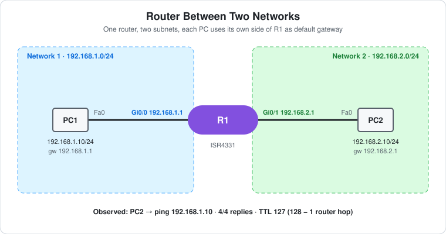

# CCNA Lab 22: Router Between Two Networks

The simplest routed network, built in the **PingMyNetwork Sandbox**: **one router joining two subnets**. PC1 sits on `192.168.1.0/24` and PC2 on `192.168.2.0/24`. Each is cabled straight to its own router interface, and each uses that interface as its default gateway. No switches, VLANs or routing protocols are involved: the router already knows both networks because they're **directly connected**.

It's numbered 22 because it was added last, but it's the best **starting point** in this repo. Do it before [Lab 02](../lab-02-inter-vlan-routing-acl/) (routing between VLANs) and [Lab 09](../lab-09-etherchannel-roas/) (router-on-a-stick).

> **Lab status:** The config in [`configs/`](configs/) and the results below come from the exported Sandbox JSON in [`lab-files/`](lab-files/). That export includes R1's saved configuration and the console output of the session. Results marked **observed** are copied from that output. `show ip route` wasn't run in this export, so the routing table below is the **expected** output.

## Learning objectives

- Give router interfaces IP addresses and bring them up with `no shutdown`.
- Explain why each subnet needs its own router interface.
- Explain what a host's **default gateway** is for, and what happens without one.
- Read **connected (C)** and **local (L)** routes in `show ip route`.
- Use the ping TTL to count router hops.

## Topology



```text
   192.168.1.0/24                                      192.168.2.0/24
  PC1 ---------- Gi0/0  R1  Gi0/1 ---------- PC2
 .10            .1            .1            .10
 gw 192.168.1.1                             gw 192.168.2.1
```

| Device | Role | Model |
|---|---|---|
| R1 | Router: gateway for both networks | Cisco ISR4331 (IOS 15.9 in the Sandbox) |
| PC1 | Host on network 1 | PC |
| PC2 | Host on network 2 | PC |

## Addressing plan

| Device | Interface | IP address | Subnet mask | Default gateway |
|---|---|---|---|---|
| R1 | Gi0/0 | `192.168.1.1` | `255.255.255.0` | – |
| R1 | Gi0/1 | `192.168.2.1` | `255.255.255.0` | – |
| PC1 | FastEthernet0 | `192.168.1.10` | `255.255.255.0` | `192.168.1.1` |
| PC2 | FastEthernet0 | `192.168.2.10` | `255.255.255.0` | `192.168.2.1` |

## Configuration

This is R1's whole configuration, apart from the defaults. The full config is in [`configs/`](configs/).

```cisco
hostname R1
!
interface GigabitEthernet0/0
 ip address 192.168.1.1 255.255.255.0
 no shutdown
!
interface GigabitEthernet0/1
 ip address 192.168.2.1 255.255.255.0
 no shutdown
```

- Router interfaces are **shut down by default**. Without `no shutdown`, the interface stays `administratively down` and the subnet doesn't exist as far as the router is concerned.
- There are **no static routes and no routing protocol**. A router automatically installs a route for every subnet configured on an up/up interface.
- Unlike a multilayer switch ([Lab 02](../lab-02-inter-vlan-routing-acl/)), a router routes by default. There's no `ip routing` to enable.

## How a ping crosses the router

1. PC2 wants to reach `192.168.1.10`. Using its mask, it sees that address is **not** in its own subnet `192.168.2.0/24`.
2. So PC2 sends the packet to its **default gateway** `192.168.2.1`, after an ARP for R1 Gi0/1's MAC address.
3. R1 looks up `192.168.1.10`, matches the connected route `192.168.1.0/24` on Gi0/0, ARPs for PC1's MAC address, and forwards the packet. It **decrements the TTL by 1** on the way.
4. PC1 replies to `192.168.2.10` through its own gateway `192.168.1.1`, and R1 forwards that back the same way.

## Results

### Observed

```text
R1 log:
%LINK-3-UPDOWN: Interface GigabitEthernet0/0, changed state to up
%LINK-3-UPDOWN: Interface GigabitEthernet0/1, changed state to up
%LINEPROTO-5-UPDOWN: Line protocol on Interface GigabitEthernet0/0, changed state to up
%LINEPROTO-5-UPDOWN: Line protocol on Interface GigabitEthernet0/1, changed state to up
```

```text
C:\>ping 192.168.1.10          (from PC2)
Reply from 192.168.1.10: bytes=32 time=60ms TTL=127
Reply from 192.168.1.10: bytes=32 time=7ms TTL=127
Reply from 192.168.1.10: bytes=32 time=7ms TTL=127
Reply from 192.168.1.10: bytes=32 time=9ms TTL=127
    Packets: Sent = 4, Received = 4, Lost = 0 (0% loss),
```

- **4/4 replies.** The two networks can reach each other through R1.
- **TTL 127.** The PC sends with TTL 128, and R1 decrements it once, so there's one router hop. Two routers would give 126, as in [Lab 13](../lab-13-ospf-etherchannel-ecmp/).
- The first reply is slower (60 ms) because of the ARP lookups on the first packet.

### Expected: R1's routing table

```text
R1#show ip route | begin Gateway
Gateway of last resort is not set

      192.168.1.0/24 is variably subnetted, 2 subnets, 2 masks
C        192.168.1.0/24 is directly connected, GigabitEthernet0/0
L        192.168.1.1/32 is directly connected, GigabitEthernet0/0
      192.168.2.0/24 is variably subnetted, 2 subnets, 2 masks
C        192.168.2.0/24 is directly connected, GigabitEthernet0/1
L        192.168.2.1/32 is directly connected, GigabitEthernet0/1
```

- **C (connected):** the whole subnet on each interface. This is what R1 uses to forward packets.
- **L (local):** a /32 for R1's own address on each interface, for traffic sent **to** the router itself.

## Verification results

| Check | Command/test | Result |
|---|---|---|
| Interfaces up | R1 log | **Observed:** Gi0/0 and Gi0/1 up/up |
| Routing | PC2 → `ping 192.168.1.10` | **Observed:** 4/4 replies, `TTL=127` |
| Routing table | R1 `show ip route` | Expected: two `C` and two `L` routes as above |
| Interface summary | R1 `show ip interface brief` | Expected: Gi0/0 `192.168.1.1` up/up, Gi0/1 `192.168.2.1` up/up, Gi0/2-3 administratively down |
| Gateway reachability | PC1 → `ping 192.168.1.1` | Expected: success |

## Full configuration commands

These are the **exact commands typed in the Sandbox session**, copied from the console history in the export, in the order they were entered (including the `show` commands used to verify). Typing them on factory-default devices reproduces the lab.

How to read the blocks:

- Lines starting with `!` explain the command below them. Don't type them.
- The prompt (`SW1(config-if-range)#`) shows which mode you're in. Type only the text after `#` or `>`.
- Abbreviations such as `conf t` and `f0/1-2` are accepted by IOS, the same as `configure terminal` and `FastEthernet0/1 - 2`.

### R1 (ISR4331)

```text
! Enter privileged EXEC mode
R1>enable
! Enter global configuration mode
R1#conf t
! Set the device name to R1
R1(config)#hostname R1
! Select interface g0/0
R1(config)#interface g0/0
! Assign 192.168.1.1 / 255.255.255.0
R1(config-if)#ip address 192.168.1.1 255.255.255.0
! Enable the interface
R1(config-if)#no shutdown
! Select interface g0/1
R1(config-if)#interface g0/1
! Assign 192.168.2.1 / 255.255.255.0
R1(config-if)#ip address 192.168.2.1 255.255.255.0
! Enable the interface
R1(config-if)#no shutdown
R1(config-if)#end
! Save the running config to NVRAM
R1#write memory
```

### PCs

Set these in each PC's IP configuration:

| PC | IP address | Subnet mask | Default gateway |
|---|---|---|---|
| PC1 | `192.168.1.10` | `255.255.255.0` | `192.168.1.1` |
| PC2 | `192.168.2.10` | `255.255.255.0` | `192.168.2.1` |

Then test from PC2's command prompt:

```text
! Test reachability to 192.168.1.10
C:\> ping 192.168.1.10
```

## Try it yourself: guided challenges

1. **Remove a gateway.** Clear PC1's default gateway and ping PC2 again. Why does it fail, even though R1 is unchanged? (This is the lab note's "Try" item.) Can PC1 still ping `192.168.1.1`?
2. **Forget `no shutdown`.** Run `shutdown` on R1 Gi0/1. What happens to the `C` route for `192.168.2.0/24`, and to the ping?
3. **Wrong mask on a PC.** Give PC2 the mask `255.255.0.0`. It now thinks `192.168.1.10` is in its own network. Does the ping still work, and why?
4. **Count hops with tracert.** Run `tracert 192.168.1.10` on PC2. How many hops are listed, and which address is the first one?
5. **Look at ARP.** After a ping, run `show arp` on R1 and `arp -a` on PC2. Whose MAC address does PC2 have for `192.168.2.1`?
6. **Add a third network.** Configure Gi0/2 as `192.168.3.1/24` with a PC3. Do you need to add any routes?

## Scope and caveats

- This is an introductory **CCNA** lab: IPv4 addressing, connected routes and the default gateway.
- The PCs connect straight to the router with no switch. That's fine in the Sandbox. Real networks normally put a switch between them.
- The Sandbox names the ISR4331's ports `GigabitEthernet0/0`–`0/3`. A real ISR4331 uses `GigabitEthernet0/0/0` style names.
- R1 has no passwords, no enable secret and no SSH. `line vty 0 4` has `login` but no password, and `transport input none`.

## Useful verification commands

```cisco
show ip interface brief
show ip route
show arp
show running-config interface GigabitEthernet0/0
```

## Lab files

| File | Description |
|---|---|
| [`lab-files/router-two-networks-lab.json`](lab-files/router-two-networks-lab.json) | PingMyNetwork Sandbox export with the saved config. Import it into the Sandbox to load the lab. |
| [`configs/R1-running-config.txt`](configs/R1-running-config.txt) | R1 saved configuration |
| [`images/topology.svg`](images/topology.svg) | Topology diagram |

**Built with:** [PingMyNetwork Sandbox](https://pingmynetwork.com/sandbox)
