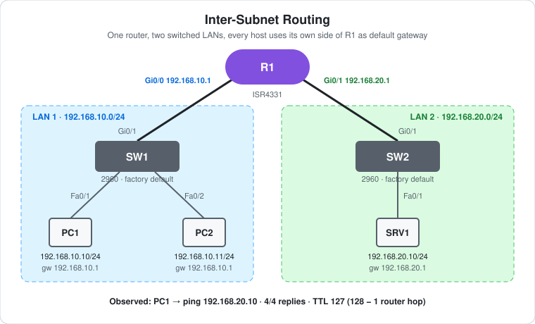

# CCNA Lab 23: Inter-Subnet Routing

The next step after [Lab 22](../lab-22-router-two-networks/), built in the **PingMyNetwork Sandbox**. It's still **one router joining two subnets**, but now each subnet is a switched LAN. PC1 and PC2 share `192.168.10.0/24` behind SW1, and the server SRV1 sits on `192.168.20.0/24` behind SW2. R1 routes between them.

The switches are left at their **factory defaults**: every port is an access port in VLAN 1. Each switch is its own broadcast domain, so no VLANs or trunks are needed. That keeps this lab about Layer 3. For two subnets on **one** switch, see [Lab 02](../lab-02-inter-vlan-routing-acl/) (Layer 3 switch) and [Lab 09](../lab-09-etherchannel-roas/) (router-on-a-stick).

> **Lab status:** The config in [`configs/`](configs/) and the results below come from the exported Sandbox JSON in [`lab-files/`](lab-files/). That export includes R1's saved configuration, the host IP settings, and the console output of the session. Results marked **observed** are copied from that output. Only one ping was run (PC1 → SRV1), and `show ip route` wasn't run, so the other checks below are **expected** results.

## Learning objectives

- Configure router interfaces as the default gateway for two switched LANs.
- Tell `administratively down` from `down` in `show ip interface brief`.
- Explain which traffic crosses the router and which stays on the switch.
- Read **connected (C)** and **local (L)** routes in `show ip route`.
- Use the ping TTL to count router hops.

## Topology



```text
                          R1 (ISR4331)
              Gi0/0 .10.1 /          \ Gi0/1 .20.1
                         /            \
                  Gi0/1 /              \ Gi0/1
                    SW1                  SW2
              Fa0/1 /  \ Fa0/2             | Fa0/1
                 PC1    PC2               SRV1
               .10.10   .10.11           .20.10
      |------ 192.168.10.0/24 ------|  |- 192.168.20.0/24 -|
```

| Device | Role | Model |
|---|---|---|
| R1 | Router: default gateway for both LANs | Cisco ISR4331 (IOS 15.9 in the Sandbox) |
| SW1 | LAN 1 access switch (factory default) | Cisco WS-C2960-24TT-L |
| SW2 | LAN 2 access switch (factory default) | Cisco WS-C2960-24TT-L |
| PC1, PC2 | Hosts on LAN 1 | PC |
| SRV1 | Server on LAN 2 | Server |

## Addressing plan

| Device | Interface | IP address | Subnet mask | Default gateway | Connected to |
|---|---|---|---|---|---|
| R1 | Gi0/0 | `192.168.10.1` | `255.255.255.0` | – | SW1 Gi0/1 |
| R1 | Gi0/1 | `192.168.20.1` | `255.255.255.0` | – | SW2 Gi0/1 |
| PC1 | FastEthernet0 | `192.168.10.10` | `255.255.255.0` | `192.168.10.1` | SW1 Fa0/1 |
| PC2 | FastEthernet0 | `192.168.10.11` | `255.255.255.0` | `192.168.10.1` | SW1 Fa0/2 |
| SRV1 | FastEthernet0 | `192.168.20.10` | `255.255.255.0` | `192.168.20.1` | SW2 Fa0/1 |

## Configuration

Only R1 is configured. This is its whole configuration, apart from the defaults. The full config is in [`configs/`](configs/).

```cisco
interface GigabitEthernet0/0
 ip address 192.168.10.1 255.255.255.0
 no shutdown
!
interface GigabitEthernet0/1
 ip address 192.168.20.1 255.255.255.0
 no shutdown
```

- Router interfaces are **shut down by default**, so each one needs `no shutdown`.
- There are **no static routes and no routing protocol**. R1 installs a connected route for each subnet as soon as its interface is up/up.
- The hostname `R1` wasn't typed in this session. It's the Sandbox's default name for the device, and it's in the saved config.
- SW1 and SW2 have **no configuration**. Nothing was typed on them and nothing was saved. Their running configs in the export are the Sandbox defaults, so there's no `configs/` file for them.

## Which traffic crosses R1

| From → to | Same subnet? | Path |
|---|---|---|
| PC1 → PC2 | Yes (`192.168.10.0/24`) | SW1 only. PC1 ARPs for PC2 directly, and R1 never sees the frames. |
| PC1 → SRV1 | No | PC1 → SW1 → **R1** (Gi0/0 → Gi0/1) → SW2 → SRV1 |
| PC2 → SRV1 | No | Same as PC1, through gateway `192.168.10.1` |

For PC1 → SRV1:

1. PC1 compares `192.168.20.10` with its own subnet `192.168.10.0/24`. It's not local, so PC1 sends the packet to its **default gateway** `192.168.10.1`, after an ARP for R1 Gi0/0's MAC address.
2. SW1 forwards the frame to Gi0/1 based on its MAC table.
3. R1 matches the connected route `192.168.20.0/24` on Gi0/1, ARPs for SRV1, rewrites the Ethernet header, **decrements the TTL by 1** and forwards the packet.
4. SRV1 replies to `192.168.10.10` through its own gateway `192.168.20.1`, and R1 forwards that back the same way.

## Results

### Observed: right after `no shutdown`

```text
R1#write memory
Building configuration...
[OK]
R1#show ip interface brief
Interface                  IP-Address      OK? Method Status                Protocol
GigabitEthernet0/0         192.168.10.1    YES manual down                  down
GigabitEthernet0/1         192.168.20.1    YES manual down                  down
GigabitEthernet0/2         unassigned      YES unset  administratively down down
GigabitEthernet0/3         unassigned      YES unset  administratively down down
*Oct 26 16:23:35.859: %LINK-3-UPDOWN: Interface GigabitEthernet0/0, changed state to up
*Oct 26 16:23:35.890: %LINK-3-UPDOWN: Interface GigabitEthernet0/1, changed state to up
*Oct 26 16:23:36.859: %LINEPROTO-5-UPDOWN: Line protocol on Interface GigabitEthernet0/0, changed state to up
*Oct 26 16:23:36.890: %LINEPROTO-5-UPDOWN: Line protocol on Interface GigabitEthernet0/1, changed state to up
```

- `show ip interface brief` ran **before the links had finished coming up**, so Gi0/0 and Gi0/1 show `down/down`. The `%LINK` and `%LINEPROTO` messages that follow show them going **up/up**.
- Note the difference: `down` means the interface is enabled but the link isn't up yet (or the cable is unplugged). Gi0/2 and Gi0/3 show `administratively down` because they were never given `no shutdown`.
- SW1 and SW2 logged their Gi0/1 ports coming up at the same moment (`16:23:35.859` and `16:23:35.890`), matching R1's two interfaces. Their host ports (Fa0/1, Fa0/2 on SW1, Fa0/1 on SW2) were already up at `16:23:26`.

### Observed: PC1 → SRV1

```text
C:\>ping 192.168.20.10

Pinging 192.168.20.10 with 32 bytes of data:

Reply from 192.168.20.10: bytes=32 time=73ms TTL=127
Reply from 192.168.20.10: bytes=32 time=13ms TTL=127
Reply from 192.168.20.10: bytes=32 time=13ms TTL=127
Reply from 192.168.20.10: bytes=32 time=18ms TTL=127

Ping statistics for 192.168.20.10:
    Packets: Sent = 4, Received = 4, Lost = 0 (0% loss),
```

- **4/4 replies.** LAN 1 reaches LAN 2 through R1.
- **TTL 127.** SRV1 replies with TTL 128, and R1 decrements it once, so there's one router hop. The switches don't touch the TTL because they forward at Layer 2.
- The first reply is slower (73 ms) because of the ARP lookups on the first packet.

### Expected: R1's routing table

```text
R1#show ip route | begin Gateway
Gateway of last resort is not set

      192.168.10.0/24 is variably subnetted, 2 subnets, 2 masks
C        192.168.10.0/24 is directly connected, GigabitEthernet0/0
L        192.168.10.1/32 is directly connected, GigabitEthernet0/0
      192.168.20.0/24 is variably subnetted, 2 subnets, 2 masks
C        192.168.20.0/24 is directly connected, GigabitEthernet0/1
L        192.168.20.1/32 is directly connected, GigabitEthernet0/1
```

## Verification results

| Check | Command/test | Result |
|---|---|---|
| Interfaces up | R1 log | **Observed:** Gi0/0 and Gi0/1 up/up |
| `show ip interface brief` | R1 | **Observed:** run too early, shows Gi0/0 and Gi0/1 `down/down` before the links came up |
| Inter-subnet routing | PC1 → `ping 192.168.20.10` | **Observed:** 4/4 replies, `TTL=127` |
| Inter-subnet routing | PC2 → `ping 192.168.20.10` | Expected: 4/4 replies, `TTL=127` |
| Same-subnet traffic | PC1 → `ping 192.168.10.11` | Expected: success, `TTL=128` (no router hop) |
| Routing table | R1 `show ip route` | Expected: two `C` and two `L` routes as above |
| Interface summary (re-run) | R1 `show ip interface brief` | Expected: Gi0/0 and Gi0/1 up/up |

## Full configuration commands

These are the **exact commands typed in the Sandbox session**, copied from the console history in the export, in the order they were entered (including the `show` command used to verify). Typing them on factory-default devices reproduces the lab.

How to read the blocks:

- Lines starting with `!` explain the command below them. Don't type them.
- The prompt (`R1(config-if)#`) shows which mode you're in. Type only the text after `#` or `>`.
- Abbreviations such as `g0/0` are accepted by IOS, the same as `GigabitEthernet0/0`.

### R1 (ISR4331)

```text
! Enter privileged EXEC mode
R1>enable
! Enter global configuration mode
R1#configure terminal
! Select interface g0/0
R1(config)#interface g0/0
! Assign 192.168.10.1 / 255.255.255.0
R1(config-if)#ip address 192.168.10.1 255.255.255.0
! Enable the interface
R1(config-if)#no shutdown
R1(config-if)#exit
! Select interface g0/1
R1(config)#interface g0/1
! Assign 192.168.20.1 / 255.255.255.0
R1(config-if)#ip address 192.168.20.1 255.255.255.0
! Enable the interface
R1(config-if)#no shutdown
R1(config-if)#end
! Save the running config to NVRAM
R1#write memory
! Verify: interface IPs and up/up status
R1#show ip interface brief
```

### SW1 and SW2 (WS-C2960-24TT-L)

No commands. Leave them at factory defaults.

### PCs and server

Set these in each host's IP configuration:

| Host | IP address | Subnet mask | Default gateway |
|---|---|---|---|
| PC1 | `192.168.10.10` | `255.255.255.0` | `192.168.10.1` |
| PC2 | `192.168.10.11` | `255.255.255.0` | `192.168.10.1` |
| SRV1 | `192.168.20.10` | `255.255.255.0` | `192.168.20.1` |

Then test from PC1's command prompt:

```text
! Test reachability to 192.168.20.10
C:\> ping 192.168.20.10
```

## Try it yourself: guided challenges

1. **Re-run the check.** Run `show ip interface brief` on R1 again now. What do Gi0/0 and Gi0/1 show, and why was the first output different?
2. **Same subnet vs. different subnet.** Ping PC2 from PC1, then SRV1 from PC1. Compare the TTLs. Which ping went through R1?
3. **Remove PC2's gateway.** Can PC2 still ping PC1? Can it still ping SRV1? Explain both answers.
4. **Unplug the router.** Shut down R1 Gi0/1. What happens to the `C` route for `192.168.20.0/24`? What does `show ip interface brief` show for Gi0/1 now, `down` or `administratively down`?
5. **Look at ARP.** After a PC1 → SRV1 ping, run `arp -a` on PC1. Which MAC address does it have for `192.168.10.1`, and is there an entry for `192.168.20.10`? Why not?
6. **Check the MAC tables.** Run `show mac address-table` on SW1. Which port is R1's MAC address learned on?
7. **Use one switch.** Remove SW2 and cable R1 Gi0/1 and SRV1 to SW1. Both subnets now share one broadcast domain in VLAN 1. Why is that a problem, and how would VLANs fix it? (Compare [Lab 09](../lab-09-etherchannel-roas/).)

## Scope and caveats

- This is an introductory **CCNA** lab: IPv4 addressing, connected routes, default gateways, and the line between switching and routing.
- Only PC1 → SRV1 was tested in the export. PC2 and SRV1 have no console output.
- The Sandbox's default 2960 config includes `spanning-tree mode rapid-pvst` and `spanning-tree portfast edge default`. A real 2960 defaults to PVST+ without PortFast.
- The Sandbox names the ISR4331's ports `GigabitEthernet0/0`–`0/3`. A real ISR4331 uses `GigabitEthernet0/0/0` style names.
- R1 has no passwords, no enable secret and no SSH. `line vty 0 4` has `login` but no password, and `transport input none`.

## Useful verification commands

```cisco
show ip interface brief
show ip route
show arp
show mac address-table
```

## Lab files

| File | Description |
|---|---|
| [`lab-files/inter-subnet-routing-lab.json`](lab-files/inter-subnet-routing-lab.json) | PingMyNetwork Sandbox export with the saved config. Import it into the Sandbox to load the lab. |
| [`configs/R1-running-config.txt`](configs/R1-running-config.txt) | R1 saved configuration |
| [`images/topology.svg`](images/topology.svg) | Topology diagram |

**Built with:** [PingMyNetwork Sandbox](https://pingmynetwork.com/sandbox)
