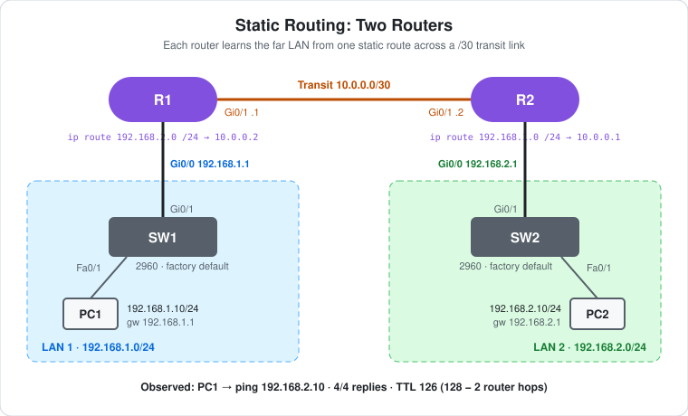

# CCNA Lab 24: Static Routing with Two Routers

The step after [Lab 22](../lab-22-router-two-networks/) and [Lab 23](../lab-23-inter-subnet-routing/), built in the **PingMyNetwork Sandbox**. With one router, every subnet was directly connected. Now there are **two routers**, and neither one can see the other's LAN. R1 has `192.168.1.0/24`, R2 has `192.168.2.0/24`, and they're joined by a point-to-point `/30` transit link. One **static route** on each router fills the gap.

The switches are left at their **factory defaults**, as in Lab 23.

> **Lab status:** The configs in [`configs/`](configs/) and the results below come from the exported Sandbox JSON in [`lab-files/`](lab-files/). That export includes both routers' saved configurations, the PC IP settings, and the console output of the session. Results marked **observed** are copied from that output. `show ip route` wasn't run on either router, so the routing tables below are **expected** output.

## Learning objectives

- Address a point-to-point link with a `/30` (`255.255.255.252`) subnet.
- Explain why a router can't reach a subnet that isn't directly connected without a route.
- Configure a static route with `ip route <network> <mask> <next-hop>`.
- Explain why routing has to work **in both directions**.
- Read **static (S)** routes in `show ip route` and use the ping TTL to count two router hops.

## Topology



```text
                   Gi0/1 10.0.0.1      10.0.0.2 Gi0/1
               R1 ------------- 10.0.0.0/30 ------------- R2
   Gi0/0 192.168.1.1 |                                     | Gi0/0 192.168.2.1
               Gi0/1 |                                     | Gi0/1
                    SW1                                   SW2
               Fa0/1 |                                     | Fa0/1
                    PC1                                   PC2
              192.168.1.10                          192.168.2.10
      |--- 192.168.1.0/24 ---|                |--- 192.168.2.0/24 ---|
```

| Device | Role | Model |
|---|---|---|
| R1 | Gateway for LAN 1, static route to LAN 2 | Cisco ISR4331 (IOS 15.9 in the Sandbox) |
| R2 | Gateway for LAN 2, static route to LAN 1 | Cisco ISR4331 (IOS 15.9 in the Sandbox) |
| SW1 | LAN 1 access switch (factory default) | Cisco WS-C2960-24TT-L |
| SW2 | LAN 2 access switch (factory default) | Cisco WS-C2960-24TT-L |
| PC1 | Host on LAN 1 | PC |
| PC2 | Host on LAN 2 | PC |

## Addressing plan

| Device | Interface | IP address | Subnet mask | Default gateway | Connected to |
|---|---|---|---|---|---|
| R1 | Gi0/0 | `192.168.1.1` | `255.255.255.0` | – | SW1 Gi0/1 |
| R1 | Gi0/1 | `10.0.0.1` | `255.255.255.252` | – | R2 Gi0/1 |
| R2 | Gi0/0 | `192.168.2.1` | `255.255.255.0` | – | SW2 Gi0/1 |
| R2 | Gi0/1 | `10.0.0.2` | `255.255.255.252` | – | R1 Gi0/1 |
| PC1 | FastEthernet0 | `192.168.1.10` | `255.255.255.0` | `192.168.1.1` | SW1 Fa0/1 |
| PC2 | FastEthernet0 | `192.168.2.10` | `255.255.255.0` | `192.168.2.1` | SW2 Fa0/1 |

**Why a /30 for the transit link?** `10.0.0.0/30` has four addresses: `10.0.0.0` (network), `10.0.0.1` and `10.0.0.2` (the two routers), and `10.0.0.3` (broadcast). A point-to-point link only needs two hosts, so a `/30` wastes nothing.

## Configuration

This is each router's whole configuration, apart from the defaults. The full configs are in [`configs/`](configs/).

**R1**

```cisco
interface GigabitEthernet0/0
 ip address 192.168.1.1 255.255.255.0
 no shutdown
!
interface GigabitEthernet0/1
 ip address 10.0.0.1 255.255.255.252
 no shutdown
!
ip route 192.168.2.0 255.255.255.0 10.0.0.2
```

**R2**

```cisco
interface GigabitEthernet0/0
 ip address 192.168.2.1 255.255.255.0
 no shutdown
!
interface GigabitEthernet0/1
 ip address 10.0.0.2 255.255.255.252
 no shutdown
!
ip route 192.168.1.0 255.255.255.0 10.0.0.1
```

- `ip route 192.168.2.0 255.255.255.0 10.0.0.2` means "to reach `192.168.2.0/24`, send the packet to `10.0.0.2`". The next hop must be on a subnet R1 can already reach. Here it's on the connected `10.0.0.0/30`.
- **Both routes are needed.** With only R1's route, PC1's ping would reach PC2, but PC2's reply would die at R2, because R2 wouldn't know where `192.168.1.0/24` is.
- The hostnames `R1` and `R2` weren't typed in this session. They're the Sandbox's default names, and they're in the saved configs.
- SW1 and SW2 have **no configuration**. Nothing was typed on them and nothing was saved, so there's no `configs/` file for them.

## How the ping crosses two routers

1. PC1 sees that `192.168.2.10` isn't in `192.168.1.0/24`, so it sends the packet to its gateway `192.168.1.1` (R1).
2. R1 has no connected route for `192.168.2.10`. It matches the **static route** `192.168.2.0/24 via 10.0.0.2`, ARPs for `10.0.0.2` on Gi0/1, decrements the TTL and forwards.
3. R2 matches its **connected** route `192.168.2.0/24` on Gi0/0, ARPs for PC2, decrements the TTL again and delivers the packet.
4. PC2 replies to `192.168.1.10` through `192.168.2.1`. R2 uses **its** static route `192.168.1.0/24 via 10.0.0.1`, and R1 delivers the reply on its connected LAN.

## Results

### Observed: links coming up

```text
R1 log:
*Oct 26 16:33:04.439: %LINK-3-UPDOWN: Interface GigabitEthernet0/0, changed state to up
*Oct 26 16:33:04.466: %LINK-3-UPDOWN: Interface GigabitEthernet0/1, changed state to down
*Oct 26 16:33:05.439: %LINEPROTO-5-UPDOWN: Line protocol on Interface GigabitEthernet0/0, changed state to up
*Oct 26 16:33:10.614: %LINK-3-UPDOWN: Interface GigabitEthernet0/1, changed state to up
*Oct 26 16:33:11.614: %LINEPROTO-5-UPDOWN: Line protocol on Interface GigabitEthernet0/1, changed state to up
```

- R1 was configured first. Its Gi0/0 to SW1 came straight up, but **Gi0/1 went to `down`**, because the other end of the cable (R2 Gi0/1) was still shut down.
- Gi0/1 came up at `16:33:10.614`, the same moment R2's Gi0/1 came up (R2's log shows the same timestamp). A point-to-point link needs both ends enabled.
- SW1's Gi0/1 came up with R1 Gi0/0 (`16:33:04.439`), and SW2's Gi0/1 came up with R2 Gi0/0 (`16:33:10.587`).

### Observed: R2 → R1 across the transit link

```text
R2#ping 10.0.0.1
Type escape sequence to abort.
Sending 5, 100-byte ICMP Echos to 10.0.0.1, timeout is 2 seconds:
*Oct 26 16:33:10.587: %LINK-3-UPDOWN: Interface GigabitEthernet0/0, changed state to up
*Oct 26 16:33:10.614: %LINK-3-UPDOWN: Interface GigabitEthernet0/1, changed state to up
.!!!!
Success rate is 80 percent (4/5), round-trip min/avg/max = 9/11/12 ms
```

- **4/5.** The link-up messages appear **during** the ping, so it was started while R2's interfaces were still coming up. The first echo (`.`) was lost. The export doesn't show whether that was because the link wasn't up yet or because of the ARP for `10.0.0.1`. On a real router, a first-ping loss of 4/5 is normally ARP.
- The other four echoes succeeded, so the `/30` link works.

### Observed: PC1 → PC2

```text
C:\>ping 192.168.2.10

Pinging 192.168.2.10 with 32 bytes of data:

Reply from 192.168.2.10: bytes=32 time=78ms TTL=126
Reply from 192.168.2.10: bytes=32 time=28ms TTL=126
Reply from 192.168.2.10: bytes=32 time=18ms TTL=126
Reply from 192.168.2.10: bytes=32 time=20ms TTL=126

Ping statistics for 192.168.2.10:
    Packets: Sent = 4, Received = 4, Lost = 0 (0% loss),
```

- **4/4 replies.** Since each reply had to come back through R2's static route, this shows **both** static routes work.
- **TTL 126.** PC2 replies with TTL 128, and R2 and R1 each decrement it once: **two router hops**. Compare TTL 127 in Labs 22 and 23, where there was one router.
- The first reply is slower (78 ms) because of ARP on each of the three segments.

### Expected: routing tables

```text
R1#show ip route | begin Gateway
Gateway of last resort is not set

      10.0.0.0/8 is variably subnetted, 2 subnets, 2 masks
C        10.0.0.0/30 is directly connected, GigabitEthernet0/1
L        10.0.0.1/32 is directly connected, GigabitEthernet0/1
      192.168.1.0/24 is variably subnetted, 2 subnets, 2 masks
C        192.168.1.0/24 is directly connected, GigabitEthernet0/0
L        192.168.1.1/32 is directly connected, GigabitEthernet0/0
S     192.168.2.0/24 [1/0] via 10.0.0.2
```

```text
R2#show ip route | begin Gateway
Gateway of last resort is not set

      10.0.0.0/8 is variably subnetted, 2 subnets, 2 masks
C        10.0.0.0/30 is directly connected, GigabitEthernet0/1
L        10.0.0.2/32 is directly connected, GigabitEthernet0/1
S     192.168.1.0/24 [1/0] via 10.0.0.1
      192.168.2.0/24 is variably subnetted, 2 subnets, 2 masks
C        192.168.2.0/24 is directly connected, GigabitEthernet0/0
L        192.168.2.1/32 is directly connected, GigabitEthernet0/0
```

- **S (static):** the route you typed. `[1/0]` is the **administrative distance** (1 for a static route) and the metric (0).
- Each router has two connected subnets and one static route, so it knows all three subnets in the lab.

## Verification results

| Check | Command/test | Result |
|---|---|---|
| Interfaces up | R1 and R2 logs | **Observed:** Gi0/0 and Gi0/1 up/up on both routers |
| Transit link | R2 → `ping 10.0.0.1` | **Observed:** 4/5 (`.!!!!`), started while the link was coming up |
| End-to-end routing | PC1 → `ping 192.168.2.10` | **Observed:** 4/4 replies, `TTL=126` |
| Reverse direction | PC2 → `ping 192.168.1.10` | Expected: 4/4 replies, `TTL=126` |
| Routing tables | `show ip route` on R1 and R2 | Expected: two `C`, two `L` and one `S` route each, as above |
| Path | PC1 → `tracert 192.168.2.10` | Expected: hops `192.168.1.1`, `10.0.0.2`, `192.168.2.10` |

## Full configuration commands

These are the **exact commands typed in the Sandbox session**, copied from the console history in the export, in the order they were entered (including the `ping` used to verify). Typing them on factory-default devices reproduces the lab.

How to read the blocks:

- Lines starting with `!` explain the command below them. Don't type them.
- The prompt (`R1(config-if)#`) shows which mode you're in. Type only the text after `#` or `>`.
- Abbreviations such as `g0/0` are accepted by IOS, the same as `GigabitEthernet0/0`.

### R1 (ISR4331)

```text
! Enter privileged EXEC mode
R1>enable
! Enter global configuration mode
R1#configure terminal
! Select interface g0/0
R1(config)#interface g0/0
! Assign 192.168.1.1 / 255.255.255.0
R1(config-if)#ip address 192.168.1.1 255.255.255.0
! Enable the interface
R1(config-if)#no shutdown
R1(config-if)#exit
! Select interface g0/1
R1(config)#interface g0/1
! Assign 10.0.0.1 / 255.255.255.252
R1(config-if)#ip address 10.0.0.1 255.255.255.252
! Enable the interface
R1(config-if)#no shutdown
R1(config-if)#exit
! Static route to 192.168.2.0/255.255.255.0 via 10.0.0.2
R1(config)#ip route 192.168.2.0 255.255.255.0 10.0.0.2
R1(config)#end
! Save the running config to NVRAM
R1#write memory
```

### R2 (ISR4331)

```text
! Enter privileged EXEC mode
R2>enable
! Enter global configuration mode
R2#configure terminal
! Select interface g0/0
R2(config)#interface g0/0
! Assign 192.168.2.1 / 255.255.255.0
R2(config-if)#ip address 192.168.2.1 255.255.255.0
! Enable the interface
R2(config-if)#no shutdown
R2(config-if)#exit
! Select interface g0/1
R2(config)#interface g0/1
! Assign 10.0.0.2 / 255.255.255.252
R2(config-if)#ip address 10.0.0.2 255.255.255.252
! Enable the interface
R2(config-if)#no shutdown
R2(config-if)#exit
! Static route to 192.168.1.0/255.255.255.0 via 10.0.0.1
R2(config)#ip route 192.168.1.0 255.255.255.0 10.0.0.1
R2(config)#end
! Save the running config to NVRAM
R2#write memory
! Test reachability to 10.0.0.1
R2#ping 10.0.0.1
```

### SW1 and SW2 (WS-C2960-24TT-L)

No commands. Leave them at factory defaults.

### PCs

Set these in each PC's IP configuration:

| PC | IP address | Subnet mask | Default gateway |
|---|---|---|---|
| PC1 | `192.168.1.10` | `255.255.255.0` | `192.168.1.1` |
| PC2 | `192.168.2.10` | `255.255.255.0` | `192.168.2.1` |

Then test from PC1's command prompt:

```text
! Test reachability to 192.168.2.10
C:\> ping 192.168.2.10
```

## Try it yourself: guided challenges

1. **Remove one route.** On R2, run `no ip route 192.168.1.0 255.255.255.0 10.0.0.1`, then ping PC2 from PC1. It fails. Did the request reach PC2? Where did the reply get lost?
2. **Check before and after.** Run `show ip route` on R1 before and after adding its static route. Which line appears?
3. **Wrong next hop.** Change R1's route to use `10.0.0.3` as the next hop. What happens, and why is `10.0.0.3` not a usable address in `10.0.0.0/30`?
4. **Exit interface instead of next hop.** Replace R1's route with `ip route 192.168.2.0 255.255.255.0 GigabitEthernet0/1`. How does `show ip route` display it now?
5. **Default route.** Replace R1's static route with `ip route 0.0.0.0 0.0.0.0 10.0.0.2`. Does PC1 → PC2 still work? What does "Gateway of last resort" show now?
6. **Trace the path.** Run `tracert 192.168.2.10` on PC1. Which address does R2 show as its hop, and why that one?
7. **Ping from the router.** Ping `192.168.2.10` from R1 without options, then with `ping 192.168.2.10 source 192.168.1.1`. Which source address does R1 use by default?

## Scope and caveats

- This is an introductory **CCNA** lab: `/30` point-to-point links, static routes, two-way routing and administrative distance.
- PC2 has no console output, so the reverse ping wasn't run in the export. The PC1 → PC2 replies still prove both routes, because they came back through R2.
- Static routes don't adapt. If the transit link fails, nothing reroutes, and a larger network would use a routing protocol such as OSPF ([Lab 13](../lab-13-ospf-etherchannel-ecmp/)).
- The Sandbox's default 2960 config includes `spanning-tree mode rapid-pvst` and `spanning-tree portfast edge default`. A real 2960 defaults to PVST+ without PortFast.
- The Sandbox names the ISR4331's ports `GigabitEthernet0/0`–`0/3`. A real ISR4331 uses `GigabitEthernet0/0/0` style names.
- Neither router has passwords, an enable secret or SSH. `line vty 0 4` has `login` but no password, and `transport input none`.

## Useful verification commands

```cisco
show ip route
show ip route static
show ip interface brief
ping 192.168.2.10 source 192.168.1.1
traceroute 192.168.2.10
```

## Lab files

| File | Description |
|---|---|
| [`lab-files/static-routing-two-routers-lab.json`](lab-files/static-routing-two-routers-lab.json) | PingMyNetwork Sandbox export with the saved configs. Import it into the Sandbox to load the lab. |
| [`configs/R1-running-config.txt`](configs/R1-running-config.txt) | R1 saved configuration |
| [`configs/R2-running-config.txt`](configs/R2-running-config.txt) | R2 saved configuration |
| [`images/topology.svg`](images/topology.svg) | Topology diagram |

**Built with:** [PingMyNetwork Sandbox](https://pingmynetwork.com/sandbox)
