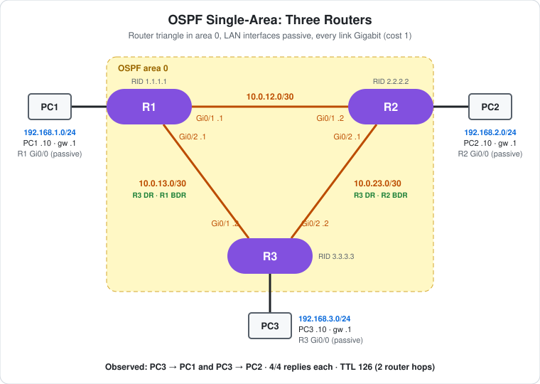

# CCNA Lab 25: OSPF Single-Area with Three Routers

The step after [Lab 24](../lab-24-static-routing-two-routers/), built in the **PingMyNetwork Sandbox**. Three routers form a **triangle**, each with its own LAN. Instead of static routes, they run **OSPF in area 0** and learn every remote subnet from each other. With three routers and three transit links, static routing would already need six routes, and none of them would react to a link failure. OSPF needs one `network` statement per interface.

There are no switches here. Each PC is cabled straight to its router's Gi0/0.

> **Lab status:** The configs in [`configs/`](configs/) and the results below come from the exported Sandbox JSON in [`lab-files/`](lab-files/). That export includes all three routers' saved configurations, the PC IP settings, and the console output of the session. Results marked **observed** are copied from that output. The `show` commands were only run on R3, so R1's and R2's tables below are **expected** output.

## Learning objectives

- Enable OSPF with `router ospf`, a manual `router-id` and `network ... area 0` statements using **wildcard masks**.
- Use `passive-interface` to advertise a LAN without sending hellos onto it.
- Follow an adjacency from `2WAY/DROTHER` to `FULL`, and read DR/BDR roles in `show ip ospf neighbor`.
- Read `O` routes, administrative distance 110 and OSPF cost in `show ip route`.
- Explain why OSPF picks the direct link and when it installs two equal-cost paths.

## Topology



```text
        192.168.1.0/24                                   192.168.2.0/24
   PC1 ---- Gi0/0 R1 Gi0/1 ---- 10.0.12.0/30 ---- Gi0/1 R2 Gi0/0 ---- PC2
                   Gi0/2 \                       / Gi0/2
              10.0.13.0/30 \                   / 10.0.23.0/30
                            \ Gi0/1     Gi0/2 /
                                    R3
                                  Gi0/0
                                    |
                                   PC3   192.168.3.0/24
```

| Device | Role | Model | OSPF router ID |
|---|---|---|---|
| R1 | Router for LAN 1 | Cisco ISR4331 (IOS 15.9 in the Sandbox) | `1.1.1.1` |
| R2 | Router for LAN 2 | Cisco ISR4331 (IOS 15.9 in the Sandbox) | `2.2.2.2` |
| R3 | Router for LAN 3 | Cisco ISR4331 (IOS 15.9 in the Sandbox) | `3.3.3.3` |
| PC1, PC2, PC3 | One host per LAN | PC | – |

## Addressing plan

| Device | Interface | IP address | Subnet mask | Connected to |
|---|---|---|---|---|
| R1 | Gi0/0 | `192.168.1.1` | `255.255.255.0` | PC1 |
| R1 | Gi0/1 | `10.0.12.1` | `255.255.255.252` | R2 Gi0/1 |
| R1 | Gi0/2 | `10.0.13.1` | `255.255.255.252` | R3 Gi0/1 |
| R2 | Gi0/0 | `192.168.2.1` | `255.255.255.0` | PC2 |
| R2 | Gi0/1 | `10.0.12.2` | `255.255.255.252` | R1 Gi0/1 |
| R2 | Gi0/2 | `10.0.23.1` | `255.255.255.252` | R3 Gi0/2 |
| R3 | Gi0/0 | `192.168.3.1` | `255.255.255.0` | PC3 |
| R3 | Gi0/1 | `10.0.13.2` | `255.255.255.252` | R1 Gi0/2 |
| R3 | Gi0/2 | `10.0.23.2` | `255.255.255.252` | R2 Gi0/2 |

| PC | IP address | Subnet mask | Default gateway |
|---|---|---|---|
| PC1 | `192.168.1.10` | `255.255.255.0` | `192.168.1.1` |
| PC2 | `192.168.2.10` | `255.255.255.0` | `192.168.2.1` |
| PC3 | `192.168.3.10` | `255.255.255.0` | `192.168.3.1` |

The transit links are named after the routers they join: `10.0.12.0/30` is R1–R2, `10.0.13.0/30` is R1–R3, and `10.0.23.0/30` is R2–R3. The lower-numbered router gets `.1`.

## Configuration

The three routers are configured the same way. This is R1's OSPF section. The full configs are in [`configs/`](configs/).

```cisco
router ospf 1
 router-id 1.1.1.1
 passive-interface GigabitEthernet0/0
 network 10.0.12.0 0.0.0.3 area 0
 network 10.0.13.0 0.0.0.3 area 0
 network 192.168.1.0 0.0.0.255 area 0
```

| Router | `router-id` | `network` statements (all `area 0`) | Passive |
|---|---|---|---|
| R1 | `1.1.1.1` | `192.168.1.0 0.0.0.255`, `10.0.12.0 0.0.0.3`, `10.0.13.0 0.0.0.3` | Gi0/0 |
| R2 | `2.2.2.2` | `192.168.2.0 0.0.0.255`, `10.0.12.0 0.0.0.3`, `10.0.23.0 0.0.0.3` | Gi0/0 |
| R3 | `3.3.3.3` | `192.168.3.0 0.0.0.255`, `10.0.13.0 0.0.0.3`, `10.0.23.0 0.0.0.3` | Gi0/0 |

- **`network` uses a wildcard mask**, the inverse of the subnet mask. `0.0.0.3` matches a `/30` and `0.0.0.255` matches a `/24`. Any interface whose address falls inside the range joins OSPF in that area, and its subnet is advertised.
- **`router-id`** gives each router a fixed, readable ID. Without it, OSPF would pick the highest loopback address, or else the highest address on an up interface.
- **`passive-interface g0/0`** keeps the LAN subnet in OSPF (so it's advertised) but stops hellos going out to the PC. There's no router on the LAN to talk to, and hellos there would only invite a rogue neighbor.
- In the saved config, IOS lists `passive-interface` before the `network` lines and expands `g0/0` to `GigabitEthernet0/0`, regardless of the order they were typed.

## Results

### Observed: "OSPF process 1 cannot start"

```text
R1(config-if)#exit
R1(config)#router ospf 1
OSPF process 1 cannot start. There must be at least one "up" IP interface, for OSPF to use as router ID.
R1(config-router)#router-id 1.1.1.1
```

- All three routers printed this. When `router ospf 1` was typed, **no interface was up yet**: each router's log shows its interfaces coming up only after `write memory`.
- OSPF needs a router ID before it can run, and with no up interface it had nothing to choose from. The `router-id` command on the next line supplied one, and the adjacencies below show OSPF ran normally.
- This is a good reason to always set `router-id` by hand.

### Observed: interfaces and adjacencies (R1 log)

```text
*Oct 26 17:19:40.170: %LINK-3-UPDOWN: Interface GigabitEthernet0/0, changed state to up
*Oct 26 17:19:40.194: %LINK-3-UPDOWN: Interface GigabitEthernet0/1, changed state to down
*Oct 26 17:19:40.217: %LINK-3-UPDOWN: Interface GigabitEthernet0/2, changed state to down
*Oct 26 17:19:41.170: %LINEPROTO-5-UPDOWN: Line protocol on Interface GigabitEthernet0/0, changed state to up
*Oct 26 17:19:48.454: %LINK-3-UPDOWN: Interface GigabitEthernet0/1, changed state to up
*Oct 26 17:19:49.454: %LINEPROTO-5-UPDOWN: Line protocol on Interface GigabitEthernet0/1, changed state to up
*Oct 26 17:19:57.832: %LINK-3-UPDOWN: Interface GigabitEthernet0/2, changed state to up
*Oct 26 17:19:58.832: %LINEPROTO-5-UPDOWN: Line protocol on Interface GigabitEthernet0/2, changed state to up
*Oct 26 17:20:29.680: %OSPF-5-ADJCHG: Process 1, Nbr 2.2.2.2 on GigabitEthernet0/1 from LOADING to FULL, Loading Done
*Oct 26 17:20:39.084: %OSPF-5-ADJCHG: Process 1, Nbr 3.3.3.3 on GigabitEthernet0/2 from LOADING to FULL, Loading Done
```

- The routers were configured in order R1, R2, R3. R1's transit links showed `down` until the router at the other end enabled its side: Gi0/1 when R2 did, Gi0/2 when R3 did.
- **Each adjacency went FULL about 40 seconds after its link came up**: R1–R2 at `17:19:49` → `17:20:29`, and both R3 links at `17:19:58` → `17:20:39`. That matches the OSPF **wait timer** (equal to the 40-second dead interval) on a broadcast network. The routers wait that long to hear an existing DR before electing one.
- R2 logged the same two adjacencies (`1.1.1.1` at `17:20:29.706`, `3.3.3.3` at `17:20:39.084`), and R3 logged `1.1.1.1` and `2.2.2.2` at `17:20:39`.

### Observed: R3 during the wait timer

```text
R3#show ip ospf neighbor

Neighbor ID     Pri   State           Dead Time   Address         Interface
2.2.2.2           1   2WAY/DROTHER    00:00:33    10.0.23.1       GigabitEthernet0/2
1.1.1.1           1   2WAY/DROTHER    00:00:34    10.0.13.1       GigabitEthernet0/1
R3#show ip route ospf
...
Gateway of last resort is not set

```

- R3 could already see both neighbors in its hellos (**2WAY**), but no DR or BDR had been elected yet, so both are listed as `DROTHER`. Routers don't exchange their databases until the election is done.
- With no FULL adjacency, R3 had **no OSPF routes**: the table is empty after the "Gateway" line.

### Observed: R3 after the adjacencies went FULL

```text
*Oct 26 17:20:39.084: %OSPF-5-ADJCHG: Process 1, Nbr 1.1.1.1 on GigabitEthernet0/1 from LOADING to FULL, Loading Done
*Oct 26 17:20:39.110: %OSPF-5-ADJCHG: Process 1, Nbr 2.2.2.2 on GigabitEthernet0/2 from LOADING to FULL, Loading Done
R3#show ip ospf neighbor

Neighbor ID     Pri   State           Dead Time   Address         Interface
2.2.2.2           1   FULL/BDR        00:00:36    10.0.23.1       GigabitEthernet0/2
1.1.1.1           1   FULL/BDR        00:00:38    10.0.13.1       GigabitEthernet0/1
R3#show ip route ospf | include O
       D - EIGRP, EX - EIGRP external, O - OSPF, IA - OSPF inter area
       N1 - OSPF NSSA external type 1, N2 - OSPF NSSA external type 2
       E1 - OSPF external type 1, E2 - OSPF external type 2
       o - ODR, P - periodic downloaded static route, H - NHRP, l - LISP
O        10.0.12.0/30 [110/2] via 10.0.23.1, 00:00:17, GigabitEthernet0/2
O     192.168.1.0/24 [110/2] via 10.0.13.1, 00:00:17, GigabitEthernet0/1
O     192.168.2.0/24 [110/2] via 10.0.23.1, 00:00:17, GigabitEthernet0/2
```

- **FULL/BDR:** both neighbors are FULL, and each is the **BDR** on its link. The `State` column shows the *neighbor's* role, so **R3 is the DR on both of its links**. That's expected, because all priorities are 1 and R3 has the highest router ID (`3.3.3.3`).
- **R3 learned all three remote subnets**: LAN 1 via R1, LAN 2 via R2, and the R1–R2 transit link.
- **`[110/2]`:** 110 is OSPF's administrative distance, and 2 is the cost. Every link is Gigabit, and with the default reference bandwidth of 100 Mbps each one costs 1. To LAN 1 that's R3→R1 (1) plus R1's Gi0/0 (1). Compare [Lab 13](../lab-13-ospf-etherchannel-ecmp/), which changes the reference bandwidth.
- **The direct link wins.** R3 reaches `192.168.1.0/24` straight across Gi0/1 (cost 2), not round through R2 (cost 3).
- **The `include O` filter is case-sensitive but not specific.** It also matched four lines of the legend, because they contain a capital O. `show ip route ospf | begin Gateway` is a cleaner filter.

**Check this: a hidden second path.** R3 can reach `10.0.12.0/30` (R1–R2) through R1 *or* R2, both at cost 2. OSPF installs equal-cost paths together, so the full output should have a second line for it:

```text
O        10.0.12.0/30 [110/2] via 10.0.23.1, 00:00:17, GigabitEthernet0/2
                      [110/2] via 10.0.13.1, 00:00:17, GigabitEthernet0/1
```

That continuation line contains no capital O, so `| include O` would hide it. The export doesn't show whether the Sandbox installed it. Run `show ip route 10.0.12.0` on R3 to check.

### Observed: PC3 → PC1 and PC3 → PC2

```text
C:\>ping 192.168.1.10
Reply from 192.168.1.10: bytes=32 time=72ms TTL=126
Reply from 192.168.1.10: bytes=32 time=20ms TTL=126
Reply from 192.168.1.10: bytes=32 time=18ms TTL=126
Reply from 192.168.1.10: bytes=32 time=17ms TTL=126
    Packets: Sent = 4, Received = 4, Lost = 0 (0% loss),

C:\>ping 192.168.2.10
Reply from 192.168.2.10: bytes=32 time=51ms TTL=126
Reply from 192.168.2.10: bytes=32 time=22ms TTL=126
Reply from 192.168.2.10: bytes=32 time=19ms TTL=126
Reply from 192.168.2.10: bytes=32 time=16ms TTL=126
    Packets: Sent = 4, Received = 4, Lost = 0 (0% loss),
```

- **4/4 to both LANs.** The replies came back over routes that R1 and R2 learned by OSPF, so their tables must hold `192.168.3.0/24` too.
- **TTL 126 = two router hops** in each case (R3 and the far router). Traffic takes the direct link, not the long way round the triangle, which would give TTL 125.

### Expected: R1's and R2's OSPF routes

```text
R1#show ip route ospf | begin Gateway
Gateway of last resort is not set

      10.0.0.0/8 is variably subnetted, 5 subnets, 2 masks
O        10.0.23.0/30 [110/2] via 10.0.13.2, GigabitEthernet0/2
                      [110/2] via 10.0.12.2, GigabitEthernet0/1
O     192.168.2.0/24 [110/2] via 10.0.12.2, GigabitEthernet0/1
O     192.168.3.0/24 [110/2] via 10.0.13.2, GigabitEthernet0/2
```

```text
R2#show ip route ospf | begin Gateway
Gateway of last resort is not set

      10.0.0.0/8 is variably subnetted, 5 subnets, 2 masks
O        10.0.13.0/30 [110/2] via 10.0.23.2, GigabitEthernet0/2
                      [110/2] via 10.0.12.1, GigabitEthernet0/1
O     192.168.1.0/24 [110/2] via 10.0.12.1, GigabitEthernet0/1
O     192.168.3.0/24 [110/2] via 10.0.23.2, GigabitEthernet0/2
```

The age column is left out because it depends on when you run the command. On the R1–R2 link, R2 (`2.2.2.2`) is expected to be the DR and R1 the BDR.

## Verification results

| Check | Command/test | Result |
|---|---|---|
| OSPF startup | `router ospf 1` on each router | **Observed:** "cannot start" warning (no up interface yet), resolved by `router-id` |
| Adjacencies | Router logs | **Observed:** all three adjacencies FULL, about 40 s after each link came up |
| Neighbors and DR/BDR | R3 `show ip ospf neighbor` | **Observed:** first `2WAY/DROTHER`, then `FULL/BDR` for R1 and R2, so R3 is DR on both links |
| R3 routing table | R3 `show ip route ospf` | **Observed:** empty before FULL, then three `O` routes at `[110/2]` |
| End-to-end | PC3 → PC1 and PC3 → PC2 | **Observed:** 4/4 each, `TTL=126` |
| ECMP to `10.0.12.0/30` | R3 `show ip route 10.0.12.0` | Expected: two equal-cost paths (hidden by the filter in the export) |
| R1 and R2 tables | `show ip route ospf` | Expected: as above |
| PC1 → PC2 | `ping 192.168.2.10` | Expected: 4/4, `TTL=126` |
| Passive LANs | `show ip ospf interface brief` | Expected: Gi0/0 listed in area 0 with 0 neighbors on each router |

## Full configuration commands

These are the **exact commands typed in the Sandbox session**, copied from the console history in the export, in the order they were entered (including the `show` commands used to verify). Typing them on factory-default devices reproduces the lab.

How to read the blocks:

- Lines starting with `!` explain the command below them. Don't type them.
- The prompt (`R1(config-router)#`) shows which mode you're in. Type only the text after `#` or `>`.
- Abbreviations such as `g0/0` are accepted by IOS, the same as `GigabitEthernet0/0`.
- Typing `interface g0/1` straight from `(config-if)#` moves to the next interface without an `exit`.

### R1 (ISR4331)

```text
! Enter privileged EXEC mode
R1>enable
! Enter global configuration mode
R1#configure terminal
! Select interface g0/0
R1(config)#interface g0/0
! Assign 192.168.1.1 / 255.255.255.0
R1(config-if)#ip address 192.168.1.1 255.255.255.0
! Enable the interface
R1(config-if)#no shutdown
! Select interface g0/1
R1(config-if)#interface g0/1
! Assign 10.0.12.1 / 255.255.255.252
R1(config-if)#ip address 10.0.12.1 255.255.255.252
! Enable the interface
R1(config-if)#no shutdown
! Select interface g0/2
R1(config-if)#interface g0/2
! Assign 10.0.13.1 / 255.255.255.252
R1(config-if)#ip address 10.0.13.1 255.255.255.252
! Enable the interface
R1(config-if)#no shutdown
R1(config-if)#exit
! Start OSPF process 1 (enter router config mode)
R1(config)#router ospf 1
! Fix the OSPF router ID to 1.1.1.1
R1(config-router)#router-id 1.1.1.1
! Run OSPF in area 0 on every interface inside 192.168.1.0 0.0.0.255
R1(config-router)#network 192.168.1.0 0.0.0.255 area 0
! Run OSPF in area 0 on every interface inside 10.0.12.0 0.0.0.3
R1(config-router)#network 10.0.12.0 0.0.0.3 area 0
! Run OSPF in area 0 on every interface inside 10.0.13.0 0.0.0.3
R1(config-router)#network 10.0.13.0 0.0.0.3 area 0
! Advertise g0/0 but send no hellos on it
R1(config-router)#passive-interface g0/0
R1(config-router)#end
! Save the running config to NVRAM
R1#write memory
```

### R2 (ISR4331)

```text
! Enter privileged EXEC mode
R2>enable
! Enter global configuration mode
R2#configure terminal
! Select interface g0/0
R2(config)#interface g0/0
! Assign 192.168.2.1 / 255.255.255.0
R2(config-if)#ip address 192.168.2.1 255.255.255.0
! Enable the interface
R2(config-if)#no shutdown
! Select interface g0/1
R2(config-if)#interface g0/1
! Assign 10.0.12.2 / 255.255.255.252
R2(config-if)#ip address 10.0.12.2 255.255.255.252
! Enable the interface
R2(config-if)#no shutdown
! Select interface g0/2
R2(config-if)#interface g0/2
! Assign 10.0.23.1 / 255.255.255.252
R2(config-if)#ip address 10.0.23.1 255.255.255.252
! Enable the interface
R2(config-if)#no shutdown
R2(config-if)#exit
! Start OSPF process 1 (enter router config mode)
R2(config)#router ospf 1
! Fix the OSPF router ID to 2.2.2.2
R2(config-router)#router-id 2.2.2.2
! Run OSPF in area 0 on every interface inside 192.168.2.0 0.0.0.255
R2(config-router)#network 192.168.2.0 0.0.0.255 area 0
! Run OSPF in area 0 on every interface inside 10.0.12.0 0.0.0.3
R2(config-router)#network 10.0.12.0 0.0.0.3 area 0
! Run OSPF in area 0 on every interface inside 10.0.23.0 0.0.0.3
R2(config-router)#network 10.0.23.0 0.0.0.3 area 0
! Advertise g0/0 but send no hellos on it
R2(config-router)#passive-interface g0/0
R2(config-router)#end
! Save the running config to NVRAM
R2#write memory
```

### R3 (ISR4331)

```text
! Enter privileged EXEC mode
R3>enable
! Enter global configuration mode
R3#configure terminal
! Select interface g0/0
R3(config)#interface g0/0
! Assign 192.168.3.1 / 255.255.255.0
R3(config-if)#ip address 192.168.3.1 255.255.255.0
! Enable the interface
R3(config-if)#no shutdown
! Select interface g0/1
R3(config-if)#interface g0/1
! Assign 10.0.13.2 / 255.255.255.252
R3(config-if)#ip address 10.0.13.2 255.255.255.252
! Enable the interface
R3(config-if)#no shutdown
! Select interface g0/2
R3(config-if)#interface g0/2
! Assign 10.0.23.2 / 255.255.255.252
R3(config-if)#ip address 10.0.23.2 255.255.255.252
! Enable the interface
R3(config-if)#no shutdown
R3(config-if)#exit
! Start OSPF process 1 (enter router config mode)
R3(config)#router ospf 1
! Fix the OSPF router ID to 3.3.3.3
R3(config-router)#router-id 3.3.3.3
! Run OSPF in area 0 on every interface inside 192.168.3.0 0.0.0.255
R3(config-router)#network 192.168.3.0 0.0.0.255 area 0
! Run OSPF in area 0 on every interface inside 10.0.13.0 0.0.0.3
R3(config-router)#network 10.0.13.0 0.0.0.3 area 0
! Run OSPF in area 0 on every interface inside 10.0.23.0 0.0.0.3
R3(config-router)#network 10.0.23.0 0.0.0.3 area 0
! Advertise g0/0 but send no hellos on it
R3(config-router)#passive-interface g0/0
R3(config-router)#end
! Save the running config to NVRAM
R3#write memory
! Verify: OSPF neighbours and adjacency state
R3#show ip ospf neighbor
! Verify: routing table
R3#show ip route ospf
! Verify: OSPF neighbours and adjacency state
R3#show ip ospf neighbor
! Verify: routing table
R3#show ip route ospf | include O
```

### PCs

Set these in each PC's IP configuration:

| PC | IP address | Subnet mask | Default gateway |
|---|---|---|---|
| PC1 | `192.168.1.10` | `255.255.255.0` | `192.168.1.1` |
| PC2 | `192.168.2.10` | `255.255.255.0` | `192.168.2.1` |
| PC3 | `192.168.3.10` | `255.255.255.0` | `192.168.3.1` |

Then test from PC3's command prompt:

```text
! Test reachability to 192.168.1.10
C:\> ping 192.168.1.10
! Test reachability to 192.168.2.10
C:\> ping 192.168.2.10
```

## Try it yourself: guided challenges

1. **Find the hidden path.** Run `show ip route 10.0.12.0` on R3. Are there one or two next hops?
2. **Break a link.** Shut down R1 Gi0/2. How long does R3 take to notice, and which way does it reach `192.168.1.0/24` now? What's the new cost and the new TTL from PC3?
3. **Change the cost.** On R3 Gi0/1, set `ip ospf cost 10`. Which path does R3 now use to LAN 1? What does that do to the ECMP route for `10.0.12.0/30`?
4. **Remove the router ID.** Delete `router-id 3.3.3.3`, then run `clear ip ospf process`. Which router ID does R3 pick, and why?
5. **Forget a network statement.** Remove `network 192.168.3.0 0.0.0.255 area 0` from R3. Can PC1 still reach PC3? Which routers lose the route?
6. **Skip the DR election.** Configure `ip ospf network point-to-point` on both ends of one transit link. How fast does the adjacency come up now, and what does `show ip ospf neighbor` show instead of `BDR`?
7. **Area mismatch.** Put R2's `10.0.23.0` network in area 1 instead of area 0. What happens to the R2–R3 adjacency?

## Scope and caveats

- This is a **CCNA** single-area OSPFv2 lab: `network` statements, wildcard masks, router ID, passive interfaces, DR/BDR and cost.
- The `/30` transit links use Ethernet's default **broadcast** network type, so each one elects a DR and BDR, which a two-router link doesn't need. Real designs usually set `ip ospf network point-to-point` here (challenge 6).
- Only R3's `show` output and PC3's pings are in the export. PC1 and PC2 have no console output.
- The Sandbox names the ISR4331's ports `GigabitEthernet0/0`–`0/3`. A real ISR4331 uses `GigabitEthernet0/0/0` style names.
- No router has passwords, an enable secret or SSH, and OSPF has no authentication. `line vty 0 4` has `login` but no password, and `transport input none`.

## Useful verification commands

```cisco
show ip ospf neighbor
show ip ospf interface brief
show ip route ospf | begin Gateway
show ip route 10.0.12.0
show ip protocols
show ip ospf database
```

## Lab files

| File | Description |
|---|---|
| [`lab-files/ospf-single-area-three-routers-lab.json`](lab-files/ospf-single-area-three-routers-lab.json) | PingMyNetwork Sandbox export with the saved configs. Import it into the Sandbox to load the lab. |
| [`configs/R1-running-config.txt`](configs/R1-running-config.txt) | R1 saved configuration |
| [`configs/R2-running-config.txt`](configs/R2-running-config.txt) | R2 saved configuration |
| [`configs/R3-running-config.txt`](configs/R3-running-config.txt) | R3 saved configuration |
| [`images/topology.svg`](images/topology.svg) | Topology diagram |

**Built with:** [PingMyNetwork Sandbox](https://pingmynetwork.com/sandbox)
