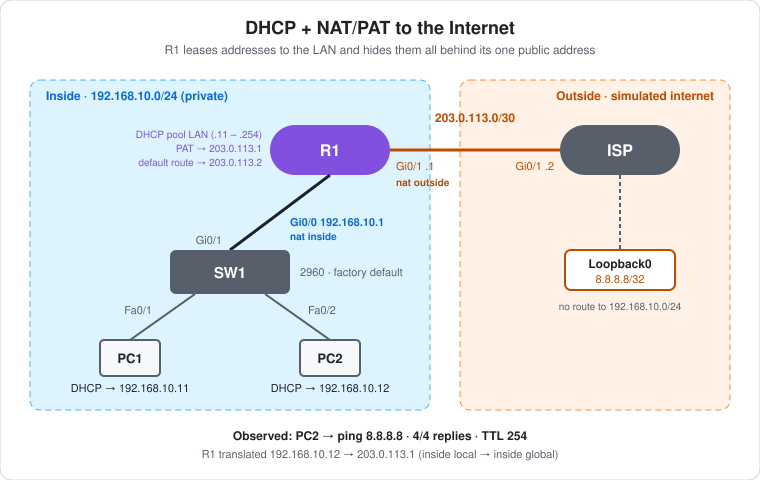

# CCNA Lab 26: DHCP and NAT/PAT to the Internet

The edge of a small office network, built in the **PingMyNetwork Sandbox**. One router, R1, does three jobs for the LAN:

1. **DHCP server:** it leases addresses in `192.168.10.0/24`, so the PCs need no manual IP settings.
2. **NAT overload (PAT):** it translates every private address to its single public address `203.0.113.1`.
3. **Default route:** it sends everything it doesn't know to the ISP.

The ISP is a second router with a loopback `8.8.8.8` that stands in for "the internet". The ISP has **no route back to `192.168.10.0/24`**, just as a real ISP has no route to your private network. The ping only works because of NAT.

This follows the routing series in [Labs 22–25](../lab-22-router-two-networks/). For DHCP across a relay, see [Lab 16](../lab-16-dhcp-relay-etherchannel/). For NAT in a larger network, see the [Lab 21 capstone](../lab-21-capstone-campus-branch/).

> **Lab status:** The configs in [`configs/`](configs/) and the results below come from the exported Sandbox JSON in [`lab-files/`](lab-files/). That export includes R1's and the ISP's saved configurations and the console output of the session. Results marked **observed** are copied from that output. Neither PC ran `ipconfig`, so which PC got which address is **inferred** from the NAT table, as explained below.

## Learning objectives

- Configure an IOS DHCP pool with `excluded-address`, `network`, `default-router` and `dns-server`.
- Mark interfaces `ip nat inside` and `ip nat outside`.
- Configure PAT with an ACL and `ip nat inside source list ... interface ... overload`.
- Read `show ip nat translations`: inside local, inside global, outside local, outside global.
- Read `show ip dhcp binding`.
- Explain why the ISP can reply without a route to the private network.

## Topology



```text
        Inside (private)                         |        Outside
                                                 |
 PC1 --Fa0/1--+                                  |
              SW1 --Gi0/1---Gi0/0 R1 Gi0/1 ------+------ Gi0/1 ISP  Lo0 8.8.8.8/32
 PC2 --Fa0/2--+       192.168.10.1   203.0.113.1 |  203.0.113.2
                      nat inside     nat outside |
       192.168.10.0/24 (DHCP)                    |   203.0.113.0/30
```

| Device | Role | Model |
|---|---|---|
| R1 | LAN gateway, DHCP server, PAT, default route to ISP | Cisco ISR4331 (IOS 15.9 in the Sandbox) |
| ISP | Simulated internet: one link to R1 and a loopback `8.8.8.8` | Cisco ISR4331 (IOS 15.9 in the Sandbox) |
| SW1 | LAN access switch (factory default) | Cisco WS-C2960-24TT-L |
| PC1, PC2 | DHCP clients | PC |

## Addressing plan

| Device | Interface | IP address | Subnet mask | Notes |
|---|---|---|---|---|
| R1 | Gi0/0 | `192.168.10.1` | `255.255.255.0` | LAN gateway, `ip nat inside` |
| R1 | Gi0/1 | `203.0.113.1` | `255.255.255.252` | Public address, `ip nat outside` |
| ISP | Gi0/1 | `203.0.113.2` | `255.255.255.252` | R1's next hop |
| ISP | Loopback0 | `8.8.8.8` | `255.255.255.255` | Simulated internet host |
| PC1 | FastEthernet0 | DHCP: `192.168.10.11` (inferred) | `255.255.255.0` | Gateway and DNS from DHCP |
| PC2 | FastEthernet0 | DHCP: `192.168.10.12` (observed in the NAT table) | `255.255.255.0` | Gateway and DNS from DHCP |

`203.0.113.0/24` is a documentation range (TEST-NET-3) reserved for examples like this. It's never routed on the real internet.

## Configuration

**R1: DHCP**

```cisco
ip dhcp excluded-address 192.168.10.1 192.168.10.10
!
ip dhcp pool LAN
 network 192.168.10.0 255.255.255.0
 default-router 192.168.10.1
 dns-server 8.8.8.8
```

- `excluded-address` keeps `.1`–`.10` out of the pool for the router and any static devices. Leases start at `.11`.
- `default-router` and `dns-server` are handed to every client with its address.

**R1: NAT/PAT and the default route**

```cisco
interface GigabitEthernet0/0
 ip address 192.168.10.1 255.255.255.0
 ip nat inside
!
interface GigabitEthernet0/1
 ip address 203.0.113.1 255.255.255.252
 ip nat outside
!
access-list 1 permit 192.168.10.0 0.0.0.255
ip nat inside source list 1 interface GigabitEthernet0/1 overload
ip route 0.0.0.0 0.0.0.0 203.0.113.2
```

- **ACL 1** chooses *which* inside sources get translated: the whole LAN.
- **`interface GigabitEthernet0/1`** chooses *what* they're translated to: Gi0/1's own address, `203.0.113.1`.
- **`overload`** makes it **PAT**. All the inside hosts share the one public address, and R1 tells their sessions apart by port number (or ICMP query ID).
- The **default route** sends anything not on R1's connected networks to the ISP.

**ISP**

```cisco
hostname ISP
!
interface Loopback0
 ip address 8.8.8.8 255.255.255.255
!
interface GigabitEthernet0/1
 ip address 203.0.113.2 255.255.255.252
 no shutdown
```

- The ISP has **no static routes**. It only knows its connected `203.0.113.0/30` and `8.8.8.8/32`.
- The router's default name in the Sandbox was `R2`. It was renamed with `hostname ISP`, as the prompt change in the console shows.

## How PC2's ping reaches 8.8.8.8

| Step | Where | Source → destination |
|---|---|---|
| 1 | PC2 → R1 Gi0/0 | `192.168.10.12` → `8.8.8.8` |
| 2 | R1 routes the packet (default route), then **NAT translates the source** on the way out of Gi0/1 | `203.0.113.1` → `8.8.8.8` |
| 3 | ISP replies to a connected address | `8.8.8.8` → `203.0.113.1` |
| 4 | R1 matches the translation and **translates the destination back** | `8.8.8.8` → `192.168.10.12` |

The ISP only ever sees `203.0.113.1`, which is on its connected link. That's why it doesn't need a route to `192.168.10.0/24`.

## Results

### Observed: links coming up

```text
ISP log:
*Oct 26 17:56:00.596: %LINK-3-UPDOWN: Interface GigabitEthernet0/1, changed state to down
*Oct 26 17:56:01.607: %LINEPROTO-5-UPDOWN: Line protocol on Interface Loopback0, changed state to up
*Oct 26 17:56:09.176: %LINK-3-UPDOWN: Interface GigabitEthernet0/1, changed state to up
*Oct 26 17:56:10.176: %LINEPROTO-5-UPDOWN: Line protocol on Interface GigabitEthernet0/1, changed state to up
```

- The ISP was configured first. Its Gi0/1 stayed `down` until R1 enabled the other end, at `17:56:09.176` in both routers' logs.
- **Loopback0 came up straight away.** A loopback is virtual, needs no cable and no `no shutdown`, and stays up as long as the router is running. That makes it a good stand-in for a remote host.

### Observed: DHCP leases

```text
R1#show ip dhcp binding
Bindings from all pools not associated with VRF:
IP address          Client-ID/              Lease expiration        Type
                    Hardware address/
                    User name
192.168.10.11       0128.7564.3529.02       Oct 27 2026 11:26 PM    Automatic
192.168.10.12       0142.5090.2180.63       Oct 27 2026 11:26 PM    Automatic
```

- **Both PCs got leases**, and both are the first addresses after the exclusion: `.11` and `.12`.
- **Client-ID** is `01` (Ethernet) followed by the PC's MAC address. So `192.168.10.11` went to MAC `2875.6435.2902` and `.12` to `4250.9021.8063`.
- **Lease expiration** is one day after the lease was granted, which is the IOS default (`lease 1`). The time is shown as `11:26 PM`, 5½ hours ahead of the UTC log timestamps, so this column seems to use local time.
- **Which PC is which?** Only PC2 sent traffic, and the NAT table below shows inside local `192.168.10.12`. So PC2 has `.12`, and PC1, the only other client, has `.11`.

### Observed: PC2 → 8.8.8.8

```text
C:\>ping 8.8.8.8

Pinging 8.8.8.8 with 32 bytes of data:

Reply from 8.8.8.8: bytes=32 time=37ms TTL=254
Reply from 8.8.8.8: bytes=32 time=14ms TTL=254
Reply from 8.8.8.8: bytes=32 time=7ms TTL=254
Reply from 8.8.8.8: bytes=32 time=10ms TTL=254

Ping statistics for 8.8.8.8:
    Packets: Sent = 4, Received = 4, Lost = 0 (0% loss),
```

- **4/4 replies** from the "internet", although the ISP has no route to PC2's network.
- **TTL 254.** The reply comes from a **router** (the ISP's loopback), and IOS sends with TTL 255, not 128 like a PC. R1 decrements it once, giving 254. Compare TTL 127 and 126 from PCs in Labs 22–25.

### Observed: the PAT translation

```text
R1#show ip nat translations
Pro  Inside global     Inside local       Outside local      Outside global
icmp 203.0.113.1:1025  192.168.10.12:1025 8.8.8.8:1025       8.8.8.8:1025
```

| Column | Value | Meaning |
|---|---|---|
| Inside local | `192.168.10.12:1025` | PC2's real (private) address, as seen inside |
| Inside global | `203.0.113.1:1025` | What PC2 looks like on the internet: R1's Gi0/1 address |
| Outside local | `8.8.8.8:1025` | The destination as seen from inside |
| Outside global | `8.8.8.8:1025` | The destination's real address. It's the same as outside local because only the source is translated. |

- The `:1025` is the **ICMP query ID**, which ICMP PAT uses in place of a port number. All four echoes share one entry because they share the same ID.
- If PC1 pinged at the same time, it would get its own entry with the **same inside global address** and a different ID. That's the "overload".
- Dynamic translations don't last. An ICMP entry times out after about a minute by default, so run the command soon after the ping.

## Verification results

| Check | Command/test | Result |
|---|---|---|
| Links | R1 and ISP logs | **Observed:** R1 Gi0/0, Gi0/1 and ISP Gi0/1 up/up, ISP Loopback0 up |
| DHCP | R1 `show ip dhcp binding` | **Observed:** `.11` and `.12` leased, 1-day lease |
| Internet reachability | PC2 → `ping 8.8.8.8` | **Observed:** 4/4, `TTL=254` |
| PAT | R1 `show ip nat translations` | **Observed:** `192.168.10.12` → `203.0.113.1` for ICMP to `8.8.8.8` |
| PC addressing | `ipconfig /all` on PC1 and PC2 | Expected: `.11` / `.12`, gateway `192.168.10.1`, DNS `8.8.8.8` |
| PC1 → internet | PC1 → `ping 8.8.8.8` | Expected: 4/4, and a second NAT entry with inside local `192.168.10.11` |
| NAT counters | R1 `show ip nat statistics` | Expected: Gi0/0 inside, Gi0/1 outside, hits on the translation |

## Full configuration commands

These are the **exact commands typed in the Sandbox session**, copied from the console history in the export, in the order they were entered (including the `show` commands used to verify). Typing them on factory-default devices reproduces the lab. The ISP was configured first, then R1.

How to read the blocks:

- Lines starting with `!` explain the command below them. Don't type them.
- The prompt (`R1(dhcp-config)#`) shows which mode you're in. Type only the text after `#` or `>`.
- Abbreviations such as `g0/0` are accepted by IOS, the same as `GigabitEthernet0/0`.

### R1 (ISR4331)

```text
! Enter privileged EXEC mode
R1>enable
! Enter global configuration mode
R1#configure terminal
! Select interface g0/0
R1(config)#interface g0/0
! Assign 192.168.10.1 / 255.255.255.0
R1(config-if)#ip address 192.168.10.1 255.255.255.0
! NAT: this interface faces the private network (inside)
R1(config-if)#ip nat inside
! Enable the interface
R1(config-if)#no shutdown
! Select interface g0/1
R1(config-if)#interface g0/1
! Assign 203.0.113.1 / 255.255.255.252
R1(config-if)#ip address 203.0.113.1 255.255.255.252
! NAT: this interface faces the internet (outside)
R1(config-if)#ip nat outside
! Enable the interface
R1(config-if)#no shutdown
R1(config-if)#exit
! Never lease 192.168.10.1 - 192.168.10.10 (reserved for gateways/servers)
R1(config)#ip dhcp excluded-address 192.168.10.1 192.168.10.10
! Create DHCP pool LAN (enter DHCP pool config mode)
R1(config)#ip dhcp pool LAN
! Pool subnet 192.168.10.0 / 255.255.255.0
R1(dhcp-config)#network 192.168.10.0 255.255.255.0
! Gateway handed to clients: 192.168.10.1
R1(dhcp-config)#default-router 192.168.10.1
! DNS server(s) handed to clients: 8.8.8.8
R1(dhcp-config)#dns-server 8.8.8.8
R1(dhcp-config)#exit
! Standard ACL 1: permit 192.168.10.0 0.0.0.255
R1(config)#access-list 1 permit 192.168.10.0 0.0.0.255
! PAT: translate sources matching ACL 1 to g0/1's address, sharing it by port number
R1(config)#ip nat inside source list 1 interface g0/1 overload
! Default route: send everything unknown to 203.0.113.2
R1(config)#ip route 0.0.0.0 0.0.0.0 203.0.113.2
R1(config)#end
! Save the running config to NVRAM
R1#write memory
! Verify: NAT/PAT translation table
R1#show ip nat translations
! Verify: which IP was leased to which client
R1#show ip dhcp binding
```

### ISP (ISR4331)

```text
! Enter privileged EXEC mode
R2>enable
! Enter global configuration mode
R2#configure terminal
! Set the device name to ISP
R2(config)#hostname ISP
! Select interface g0/1
ISP(config)#interface g0/1
! Assign 203.0.113.2 / 255.255.255.252
ISP(config-if)#ip address 203.0.113.2 255.255.255.252
! Enable the interface
ISP(config-if)#no shutdown
ISP(config-if)#exit
! Create Loopback0 (always-up virtual interface)
ISP(config)#interface loopback0
! Assign 8.8.8.8 / 255.255.255.255
ISP(config-if)#ip address 8.8.8.8 255.255.255.255
ISP(config-if)#end
! Save the running config to NVRAM
ISP#write memory
```

### SW1 (WS-C2960-24TT-L)

No commands. Leave it at factory defaults.

### PCs

Set **both** PCs' IPv4 configuration to **DHCP**. Then test from PC2's command prompt:

```text
! Test reachability to 8.8.8.8
C:\> ping 8.8.8.8
```

## Try it yourself: guided challenges

1. **Check the lease.** Run `ipconfig /all` on PC1. Do the gateway and DNS server match the pool?
2. **Watch the overload.** Ping `8.8.8.8` from PC1 and PC2 together, then run `show ip nat translations`. How many entries share `203.0.113.1`?
3. **Break NAT.** Remove `ip nat outside` from R1 Gi0/1 and ping again. Where do the replies go, and why does the ping fail?
4. **Prove the ISP has no route.** On the ISP, run `show ip route`. Is `192.168.10.0/24` there? Now ping `192.168.10.12` from the ISP. What happens?
5. **Narrow the ACL.** Change ACL 1 to `permit host 192.168.10.12`. Which PC can still reach `8.8.8.8`?
6. **Port forwarding.** Add `ip nat inside source static tcp 192.168.10.11 80 interface GigabitEthernet0/1 80`. What does it let the internet reach, and how does it appear in `show ip nat translations` before any traffic?
7. **Exhaust the pool.** Exclude the rest of the pool with `ip dhcp excluded-address 192.168.10.13 192.168.10.254`, add a third PC set to DHCP, and run `show ip dhcp pool`. What address does the new PC end up with?

## Scope and caveats

- This is a **CCNA** lab: an IOS DHCP server, PAT (NAT overload), the four NAT address types and a default route.
- `8.8.8.8` is only a loopback address on the ISP router. Nothing in this lab answers DNS queries, so the PCs get a DNS server setting but name lookups won't work.
- PC1 has no console output and neither PC ran `ipconfig`. PC1's address is inferred from the binding and NAT tables.
- The Sandbox's default 2960 config includes `spanning-tree mode rapid-pvst` and `spanning-tree portfast edge default`. A real 2960 defaults to PVST+ without PortFast.
- The Sandbox names the ISR4331's ports `GigabitEthernet0/0`–`0/3`. A real ISR4331 uses `GigabitEthernet0/0/0` style names.
- Neither router has passwords, an enable secret or SSH. `line vty 0 4` has `login` but no password, and `transport input none`.

## Useful verification commands

```cisco
show ip dhcp binding
show ip dhcp pool
show ip nat translations
show ip nat statistics
clear ip nat translation *
show ip route
```

## Lab files

| File | Description |
|---|---|
| [`lab-files/dhcp-nat-pat-internet-lab.json`](lab-files/dhcp-nat-pat-internet-lab.json) | PingMyNetwork Sandbox export with the saved configs. Import it into the Sandbox to load the lab. |
| [`configs/R1-running-config.txt`](configs/R1-running-config.txt) | R1 saved configuration |
| [`configs/ISP-running-config.txt`](configs/ISP-running-config.txt) | ISP saved configuration |
| [`images/topology.svg`](images/topology.svg) | Topology diagram |

**Built with:** [PingMyNetwork Sandbox](https://pingmynetwork.com/sandbox)
