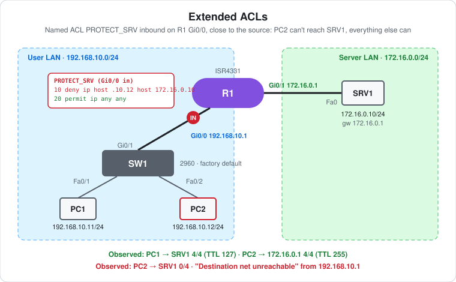

# CCNA Lab 27: Extended ACLs

Traffic filtering on a router, built in the **PingMyNetwork Sandbox**. R1 joins a user LAN (`192.168.10.0/24`, PC1 and PC2) to a server LAN (`172.16.0.0/24`, SRV1). A **named extended ACL**, `PROTECT_SRV`, blocks **one host from one server** and lets everything else through. It's applied **inbound on the user-side interface**, as close to the source as possible.

This follows the routing series in [Labs 22–26](../lab-22-router-two-networks/). [Lab 02](../lab-02-inter-vlan-routing-acl/) uses the same kind of ACL on a Layer 3 switch to isolate whole VLANs.

> **Lab status:** The config in [`configs/`](configs/) and the results below come from the exported Sandbox JSON in [`lab-files/`](lab-files/). That export includes R1's saved configuration, the host IP settings, and the console output of the session. Results marked **observed** are copied from that output. SRV1 has no console output.

## Learning objectives

- Create a named extended ACL with `ip access-list extended`, a `remark`, and `deny`/`permit` entries.
- Match single hosts with the `host` keyword.
- Apply an ACL with `ip access-group ... in` and choose the interface and direction.
- Explain the **implicit deny** at the end of every ACL, and why `permit ip any any` is needed here.
- Read the per-entry **match counters** in `show access-lists`.

## Topology



```text
      User LAN 192.168.10.0/24                       Server LAN 172.16.0.0/24

 PC1 .11 --Fa0/1--+
                  SW1 --Gi0/1---Gi0/0 [ACL in] R1 Gi0/1 ------ Fa0 SRV1 .10
 PC2 .12 --Fa0/2--+            192.168.10.1       172.16.0.1
```

| Device | Role | Model |
|---|---|---|
| R1 | Router between the two LANs, ACL enforcement | Cisco ISR4331 (IOS 15.9 in the Sandbox) |
| SW1 | User LAN access switch (factory default) | Cisco WS-C2960-24TT-L |
| PC1 | Allowed user | PC |
| PC2 | Blocked user | PC |
| SRV1 | Protected server | Server |

## Addressing plan

| Device | Interface | IP address | Subnet mask | Default gateway | Connected to |
|---|---|---|---|---|---|
| R1 | Gi0/0 | `192.168.10.1` | `255.255.255.0` | – | SW1 Gi0/1 |
| R1 | Gi0/1 | `172.16.0.1` | `255.255.255.0` | – | SRV1 |
| PC1 | FastEthernet0 | `192.168.10.11` | `255.255.255.0` | `192.168.10.1` | SW1 Fa0/1 |
| PC2 | FastEthernet0 | `192.168.10.12` | `255.255.255.0` | `192.168.10.1` | SW1 Fa0/2 |
| SRV1 | FastEthernet0 | `172.16.0.10` | `255.255.255.0` | `172.16.0.1` | R1 Gi0/1 |

## Configuration

This is R1's whole configuration, apart from the defaults. The full config is in [`configs/`](configs/).

```cisco
interface GigabitEthernet0/0
 ip address 192.168.10.1 255.255.255.0
 ip access-group PROTECT_SRV in
 no shutdown
!
interface GigabitEthernet0/1
 ip address 172.16.0.1 255.255.255.0
 no shutdown
!
ip access-list extended PROTECT_SRV
 remark Block PC2 from the server, allow everything else
 deny   ip host 192.168.10.12 host 172.16.0.10
 permit ip any any
```

### Reading the ACL

| Seq | Entry | Matches |
|---|---|---|
| – | `remark ...` | Nothing. It's a note for whoever reads the config. |
| 10 | `deny ip host 192.168.10.12 host 172.16.0.10` | Any IP packet (ICMP, TCP, UDP...) **from** PC2 **to** SRV1 |
| 20 | `permit ip any any` | Everything else |
| (implicit) | `deny ip any any` | Never reached here, because entry 20 matches everything first |

- **Extended** ACLs match on source *and* destination (and protocol and ports). A standard ACL can only match the source, so it couldn't block PC2 from just the server.
- **`host 192.168.10.12`** is shorthand for `192.168.10.12 0.0.0.0`: exactly one address.
- **Order matters.** IOS checks entries top-down and stops at the first match. If `permit ip any any` came first, nothing would ever be denied.
- **Without entry 20, everything would be blocked.** Every ACL ends with an invisible `deny ip any any`, so an ACL with only the deny would drop PC1's traffic too.

### Where to apply it

`ip access-group PROTECT_SRV in` on **Gi0/0** filters packets as they **enter R1 from the user LAN**.

- The CCNA rule of thumb is to place **extended ACLs close to the source**. Unwanted traffic is dropped at the first router, before it's routed anywhere.
- Applying it **out** on Gi0/1 (towards the server) would also block PC2. But R1 would route each packet first, and the ACL would then filter traffic arriving from any interface, not only the user LAN.
- Applying it **in** on Gi0/1 would do nothing useful. Traffic entering Gi0/1 comes *from* SRV1, so it never has PC2 as the source.
- One ACL per interface, per direction, per protocol.

## Results

### Observed: the ACL before any traffic

```text
R1#show access-lists
Extended IP access list PROTECT_SRV
    10 deny ip host 192.168.10.12 host 172.16.0.10
    20 permit ip any any
```

- IOS numbered the entries **10** and **20** automatically. Gaps of 10 leave room to insert entries later (for example `15 deny ...`) without retyping the ACL.
- No counters yet, because no traffic had crossed Gi0/0. The links only came up after this command (the log follows it).

### Observed: PC1 → SRV1 (allowed)

```text
C:\>ping 172.16.0.10

Reply from 172.16.0.10: bytes=32 time=64ms TTL=127
Reply from 172.16.0.10: bytes=32 time=8ms TTL=127
Reply from 172.16.0.10: bytes=32 time=8ms TTL=127
Reply from 172.16.0.10: bytes=32 time=9ms TTL=127
    Packets: Sent = 4, Received = 4, Lost = 0 (0% loss),
```

PC1's packets don't match entry 10 (wrong source), so they match entry 20 and are routed. TTL 127 = one router hop.

### Observed: PC2 → SRV1 (denied)

```text
C:\>ping 172.16.0.10

Reply from 192.168.10.1: Destination net unreachable.
Reply from 192.168.10.1: Destination net unreachable.
Reply from 192.168.10.1: Destination net unreachable.
Reply from 192.168.10.1: Destination net unreachable.
    Packets: Sent = 4, Received = 0, Lost = 4 (100% loss),
```

- **The reply comes from `192.168.10.1`**, R1's Gi0/0, not from the server. R1 dropped each echo as it arrived and answered with an ICMP unreachable message. The server never saw the packets.
- On real IOS, a packet denied by an ACL triggers an ICMP "administratively prohibited" unreachable. How it's worded depends on the client. You can stop R1 sending these with `no ip unreachables` on Gi0/0, and the ping then just times out.

### Observed: PC2 → R1's server-side interface (allowed)

```text
C:\>ping 172.16.0.1

Reply from 172.16.0.1: bytes=32 time<1ms TTL=255
Reply from 172.16.0.1: bytes=32 time<1ms TTL=255
Reply from 172.16.0.1: bytes=32 time<1ms TTL=255
Reply from 172.16.0.1: bytes=32 time<1ms TTL=255
    Packets: Sent = 4, Received = 4, Lost = 0 (0% loss),
```

- The ACL only denies the **host** `172.16.0.10`. `172.16.0.1` matches entry 20, so PC2 can still reach R1's other interface. The block is as narrow as it was written.
- **TTL 255:** R1 answered itself. IOS sends with TTL 255, and no router sat in between to decrement it.

### Observed: the counters after the pings

```text
R1#show access-lists
Extended IP access list PROTECT_SRV
    10 deny ip host 192.168.10.12 host 172.16.0.10 (4 matches)
    20 permit ip any any (8 matches)
```

The counters account for every packet that entered Gi0/0:

| Entry | Matches | Packets |
|---|---|---|
| 10 deny | **4** | PC2's 4 echoes to SRV1 |
| 20 permit | **8** | PC1's 4 echoes to SRV1 + PC2's 4 echoes to `172.16.0.1` |

- Only **inbound** packets on Gi0/0 are counted. The replies arrive on Gi0/1 and leave through Gi0/0, so they're never checked against this ACL.
- The counts show all three pings ran between the two `show access-lists` commands. `clear access-list counters` resets them.

## Verification results

| Check | Command/test | Result |
|---|---|---|
| ACL entries | R1 `show access-lists` | **Observed:** seq 10 deny, seq 20 permit |
| Allowed host | PC1 → `ping 172.16.0.10` | **Observed:** 4/4, `TTL=127` |
| Blocked host | PC2 → `ping 172.16.0.10` | **Observed:** 0/4, "Destination net unreachable" from `192.168.10.1` |
| Narrow block | PC2 → `ping 172.16.0.1` | **Observed:** 4/4, `TTL=255` |
| Counters | R1 `show access-lists` | **Observed:** 4 deny matches, 8 permit matches |
| ACL applied | R1 `show ip interface GigabitEthernet0/0` | Expected: "Inbound access list is PROTECT_SRV" |
| Return traffic | SRV1 → `ping 192.168.10.12` | Expected: the echo reaches PC2, but PC2's reply is denied at Gi0/0, so it fails |

## Full configuration commands

These are the **exact commands typed in the Sandbox session**, copied from the console output in the export, in the order they were entered (including the `show` commands used to verify). Typing them on factory-default devices reproduces the lab.

How to read the blocks:

- Lines starting with `!` explain the command below them. Don't type them.
- The prompt (`R1(config-ext-nacl)#`) shows which mode you're in. Type only the text after `#` or `>`.
- Abbreviations such as `g0/0` are accepted by IOS, the same as `GigabitEthernet0/0`.

### R1 (ISR4331)

```text
! Enter privileged EXEC mode
R1>enable
! Enter global configuration mode
R1#configure terminal
! Select interface g0/0
R1(config)#interface g0/0
! Assign 192.168.10.1 / 255.255.255.0
R1(config-if)#ip address 192.168.10.1 255.255.255.0
! Enable the interface
R1(config-if)#no shutdown
! Select interface g0/1
R1(config-if)#interface g0/1
! Assign 172.16.0.1 / 255.255.255.0
R1(config-if)#ip address 172.16.0.1 255.255.255.0
! Enable the interface
R1(config-if)#no shutdown
R1(config-if)#exit
! Create named extended ACL PROTECT_SRV
R1(config)#ip access-list extended PROTECT_SRV
! Note stored with the ACL (doesn't affect matching)
R1(config-ext-nacl)#remark Block PC2 from the server, allow everything else
! ACL entry: deny ip host 192.168.10.12 host 172.16.0.10
R1(config-ext-nacl)#deny ip host 192.168.10.12 host 172.16.0.10
! ACL entry: permit ip any any
R1(config-ext-nacl)#permit ip any any
R1(config-ext-nacl)#exit
! Select interface g0/0
R1(config)#interface g0/0
! Apply ACL PROTECT_SRV to traffic entering this interface
R1(config-if)#ip access-group PROTECT_SRV in
R1(config-if)#end
! Save the running config to NVRAM
R1#write memory
! Verify: ACL entries and match counters
R1#show access-lists
! Verify: ACL entries and match counters
R1#show access-lists
```

### SW1 (WS-C2960-24TT-L)

No commands. Leave it at factory defaults.

### PCs and server

Set these in each host's IP configuration:

| Host | IP address | Subnet mask | Default gateway |
|---|---|---|---|
| PC1 | `192.168.10.11` | `255.255.255.0` | `192.168.10.1` |
| PC2 | `192.168.10.12` | `255.255.255.0` | `192.168.10.1` |
| SRV1 | `172.16.0.10` | `255.255.255.0` | `172.16.0.1` |

Then test from the PCs' command prompts:

```text
! PC1: test reachability to 172.16.0.10 (allowed)
C:\> ping 172.16.0.10
! PC2: test reachability to 172.16.0.10 (denied)
C:\> ping 172.16.0.10
! PC2: test reachability to 172.16.0.1 (allowed)
C:\> ping 172.16.0.1
```

## Try it yourself: guided challenges

1. **Ping from the server.** Ping PC2 from SRV1. It fails, although the ACL only "blocks PC2 to the server". Why? (Think about which way the reply travels and which interface it enters.)
2. **Remove the permit.** Delete entry 20 with `no 20` inside the ACL. What happens to PC1, and why?
3. **Insert an entry.** Add `15 deny icmp host 192.168.10.11 host 172.16.0.1` and check `show access-lists`. Where does it land, and what does PC1 lose?
4. **Block only ping.** Change entry 10 to `deny icmp host 192.168.10.12 host 172.16.0.10`. PC2 can no longer ping the server. Could it still reach a web server on SRV1?
5. **Move the ACL.** Remove it from Gi0/0 and apply it `out` on Gi0/1. Do the results change? What changes in the router's work?
6. **Wrong direction.** Apply it `in` on Gi0/1 instead. Does it still block PC2? Why not?
7. **Silence the router.** Add `no ip unreachables` on Gi0/0. How does PC2's failed ping look now?

## Scope and caveats

- This is a **CCNA** lab: named extended ACLs, `host`, sequence numbers, the implicit deny, placement and direction, and match counters.
- `deny ip` blocks **all** IP traffic between the two hosts, not just ping. Only ICMP was tested in the export.
- SRV1 has no console output, so traffic from the server side wasn't tested.
- The Sandbox's default 2960 config includes `spanning-tree mode rapid-pvst` and `spanning-tree portfast edge default`. A real 2960 defaults to PVST+ without PortFast.
- The Sandbox names the ISR4331's ports `GigabitEthernet0/0`–`0/3`. A real ISR4331 uses `GigabitEthernet0/0/0` style names.
- R1 has no passwords, no enable secret and no SSH. `line vty 0 4` has `login` but no password, and `transport input none`.

## Useful verification commands

```cisco
show access-lists
show ip access-lists PROTECT_SRV
show ip interface GigabitEthernet0/0
clear access-list counters
```

## Lab files

| File | Description |
|---|---|
| [`lab-files/extended-acls-lab.json`](lab-files/extended-acls-lab.json) | PingMyNetwork Sandbox export with the saved config. Import it into the Sandbox to load the lab. |
| [`configs/R1-running-config.txt`](configs/R1-running-config.txt) | R1 saved configuration |
| [`images/topology.svg`](images/topology.svg) | Topology diagram |

**Built with:** [PingMyNetwork Sandbox](https://pingmynetwork.com/sandbox)
