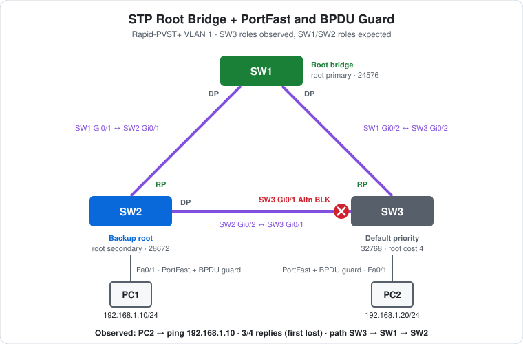

# CCNA Lab 28: STP Root Bridge, PortFast and BPDU Guard

Spanning tree on a switch triangle, built in the **PingMyNetwork Sandbox**. Three 2960s are cabled in a loop. Rapid-PVST+ has to **block one port** to keep it loop-free, and this lab decides *which* one by choosing the root bridge: **SW1** is `root primary` and **SW2** is `root secondary`. The PC ports on SW2 and SW3 get **PortFast** (forward immediately) and **BPDU guard** (shut the port if a switch appears on it).

This picks up the switching side after the routing series in [Labs 22–27](../lab-22-router-two-networks/). [Lab 03](../lab-03-stp-failover/) covers STP failover with four switches, and [Lab 20](../lab-20-layer2-security/) shows BPDU guard actually tripping.

> **Lab status:** The configs in [`configs/`](configs/) and the results below come from the exported Sandbox JSON in [`lab-files/`](lab-files/). That export includes all three switches' saved configurations, the PC IP settings, and the console output of the session. Results marked **observed** are copied from that output. `show spanning-tree` was only run on SW3, so SW1's and SW2's port roles are **expected**. BPDU guard was configured but not triggered.

## Learning objectives

- Control the root bridge election with `spanning-tree vlan 1 root primary` and `root secondary`.
- Read **bridge priority**, the **sys-id-ext** (VLAN number) and the bridge MAC in `show spanning-tree`.
- Work out the **root port**, **designated ports** and **alternate (blocked) port** in a triangle from costs and bridge IDs.
- Explain what **PortFast** and **BPDU guard** do, and why they belong only on host ports.

## Topology



```text
                         SW1  (root, 24576)
                  Gi0/1 /    \ Gi0/2
                       /      \
                Gi0/1 /        \ Gi0/2
   (28672)  SW2 ----------------X SW3  (32768)
              Gi0/2          Gi0/1 = Alternate, blocking
            Fa0/1 |              | Fa0/1
                 PC1            PC2
           192.168.1.10    192.168.1.20
```

| Device | Role | Model | VLAN 1 priority |
|---|---|---|---|
| SW1 | Root bridge | Cisco WS-C2960-24TT-L | `24576` (`root primary`) |
| SW2 | Backup root, PC1's access switch | Cisco WS-C2960-24TT-L | `28672` (`root secondary`) |
| SW3 | PC2's access switch | Cisco WS-C2960-24TT-L | `32768` (default) |
| PC1, PC2 | Hosts in VLAN 1 | PC | – |

## Addressing plan

| Device | Interface | IP address | Subnet mask | Default gateway | Connected to |
|---|---|---|---|---|---|
| PC1 | FastEthernet0 | `192.168.1.10` | `255.255.255.0` | none | SW2 Fa0/1 |
| PC2 | FastEthernet0 | `192.168.1.20` | `255.255.255.0` | none | SW3 Fa0/1 |

| Link | Ports |
|---|---|
| SW1–SW2 | SW1 Gi0/1 ↔ SW2 Gi0/1 |
| SW1–SW3 | SW1 Gi0/2 ↔ SW3 Gi0/2 |
| SW2–SW3 | SW2 Gi0/2 ↔ SW3 Gi0/1 |

There's no router. Both PCs are in the same subnet and VLAN, so they don't need a gateway. All switch ports stay in VLAN 1 with no trunks configured.

## Configuration

```cisco
! SW1
spanning-tree mode rapid-pvst
spanning-tree vlan 1 root primary
!
! SW2
spanning-tree mode rapid-pvst
spanning-tree vlan 1 root secondary
interface FastEthernet0/1
 spanning-tree portfast
 spanning-tree bpduguard enable
!
! SW3
spanning-tree mode rapid-pvst
interface FastEthernet0/1
 spanning-tree portfast
 spanning-tree bpduguard enable
```

- **`root primary` is a macro, not a setting.** IOS looks at the current root's priority and picks a lower one. With every switch at the default 32768, it chose **24576**, and the saved config shows `spanning-tree vlan 1 priority 24576`. `root secondary` always sets **28672**, so SW2 takes over if SW1 fails.
- **PortFast** puts a host port straight into forwarding instead of waiting, so a PC gets a working link at once. On a port that leads to a switch, that could create a loop for a moment.
- **BPDU guard** protects PortFast ports. A PC never sends BPDUs, so if one arrives, someone has plugged in a switch, and the port goes **err-disabled**.
- **`spanning-tree mode rapid-pvst` is already the Sandbox default** (it's in every factory config in this repo). On a real 2960, the default is PVST+, so the command matters there.
- The Sandbox's default config also has **`spanning-tree portfast edge default`**, which already enables PortFast on every access port. So the per-port `spanning-tree portfast` changes nothing here, but on a real switch it's what enables PortFast.

### The PortFast warning

```text
SW2(config-if)#spanning-tree portfast
%Warning: portfast should only be enabled on ports connected to a single
 host. Connecting hubs, concentrators, switches, bridges, etc... to this
 interface  when portfast is enabled, can cause temporary bridging loops.
 Use with CAUTION

%Portfast has been configured on FastEthernet0/1 but will only
 have effect when the interface is in a non-trunking mode.
```

IOS prints this every time. The second part is a reminder that PortFast only applies to access ports, not trunks. Fa0/1 connects to a PC, so it stays an access port.

## How the election works out

1. **Root bridge:** lowest bridge ID (priority, then MAC) wins. SW1 at 24576 beats SW2 (28672) and SW3 (32768).
2. **Root ports:** each non-root switch picks its lowest-cost path to SW1. A Gigabit link costs **4**, so the direct links win: SW2 Gi0/1 (cost 4) and SW3 Gi0/2 (cost 4). Going through the other switch would cost 8.
3. **Designated ports:** on each link, one end forwards toward the root. SW1's ports are all designated, because it *is* the root.
4. **The SW2–SW3 link** is the tie-breaker. Both switches are cost 4 from the root, so the **lower bridge ID** wins designated. That's SW2 (28672), so **SW3 Gi0/1 becomes Alternate and blocks**.

So `root secondary` on SW2 did two jobs: it made SW2 the backup root, *and* it decided which end of the SW2–SW3 link blocks.

## Results

### Observed: SW3's spanning tree

```text
SW3#show spanning-tree vlan 1
VLAN0001
  Spanning tree enabled protocol rstp
  Root ID    Priority    24577
             Address     2450.2653.0790
             Cost        4
             Port        26 (GigabitEthernet0/2)
             Hello Time   2 sec  Max Age 20 sec  Forward Delay 15 sec

  Bridge ID  Priority    32769  (priority 32768 sys-id-ext 1)
             Address     4096.5881.2242
             Hello Time   2 sec  Max Age 20 sec  Forward Delay 15 sec
             Aging Time  300 sec

Interface           Role Sts Cost      Prio.Nbr Type
------------------- ---- --- --------- -------- --------------------------------
Fa0/1               Desg FWD 19        128.1    P2p Edge
Gi0/1               Altn BLK 4         128.25   P2p
Gi0/2               Root FWD 4         128.26   P2p
```

| Field | Value | Meaning |
|---|---|---|
| `protocol rstp` | – | Rapid-PVST+ is running |
| Root ID priority | `24577` | SW1's `24576` plus sys-id-ext `1` (the VLAN number). Each VLAN has its own tree. |
| Root ID address | `2450.2653.0790` | SW1's bridge MAC |
| Cost / Port | `4` via Gi0/2 | SW3's path to the root is the direct Gigabit link |
| Bridge ID | `32769` | SW3's own default `32768` + `1` |
| Gi0/2 | **Root FWD** | SW3's root port |
| Gi0/1 | **Altn BLK** | The loop is broken here, as worked out above |
| Fa0/1 | **Desg FWD, Edge** | The PC port. `Edge` means PortFast is active. Cost 19 is FastEthernet. |

### Observed: PC2 → PC1

```text
C:\>ping 192.168.1.10

Pinging 192.168.1.10 with 32 bytes of data:

Reply from 192.168.1.20: Destination host unreachable.
Reply from 192.168.1.10: bytes=32 time<1ms TTL=128
Reply from 192.168.1.10: bytes=32 time<1ms TTL=128
Reply from 192.168.1.10: bytes=32 time<1ms TTL=128

Ping statistics for 192.168.1.10:
    Packets: Sent = 4, Received = 3, Lost = 1 (25% loss),
```

- **3/4.** The first "Destination host unreachable" comes from PC2's **own** address `192.168.1.20`. That's how a Windows-style client reports that its ARP for `192.168.1.10` got no answer in time, so the first echo was never sent. The export doesn't record when the ping ran relative to the STP changes, so it can't tell whether the tree was still converging or ARP was just slow.
- **TTL 128:** no router in the path, as expected for two hosts in one VLAN.
- **The path goes round the triangle.** SW3's link to SW2 is blocked, so frames from PC2 go SW3 → SW1 → SW2 → PC1, not straight across.

### Expected: SW1 and SW2

```text
SW1#show spanning-tree vlan 1
VLAN0001
  Spanning tree enabled protocol rstp
  Root ID    Priority    24577
             Address     2450.2653.0790
             This bridge is the root
...
Interface           Role Sts Cost      Prio.Nbr Type
------------------- ---- --- --------- -------- --------------------------------
Gi0/1               Desg FWD 4         128.25   P2p
Gi0/2               Desg FWD 4         128.26   P2p
```

```text
SW2#show spanning-tree vlan 1
VLAN0001
  Spanning tree enabled protocol rstp
  Root ID    Priority    24577
             Address     2450.2653.0790
             Cost        4
             Port        25 (GigabitEthernet0/1)
...
  Bridge ID  Priority    28673  (priority 28672 sys-id-ext 1)
...
Interface           Role Sts Cost      Prio.Nbr Type
------------------- ---- --- --------- -------- --------------------------------
Fa0/1               Desg FWD 19        128.1    P2p Edge
Gi0/1               Root FWD 4         128.25   P2p
Gi0/2               Desg FWD 4         128.26   P2p
```

## Verification results

| Check | Command/test | Result |
|---|---|---|
| Root bridge | SW3 `show spanning-tree vlan 1` | **Observed:** root priority `24577`, MAC `2450.2653.0790` (SW1) |
| SW3 roles | SW3 `show spanning-tree vlan 1` | **Observed:** Gi0/2 Root FWD, Gi0/1 Altn BLK, Fa0/1 Desg FWD Edge |
| Priorities | Saved configs | **Observed:** SW1 `priority 24576`, SW2 `priority 28672`, SW3 default |
| Host connectivity | PC2 → `ping 192.168.1.10` | **Observed:** 3/4 (first lost), `TTL=128` |
| SW1 roles | SW1 `show spanning-tree vlan 1` | Expected: "This bridge is the root", Gi0/1 and Gi0/2 Desg FWD |
| SW2 roles | SW2 `show spanning-tree vlan 1` | Expected: Gi0/1 Root FWD, Gi0/2 Desg FWD, Fa0/1 Desg FWD Edge |
| BPDU guard | `show spanning-tree interface f0/1 detail` | Expected: "Bpdu guard is enabled" |

## Full configuration commands

These are the **exact commands typed in the Sandbox session**, copied from the console history in the export, in the order they were entered (including the `show` command used to verify). Typing them on factory-default devices reproduces the lab.

How to read the blocks:

- Lines starting with `!` explain the command below them. Don't type them.
- The prompt (`SW2(config-if)#`) shows which mode you're in. Type only the text after `#` or `>`.
- Abbreviations such as `f0/1` are accepted by IOS, the same as `FastEthernet0/1`.

### SW1 (WS-C2960-24TT-L)

```text
! Enter privileged EXEC mode
SW1>enable
! Enter global configuration mode
SW1#configure terminal
! Use Rapid-PVST+
SW1(config)#spanning-tree mode rapid-pvst
! Make this switch root for VLAN(s) 1 (saved as priority 24576)
SW1(config)#spanning-tree vlan 1 root primary
SW1(config)#end
! Save the running config to NVRAM
SW1#write memory
```

### SW2 (WS-C2960-24TT-L)

```text
! Enter privileged EXEC mode
SW2>enable
! Enter global configuration mode
SW2#configure terminal
! Use Rapid-PVST+
SW2(config)#spanning-tree mode rapid-pvst
! Make this switch backup root for VLAN(s) 1 (saved as priority 28672)
SW2(config)#spanning-tree vlan 1 root secondary
! Select interface f0/1
SW2(config)#interface f0/1
! Host port: skip the STP listening/learning wait
SW2(config-if)#spanning-tree portfast
! BPDU guard: err-disable this port if any BPDU arrives on it
SW2(config-if)#spanning-tree bpduguard enable
SW2(config-if)#end
! Save the running config to NVRAM
SW2#write memory
```

### SW3 (WS-C2960-24TT-L)

```text
! Enter privileged EXEC mode
SW3>enable
! Enter global configuration mode
SW3#configure terminal
! Use Rapid-PVST+
SW3(config)#spanning-tree mode rapid-pvst
! Select interface f0/1
SW3(config)#interface f0/1
! Host port: skip the STP listening/learning wait
SW3(config-if)#spanning-tree portfast
! BPDU guard: err-disable this port if any BPDU arrives on it
SW3(config-if)#spanning-tree bpduguard enable
SW3(config-if)#end
! Save the running config to NVRAM
SW3#write memory
! Verify: STP root bridge and port roles/states
SW3#show spanning-tree vlan 1
```

### PCs

Set these in each PC's IP configuration (no gateway needed):

| PC | IP address | Subnet mask | Default gateway |
|---|---|---|---|
| PC1 | `192.168.1.10` | `255.255.255.0` | – |
| PC2 | `192.168.1.20` | `255.255.255.0` | – |

Then test from PC2's command prompt:

```text
! Test reachability to 192.168.1.10
C:\> ping 192.168.1.10
```

## Try it yourself: guided challenges

1. **Check the other two switches.** Run `show spanning-tree vlan 1` on SW1 and SW2. Do the roles match the expected output?
2. **Fail the root.** Power off SW1. Which switch becomes root, which ports change role, and how quickly does PC2 → PC1 recover?
3. **Fail a link instead.** Shut down SW1 Gi0/2. What happens to SW3 Gi0/1, and what's SW3's new root cost?
4. **Move the block.** Without changing the root, make SW3 Gi0/1 forward and SW2 Gi0/2 block. (Hint: the tie on that link is decided by bridge ID.)
5. **Trip BPDU guard.** Cable a fourth switch to SW3 Fa0/1. What does SW3 log, and what does `show interfaces status` show? How do you recover the port? ([Lab 20](../lab-20-layer2-security/) shows this.)
6. **PortFast off.** Run `no spanning-tree portfast` on SW3 Fa0/1, then shut it and bring it up again. Does it change anything here? (Remember `spanning-tree portfast edge default`.)
7. **Steal the root.** Set SW3 to `spanning-tree vlan 1 priority 4096`. Does `root primary` on SW1 adjust by itself?

## Scope and caveats

- This is a **CCNA** lab: root bridge election, port roles, path cost, PortFast and BPDU guard.
- Only SW3's spanning tree and PC2's ping are in the export. PC1 has no console output.
- BPDU guard was configured but nothing triggered it.
- In the Sandbox, Rapid-PVST+ and PortFast on access ports are on by default (see Configuration). A real 2960 defaults to PVST+ without PortFast.
- The switches have no management IP, passwords or SSH.

## Useful verification commands

```cisco
show spanning-tree vlan 1
show spanning-tree root
show spanning-tree summary
show spanning-tree interface FastEthernet0/1 detail
show interfaces status err-disabled
```

## Lab files

| File | Description |
|---|---|
| [`lab-files/stp-root-portfast-bpduguard-lab.json`](lab-files/stp-root-portfast-bpduguard-lab.json) | PingMyNetwork Sandbox export with the saved configs. Import it into the Sandbox to load the lab. |
| [`configs/SW1-running-config.txt`](configs/SW1-running-config.txt) | SW1 saved configuration |
| [`configs/SW2-running-config.txt`](configs/SW2-running-config.txt) | SW2 saved configuration |
| [`configs/SW3-running-config.txt`](configs/SW3-running-config.txt) | SW3 saved configuration |
| [`images/topology.svg`](images/topology.svg) | Topology diagram |

**Built with:** [PingMyNetwork Sandbox](https://pingmynetwork.com/sandbox)
