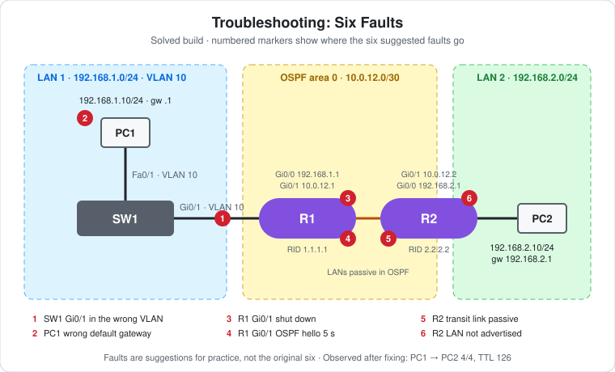

# CCNA Lab 29: Troubleshooting – Six Faults (Hard Mode)

A troubleshooting lab built in the **PingMyNetwork Sandbox**. PC1 sits behind SW1 in VLAN 10 on `192.168.1.0/24`. R1 and R2 run **OSPF area 0** over a `/30` link, and PC2 sits on R2's LAN, `192.168.2.0/24`. When everything is right, PC1 pings PC2 across two routers.

The lab is meant to be played **broken**: six faults, spread from the host up through Layer 2, the interfaces and OSPF, and you find and fix them one at a time. It pulls together [Lab 23](../lab-23-inter-subnet-routing/) (gateways and switched LANs), [Lab 25](../lab-25-ospf-single-area-three-routers/) (OSPF) and the VLAN basics from [Lab 01](../lab-01-vlan-segmentation/).

> **Lab status: read this first.** The export in [`lab-files/`](lab-files/) contains **only the solved state**. No fix commands were typed on any device. Every saved config says `Last configuration change at 09:00:00 UTC`, which is **after** the export was taken (`08:27:46 UTC`), so the configs were loaded ready-made rather than fixed by hand. **The original six faults aren't recorded anywhere in the file.**
>
> So this README is built in two parts:
> - **Observed:** the solved configs, plus R1's OSPF output and PC1's pings, copied from the export.
> - **Suggested:** six faults to inject and fix, written for this topology. They are **not** the original six, and their symptoms are **expected** results.

## Learning objectives

- Troubleshoot **methodically**, bottom-up: host → switch/VLAN → interface → routing protocol → route table.
- Tell a **host** problem from a **network** problem by *who* sends the ICMP error.
- Find a switch port in the wrong VLAN with `show vlan brief`.
- Find OSPF neighbor failures: shut interface, timer mismatch, passive interface.
- Find a missing OSPF advertisement when the neighbor is FULL but the route is missing.

## Topology



```text
   192.168.1.0/24 (VLAN 10)          10.0.12.0/30 (area 0)          192.168.2.0/24
 PC1 --Fa0/1-- SW1 --Gi0/1---Gi0/0 R1 Gi0/1 ------------ Gi0/1 R2 Gi0/0 ---- PC2
 .10                              .1      .1                .2      .1       .10
```

| Device | Role | Model |
|---|---|---|
| R1 | LAN 1 gateway, OSPF router ID `1.1.1.1` | Cisco ISR4331 (IOS 15.9 in the Sandbox) |
| R2 | LAN 2 gateway, OSPF router ID `2.2.2.2` | Cisco ISR4331 (IOS 15.9 in the Sandbox) |
| SW1 | LAN 1 access switch, VLAN 10 `USERS` | Cisco WS-C2960-24TT-L |
| PC1, PC2 | End hosts | PC |

## Addressing plan

| Device | Interface | IP address | Subnet mask | Default gateway | Connected to |
|---|---|---|---|---|---|
| R1 | Gi0/0 | `192.168.1.1` | `255.255.255.0` | – | SW1 Gi0/1 |
| R1 | Gi0/1 | `10.0.12.1` | `255.255.255.252` | – | R2 Gi0/1 |
| R2 | Gi0/0 | `192.168.2.1` | `255.255.255.0` | – | PC2 |
| R2 | Gi0/1 | `10.0.12.2` | `255.255.255.252` | – | R1 Gi0/1 |
| PC1 | FastEthernet0 | `192.168.1.10` | `255.255.255.0` | `192.168.1.1` | SW1 Fa0/1 (VLAN 10) |
| PC2 | FastEthernet0 | `192.168.2.10` | `255.255.255.0` | `192.168.2.1` | R2 Gi0/0 |

## The solved build (observed)

These are the saved configs from the export. The full files are in [`configs/`](configs/).

```cisco
! SW1
vlan 10
 name USERS
interface FastEthernet0/1
 switchport access vlan 10
 switchport mode access
 spanning-tree portfast edge
interface GigabitEthernet0/1
 switchport access vlan 10
 switchport mode access
!
! R1
interface GigabitEthernet0/0
 ip address 192.168.1.1 255.255.255.0
interface GigabitEthernet0/1
 ip address 10.0.12.1 255.255.255.252
router ospf 1
 router-id 1.1.1.1
 passive-interface GigabitEthernet0/0
 network 10.0.12.0 0.0.0.3 area 0
 network 192.168.1.0 0.0.0.255 area 0
!
! R2
interface GigabitEthernet0/0
 ip address 192.168.2.1 255.255.255.0
interface GigabitEthernet0/1
 ip address 10.0.12.2 255.255.255.252
router ospf 1
 router-id 2.2.2.2
 passive-interface GigabitEthernet0/0
 network 10.0.12.0 0.0.0.3 area 0
 network 192.168.2.0 0.0.0.255 area 0
```

- **SW1 Gi0/1 is an access port in VLAN 10**, not a trunk. R1 Gi0/0 has no subinterfaces, so it expects untagged frames, and the router port simply sits in the PCs' VLAN.
- VLAN 10 exists in SW1's VLAN database as `USERS`.
- In the saved config, R1's and R2's interfaces have no `shutdown` line, which means they're enabled.

## Results (observed)

### R1: OSPF neighbor and route

```text
*Oct 27 08:20:38.607: %OSPF-5-ADJCHG: Process 1, Nbr 2.2.2.2 on GigabitEthernet0/1 from LOADING to FULL, Loading Done
R1>show ip ospf neighbor

Neighbor ID     Pri   State           Dead Time   Address         Interface
2.2.2.2           1   FULL/DR         00:00:36    10.0.12.2       GigabitEthernet0/1
R1>show ip route
...
Gateway of last resort is not set

      10.0.0.0/8 is variably subnetted, 2 subnets, 2 masks
C        10.0.12.0/30 is directly connected, GigabitEthernet0/1
L        10.0.12.1/32 is directly connected, GigabitEthernet0/1
      192.168.1.0/24 is variably subnetted, 2 subnets, 2 masks
C        192.168.1.0/24 is directly connected, GigabitEthernet0/0
L        192.168.1.1/32 is directly connected, GigabitEthernet0/0
O     192.168.2.0/24 [110/2] via 10.0.12.2, 00:00:18, GigabitEthernet0/1
*Oct 27 08:25:17.148: %OSPF-5-ADJCHG: Process 1, Nbr 2.2.2.2 on GigabitEthernet0/1 from LOADING to FULL, Loading Done
```

- **FULL/DR:** the adjacency is up, and R2 is the DR on the transit link, as expected with the higher router ID (`2.2.2.2`).
- **`O 192.168.2.0/24 [110/2]`:** R1 learned PC2's LAN. The cost is 2: the Gigabit transit link (1) plus R2's Gigabit LAN (1).
- **The adjacency went FULL twice,** at `08:20:38` and again at `08:25:17`, on both R1 and R2. Neither router logged it going down in between, and the export doesn't show what reset it.
- These commands were run in user EXEC mode (`R1>`). `show` commands like these don't need `enable`.

### PC1 → PC2

```text
C:\>ping 192.168.2.10
Reply from 192.168.1.1: Destination host unreachable.
Reply from 192.168.1.1: Destination host unreachable.
Reply from 192.168.1.1: Destination host unreachable.
Reply from 192.168.1.1: Destination host unreachable.
    Packets: Sent = 4, Received = 0, Lost = 4 (100% loss),

C:\>ping 192.168.2.10
Reply from 192.168.1.1: Destination host unreachable.
    (4 times)
    Packets: Sent = 4, Received = 0, Lost = 4 (100% loss),

C:\>ping 192.168.2.10
Reply from 192.168.2.10: bytes=32 time=78ms TTL=126
Reply from 192.168.2.10: bytes=32 time=18ms TTL=126
Reply from 192.168.2.10: bytes=32 time=19ms TTL=126
Reply from 192.168.2.10: bytes=32 time=31ms TTL=126
    Packets: Sent = 4, Received = 4, Lost = 0 (0% loss),
```

- **The two failures came from `192.168.1.1`**, R1's Gi0/0. So PC1 *did* reach its gateway: SW1, VLAN 10 and PC1's own settings were working at that point. **R1 was the one that couldn't deliver the packet**, which points at R1's routing (no route yet, or no working next hop) rather than at LAN 1.
- **Then 4/4 with TTL 126:** two router hops, R1 and R2.
- The export doesn't record when these pings ran relative to R1's output or the two adjacency messages, so it can't say exactly what changed between the second and third ping.

**Reading the error source is the key troubleshooting skill here:**

| Reply comes from | Means |
|---|---|
| PC1's own address (`192.168.1.10`) | PC1 couldn't even reach the next hop. Check the PC's gateway, the switch port and the VLAN. |
| The gateway (`192.168.1.1`) | PC1 → R1 works, but R1 can't forward. Check R1's routes and the path beyond it. |
| No reply ("Request timed out") | Packets are lost silently. Check the return path, ACLs and the far host. |

## The six faults (suggested)

> These six are **suggestions for practice** that fit this topology. They aren't the original six. Their symptoms below are the **expected** results on IOS, and the Sandbox may word some messages differently.

Inject them all on the solved build (see [Break the lab](#break-the-lab)), then fix them bottom-up. After each fix, ping again from PC1 and see how the symptom changes.

| # | Layer | Device | Fault |
|---|---|---|---|
| 1 | Layer 2 | SW1 | Gi0/1 (to R1) put back in VLAN 1 |
| 2 | Host | PC1 | Default gateway `192.168.1.254` instead of `.1` |
| 3 | Interface | R1 | Gi0/1 `shutdown` |
| 4 | OSPF neighbor | R1 | `ip ospf hello-interval 5` on Gi0/1 |
| 5 | OSPF neighbor | R2 | `passive-interface GigabitEthernet0/1` |
| 6 | OSPF routes | R2 | `network 192.168.2.0 0.0.0.255 area 0` removed |

### Fault 1: SW1 Gi0/1 in the wrong VLAN

- **Symptom:** PC1 can't ping its own gateway `192.168.1.1`. The error comes from PC1 itself, or the ping times out. R1 Gi0/0 is still **up/up**, because a VLAN mismatch doesn't take a link down.
- **Find it:** `show vlan brief` on SW1 lists Fa0/1 under VLAN 10 and Gi0/1 under VLAN 1. PC1 and R1 are in different broadcast domains, so PC1's ARP for `.1` never reaches R1.
- **Fix:** `interface g0/1`, then `switchport access vlan 10`.

### Fault 2: PC1's wrong default gateway

- **Symptom:** PC1 *can* ping `192.168.1.1`, but nothing beyond it. The error comes from PC1 itself (it can't resolve `192.168.1.254`).
- **Find it:** `ipconfig` on PC1 shows gateway `192.168.1.254`. Nothing on LAN 1 has that address.
- **Fix:** Set PC1's gateway to `192.168.1.1`.

### Fault 3: R1 Gi0/1 shut down

- **Symptom:** PC1 gets "Destination host unreachable" **from `192.168.1.1`**, because R1 has no route to `192.168.2.0/24`. This matches the shape of the failures observed above.
- **Find it:** `show ip interface brief` on R1 shows Gi0/1 **administratively down**. R2 sees its Gi0/1 as plain `down`. `show ip ospf neighbor` is empty on both.
- **Fix:** `interface g0/1`, then `no shutdown`.

### Fault 4: OSPF hello timer mismatch

- **Symptom:** After fault 3 is fixed, the link is up/up and R1 can ping `10.0.12.2`, but **no OSPF neighbor forms**. PC1 still gets "unreachable" from `192.168.1.1`.
- **Find it:** `show ip ospf interface g0/1` on both routers. R1 shows `Hello 5, Dead 20` and R2 shows `Hello 10, Dead 40`. Hello and dead intervals **must match** for routers to become neighbors.
- **Fix:** on R1 Gi0/1, `no ip ospf hello-interval`. The dead interval follows back to 40 automatically.

### Fault 5: Passive interface on the transit link

- **Symptom:** Same as fault 4: link up, ping across it works, no neighbor.
- **Find it:** `show ip protocols` on R2 lists Gi0/1 under **Passive Interface(s)**, and `show ip ospf interface g0/1` says no hellos are sent. A passive interface still advertises its subnet but never forms an adjacency.
- **Fix:** under `router ospf 1` on R2, `no passive-interface g0/1`. Only Gi0/0 should be passive.

### Fault 6: R2's LAN not advertised

- **Symptom:** The neighbor is now **FULL**, but PC1 still gets "unreachable" from `192.168.1.1`. On R1, `show ip route ospf` has **no `192.168.2.0/24`**.
- **Find it:** `show ip protocols` on R2: "Routing for Networks" only lists `10.0.12.0 0.0.0.3`. `show ip ospf interface brief` doesn't list Gi0/0.
- **Fix:** under `router ospf 1` on R2, `network 192.168.2.0 0.0.0.255 area 0`. R1 then installs `O 192.168.2.0/24 [110/2]`, and PC1 gets 4/4 with TTL 126, as in the observed result.

## Verification results

| Check | Command/test | Result |
|---|---|---|
| OSPF neighbor | R1 `show ip ospf neighbor` | **Observed:** `2.2.2.2` FULL/DR on Gi0/1 |
| OSPF route | R1 `show ip route` | **Observed:** `O 192.168.2.0/24 [110/2] via 10.0.12.2` |
| End-to-end, before | PC1 → `ping 192.168.2.10` | **Observed:** twice 0/4, "Destination host unreachable" from `192.168.1.1` |
| End-to-end, after | PC1 → `ping 192.168.2.10` | **Observed:** 4/4, `TTL=126` |
| VLANs | SW1 `show vlan brief` | Expected: Fa0/1 and Gi0/1 in VLAN 10 `USERS` |
| Interfaces | `show ip interface brief` on R1 and R2 | Expected: Gi0/0 and Gi0/1 up/up |
| OSPF timers | `show ip ospf interface g0/1` on both | Expected: Hello 10, Dead 40 on both |
| Reverse path | PC2 → `ping 192.168.1.10` | Expected: 4/4, `TTL=126` |

## Full configuration commands

**No configuration was typed in this export.** The solved configs were loaded ready-made, and the only commands in the console history are R1's two `show` commands and PC1's ping. The blocks below are **reconstructed from the saved configs**: typing them on factory-default devices builds the solved lab. The [Break the lab](#break-the-lab) block then adds the six suggested faults.

How to read the blocks:

- Lines starting with `!` explain the command below them. Don't type them.
- The prompt (`SW1(config-vlan)#`) shows which mode you're in. Type only the text after `#` or `>`.
- Abbreviations such as `g0/0` and `f0/1` are accepted by IOS, the same as `GigabitEthernet0/0` and `FastEthernet0/1`.

### SW1 (WS-C2960-24TT-L)

```text
! Enter privileged EXEC mode
SW1>enable
! Enter global configuration mode
SW1#configure terminal
! Create VLAN 10 (and enter VLAN config mode)
SW1(config)#vlan 10
! Name the VLAN "USERS"
SW1(config-vlan)#name USERS
SW1(config-vlan)#exit
! Select interface f0/1
SW1(config)#interface f0/1
! Make it an access (host) port
SW1(config-if)#switchport mode access
! Put the port in VLAN 10
SW1(config-if)#switchport access vlan 10
! Host port: skip the STP listening/learning wait
SW1(config-if)#spanning-tree portfast edge
! Select interface g0/1
SW1(config-if)#interface g0/1
! Make it an access (host) port
SW1(config-if)#switchport mode access
! Put the port in VLAN 10
SW1(config-if)#switchport access vlan 10
SW1(config-if)#end
! Save the running config to NVRAM
SW1#write memory
```

### R1 (ISR4331)

```text
! Enter privileged EXEC mode
R1>enable
! Enter global configuration mode
R1#configure terminal
! Select interface g0/0
R1(config)#interface g0/0
! Assign 192.168.1.1 / 255.255.255.0
R1(config-if)#ip address 192.168.1.1 255.255.255.0
! Enable the interface
R1(config-if)#no shutdown
! Select interface g0/1
R1(config-if)#interface g0/1
! Assign 10.0.12.1 / 255.255.255.252
R1(config-if)#ip address 10.0.12.1 255.255.255.252
! Enable the interface
R1(config-if)#no shutdown
R1(config-if)#exit
! Start OSPF process 1 (enter router config mode)
R1(config)#router ospf 1
! Fix the OSPF router ID to 1.1.1.1
R1(config-router)#router-id 1.1.1.1
! Advertise g0/0 but send no hellos on it
R1(config-router)#passive-interface g0/0
! Run OSPF in area 0 on every interface inside 10.0.12.0 0.0.0.3
R1(config-router)#network 10.0.12.0 0.0.0.3 area 0
! Run OSPF in area 0 on every interface inside 192.168.1.0 0.0.0.255
R1(config-router)#network 192.168.1.0 0.0.0.255 area 0
R1(config-router)#end
! Save the running config to NVRAM
R1#write memory
! Verify: OSPF neighbours and adjacency state
R1#show ip ospf neighbor
! Verify: routing table
R1#show ip route
```

### R2 (ISR4331)

```text
! Enter privileged EXEC mode
R2>enable
! Enter global configuration mode
R2#configure terminal
! Select interface g0/0
R2(config)#interface g0/0
! Assign 192.168.2.1 / 255.255.255.0
R2(config-if)#ip address 192.168.2.1 255.255.255.0
! Enable the interface
R2(config-if)#no shutdown
! Select interface g0/1
R2(config-if)#interface g0/1
! Assign 10.0.12.2 / 255.255.255.252
R2(config-if)#ip address 10.0.12.2 255.255.255.252
! Enable the interface
R2(config-if)#no shutdown
R2(config-if)#exit
! Start OSPF process 1 (enter router config mode)
R2(config)#router ospf 1
! Fix the OSPF router ID to 2.2.2.2
R2(config-router)#router-id 2.2.2.2
! Advertise g0/0 but send no hellos on it
R2(config-router)#passive-interface g0/0
! Run OSPF in area 0 on every interface inside 10.0.12.0 0.0.0.3
R2(config-router)#network 10.0.12.0 0.0.0.3 area 0
! Run OSPF in area 0 on every interface inside 192.168.2.0 0.0.0.255
R2(config-router)#network 192.168.2.0 0.0.0.255 area 0
R2(config-router)#end
! Save the running config to NVRAM
R2#write memory
```

### PCs

| PC | IP address | Subnet mask | Default gateway |
|---|---|---|---|
| PC1 | `192.168.1.10` | `255.255.255.0` | `192.168.1.1` |
| PC2 | `192.168.2.10` | `255.255.255.0` | `192.168.2.1` |

Then test from PC1's command prompt:

```text
! Test reachability to 192.168.2.10
C:\> ping 192.168.2.10
```

### Break the lab

Run these on the solved build to inject the six suggested faults. Don't look at the fixes above until you've tried.

```text
! Fault 1: move the router-facing port out of VLAN 10
SW1(config)#interface g0/1
SW1(config-if)#switchport access vlan 1
SW1(config-if)#end

! Fault 3: shut the transit link
R1(config)#interface g0/1
R1(config-if)#shutdown
! Fault 4: mismatch the OSPF hello timer (dead interval follows to 20)
R1(config-if)#ip ospf hello-interval 5
R1(config-if)#end

! Fault 5: make the transit link passive
R2(config)#router ospf 1
R2(config-router)#passive-interface g0/1
! Fault 6: stop advertising R2's LAN
R2(config-router)#no network 192.168.2.0 0.0.0.255 area 0
R2(config-router)#end
```

**Fault 2:** set PC1's default gateway to `192.168.1.254`.

## Troubleshooting checklist

1. **Host:** `ipconfig`. Are the IP, mask and gateway right?
2. **Gateway reachable?** Ping the gateway. If it fails, the problem is on the LAN.
3. **Switch:** `show vlan brief` and `show interfaces status`. Are the PC port and router port in the same VLAN?
4. **Router interfaces:** `show ip interface brief`. Are they up/up, `down`, or `administratively down`?
5. **OSPF neighbors:** `show ip ospf neighbor`. Empty? Compare `show ip ospf interface` on both ends (timers, area, passive, network type).
6. **OSPF routes:** `show ip route ospf`. Neighbor FULL but route missing? Check `show ip protocols` on the far router.
7. **Return path:** ping from the far side as well.

## Try it yourself: guided challenges

1. **Fix in the wrong order.** Inject all six faults and fix fault 6 first. Does anything improve? Why is bottom-up faster?
2. **Area mismatch.** Put R2's `10.0.12.0` network in area 1. What does R1 log?
3. **Duplicate router ID.** Set R1's router ID to `2.2.2.2` and run `clear ip ospf process`. What happens to the adjacency?
4. **Wrong mask on PC2.** Give PC2 `255.255.0.0`. Does PC1 → PC2 still work? (Look up **proxy ARP**, which IOS has on by default on R2 Gi0/0, and try again after `no ip proxy-arp`.)
5. **Make SW1 Gi0/1 a trunk.** What would R1 Gi0/0 need to keep working? ([Lab 09](../lab-09-etherchannel-roas/) shows router-on-a-stick.)
6. **Write your own.** Pick a seventh fault, inject it, and see whether someone else can find it with the checklist.

## Scope and caveats

- This is a **CCNA** troubleshooting lab covering VLAN access ports, default gateways, interface state and single-area OSPF.
- **The original six faults aren't in the export.** The faults here are suggestions, and their symptoms are expected, not observed.
- The command blocks were reconstructed from the saved configs. Nothing was typed in the session apart from the `show` commands and the pings shown.
- The Sandbox's default 2960 config includes `spanning-tree mode rapid-pvst` and `spanning-tree portfast edge default`. A real 2960 defaults to PVST+ without PortFast.
- The Sandbox names the ISR4331's ports `GigabitEthernet0/0`–`0/3`. A real ISR4331 uses `GigabitEthernet0/0/0` style names.
- No device has passwords, an enable secret or SSH, and OSPF has no authentication.

## Useful verification commands

```cisco
show vlan brief
show interfaces status
show ip interface brief
show ip ospf neighbor
show ip ospf interface GigabitEthernet0/1
show ip protocols
show ip route ospf
```

## Lab files

| File | Description |
|---|---|
| [`lab-files/troubleshooting-six-faults-solved-lab.json`](lab-files/troubleshooting-six-faults-solved-lab.json) | PingMyNetwork Sandbox export of the **solved** build. Import it, then inject the faults with [Break the lab](#break-the-lab). |
| [`configs/R1-running-config.txt`](configs/R1-running-config.txt) | R1 saved configuration (solved) |
| [`configs/R2-running-config.txt`](configs/R2-running-config.txt) | R2 saved configuration (solved) |
| [`configs/SW1-running-config.txt`](configs/SW1-running-config.txt) | SW1 saved configuration (solved) |
| [`images/topology.svg`](images/topology.svg) | Topology diagram with the six fault positions |

**Built with:** [PingMyNetwork Sandbox](https://pingmynetwork.com/sandbox)
