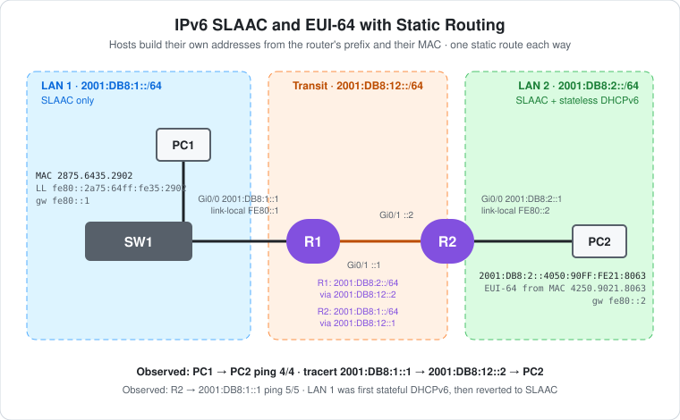

# CCNA Lab 30: IPv6 SLAAC and EUI-64 with Static Routing

An **IPv6-only** network built in the **PingMyNetwork Sandbox**. It's the IPv6 version of [Lab 24](../lab-24-static-routing-two-routers/): two routers, a transit link, and one static route on each router. The difference is how hosts get their addresses. Nobody types an address into the PCs. Each router **advertises its LAN prefix**, and each PC builds its own address from that prefix plus an **EUI-64** interface ID made from its MAC address (**SLAAC**).

The two LANs do it slightly differently:

| LAN | Router | Method | RA flags |
|---|---|---|---|
| LAN 1 `2001:DB8:1::/64` | R1 | **SLAAC only** | A=1, M=0, O=0 |
| LAN 2 `2001:DB8:2::/64` | R2 | **SLAAC + stateless DHCPv6** (address from SLAAC, DNS and domain from DHCPv6) | A=1, M=0, O=1 |

There's no IPv4 anywhere. Every router interface has `no ip address`, and the PCs show IPv4 `0.0.0.0`.

> **Lab status:** The configs in [`configs/`](configs/) and the results below come from the exported Sandbox JSON in [`lab-files/`](lab-files/). That export includes both routers' saved configurations, the PCs' IPv6 mode (`auto`), and the console output of the session. Results marked **observed** are copied from that output. Two things the export **doesn't** show: PC1's global address, and whether PC1's tests ran before or after R1's LAN was switched from stateful DHCPv6 to SLAAC (see [The stateful detour](#the-stateful-detour-on-r1)). No `show ipv6` commands were run, so the routing tables are **expected**.

## Learning objectives

- Enable IPv6 routing with `ipv6 unicast-routing`, and explain why it also turns on Router Advertisements.
- Configure global and manual **link-local** addresses, and explain why the gateway is a link-local address.
- Explain how **SLAAC** and **EUI-64** build a host address: prefix + MAC, with `FFFE` inserted and the U/L bit flipped.
- Tell **SLAAC**, **stateless DHCPv6** (O flag) and **stateful DHCPv6** (M flag) apart.
- Configure IPv6 static routes, and read hops in an IPv6 `tracert`.

## Topology



```text
     LAN 1 2001:DB8:1::/64          Transit 2001:DB8:12::/64          LAN 2 2001:DB8:2::/64
          (SLAAC)                                                 (SLAAC + stateless DHCPv6)

 PC1 --Fa0/1-- SW1 --Gi0/1---Gi0/0 R1 Gi0/1 ------------ Gi0/1 R2 Gi0/0 ---- PC2
                                 ::1   ::1                 ::2   ::1
                             FE80::1  FE80::1          FE80::2  FE80::2
```

| Device | Role | Model |
|---|---|---|
| R1 | LAN 1 router: RAs for SLAAC, static route to LAN 2 | Cisco ISR4331 (IOS 15.9 in the Sandbox) |
| R2 | LAN 2 router: RAs with O flag, stateless DHCPv6, static route to LAN 1 | Cisco ISR4331 (IOS 15.9 in the Sandbox) |
| SW1 | LAN 1 access switch (factory default) | Cisco WS-C2960-24TT-L |
| PC1, PC2 | IPv6 hosts set to automatic configuration | PC |

## Addressing plan

| Device | Interface | Global address | Link-local | Notes |
|---|---|---|---|---|
| R1 | Gi0/0 | `2001:DB8:1::1/64` | `FE80::1` | LAN 1 gateway |
| R1 | Gi0/1 | `2001:DB8:12::1/64` | `FE80::1` | Transit to R2 |
| R2 | Gi0/1 | `2001:DB8:12::2/64` | `FE80::2` | Transit to R1 |
| R2 | Gi0/0 | `2001:DB8:2::1/64` | `FE80::2` | LAN 2 gateway |
| PC1 | FastEthernet0 | Expected (SLAAC): `2001:DB8:1::2A75:64FF:FE35:2902` | **Observed:** `fe80::2a75:64ff:fe35:2902` | Gateway **observed:** `fe80::1` |
| PC2 | FastEthernet0 | **Observed:** `2001:DB8:2::4050:90FF:FE21:8063` | Expected: `fe80::4050:90ff:fe21:8063` | Gateway expected: `fe80::2` |

`2001:DB8::/32` is the IPv6 documentation prefix, reserved for examples like this. It's never routed on the real internet.

- **The same link-local `FE80::1` is on both of R1's interfaces.** That's allowed: link-local addresses only have to be unique on their own link, and they're never routed. Setting them by hand makes the gateway easy to read (`fe80::1` rather than an EUI-64 string).
- **Hosts use the router's link-local as the gateway**, not its global address. PC1's `ipconfig` shows exactly that: `Default Gateway . . . : fe80::1`.

## Configuration

**R1 (final, saved)**

```cisco
no ip domain lookup
ipv6 unicast-routing
!
interface GigabitEthernet0/0
 description LAN1 - SLAAC
 no ip address
 ipv6 address FE80::1 link-local
 ipv6 address 2001:DB8:1::1/64
!
interface GigabitEthernet0/1
 description Link to R2
 no ip address
 ipv6 address FE80::1 link-local
 ipv6 address 2001:DB8:12::1/64
!
ipv6 route 2001:DB8:2::/64 2001:DB8:12::2
```

**R2 (saved)**

```cisco
no ip domain lookup
ipv6 unicast-routing
!
ipv6 dhcp pool LAN2-STATELESS
 dns-server 2001:DB8:2::254
 domain-name lab.local
!
interface GigabitEthernet0/0
 description LAN2 - SLAAC + Stateless DHCPv6
 no ip address
 ipv6 address FE80::2 link-local
 ipv6 address 2001:DB8:2::1/64
 ipv6 nd other-config-flag
 ipv6 dhcp server LAN2-STATELESS
!
interface GigabitEthernet0/1
 description Link to R1
 no ip address
 ipv6 address FE80::2 link-local
 ipv6 address 2001:DB8:12::2/64
!
ipv6 route 2001:DB8:1::/64 2001:DB8:12::1
```

- **`ipv6 unicast-routing`** does two things. It lets the router forward IPv6 packets, and it makes the router **send Router Advertisements (RAs)** on its IPv6 interfaces. Without it, the PCs would get no prefix and no gateway.
- **SLAAC needs no extra command.** A `/64` on an interface is advertised in RAs with the A (autonomous) flag set by default.
- **`ipv6 nd other-config-flag`** sets the RA's **O flag**: "make your own address, but ask DHCPv6 for the *other* settings". R2's pool has **no `address prefix`**, which is what makes it **stateless**. It hands out DNS and domain only, and keeps no record of who has which address.
- **Static routes** use the neighbor's **global** address as the next hop. That address is on the connected `2001:DB8:12::/64`, so the router can resolve it.
- `no ip domain-lookup` stops a mistyped command being treated as a hostname to look up. IOS saves it as `no ip domain lookup`.

## How EUI-64 builds the address

PC1's MAC address is `28-75-64-35-29-02` (observed in `ipconfig /all`):

| Step | Result |
|---|---|
| MAC | `28 75 64` `35 29 02` |
| Split it in half and insert `FF FE` | `28 75 64 FF FE 35 29 02` |
| Flip the 7th bit of the first byte (U/L bit): `0x28` = `0010 1000` → `0010 1010` = `0x2A` | `2A 75 64 FF FE 35 29 02` |
| Interface ID | `2a75:64ff:fe35:2902` |
| + link-local prefix `fe80::/64` | **`fe80::2a75:64ff:fe35:2902`** (observed) |
| + LAN 1 prefix `2001:DB8:1::/64` | `2001:DB8:1::2A75:64FF:FE35:2902` (expected) |

PC2 works the same way in reverse. Its observed address `2001:DB8:2::4050:90FF:FE21:8063` has `FFFE` in the middle, which marks it as EUI-64. Flip `0x40` back to `0x42` and drop `FFFE`, and you get its MAC: `42-50-90-21-80-63`.

## The stateful detour on R1

R1's LAN was **first configured for stateful DHCPv6**, saved, and then **changed back to SLAAC** in the same session. Both stages are in the console, and the saved config is the SLAAC one.

**Stage 1: stateful (saved at 17:56:56, then replaced)**

```cisco
ipv6 dhcp pool LAN1-STATEFUL
 address prefix 2001:DB8:1:0:AAAA::/80
 dns-server 2001:DB8:1::254
 domain-name lab.local
interface GigabitEthernet0/0
 description LAN1 - Stateful DHCPv6
 ipv6 nd managed-config-flag
 ipv6 nd prefix 2001:DB8:1::/64 2592000 604800 no-autoconfig
 ipv6 dhcp server LAN1-STATEFUL
```

- **M flag** (`managed-config-flag`): "get your address from DHCPv6".
- **`no-autoconfig`** clears the A flag for the prefix, so hosts **don't** also build a SLAAC address. `2592000` and `604800` are the default valid and preferred lifetimes (30 days and 7 days).
- The pool's **`address prefix`** is what makes it stateful: it leases addresses from `2001:DB8:1:0:AAAA::/80`.

**Stage 2: back to SLAAC (saved at 17:58:47)**

```text
R1(config-if)#description LAN1 - SLAAC
R1(config-if)#no ipv6 nd managed-config-flag
R1(config-if)#no ipv6 nd prefix 2001:DB8:1::/64 2592000 604800 no-autoconfig
R1(config-if)#no ipv6 dhcp server LAN1-STATEFUL
R1(config)#no ipv6 dhcp pool LAN1-STATEFUL
```

**The export can't tell which stage PC1 was tested under.** It doesn't record when PC1's `ipconfig`, ping and `tracert` ran relative to R1's change at 17:58:47. PC1's `ipconfig` shows an empty DNS suffix, which a lease from the stateful pool (`domain-name lab.local`) would normally fill in. That hints at SLAAC, but it doesn't prove it.

## Results

### Observed: links coming up

```text
R1 log:
*Oct 28 17:56:58.096: %LINK-3-UPDOWN: Interface GigabitEthernet0/1, changed state to down
*Oct 28 17:56:58.195: %LINK-3-UPDOWN: Interface GigabitEthernet0/0, changed state to up
*Oct 28 17:56:59.195: %LINEPROTO-5-UPDOWN: Line protocol on Interface GigabitEthernet0/0, changed state to up
*Oct 28 17:57:11.561: %LINK-3-UPDOWN: Interface GigabitEthernet0/1, changed state to up
*Oct 28 17:57:12.561: %LINEPROTO-5-UPDOWN: Line protocol on Interface GigabitEthernet0/1, changed state to up
```

R1 was configured first. Its transit link stayed `down` until R2 enabled the other end, at `17:57:11.561` in both routers' logs.

### Observed: R2 → R1's LAN address

```text
R2#ping 2001:DB8:1::1
Type escape sequence to abort.
Sending 5, 100-byte ICMP Echos to 2001:DB8:1::1, timeout is 2 seconds:
!!!!!
Success rate is 100 percent (5/5), round-trip min/avg/max = 10/25/70 ms
```

`2001:DB8:1::1` isn't on any of R2's links, so R2 used its **static route** to reach it. R2 sends from its exit interface, `2001:DB8:12::2`, which R1 knows as connected, so the reply comes straight back. **5/5**, so the transit link, Neighbor Discovery and R2's static route all work.

### Observed: PC1's configuration

```text
C:\>ipconfig /all

Windows IP Configuration

Fa0 Connection:(default port)

   Host Name . . . . . . . . . . . . : PC1
   Physical Address. . . . . . . . . : 28-75-64-35-29-02
   DHCP Enabled. . . . . . . . . . . : No
   Autoconfiguration Enabled . . . . : Yes
   Connection-specific DNS Suffix. . :
   Link-local IPv6 Address . . . . . : fe80::2a75:64ff:fe35:2902
   IPv4 Address. . . . . . . . . . . : 0.0.0.0
   Subnet Mask . . . . . . . . . . . : 0.0.0.0
   Default Gateway . . . . . . . . . : fe80::1
```

- **The link-local address is EUI-64**, built from the MAC exactly as worked out above.
- **The gateway is `fe80::1`**, R1's manual link-local address, learned from R1's Router Advertisement.
- **No global IPv6 address is listed.** The export doesn't say whether this Sandbox `ipconfig` doesn't show one, or PC1 didn't have one yet when the command ran. PC1 *must* have had a `2001:DB8:1::/64` address when it pinged PC2 (next section): the reply has to be routed back to PC1, and a link-local source address can't be routed. Run `ipconfig` again to see it.
- `IPv4 Address 0.0.0.0` confirms this is an IPv6-only network.

### Observed: PC1 → PC2

```text
C:\>ping 2001:DB8:2:0:4050:90FF:FE21:8063

Pinging 2001:DB8:2:0:4050:90FF:FE21:8063 with 32 bytes of data:

Reply from 2001:DB8:2:0:4050:90FF:FE21:8063: time=69ms
Reply from 2001:DB8:2:0:4050:90FF:FE21:8063: time=18ms
Reply from 2001:DB8:2:0:4050:90FF:FE21:8063: time=17ms
Reply from 2001:DB8:2:0:4050:90FF:FE21:8063: time=17ms

Ping statistics for 2001:DB8:2:0:4050:90FF:FE21:8063:
    Packets: Sent = 4, Received = 4, Lost = 0 (0% loss),
```

- **4/4.** Both static routes work: R1's took the echo to LAN 2, and R2's brought the reply back.
- **PC2 had a SLAAC/EUI-64 address** (`FFFE` in the middle) in R2's prefix, so R2's RA did its job. PC2 has no console output, so its DNS settings from stateless DHCPv6 weren't checked.
- IPv6 ping replies don't print a TTL. IPv6 calls it the **hop limit**, and Windows doesn't show it.

### Observed: tracert

```text
C:\>tracert 2001:DB8:2:0:4050:90FF:FE21:8063

Tracing route to 2001:DB8:2:0:4050:90FF:FE21:8063
over a maximum of 30 hops:

 1    26 ms    26 ms    26 ms  2001:DB8:1::1
 2    34 ms    36 ms    36 ms  2001:DB8:12::2
 3    20 ms    22 ms    17 ms  2001:DB8:2:0:4050:90FF:FE21:8063

Trace complete.
```

| Hop | Address | Device |
|---|---|---|
| 1 | `2001:DB8:1::1` | R1, answering from Gi0/0, the interface the probe arrived on |
| 2 | `2001:DB8:12::2` | R2, answering from Gi0/1 (its transit side) |
| 3 | `2001:DB8:2::4050:90FF:FE21:8063` | PC2 |

Each router reports the address of the interface the probe **entered** on. That's why R2 shows up as `12::2`, not `2::1`.

### Expected: R1's routing table

```text
R1#show ipv6 route
IPv6 Routing Table - default - 6 entries
...
C   2001:DB8:1::/64 [0/0]
     via GigabitEthernet0/0, directly connected
L   2001:DB8:1::1/128 [0/0]
     via GigabitEthernet0/0, receive
S   2001:DB8:2::/64 [1/0]
     via 2001:DB8:12::2
C   2001:DB8:12::/64 [0/0]
     via GigabitEthernet0/1, directly connected
L   2001:DB8:12::1/128 [0/0]
     via GigabitEthernet0/1, receive
L   FF00::/8 [0/0]
     via Null0, receive
```

As in IPv4, there's a `C` and an `L` route per interface, and an `S` route for the static route at administrative distance 1. `FF00::/8` is the multicast range, which IOS installs by itself.

## Verification results

| Check | Command/test | Result |
|---|---|---|
| Links | R1 and R2 logs | **Observed:** all router links up/up |
| R2 static route | R2 → `ping 2001:DB8:1::1` | **Observed:** 5/5 |
| PC1 link-local and gateway | PC1 `ipconfig /all` | **Observed:** EUI-64 `fe80::2a75:64ff:fe35:2902`, gateway `fe80::1` |
| End-to-end | PC1 → `ping 2001:DB8:2:0:4050:90FF:FE21:8063` | **Observed:** 4/4 |
| Path | PC1 → `tracert` | **Observed:** R1 `1::1` → R2 `12::2` → PC2 |
| PC1 global address | PC1 `ipconfig` (re-run) | Expected: `2001:DB8:1::2A75:64FF:FE35:2902` |
| PC2 DNS | PC2 `ipconfig /all` | Expected: DNS `2001:DB8:2::254`, suffix `lab.local` (stateless DHCPv6) |
| Routing tables | `show ipv6 route` on R1 and R2 | Expected: `C`, `L` and one `S` route, as above |
| RA flags | `show ipv6 interface g0/0` on R2 | Expected: "Hosts use DHCP to obtain other configuration" |
| Neighbors | `show ipv6 neighbors` on R1 | Expected: PC1's link-local and global addresses with its MAC |

## Full configuration commands

These are the **exact commands typed in the Sandbox session**, copied from the console history in the export, in the order they were entered (including the `ping` used to verify). Typing them on factory-default devices reproduces the lab. R1's block includes the stateful DHCPv6 stage and its removal, as typed. To build only the final SLAAC version, leave out the `ipv6 dhcp pool LAN1-STATEFUL` block, the `managed-config-flag`, `ipv6 nd prefix ... no-autoconfig` and `ipv6 dhcp server` lines, and everything after the first `write memory`, and use `description LAN1 - SLAAC`.

The commands were typed with a leading space in sub-modes (for example `R1(config-if)# description ...`). IOS ignores leading spaces, so they're shown without them here.

How to read the blocks:

- Lines starting with `!` explain the command below them. Don't type them.
- The prompt (`R2(config-dhcpv6)#`) shows which mode you're in. Type only the text after `#` or `>`.
- Abbreviations such as `g0/0` are accepted by IOS, the same as `GigabitEthernet0/0`.

### R1 (ISR4331)

```text
! Enter privileged EXEC mode
R1>enable
! Enter global configuration mode
R1#configure terminal
! Stop mistyped commands being treated as hostnames to look up
R1(config)#no ip domain-lookup
! Enable IPv6 routing (and sending Router Advertisements)
R1(config)#ipv6 unicast-routing
! Create DHCPv6 pool LAN1-STATEFUL (enter DHCPv6 pool config mode)
R1(config)#ipv6 dhcp pool LAN1-STATEFUL
! Stateful pool: lease addresses from 2001:DB8:1:0:AAAA::/80
R1(config-dhcpv6)#address prefix 2001:DB8:1:0:AAAA::/80
! DNS server handed to clients: 2001:DB8:1::254
R1(config-dhcpv6)#dns-server 2001:DB8:1::254
! Domain name handed to clients: lab.local
R1(config-dhcpv6)#domain-name lab.local
R1(config-dhcpv6)#exit
! Select interface g0/1
R1(config)#interface g0/1
! Label the interface
R1(config-if)#description Link to R2
! Assign global address 2001:DB8:12::1/64
R1(config-if)#ipv6 address 2001:DB8:12::1/64
! Set the link-local address to FE80::1 (the gateway hosts will see)
R1(config-if)#ipv6 address FE80::1 link-local
! Enable the interface
R1(config-if)#no shutdown
! Select interface g0/0
R1(config-if)#interface g0/0
! Label the interface
R1(config-if)#description LAN1 - Stateful DHCPv6
! Assign global address 2001:DB8:1::1/64
R1(config-if)#ipv6 address 2001:DB8:1::1/64
! Set the link-local address to FE80::1 (the gateway hosts will see)
R1(config-if)#ipv6 address FE80::1 link-local
! RA M flag: tell hosts to get their address from DHCPv6 (stateful)
R1(config-if)#ipv6 nd managed-config-flag
! Advertise 2001:DB8:1::/64 but clear the A flag, so hosts don't use SLAAC
R1(config-if)#ipv6 nd prefix 2001:DB8:1::/64 2592000 604800 no-autoconfig
! Answer DHCPv6 requests on this interface from pool LAN1-STATEFUL
R1(config-if)#ipv6 dhcp server LAN1-STATEFUL
! Enable the interface
R1(config-if)#no shutdown
R1(config-if)#exit
! Static route to 2001:DB8:2::/64 via 2001:DB8:12::2
R1(config)#ipv6 route 2001:DB8:2::/64 2001:DB8:12::2
R1(config)#end
! Save the running config to NVRAM
R1#write memory
! Enter global configuration mode
R1#configure terminal
! Select interface g0/0
R1(config)#interface g0/0
! Label the interface
R1(config-if)#description LAN1 - SLAAC
! Clear the M flag
R1(config-if)#no ipv6 nd managed-config-flag
! Remove the no-autoconfig prefix setting (SLAAC allowed again)
R1(config-if)#no ipv6 nd prefix 2001:DB8:1::/64 2592000 604800 no-autoconfig
! Stop the DHCPv6 server on this interface
R1(config-if)#no ipv6 dhcp server LAN1-STATEFUL
R1(config-if)#exit
! Delete DHCPv6 pool LAN1-STATEFUL
R1(config)#no ipv6 dhcp pool LAN1-STATEFUL
R1(config)#end
! Save the running config to NVRAM
R1#write memory
```

### R2 (ISR4331)

```text
! Enter privileged EXEC mode
R2>enable
! Enter global configuration mode
R2#configure terminal
! Stop mistyped commands being treated as hostnames to look up
R2(config)#no ip domain-lookup
! Enable IPv6 routing (and sending Router Advertisements)
R2(config)#ipv6 unicast-routing
! Create DHCPv6 pool LAN2-STATELESS (enter DHCPv6 pool config mode)
R2(config)#ipv6 dhcp pool LAN2-STATELESS
! DNS server handed to clients: 2001:DB8:2::254
R2(config-dhcpv6)#dns-server 2001:DB8:2::254
! Domain name handed to clients: lab.local
R2(config-dhcpv6)#domain-name lab.local
R2(config-dhcpv6)#exit
! Select interface g0/1
R2(config)#interface g0/1
! Label the interface
R2(config-if)#description Link to R1
! Assign global address 2001:DB8:12::2/64
R2(config-if)#ipv6 address 2001:DB8:12::2/64
! Set the link-local address to FE80::2 (the gateway hosts will see)
R2(config-if)#ipv6 address FE80::2 link-local
! Enable the interface
R2(config-if)#no shutdown
! Select interface g0/0
R2(config-if)#interface g0/0
! Label the interface
R2(config-if)#description LAN2 - SLAAC + Stateless DHCPv6
! Assign global address 2001:DB8:2::1/64
R2(config-if)#ipv6 address 2001:DB8:2::1/64
! Set the link-local address to FE80::2 (the gateway hosts will see)
R2(config-if)#ipv6 address FE80::2 link-local
! RA O flag: tell hosts to get DNS/domain (not the address) from DHCPv6 (stateless)
R2(config-if)#ipv6 nd other-config-flag
! Answer DHCPv6 requests on this interface from pool LAN2-STATELESS
R2(config-if)#ipv6 dhcp server LAN2-STATELESS
! Enable the interface
R2(config-if)#no shutdown
R2(config-if)#exit
! Static route to 2001:DB8:1::/64 via 2001:DB8:12::1
R2(config)#ipv6 route 2001:DB8:1::/64 2001:DB8:12::1
R2(config)#end
! Save the running config to NVRAM
R2#write memory
! Test reachability to 2001:DB8:1::1
R2#ping 2001:DB8:1::1
```

### SW1 (WS-C2960-24TT-L)

No commands. Leave it at factory defaults.

### PCs

Set **IPv6** to **automatic** on both PCs and leave IPv4 empty. Then, from PC1's command prompt:

```text
! Check the link-local address, gateway (and global address)
C:\> ipconfig /all
! Test reachability to PC2 (use the address PC2 shows in its own ipconfig)
C:\> ping 2001:DB8:2:0:4050:90FF:FE21:8063
! Trace the path to PC2
C:\> tracert 2001:DB8:2:0:4050:90FF:FE21:8063
```

PC2's address depends on its MAC. In another Sandbox session the MAC may differ, so check `ipconfig` on PC2 first.

## Try it yourself: guided challenges

1. **Find PC1's global address.** Run `ipconfig` on PC1 and `show ipv6 neighbors` on R1. Does it match the EUI-64 address worked out above?
2. **Check the stateless options.** Run `ipconfig /all` on PC2. Do you see DNS `2001:DB8:2::254` and suffix `lab.local`? Why does PC1 show neither?
3. **Turn off routing.** Run `no ipv6 unicast-routing` on R1. What happens to PC1's gateway after a while, and why?
4. **Redo the stateful stage.** Re-apply R1's stage 1 commands. What address does PC1 get now, and does it still have a SLAAC address? Check `show ipv6 dhcp binding` on R1.
5. **EUI-64 on a router.** Replace R1 Gi0/0's address with `ipv6 address 2001:DB8:1::/64 eui-64`. What address does R1 get? (`show ipv6 interface brief`.)
6. **Link-local next hop.** Replace R1's static route with `ipv6 route 2001:DB8:2::/64 GigabitEthernet0/1 FE80::2`. Why does a link-local next hop need the exit interface?
7. **Default route.** Replace both static routes with `ipv6 route ::/0 <neighbor>`. Does everything still work?

## Scope and caveats

- This is a **CCNA** IPv6 lab: addressing, link-local, `ipv6 unicast-routing`, SLAAC and EUI-64, stateless vs stateful DHCPv6, and IPv6 static routes.
- PC1's global address and its addressing method at test time aren't in the export (see [The stateful detour](#the-stateful-detour-on-r1)).
- PC2 has no console output. Its address is known only from PC1's ping and tracert.
- Nothing in the lab is a DNS server. `2001:DB8:1::254` and `2001:DB8:2::254` are only settings handed to clients.
- Real Windows hosts use **random** interface IDs (privacy extensions) by default, not EUI-64. The Sandbox PCs use EUI-64, which makes the addresses easy to follow.
- The Sandbox's default 2960 config includes `spanning-tree mode rapid-pvst` and `spanning-tree portfast edge default`. A real 2960 defaults to PVST+ without PortFast.
- The Sandbox names the ISR4331's ports `GigabitEthernet0/0`–`0/3`. A real ISR4331 uses `GigabitEthernet0/0/0` style names.
- Neither router has passwords, an enable secret or SSH.

## Useful verification commands

```cisco
show ipv6 interface brief
show ipv6 interface GigabitEthernet0/0
show ipv6 route
show ipv6 neighbors
show ipv6 dhcp pool
show ipv6 dhcp binding
```

## Lab files

| File | Description |
|---|---|
| [`lab-files/ipv6-slaac-eui64-static-lab.json`](lab-files/ipv6-slaac-eui64-static-lab.json) | PingMyNetwork Sandbox export with the saved configs. Import it into the Sandbox to load the lab. |
| [`configs/R1-running-config.txt`](configs/R1-running-config.txt) | R1 saved configuration (SLAAC) |
| [`configs/R2-running-config.txt`](configs/R2-running-config.txt) | R2 saved configuration (SLAAC + stateless DHCPv6) |
| [`images/topology.svg`](images/topology.svg) | Topology diagram |

**Built with:** [PingMyNetwork Sandbox](https://pingmynetwork.com/sandbox)
