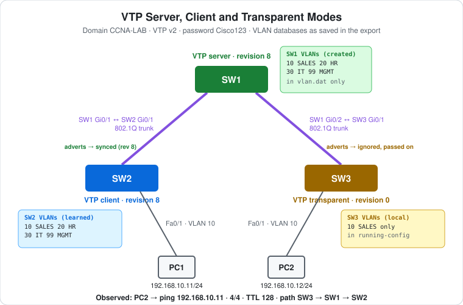

# CCNA Lab 31: VTP Server, Client and Transparent Modes

VLAN Trunking Protocol (VTP), built in the **PingMyNetwork Sandbox**. Three 2960s share the VTP domain `CCNA-LAB`, each in a different mode:

| Switch | VTP mode | What it does with VLANs |
|---|---|---|
| **SW1** | **Server** | VLANs are created here (10 SALES, 20 HR, 30 IT, 99 MGMT) and advertised over the trunks |
| **SW2** | **Client** | Learns the whole VLAN list from SW1. It can't create VLANs itself. |
| **SW3** | **Transparent** | Ignores SW1's VLAN list and keeps its own (just VLAN 10). It still passes VTP adverts on. |

PC1 (on SW2) and PC2 (on SW3) are both in VLAN 10 and can ping each other through SW1.

This continues the switching labs after [Lab 28](../lab-28-stp-root-portfast-bpduguard/). VLANs and access ports are introduced in [Lab 01](../lab-01-vlan-segmentation/) and trunks in [Lab 02](../lab-02-inter-vlan-routing-acl/).

> **Lab status:** The configs in [`configs/`](configs/) and the results below come from the exported Sandbox JSON in [`lab-files/`](lab-files/). That export includes all three switches' saved configurations and **VLAN databases** (`vlan.dat`, with VTP mode, domain and revision), the PC IP settings, and the console output of the session. Results marked **observed** are copied from that output. Where this README says *when* SW2 synced, that's **inferred** from revision numbers, not recorded in the export.

## Learning objectives

- Configure the VTP domain, version, password and mode.
- Explain what server, client and transparent modes each do with VLANs.
- Read the **configuration revision** in `show vtp status`, and explain why it's dangerous.
- Explain why a transparent switch must create its own VLANs, and why they show up in its running-config.
- Recognise two 2960 quirks: there's no `switchport trunk encapsulation`, and the "Inconsistent port type" block.

## Topology



```text
                          SW1  VTP server (rev 8)
                   Gi0/1 /    \ Gi0/2
          802.1Q trunk  /      \  802.1Q trunk
                 Gi0/1 /        \ Gi0/1
   VTP client (rev 8) SW2        SW3  VTP transparent (rev 0)
                 Fa0/1 |          | Fa0/1
                      PC1        PC2
             192.168.10.11      192.168.10.12      (both VLAN 10)
```

| Device | Role | Model |
|---|---|---|
| SW1 | VTP server | Cisco WS-C2960-24TT-L |
| SW2 | VTP client, PC1's access switch | Cisco WS-C2960-24TT-L |
| SW3 | VTP transparent, PC2's access switch | Cisco WS-C2960-24TT-L |
| PC1, PC2 | Hosts in VLAN 10 | PC |

## Addressing plan

| Device | Interface | VLAN | IP address | Subnet mask | Default gateway |
|---|---|---|---|---|---|
| PC1 | SW2 Fa0/1 | 10 | `192.168.10.11` | `255.255.255.0` | none |
| PC2 | SW3 Fa0/1 | 10 | `192.168.10.12` | `255.255.255.0` | none |

| Link | Ports | Mode |
|---|---|---|
| SW1–SW2 | SW1 Gi0/1 ↔ SW2 Gi0/1 | 802.1Q trunk |
| SW1–SW3 | SW1 Gi0/2 ↔ SW3 Gi0/1 | 802.1Q trunk |

There's no router. Both PCs are in VLAN 10 and the same subnet, so they don't need a gateway.

## Configuration

| Setting | SW1 | SW2 | SW3 |
|---|---|---|---|
| `vtp domain` | `CCNA-LAB` | `CCNA-LAB` | `CCNA-LAB` |
| `vtp version` | 2 | 2 | 2 |
| `vtp password` | `Cisco123` | `Cisco123` | `Cisco123` |
| `vtp mode` | server | client | transparent |
| Trunks | Gi0/1, Gi0/2 | Gi0/1 | Gi0/1 |
| VLANs created | 10, 20, 30, 99 | none (learned) | 10 (local) |
| Access port | – | Fa0/1 → VLAN 10 | Fa0/1 → VLAN 10 |

- **Domain, version and password must match** for a switch to accept another's VTP updates.
- **Server** is the default mode. That's why SW1 replied `Device mode already VTP SERVER.`
- **Where the settings live depends on the mode.** On SW1 and SW2 (server and client), the VTP settings and VLANs are stored only in `vlan.dat`. Their saved configs contain no `vtp` or `vlan` lines. On **SW3 (transparent)**, the saved config includes `vtp domain`, `vtp mode transparent` and `vlan 10` / `name SALES`. A transparent switch keeps its VLANs in the running-config, like a switch without VTP.

## Results

### Observed: SW1 after creating VLANs 10, 20 and 30

```text
SW1#show vtp status
VTP Version capable             : 1 to 3
VTP version running             : 2
VTP Domain Name                 : CCNA-LAB
VTP Pruning Mode                : Disabled
VTP Traps Generation            : Disabled
Device ID                       : 2450.2653.8790
Configuration last modified by 0.0.0.0 at 10-28-26 18:07:34
Local updater ID is 0.0.0.0 (no valid interface found)

Feature VLAN:
--------------
VTP Operating Mode                : Server
Maximum VLANs supported locally   : 1005
Number of existing VLANs          : 8
Configuration Revision            : 6
MD5 digest                        : 0x4D 0xAB 0x78 0xD9 0xF0 0x16 0x3F 0x47
                                    0x8B 0x67 0xAE 0xEC 0xED 0xE7 0x4A 0xAF
```

- **Configuration Revision 6.** Every change to the VLAN database increases the revision. Here there were six: three VLANs and three names.
- **8 existing VLANs:** 1, 10, 20, 30 and the four reserved 1002–1005.
- **Updater `0.0.0.0` ("no valid interface found")**: the server records the IP address of whoever made the change. SW1 has no management IP (its `Vlan1` is shut down), so it records `0.0.0.0`.
- **MD5 digest**: a hash of the VLAN database and the password. Switches with a different password produce a different digest and reject each other's updates.

SW1 then added **VLAN 99 MGMT**, which brought it to **revision 8**, as saved in its `vlan.dat`.

### Observed: SW2 (client) syncing

```text
SW2#show vlan brief

VLAN Name                             Status    Ports
---- -------------------------------- --------- -------------------------------
1    default                          active    Fa0/2, Fa0/3, Fa0/4, Fa0/5
                                                ...
                                                Fa0/22, Fa0/23, Fa0/24, Gi0/2
1002 fddi-default                     act/unsup
...
SW2#show vlan brief

VLAN Name                             Status    Ports
---- -------------------------------- --------- -------------------------------
1    default                          active    Fa0/2, Fa0/3, Fa0/4, Fa0/5
                                                ...
                                                Fa0/22, Fa0/23, Fa0/24, Gi0/2
10   SALES                            active    Fa0/1
20   HR                               active
30   IT                               active
99   MGMT                             active
...
SW2#show vtp status | include Revision|Mode|Domain
VTP Domain Name                 : CCNA-LAB
VTP Pruning Mode                : Disabled
VTP Operating Mode                : Client
Configuration Revision            : 8
```

- **First output: no VLAN 10 yet, and Fa0/1 isn't listed anywhere.** Fa0/1 was assigned to VLAN 10, but a client can't create VLANs, so until VLAN 10 arrived from the server the port was **inactive** and not shown under any VLAN.
- **Second output: all four VLANs learned**, with the server's names, and Fa0/1 is now active in VLAN 10 SALES.
- **Revision 8 on the client** matches the server. A client takes the server's database when the advertised revision is higher than its own.
- **When did it sync?** *(inferred)* Revision 8 only existed after VLAN 99 was added on SW1 (`18:08:09`), so SW2 synced **after** that change, not when VLANs 10–30 were created. SW2 was still being set up (password and trunk) when SW1 made its first changes. The next update it received was the one VLAN 99 triggered. Servers also send a summary advert every 5 minutes.
- `Domain name already set to CCNA-LAB` on SW2 and SW3: a switch with no domain adopts the first one it hears in a VTP advert, so they had already picked it up from SW1.

### Observed: SW3 (transparent) creating its own VLAN 10

```text
SW3(config-if)#switchport access vlan 10
% Access VLAN does not exist. Creating vlan 10
...
SW3#show vlan brief | include SALES|^10
10   VLAN0010                         active    Fa0/1
1002 fddi-default                     act/unsup
1003 token-ring-default               act/unsup
1004 fddinet-default                  act/unsup
1005 trnet-default                    act/unsup
SW3#configure terminal
SW3(config)#vlan 10
SW3(config-vlan)# name SALES
```

- **A transparent switch can create VLANs, and has to.** It ignores the server's list, so IOS created VLAN 10 locally when the port was assigned, with the default name `VLAN0010`. It was then renamed `SALES`. The name is local and only for people. What matters for traffic is the VLAN number.
- **SW3 has only VLAN 10.** VLANs 20, 30 and 99 from the server never appear on it, and its revision stays **0**. A transparent switch always shows revision 0.
- **The filter `^10` caught more than VLAN 10.** It matches any line *starting* with `10`, including `1002`–`1005`. `include ^10 ` (with a trailing space) or `include SALES` would be tighter.

### Observed: "Inconsistent port type" on SW2 and SW3

```text
SW2 (and SW3) log:
*Oct 28 18:07:34.916: %SPANTREE-7-RECV_1Q_NON_TRUNK: Received 802.1Q BPDU on non trunk GigabitEthernet0/1 VLAN1.
*Oct 28 18:07:34.916: %SPANTREE-7-BLOCK_PORT_TYPE: Blocking GigabitEthernet0/1 on VLAN0001. Inconsistent port type.
```

- This happened at the moment SW1 made its Gi0/1–2 trunks (`18:07:34`), **before** SW2 and SW3 had configured their side. SW1 sent trunk-style (802.1Q-tagged) BPDUs into ports that were still access ports, so spanning tree **blocked** them to avoid a mismatch.
- Once SW2 and SW3 set `switchport mode trunk`, both ends matched. The export has no log line for the block clearing, but the successful ping below crossed both links, so it did clear.
- On a real 2960, a port left at its default (`dynamic auto`) would normally agree to trunk with SW1 using DTP, so you'd mostly see this message when the far end is forced to access mode.

### Observed: `switchport trunk encapsulation dot1q` rejected

```text
SW1(config-if-range)# switchport trunk encapsulation dot1q
                                       ^
% Invalid input detected at '^' marker.
```

All three switches rejected it. The **2960 supports only 802.1Q**, so there's no encapsulation to choose and the command doesn't exist. On a 3560 (which also supports ISL) you need it before `switchport mode trunk`, as in the Layer 3 labs.

### Observed: PC2 → PC1

```text
C:\>ping 192.168.10.11

Reply from 192.168.10.11: bytes=32 time=1ms TTL=128
Reply from 192.168.10.11: bytes=32 time<1ms TTL=128
Reply from 192.168.10.11: bytes=32 time<1ms TTL=128
Reply from 192.168.10.11: bytes=32 time<1ms TTL=128
    Packets: Sent = 4, Received = 4, Lost = 0 (0% loss),
```

- **4/4, TTL 128.** It's Layer 2 only: SW3 VLAN 10 → trunk → SW1 → trunk → SW2 VLAN 10.
- It works because **VLAN 10 exists on all three switches**: SW1 created it, SW2 learned it, and SW3 created its own. If SW3 hadn't created VLAN 10, its Fa0/1 would be inactive.

## Verification results

| Check | Command/test | Result |
|---|---|---|
| Server status | SW1 `show vtp status` | **Observed:** Server, CCNA-LAB, v2, revision 6 (8 after VLAN 99) |
| Client before sync | SW2 `show vlan brief` | **Observed:** VLAN 1 only, Fa0/1 inactive |
| Client after sync | SW2 `show vlan brief` | **Observed:** 10 SALES (Fa0/1), 20 HR, 30 IT, 99 MGMT |
| Client revision | SW2 `show vtp status` | **Observed:** Client, revision 8 |
| Transparent VLAN | SW3 `show vlan brief` | **Observed:** VLAN 10 created locally (`VLAN0010`, then named SALES) |
| Saved VLAN databases | `vlan.dat` in the export | **Observed:** SW1/SW2 rev 8 with 10, 20, 30, 99; SW3 rev 0 with 10 only |
| End-to-end | PC2 → `ping 192.168.10.11` | **Observed:** 4/4, `TTL=128` |
| Transparent status | SW3 `show vtp status` | Expected: Transparent, revision 0 |
| Trunks | `show interfaces trunk` on SW1 | Expected: Gi0/1 and Gi0/2 trunking 802.1Q, native VLAN 1 |
| Password | `show vtp password` | Expected: `Cisco123` on all three |

## Full configuration commands

These are the **exact commands typed in the Sandbox session**, copied from the console output in the export, in the order they were entered (including the `show` commands used to verify). Typing them on factory-default devices reproduces the lab. The commands IOS **rejected** are included where they were typed and marked "don't type".

Some commands were typed with a leading space in sub-modes (for example `SW1(config-vlan)# name SALES`). IOS ignores leading spaces, so they're shown without them here.

How to read the blocks:

- Lines starting with `!` explain the command below them. Don't type them.
- The prompt (`SW1(config-vlan)#`) shows which mode you're in. Type only the text after `#` or `>`.
- Abbreviations such as `g0/1 - 2` and `f0/1` are accepted by IOS, the same as `GigabitEthernet0/1 - 2` and `FastEthernet0/1`.
- `vlan 20` straight from `(config-vlan)#` moves on to the next VLAN without an `exit`.

### SW1 (WS-C2960-24TT-L)

```text
! Enter privileged EXEC mode
SW1>enable
! Enter global configuration mode
SW1#configure terminal
! Help: list the vtp subcommands (nothing is changed)
SW1(config)#vtp ?
! Rejected: "% Incomplete command" (don't type)
SW1(config)#vtp
! Stop mistyped commands being treated as hostnames to look up
SW1(config)#no ip domain-lookup
! VTP domain name: CCNA-LAB (must match on every switch)
SW1(config)#vtp domain CCNA-LAB
! Run VTP version 2
SW1(config)#vtp version 2
! VTP server: VLANs are created here and advertised
SW1(config)#vtp mode server
! VTP password: Cisco123 (must match on every switch)
SW1(config)#vtp password Cisco123
! Select interfaces g0/1 - 2
SW1(config)#interface range g0/1 - 2
! Rejected on the 2960: "% Invalid input" (it only does 802.1Q, so there's nothing to choose; don't type)
SW1(config-if-range)#switchport trunk encapsulation dot1q
! Make it an 802.1Q trunk
SW1(config-if-range)#switchport mode trunk
SW1(config-if-range)#exit
! Create VLAN 10 (and enter VLAN config mode)
SW1(config)#vlan 10
! Name the VLAN "SALES"
SW1(config-vlan)#name SALES
! Create VLAN 20 (and enter VLAN config mode)
SW1(config-vlan)#vlan 20
! Name the VLAN "HR"
SW1(config-vlan)#name HR
! Create VLAN 30 (and enter VLAN config mode)
SW1(config-vlan)#vlan 30
! Name the VLAN "IT"
SW1(config-vlan)#name IT
SW1(config-vlan)#exit
SW1(config)#end
! Save the running config to NVRAM
SW1#write memory
! Verify: VTP mode, domain and configuration revision
SW1#show vtp status
! Enter global configuration mode
SW1#configure terminal
! Create VLAN 99 (and enter VLAN config mode)
SW1(config)#vlan 99
! Name the VLAN "MGMT"
SW1(config-vlan)#name MGMT
SW1(config-vlan)#end
! Save the running config to NVRAM
SW1#write memory
```

### SW2 (WS-C2960-24TT-L)

```text
! Enter privileged EXEC mode
SW2>enable
! Enter global configuration mode
SW2#configure terminal
! Stop mistyped commands being treated as hostnames to look up
SW2(config)#no ip domain-lookup
! VTP domain name: CCNA-LAB (must match on every switch)
SW2(config)#vtp domain CCNA-LAB
! Run VTP version 2
SW2(config)#vtp version 2
! VTP client: learn VLANs from the server, no local changes
SW2(config)#vtp mode client
! VTP password: Cisco123 (must match on every switch)
SW2(config)#vtp password Cisco123
! Select interface g0/1
SW2(config)#interface g0/1
! Rejected on the 2960: "% Invalid input" (it only does 802.1Q, so there's nothing to choose; don't type)
SW2(config-if)#switchport trunk encapsulation dot1q
! Make it an 802.1Q trunk
SW2(config-if)#switchport mode trunk
! Select interface f0/1
SW2(config-if)#interface f0/1
! Make it an access (host) port
SW2(config-if)#switchport mode access
! Put the port in VLAN 10
SW2(config-if)#switchport access vlan 10
! Host port: skip the STP listening/learning wait
SW2(config-if)#spanning-tree portfast
SW2(config-if)#end
! Save the running config to NVRAM
SW2#write memory
! Verify: VLANs and their access ports
SW2#show vlan brief
! Verify: VLANs and their access ports
SW2#show vlan brief
! Verify: VTP mode, domain and configuration revision
SW2#show vtp status | include Revision|Mode|Domain
```

### SW3 (WS-C2960-24TT-L)

```text
! Enter privileged EXEC mode
SW3>enable
! Enter global configuration mode
SW3#configure terminal
! Stop mistyped commands being treated as hostnames to look up
SW3(config)#no ip domain-lookup
! VTP domain name: CCNA-LAB (must match on every switch)
SW3(config)#vtp domain CCNA-LAB
! Run VTP version 2
SW3(config)#vtp version 2
! VTP transparent: keep local VLANs, don't sync (but pass adverts on)
SW3(config)#vtp mode transparent
! VTP password: Cisco123 (must match on every switch)
SW3(config)#vtp password Cisco123
! Select interface g0/1
SW3(config)#interface g0/1
! Rejected on the 2960: "% Invalid input" (it only does 802.1Q, so there's nothing to choose; don't type)
SW3(config-if)#switchport trunk encapsulation dot1q
! Make it an 802.1Q trunk
SW3(config-if)#switchport mode trunk
! Select interface f0/1
SW3(config-if)#interface f0/1
! Make it an access (host) port
SW3(config-if)#switchport mode access
! Put the port in VLAN 10
SW3(config-if)#switchport access vlan 10
! Host port: skip the STP listening/learning wait
SW3(config-if)#spanning-tree portfast
SW3(config-if)#end
! Verify: VLANs and their access ports
SW3#show vlan brief | include SALES|^10
! Enter global configuration mode
SW3#configure terminal
! Create VLAN 10 (and enter VLAN config mode)
SW3(config)#vlan 10
! Name the VLAN "SALES"
SW3(config-vlan)#name SALES
SW3(config-vlan)#end
! Save the running config to NVRAM
SW3#write memory
```

### PCs

Set these in each PC's IP configuration (no gateway needed):

| PC | IP address | Subnet mask | Default gateway |
|---|---|---|---|
| PC1 | `192.168.10.11` | `255.255.255.0` | – |
| PC2 | `192.168.10.12` | `255.255.255.0` | – |

Then test from PC2's command prompt:

```text
! Test reachability to 192.168.10.11
C:\> ping 192.168.10.11
```

## Try it yourself: guided challenges

1. **Try to create a VLAN on the client.** On SW2, type `vlan 50`. What does IOS say?
2. **Add a VLAN on the server.** Create `vlan 40` / `name GUEST` on SW1. Does it appear on SW2? On SW3? What are the new revisions?
3. **Wrong password.** Change SW2's password to `cisco`. Then add a VLAN on SW1. Does SW2 learn it? What does `show vtp status` show for the MD5 digest?
4. **Break the transparent side.** On SW3, delete VLAN 10 (`no vlan 10`). What happens to Fa0/1 and to the ping?
5. **The revision trap.** Why is it dangerous to plug a switch from another lab, with a *higher* revision and the same domain and password, into this network as a server? What would happen to SW1's VLANs? How does putting it in transparent mode first protect you?
6. **Reset a revision.** Change a switch's mode to transparent and back to client, or change its domain name and back. What happens to its revision number?
7. **VTP pruning.** Enable `vtp pruning` on SW1. What does `show interfaces trunk` show under "VLANs in spanning tree forwarding state and not pruned"?

## Scope and caveats

- This is a **CCNA** lab: VTP v2 domain, password, server/client/transparent modes, and the configuration revision. VTP v3 isn't covered.
- **When SW2 synced is inferred** from revision numbers. The export doesn't time-stamp it.
- In the Sandbox, the access ports on SW2 and SW3 logged "Inconsistent port type" rather than negotiating a trunk with DTP, as a real 2960 left at `dynamic auto` normally would.
- The Sandbox shows `vtp password Cisco123` in SW3's saved config. On real IOS, the password is stored in `vlan.dat`. Check it with `show vtp password`.
- Many networks today run **VTP transparent or off** everywhere and create VLANs by hand, because of the revision trap in challenge 5.
- The Sandbox's default 2960 config includes `spanning-tree mode rapid-pvst` and `spanning-tree portfast edge default`. A real 2960 defaults to PVST+ without PortFast.
- The switches have no management IP, passwords or SSH.

## Useful verification commands

```cisco
show vtp status
show vtp password
show vlan brief
show interfaces trunk
show interfaces GigabitEthernet0/1 switchport
```

## Lab files

| File | Description |
|---|---|
| [`lab-files/vtp-server-client-transparent-lab.json`](lab-files/vtp-server-client-transparent-lab.json) | PingMyNetwork Sandbox export with the saved configs and VLAN databases. Import it into the Sandbox to load the lab. |
| [`configs/SW1-running-config.txt`](configs/SW1-running-config.txt) | SW1 saved configuration (VTP server) |
| [`configs/SW2-running-config.txt`](configs/SW2-running-config.txt) | SW2 saved configuration (VTP client) |
| [`configs/SW3-running-config.txt`](configs/SW3-running-config.txt) | SW3 saved configuration (VTP transparent) |
| [`images/topology.svg`](images/topology.svg) | Topology diagram |

**Built with:** [PingMyNetwork Sandbox](https://pingmynetwork.com/sandbox)
